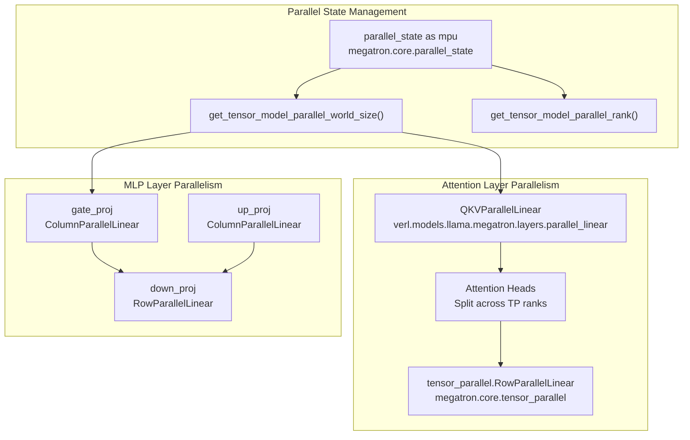
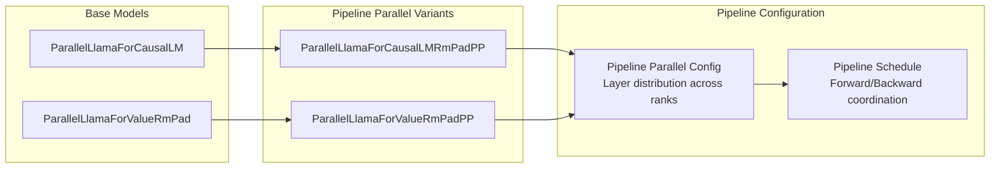
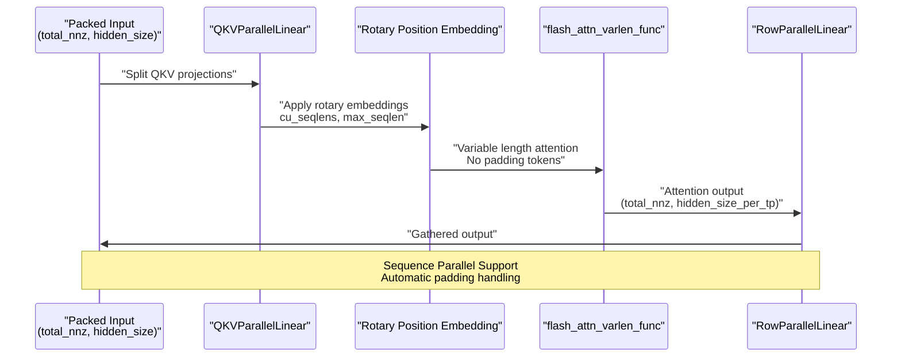
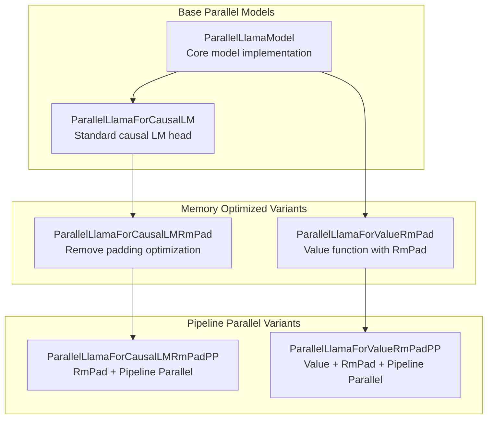

<!-- source: DeepWiki mcp.deepwiki.com · repo PRIME-RL/SimpleVLA-RL · page 2.3 Input Processing and Action Generation · fetched 2026-10-30 -->

# Megatron Integration

<details>
<summary>Relevant source files</summary>

The following files were used as context for generating this wiki page:

- [verl/utils/libero_utils.py](verl/utils/libero_utils.py)
- [verl/workers/rollout/rob_rollout.py](verl/workers/rollout/rob_rollout.py)

</details>


This document explains how SimpleVLA-RL integrates with Megatron-LM to enable efficient distributed training of Vision-Language-Action models. The integration provides tensor parallelism, pipeline parallelism, and data parallelism capabilities for scaling training across multiple GPUs and nodes.

For information about the specific parallel layer implementations, see [Layer Components](#2.2). For details about the different model architectures, see [Parallel Llama Models](#2.1).

## Purpose and Scope

The Megatron integration enables SimpleVLA-RL to train large VLA models efficiently by distributing computation and memory across multiple devices. The system implements three key parallelization strategies:

- **Tensor Parallelism**: Splits individual layers across multiple GPUs
- **Pipeline Parallelism**: Distributes different layers across different GPUs  
- **Data Parallelism**: Replicates the model across multiple GPU groups using FSDP2

The integration maintains compatibility with packed input sequences and flash attention for optimal memory usage and training speed.

## Parallelism Strategies

### Tensor Parallelism Implementation

**Tensor Parallelism Strategy Mapping**


The tensor parallelism implementation splits computation within individual layers. The `ParallelLlamaAttention` class demonstrates this pattern:

- Query, Key, Value projections are split using `QKVParallelLinear` [verl/models/llama/megatron/layers/parallel_attention.py:182-189]()
- Attention heads are distributed across tensor parallel ranks [verl/models/llama/megatron/layers/parallel_attention.py:159-166]()
- Output projection uses `RowParallelLinear` to gather results [verl/models/llama/megatron/layers/parallel_attention.py:195-200]()

**Sources:** `verl/models/llama/megatron/layers/parallel_attention.py`, `verl/models/README.md`

### Pipeline Parallelism Support

**Pipeline Parallel Variants**


Pipeline parallelism distributes different transformer layers across different GPU ranks. The system provides specialized variants:

- `ParallelLlamaForCausalLMRmPadPP`: Pipeline parallel version for causal language modeling [verl/models/llama/megatron/__init__.py:23]()
- `ParallelLlamaForValueRmPadPP`: Pipeline parallel version for value function estimation [verl/models/llama/megatron/__init__.py:24]()

**Sources:** `verl/models/llama/megatron/__init__.py`, `verl/models/README.md`

### Data Parallelism with FSDP2

The system uses PyTorch's FSDP2 (Fully Sharded Data Parallel version 2) for data parallelism. This approach:

- Shards model parameters across data parallel ranks
- Reduces memory usage by avoiding parameter duplication
- Maintains gradient synchronization across replicas
- Integrates with tensor and pipeline parallelism

The README specifies using FSDP2 APIs following the torchtitan implementation pattern [verl/models/README.md:28-29]().

**Sources:** `verl/models/README.md`

## Model Variants and Memory Optimizations

### RmPad (Remove Padding) Variants

**RmPad Architecture Flow**


The RmPad variants optimize memory usage by removing padding tokens from input sequences:

- `ParallelLlamaAttentionRmPad`: Uses flash attention with variable length sequences [verl/models/llama/megatron/layers/parallel_attention.py:338]()
- Handles `cu_seqlens` (cumulative sequence lengths) and `max_seqlen_in_batch` parameters [verl/models/llama/megatron/layers/parallel_attention.py:345-346]()
- Supports sequence parallelism with automatic padding management [verl/models/llama/megatron/layers/parallel_attention.py:349-361]()

**Sources:** `verl/models/llama/megatron/layers/parallel_attention.py`

### Model Variant Hierarchy

**Model Class Relationships**


The model hierarchy provides increasingly specialized variants:

1. **Base Models**: Standard parallel implementations with tensor parallelism
2. **RmPad Variants**: Add memory optimization by removing padding tokens  
3. **Pipeline Parallel Variants**: Combine RmPad optimization with pipeline parallelism

**Sources:** `verl/models/llama/megatron/__init__.py`

## Implementation Details

### Configuration Management

The Megatron integration uses `ModelParallelConfig` to manage parallel training settings:

```python
# Configuration propagation pattern
column_kwargs = tp_utils.get_default_kwargs_for_column_parallel_linear()
row_kwargs = tp_utils.get_default_kwargs_for_row_parallel_linear()

if megatron_config is not None:
    tp_utils.update_kwargs_with_config(column_kwargs, megatron_config)
    tp_utils.update_kwargs_with_config(row_kwargs, megatron_config)
```

This pattern ensures consistent configuration across all parallel layers [verl/models/llama/megatron/layers/parallel_attention.py:172-179]().

### Tensor Parallel Dimension Calculations

The system automatically calculates per-rank dimensions based on tensor parallel world size:

- `num_heads_per_tp = num_heads // tp_size` [verl/models/llama/megatron/layers/parallel_attention.py:164]()
- `num_key_value_heads_per_tp = num_key_value_heads // tp_size` [verl/models/llama/megatron/layers/parallel_attention.py:165]()
- `hidden_size_per_tp = hidden_size // tp_size` [verl/models/llama/megatron/layers/parallel_attention.py:166]()

These calculations ensure even distribution of computation across tensor parallel ranks.

**Sources:** `verl/models/llama/megatron/layers/parallel_attention.py`, `verl/utils/megatron`

---

