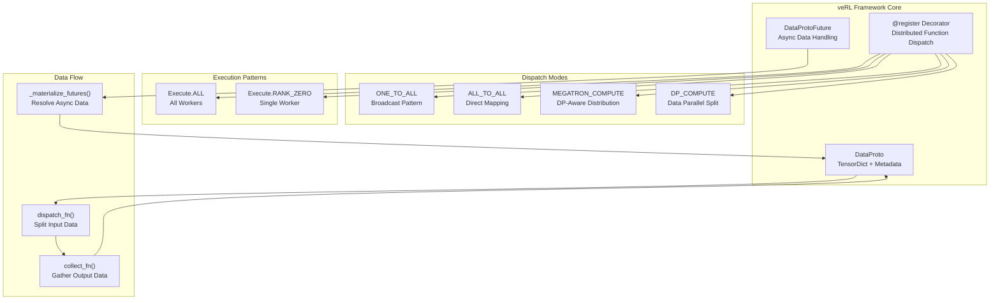
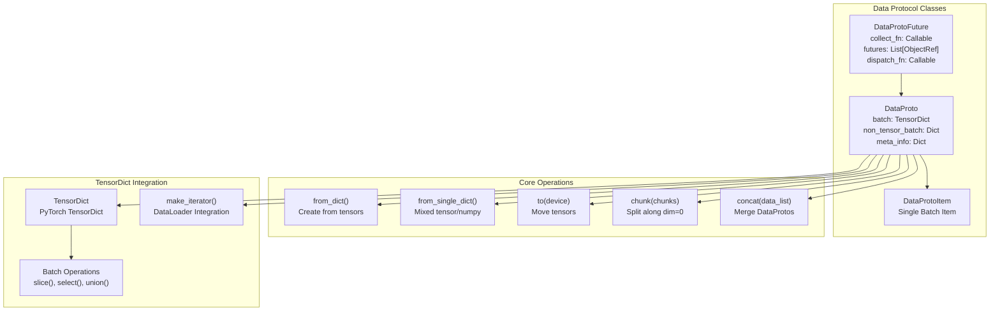
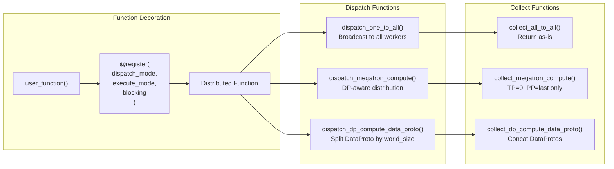
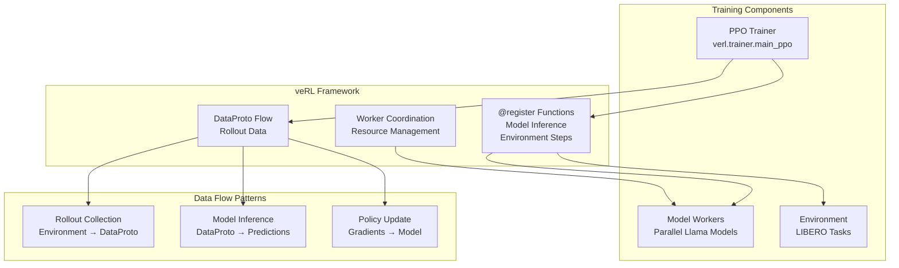

<!-- source: DeepWiki mcp.deepwiki.com · repo PRIME-RL/SimpleVLA-RL · page 3 Training with PPO · fetched 2026-10-30 -->

# veRL Framework

Relevant source files

The following files were used as context for generating this wiki page:

- [.gitignore](.gitignore)
- [README.md](README.md)
- [verl/trainer/config/ppo_trainer.yaml](verl/trainer/config/ppo_trainer.yaml)
- [verl/trainer/ppo/ray_trainer.py](verl/trainer/ppo/ray_trainer.py)

The veRL framework provides the core infrastructure for distributed reinforcement learning training in SimpleVLA-RL. It handles data serialization, distributed function execution, and worker coordination across multi-GPU and multi-node environments. The framework abstracts the complexity of distributed computing while maintaining high performance for large-scale VLA model training.

For information about the specific model architectures being trained, see [Model Architecture](#2). For details about training orchestration and the PPO implementation, see [Training Pipeline](#1.2).

## Architecture Overview

The veRL framework consists of three main subsystems that work together to enable distributed RL training:

### Core Framework Components

Sources: [verl/__init__.py:22-27](), [verl/protocol.py:98-109](), [verl/single_controller/base/decorator.py:25-38](), [verl/single_controller/base/decorator.py:394-410]()

## Data Protocol System

The `DataProto` class serves as the standardized data container for all distributed operations. It combines PyTorch tensors in a `TensorDict` with non-tensor metadata, enabling efficient serialization and transfer between workers.

### DataProto Class Hierarchy

Sources: [verl/protocol.py:90-109](), [verl/protocol.py:173-222](), [verl/protocol.py:458-503]()

The `DataProtoFuture` enables asynchronous data operations by containing Ray object references (`ray.ObjectRef`) instead of actual data, allowing for non-blocking distributed execution patterns.

For detailed information about the data protocol implementation, see [Data Protocol](#3.1).

## Distributed Execution System

The `@register` decorator provides a unified interface for distributed function execution. Functions decorated with `@register` are automatically dispatched across workers according to specified patterns.

### Register Decorator Dispatch Patterns

Sources: [verl/single_controller/base/decorator.py:60-67](), [verl/single_controller/base/decorator.py:118-126](), [verl/single_controller/base/decorator.py:272-276](), [verl/single_controller/base/decorator.py:300-347]()

The framework provides predefined dispatch modes optimized for different parallelization strategies:

| Dispatch Mode | Purpose | Data Distribution | Collection Pattern |
|---------------|---------|-------------------|-------------------|
| `ONE_TO_ALL` | Broadcast | Same data to all workers | Return all outputs |
| `MEGATRON_COMPUTE` | Megatron integration | DP-aware, same data per DP rank | Only TP=0, PP=last |
| `DP_COMPUTE_PROTO` | Data parallel | Split `DataProto` by world size | Concatenate results |
| `MEGATRON_PP_AS_DP` | Pipeline as data parallel | PP ranks treated as DP | PP=0 only |

For complete details about the distributed execution mechanisms, see [Distributed Execution](#3.2).

## Integration with Training Pipeline

The veRL framework integrates seamlessly with the overall training system through standardized interfaces:

### Training Integration Points

Sources: [verl/__init__.py:22](), [verl/protocol.py:98-109](), [verl/single_controller/base/decorator.py:394-410]()

The framework's `DataProto` protocol ensures consistent data handling across all training components, while the `@register` decorator enables transparent distribution of compute-intensive operations like model inference and environment simulation.

For information about worker management and resource allocation, see [Worker Management](#3.3). For details about how these components integrate with the model architecture, see [Megatron Integration](#2.3).

---

