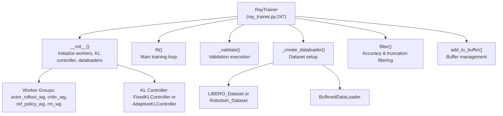
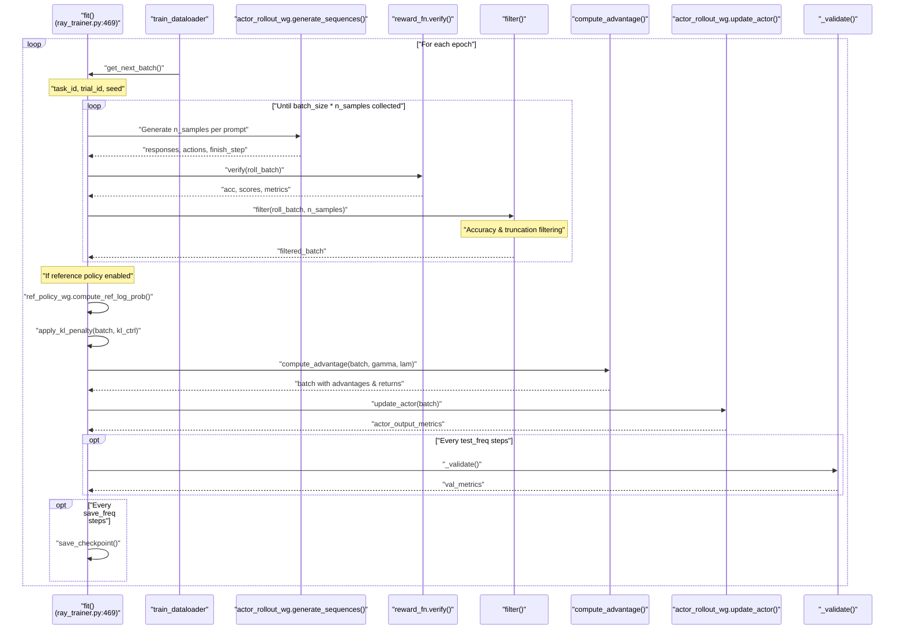
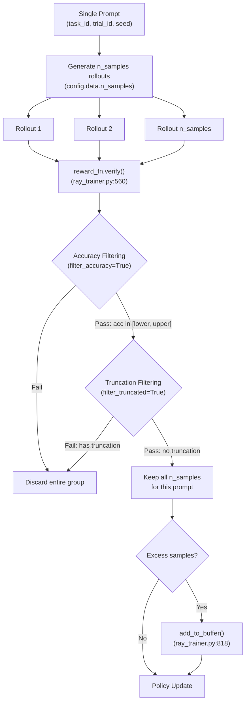
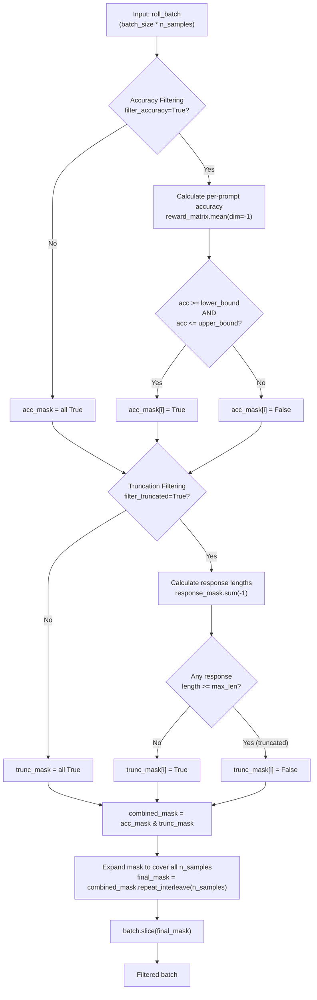
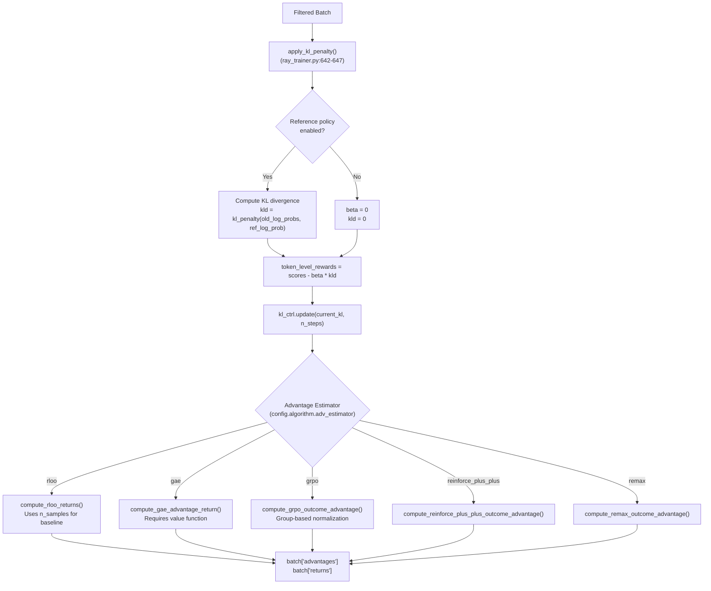
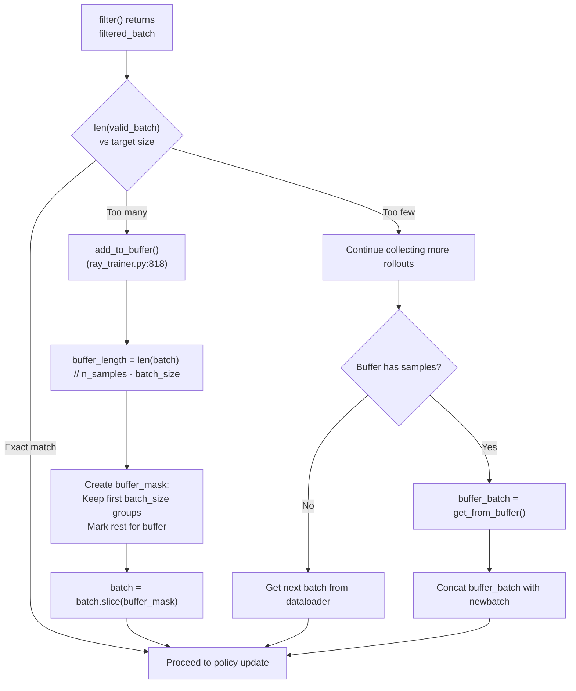
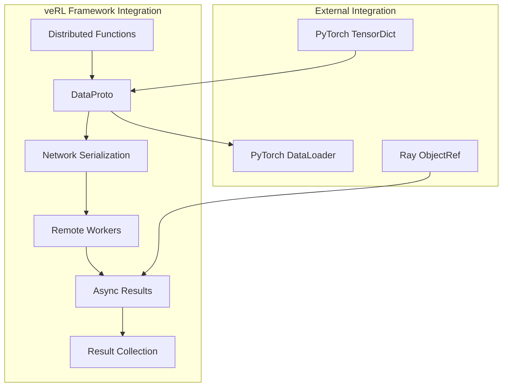

<!-- source: DeepWiki mcp.deepwiki.com · repo PRIME-RL/SimpleVLA-RL · page 3.1 PPO Training Loop · fetched 2026-10-30 -->

# PPO Training Loop

<details>
<summary>Relevant source files</summary>

The following files were used as context for generating this wiki page:

- [README.md](README.md)
- [verl/trainer/ppo/ray_trainer.py](verl/trainer/ppo/ray_trainer.py)

</details>


The PPO training loop is implemented in the `RayTrainer` class in [verl/trainer/ppo/ray_trainer.py]() and serves as the central orchestrator for Vision-Language-Action model training. The loop coordinates data collection, trajectory filtering, advantage computation, and policy updates across distributed workers.

The training loop implements an oversampling strategy where multiple rollouts are generated per prompt, then filtered based on success rate and trajectory quality before policy updates. This approach improves sample efficiency by focusing gradient updates on successful demonstrations.

Related pages: [Policy Updates and Actor](#3.2) for actor update details, [Advantage Estimation](#3.3) for advantage computation algorithms, [Rollout Workers](#4.3) for trajectory collection.

## RayTrainer Class Structure

The `RayTrainer` class manages the entire training lifecycle:

**Main Training Loop Components**



**Sources:** [verl/trainer/ppo/ray_trainer.py:247-335]()

### Key Attributes

| Attribute | Type | Purpose |
|-----------|------|---------|
| `config` | OmegaConf | Training configuration including hyperparameters |
| `tokenizer` | Tokenizer | For text processing (EOS/PAD tokens) |
| `actor_rollout_wg` | RayWorkerGroup | Generates trajectories and updates policy |
| `critic_wg` | RayWorkerGroup | Computes value estimates (if using GAE) |
| `ref_policy_wg` | RayWorkerGroup | Reference policy for KL divergence |
| `kl_ctrl` | KLController | Manages KL penalty coefficient |
| `train_dataloader` | BufferedDataLoader | Training data with buffering |
| `val_dataloader` | DataLoader | Validation data |
| `reward_fn` | Callable | Reward function wrapper |
| `val_reward_fn` | Callable | Validation reward function |

**Sources:** [verl/trainer/ppo/ray_trainer.py:249-290]()

## Main Training Loop (fit method)

The `fit()` method implements the complete training loop with epoch iteration, data collection, filtering, and updates:

**Training Loop Flow**



**Sources:** [verl/trainer/ppo/ray_trainer.py:469-717]()

### Loop Stages

| Stage | Lines | Description |
|-------|-------|-------------|
| Epoch Initialization | 498-499 | Start new epoch and reset buffer |
| Data Collection | 500-598 | Generate rollouts with oversampling |
| Reference Policy | 611-616 | Compute reference log probs for KL penalty |
| Reward Processing | 618-647 | Apply KL penalty and compute advantages |
| Policy Update | 660-671 | Update actor and compute entropy |
| Validation | 673-679 | Periodic validation runs |
| Checkpointing | 690-708 | Save model checkpoints |

**Sources:** [verl/trainer/ppo/ray_trainer.py:498-710]()

## Oversampling Strategy

The training loop implements an oversampling strategy to improve sample efficiency:

**Oversampling Flow**



**Sources:** [verl/trainer/ppo/ray_trainer.py:513-598](), [verl/trainer/ppo/ray_trainer.py:755-816]()

### Oversampling Configuration

| Parameter | Config Path | Description |
|-----------|-------------|-------------|
| `n_samples` | `config.data.n_samples` | Number of rollouts per prompt |
| `oversample_factor` | `config.data.oversample_factor` | Batch size multiplier for oversampling |
| `train_batch_size` | `config.data.train_batch_size` | Target batch size after filtering |
| `filter_accuracy` | `config.data.filter_accuracy` | Enable accuracy-based filtering |
| `accuracy_lower_bound` | `config.data.accuracy_lower_bound` | Minimum average accuracy |
| `accuracy_upper_bound` | `config.data.accuracy_upper_bound` | Maximum average accuracy |
| `filter_truncated` | `config.data.filter_truncated` | Enable truncation filtering |

**Sources:** [verl/trainer/ppo/ray_trainer.py:312-316]()

The oversampling factor determines the initial batch size: `initial_batch_size = train_batch_size * oversample_factor`. This ensures sufficient samples remain after filtering.

**Sources:** [verl/trainer/ppo/ray_trainer.py:513-598]()

## Filtering Strategy

The `filter()` method implements two-stage filtering to remove low-quality trajectories:

**Filter Implementation**



**Sources:** [verl/trainer/ppo/ray_trainer.py:755-816]()

### Filter Logic Details

**Accuracy Filtering** ([ray_trainer.py:768-776]()):
```python
# Reshape rewards: (batch_size * n_samples, 1) -> (batch_size, n_samples)
reward_matrix = reward_tensor.sum(-1).reshape(-1, n_samples)
# Calculate mean accuracy per prompt
acc_tensor = torch.mean(reward_matrix, dim=-1)  # (batch_size,)
# Keep prompts within accuracy bounds
acc_mask = (acc_tensor >= lower_bound) & (acc_tensor <= upper_bound)
```

**Truncation Filtering** ([ray_trainer.py:780-801]()):
```python
# Calculate response lengths
response_lengths = response_mask.sum(-1).reshape(-1, n_samples)
# Check if any response hit max length (indicating truncation)
has_truncated = (response_lengths >= max_len).any(dim=-1)
# Keep only non-truncated groups
trunc_mask = ~has_truncated
```

**Mask Application** ([ray_trainer.py:807-813]()):
- Combine masks: `combined_mask = acc_mask & trunc_mask`
- Expand to cover all samples: `final_mask = combined_mask.repeat_interleave(n_samples)`
- Apply to batch: `filtered_batch = batch.slice(final_mask)`

**Sources:** [verl/trainer/ppo/ray_trainer.py:755-816]()

### Group-Level Filtering

The filtering operates at the **prompt group level**: if any sample in a group fails criteria, the entire group (all `n_samples` rollouts) is discarded. This ensures consistent sample distribution per prompt for advantage estimation algorithms like RLOO and GRPO.

**Sources:** [verl/trainer/ppo/ray_trainer.py:769-816]()

## Advantage Computation

After filtering, the training loop computes advantages using the `compute_advantage()` function:

**Advantage Computation Flow**



**Sources:** [verl/trainer/ppo/ray_trainer.py:642-655](), [verl/trainer/ppo/ray_trainer.py:123-204]()

### KL Penalty Application

The `apply_kl_penalty()` function ([ray_trainer.py:85-121]()):

| Step | Code | Purpose |
|------|------|---------|
| 1. Compute KL | `kld = kl_penalty(old_log_probs, ref_log_prob)` | Measure policy divergence |
| 2. Get coefficient | `beta = kl_ctrl.value` | Current KL penalty weight |
| 3. Adjust rewards | `token_level_rewards = scores - beta * kld` | Penalize divergence |
| 4. Update controller | `kl_ctrl.update(current_kl, n_steps)` | Adapt beta (if adaptive) |

**Sources:** [verl/trainer/ppo/ray_trainer.py:85-121]()

### Supported Advantage Estimators

The `compute_advantage()` function ([ray_trainer.py:123-204]()) supports:

| Estimator | Config Value | Requires Critic | Use Case |
|-----------|--------------|-----------------|----------|
| RLOO | `'rloo'` | No | Leave-one-out baseline with oversampling |
| GAE | `'gae'` | Yes | Generalized Advantage Estimation |
| GRPO | `'grpo'` | No | Group-relative policy optimization |
| REINFORCE++ | `'reinforce_plus_plus'` | No | Enhanced REINFORCE with baseline |
| REMAX | `'remax'` | No | Reward maximization with baselines |

**Sources:** [verl/trainer/ppo/ray_trainer.py:136-201]()

## Buffer Management

The `BufferedDataLoader` maintains excess filtered samples for reuse:

**Buffer Management Flow**



**Sources:** [verl/trainer/ppo/ray_trainer.py:504-527](), [verl/trainer/ppo/ray_trainer.py:818-829]()

### Buffer Operations

**Adding to Buffer** ([ray_trainer.py:818-829]()):
1. Calculate excess: `buffer_length = len(batch) // n_samples - batch_size`
2. Create boolean mask keeping first `batch_size` groups
3. Slice batch to remove excess: `batch = batch.slice(buffer_mask)`
4. (Note: Current implementation doesn't persist buffer across iterations)

**Using Buffer** ([ray_trainer.py:504-506]()):
```python
if self.train_dataloader.buffer_size() > 0:
    buffer_batch = self.train_dataloader.get_from_buffer(batch_size, world_size)
```

**Sources:** [verl/trainer/ppo/ray_trainer.py:504-527](), [verl/trainer/ppo/ray_trainer.py:818-829]()

## Integration with Distributed Systems

The Data Protocol serves as the foundation for distributed communication in the veRL framework:



**Sources:** [verl/__init__.py:22](), [verl/protocol.py:349-388](), [verl/protocol.py:455-503]()

The protocol's design enables seamless integration with both PyTorch's data handling mechanisms and Ray's distributed computing primitives, forming the communication backbone for the distributed training system.

---

