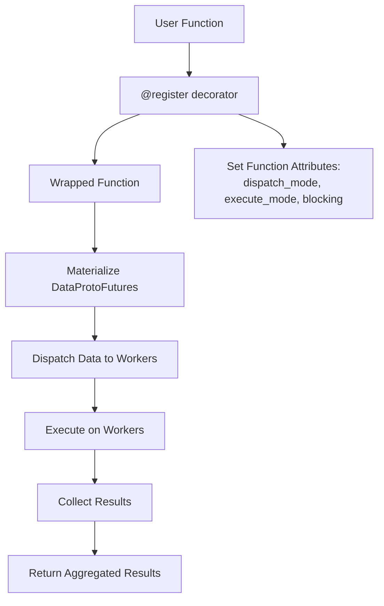
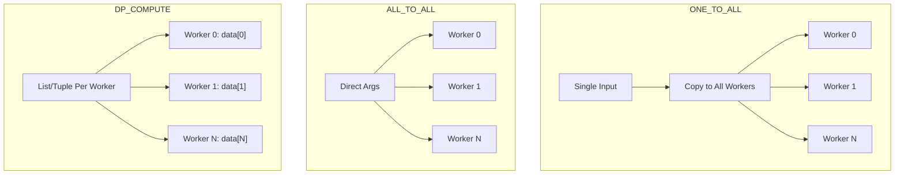
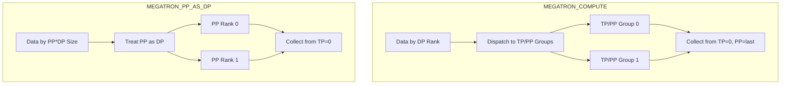
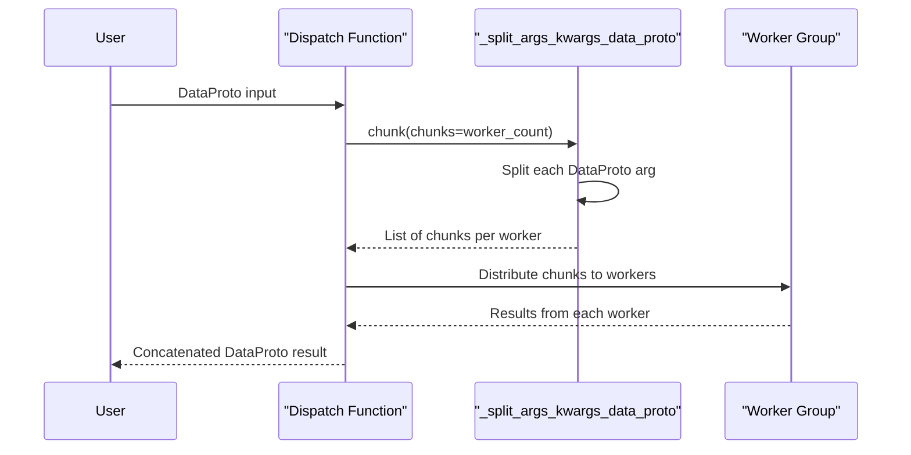
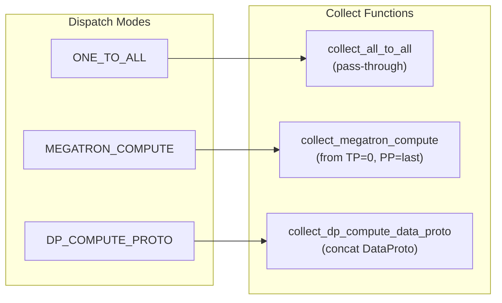
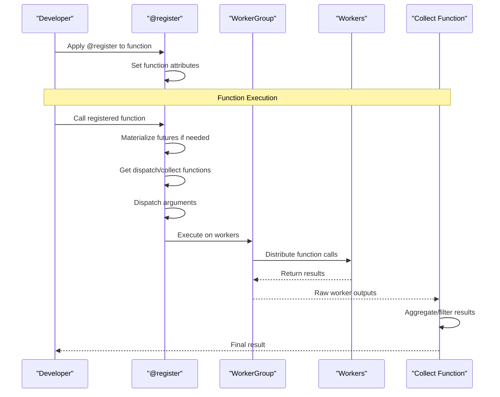

<!-- source: DeepWiki mcp.deepwiki.com · repo PRIME-RL/SimpleVLA-RL · page 3.2 Policy Updates and Actor · fetched 2026-10-30 -->

# Distributed Execution

<details>
<summary>Relevant source files</summary>

The following files were used as context for generating this wiki page:

- [verl/trainer/ppo/ray_trainer.py](verl/trainer/ppo/ray_trainer.py)
- [verl/workers/actor/dp_rob.py](verl/workers/actor/dp_rob.py)

</details>


This document covers the distributed execution system in SimpleVLA-RL, which enables functions to be executed across multiple workers in a distributed training environment. The system provides a decorator-based interface for dispatching function calls, managing data distribution patterns, and collecting results from distributed workers.

For information about the underlying worker management and resource allocation, see [Worker Management](#3.3). For details about data serialization and transfer protocols used in distributed execution, see [Data Protocol](#3.1).

## Purpose and Architecture

The distributed execution system enables seamless execution of functions across multiple workers by providing:

- **Dispatch Patterns**: Multiple strategies for distributing input data to workers
- **Collection Strategies**: Various methods for aggregating results from distributed workers  
- **Parallelization Integration**: Support for Megatron-LM's tensor, pipeline, and data parallelism
- **Protocol Integration**: Integration with DataProto for efficient data transfer

## Register Decorator System

The core interface is the `register` decorator in [verl/single_controller/base/decorator.py:394-410](), which wraps functions for distributed execution:

```python
@register(dispatch_mode=Dispatch.MEGATRON_COMPUTE, execute_mode=Execute.ALL)
def my_distributed_function(data):
    # Function executed on all workers
    return process_data(data)
```

### Decorator Parameters

| Parameter | Type | Description |
|-----------|------|-------------|
| `dispatch_mode` | `Dispatch` enum or dict | How to distribute input data to workers |
| `execute_mode` | `Execute` enum | Which workers should execute the function |
| `blocking` | bool | Whether to wait for completion |
| `materialize_futures` | bool | Whether to resolve DataProtoFuture objects |

**Title**: Register Decorator Flow


Sources: [verl/single_controller/base/decorator.py:394-410]()

## Dispatch Modes

The system supports multiple dispatch patterns defined in the `Dispatch` enum [verl/single_controller/base/decorator.py:25-37]():

### Basic Dispatch Modes

**Title**: Basic Dispatch Patterns


Sources: [verl/single_controller/base/decorator.py:60-63](), [verl/single_controller/base/decorator.py:66-67](), [verl/single_controller/base/decorator.py:255-262]()

### Megatron Dispatch Modes

For integration with Megatron-LM parallelization strategies:

**Title**: Megatron Dispatch Architecture


Sources: [verl/single_controller/base/decorator.py:74-100](), [verl/single_controller/base/decorator.py:161-206]()

## DataProto Integration

Several dispatch modes work specifically with DataProto objects, automatically chunking data for distribution:

### DataProto Dispatch Functions

| Mode | Function | Purpose |
|------|----------|---------|
| `MEGATRON_COMPUTE_PROTO` | `dispatch_megatron_compute_data_proto` | Chunk DataProto by DP size for Megatron |
| `MEGATRON_PP_AS_DP_PROTO` | `dispatch_megatron_pp_as_dp_data_proto` | Chunk by PP*DP size |
| `DP_COMPUTE_PROTO` | `dispatch_dp_compute_data_proto` | Chunk by world size |
| `DP_COMPUTE_PROTO_WITH_FUNC` | `dispatch_dp_compute_data_proto_with_func` | Include function as first argument |

The `_split_args_kwargs_data_proto` function [verl/single_controller/base/decorator.py:45-57]() handles automatic chunking:

```python
def _split_args_kwargs_data_proto(chunks, *args, **kwargs):
    # Splits DataProto/DataProtoFuture objects into chunks
    # Returns lists suitable for distributed execution
```

**Title**: DataProto Chunking Flow


Sources: [verl/single_controller/base/decorator.py:118-126](), [verl/single_controller/base/decorator.py:272-276]()

## Collection Strategies

After distributed execution, results are collected using corresponding collect functions:

### Collection Function Mapping

The `get_predefined_dispatch_fn` function [verl/single_controller/base/decorator.py:300-347]() maps dispatch modes to collection strategies:

**Title**: Dispatch-Collect Function Mapping


Sources: [verl/single_controller/base/decorator.py:300-347]()

### Specialized Collection Logic

For Megatron integration, collection functions implement rank-specific logic:

- **`collect_megatron_compute`** [verl/single_controller/base/decorator.py:103-115](): Collects only from tensor parallel rank 0 and the last pipeline parallel rank
- **`collect_megatron_pp_as_dp`** [verl/single_controller/base/decorator.py:209-220](): Collects only from tensor parallel rank 0 and pipeline parallel rank 0
- **`collect_megatron_pp_only`** [verl/single_controller/base/decorator.py:223-234](): Collects from one representative per pipeline parallel group

## Execute Modes

The `Execute` enum [verl/single_controller/base/decorator.py:40-42]() determines which workers run the function:

| Mode | Description | Use Case |
|------|-------------|----------|
| `Execute.ALL` | Execute on all workers | Distributed computation |
| `Execute.RANK_ZERO` | Execute only on rank 0 | Coordinator tasks |

The `get_predefined_execute_fn` function [verl/single_controller/base/decorator.py:350-363]() maps these to worker group execution methods:

- `Execute.ALL` → `execute_all` method
- `Execute.RANK_ZERO` → `execute_rank_zero` method

## Function Registration Process

**Title**: Complete Registration and Execution Flow


Sources: [verl/single_controller/base/decorator.py:394-410](), [verl/single_controller/base/decorator.py:379-391]()

## Custom Dispatch Modes

Besides predefined dispatch modes, users can provide custom dispatch/collect functions via dictionary:

```python
custom_dispatch = {
    'dispatch_fn': my_custom_dispatch,
    'collect_fn': my_custom_collect
}

@register(dispatch_mode=custom_dispatch)
def my_function(data):
    return process(data)
```

The validation logic in [verl/single_controller/base/decorator.py:366-373]() ensures custom dispatch modes contain required keys: `dispatch_fn` and `collect_fn`.

Sources: [verl/single_controller/base/decorator.py:366-373](), [verl/single_controller/base/decorator.py:394-410]()

---

