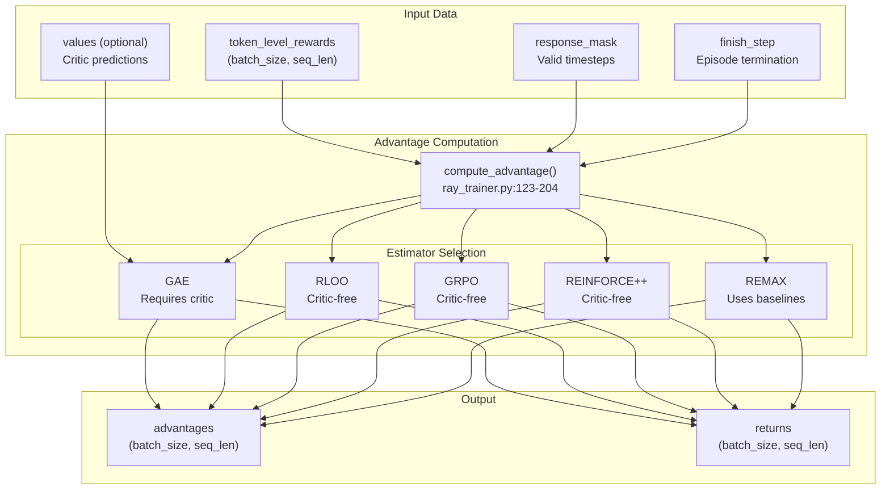
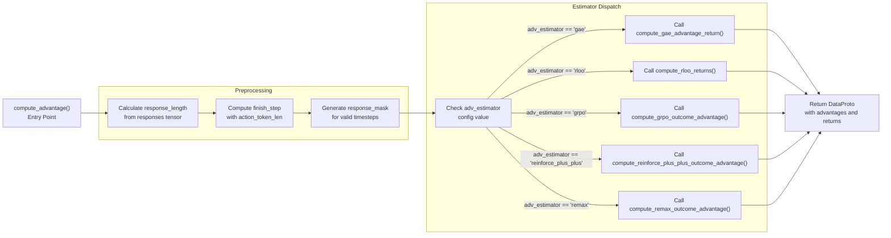
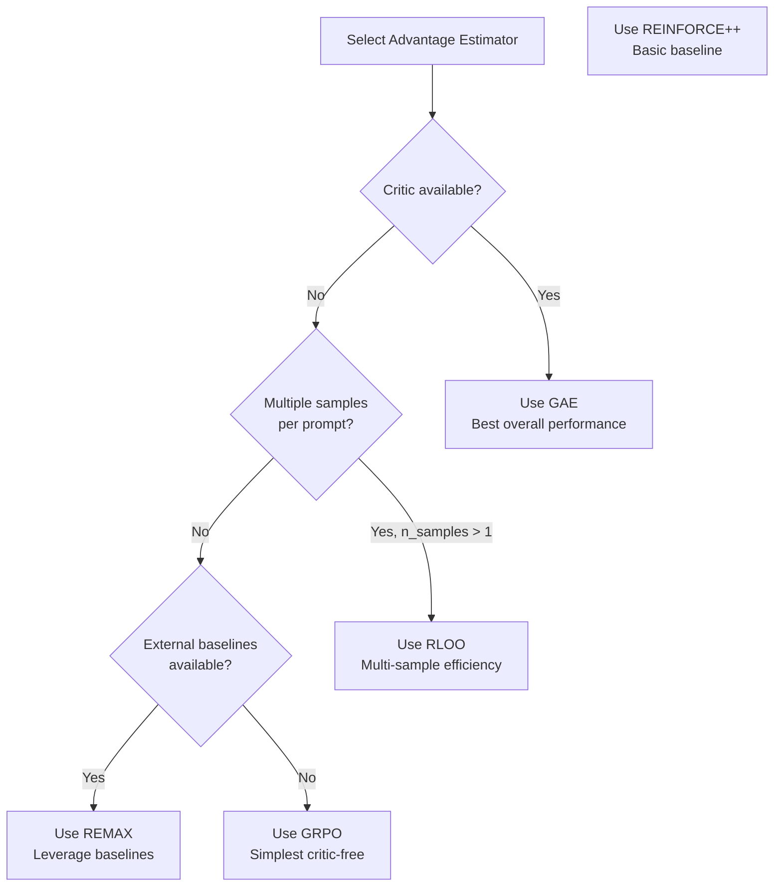

<!-- source: DeepWiki mcp.deepwiki.com · repo PRIME-RL/SimpleVLA-RL · page 3.3 Advantage Estimation · fetched 2026-10-30 -->

# Advantage Estimation

<details>
<summary>Relevant source files</summary>

The following files were used as context for generating this wiki page:

- [.gitignore](.gitignore)
- [verl/trainer/config/ppo_trainer.yaml](verl/trainer/config/ppo_trainer.yaml)
- [verl/trainer/ppo/ray_trainer.py](verl/trainer/ppo/ray_trainer.py)

</details>


## Purpose and Scope

This page documents the advantage estimation mechanisms in SimpleVLA-RL. Advantage estimation is a critical component of the PPO algorithm that quantifies how much better an action is compared to the average action at a given state. The system supports multiple advantage estimators to accommodate different training scenarios and computational constraints.

For information about the overall PPO training loop, see [PPO Training Loop](#3.1). For details on policy updates using computed advantages, see [Policy Updates and Actor](#3.2).

## Overview

Advantage estimation transforms raw rewards into signals that guide policy optimization. The advantage function A(s,a) represents the relative value of taking action a in state s compared to the expected value. Different estimators make different tradeoffs between bias and variance in this estimation.



**Sources:** [verl/trainer/ppo/ray_trainer.py:123-204]()

## Supported Advantage Estimators

The framework supports five advantage estimators, each with different characteristics:

| Estimator | Requires Critic | Sample Efficiency | Variance | Use Case |
|-----------|----------------|-------------------|----------|----------|
| **GAE** | Yes | High | Low | General purpose, when critic available |
| **RLOO** | No | Medium | Medium | Multi-sample rollouts, critic-free |
| **GRPO** | No | Medium | Medium | Group-based rewards, simplest |
| **REINFORCE++** | No | Low | High | Simple baseline, outcome-based |
| **REMAX** | No (uses baselines) | Medium | Medium | With pre-computed baselines |

### Configuration Selection

The advantage estimator is configured in `ppo_trainer.yaml`:

```yaml
algorithm:
  gamma: 1.0              # Discount factor
  lam: 1.0                # GAE lambda parameter
  adv_estimator: gae      # Options: gae, rloo, grpo, reinforce_plus_plus, remax
```

**Sources:** [verl/trainer/config/ppo_trainer.yaml:227-230]()

## Implementation Details

### Main Function: `compute_advantage`

The `compute_advantage` function serves as the central dispatcher for all advantage estimators. It handles response masking and delegates to the appropriate estimator based on configuration.



**Sources:** [verl/trainer/ppo/ray_trainer.py:123-204]()

### Response Masking

All estimators use a response mask to identify valid timesteps in the trajectory. This is crucial for handling variable-length episodes:

```python
# From ray_trainer.py:126-131
response_length = responses.size(1) * responses.size(2)
finish_step = data.batch['finish_step'] * config.actor_rollout_ref.model.action_token_len 
steps = torch.arange(response_length, device=data.batch['responses'].device)
steps_expanded = steps.unsqueeze(0).expand(data.batch['responses'].size(0), -1)
response_mask = steps_expanded < finish_step.unsqueeze(1)
```

The mask ensures that advantages are only computed for valid timesteps before episode termination.

**Sources:** [verl/trainer/ppo/ray_trainer.py:126-131]()

## Estimator-Specific Details

### Generalized Advantage Estimation (GAE)

GAE provides a bias-variance tradeoff through the λ parameter. It requires a trained critic to provide value estimates.

**When to use:** Default choice when critic is available. Provides stable, low-variance advantage estimates.

**Implementation:**
```python
# From ray_trainer.py:145-158
elif adv_estimator == 'gae':
    values = data.batch['values']
    responses = data.batch['responses']
    response_length = responses.size(-1)
    attention_mask = data.batch['attention_mask']
    response_mask = attention_mask[:, -response_length:]
    token_level_rewards = data.batch['token_level_rewards']
    advantages, returns = core_algos.compute_gae_advantage_return(
        token_level_rewards=token_level_rewards,
        values=values,
        eos_mask=response_mask,
        gamma=gamma,
        lam=lam
    )
```

**Configuration Requirements:**
- `algorithm.adv_estimator: gae`
- `algorithm.gamma`: Discount factor (typically 1.0 for robotics)
- `algorithm.lam`: GAE lambda parameter (typically 1.0)
- Critic worker group must be initialized

**Sources:** [verl/trainer/ppo/ray_trainer.py:145-158](), [verl/trainer/ppo/ray_trainer.py:410-414]()

### RLOO (Reinforce Leave-One-Out)

RLOO uses multiple samples per prompt to estimate advantages without a critic. It computes baselines by averaging rewards across samples while leaving out the current sample.

**When to use:** When you want critic-free training with multiple rollouts per prompt (`n_samples > 1`).

**Implementation:**
```python
# From ray_trainer.py:136-143
if adv_estimator == 'rloo':
    advantages, returns = core_algos.compute_rloo_returns(
        data=data,
        eos_mask=response_mask,
        n_samples=config.data.n_samples,
        config=config
    )
```

**Configuration Requirements:**
- `algorithm.adv_estimator: rloo`
- `data.n_samples`: Number of rollouts per prompt (typically > 1)
- No critic required

**Sources:** [verl/trainer/ppo/ray_trainer.py:136-143](), [verl/trainer/ppo/ray_trainer.py:415-416]()

### GRPO (Group Relative Policy Optimization)

GRPO computes advantages based on group-level outcome comparisons. It uses unique identifiers (UIDs) to group samples and compute relative advantages within each group.

**When to use:** Simplest critic-free approach, suitable for sparse reward tasks with clear success/failure outcomes.

**Implementation:**
```python
# From ray_trainer.py:160-173
elif adv_estimator == 'grpo':
    token_level_rewards = data.batch['token_level_rewards']
    index = data.non_tensor_batch['uid']
    responses = data.batch['responses']
    response_length = responses.size(1) * responses.size(2)
    finish_step = data.batch['finish_step'] * config.actor_rollout_ref.model.action_token_len 
    steps = torch.arange(response_length, device=data.batch['responses'].device)
    steps_expanded = steps.unsqueeze(0).expand(data.batch['responses'].size(0), -1)
    response_mask = steps_expanded < finish_step.unsqueeze(1)
    advantages, returns = core_algos.compute_grpo_outcome_advantage(
        token_level_rewards=token_level_rewards,
        eos_mask=response_mask,
        index=index
    )
```

**Key Feature:** Uses UID-based grouping. UIDs are generated per prompt:
```python
# From ray_trainer.py:537-538
newbatch.non_tensor_batch['uid'] = np.array([str(uuid.uuid4()) for _ in range(len(newbatch))],
                                     dtype=object)
```

**Sources:** [verl/trainer/ppo/ray_trainer.py:160-173](), [verl/trainer/ppo/ray_trainer.py:537-538](), [verl/trainer/ppo/ray_trainer.py:417-418]()

### REINFORCE++

REINFORCE++ is an outcome-based estimator with gamma-based return computation. It provides a simple baseline without requiring a critic.

**When to use:** When you need a simple baseline approach with outcome-based rewards.

**Implementation:**
```python
# From ray_trainer.py:175-184
elif adv_estimator == 'reinforce_plus_plus':
    token_level_rewards = data.batch['token_level_rewards']
    responses = data.batch['responses']
    response_length = responses.size(-1)
    attention_mask = data.batch['attention_mask']
    response_mask = attention_mask[:, -response_length:]
    advantages, returns = core_algos.compute_reinforce_plus_plus_outcome_advantage(
        token_level_rewards=token_level_rewards,
        eos_mask=response_mask,
        gamma=gamma
    )
```

**Sources:** [verl/trainer/ppo/ray_trainer.py:175-184](), [verl/trainer/ppo/ray_trainer.py:419-420]()

### REMAX

REMAX uses pre-computed reward baselines to estimate advantages. This is useful when you have external baseline estimates.

**When to use:** When you have pre-computed or external baseline rewards to compare against.

**Implementation:**
```python
# From ray_trainer.py:186-201
elif adv_estimator == 'remax':
    token_level_rewards = data.batch['token_level_rewards']
    index = data.non_tensor_batch['uid']
    responses = data.batch['responses']
    response_length = responses.size(-1)
    attention_mask = data.batch['attention_mask']
    response_mask = attention_mask[:, -response_length:]
    
    reward_baselines = data.batch['reward_baselines']
    
    advantages, returns = core_algos.compute_remax_outcome_advantage(
        token_level_rewards=token_level_rewards,
        reward_baselines=reward_baselines,
        eos_mask=response_mask
    )
```

**Sources:** [verl/trainer/ppo/ray_trainer.py:186-201]()

## Integration with Training Loop

Advantage estimation occurs after reward computation and KL penalty application in the training loop:

```mermaid
sequenceDiagram
    participant Loop as Training Loop
    participant Reward as reward_fn
    participant KL as apply_kl_penalty
    participant Adv as compute_advantage
    participant Actor as Actor Update
    
    Loop->>Reward: Compute raw rewards
    Reward-->>Loop: token_level_scores
    
    Loop->>KL: Apply KL penalty (if ref policy exists)
    KL-->>Loop: token_level_rewards (adjusted)
    
    Loop->>Adv: compute_advantage(batch, gamma, lam, estimator)
    
    alt GAE Estimator
        Adv->>Adv: Fetch values from critic
        Adv->>Adv: compute_gae_advantage_return()
    else RLOO/GRPO/REINFORCE++/REMAX
        Adv->>Adv: Critic-free computation
    end
    
    Adv-->>Loop: advantages & returns in batch
    
    Loop->>Actor: update_actor(batch with advantages)
    Actor-->>Loop: Policy updated
```

The sequence in code:

1. **Reward Computation** [verl/trainer/ppo/ray_trainer.py:631-639](): Raw rewards from `reward_fn`
2. **KL Penalty** [verl/trainer/ppo/ray_trainer.py:642-647](): Apply KL divergence penalty via `apply_kl_penalty`
3. **Advantage Estimation** [verl/trainer/ppo/ray_trainer.py:650-654](): Call `compute_advantage`
4. **Actor Update** [verl/trainer/ppo/ray_trainer.py:662-666](): Use advantages for policy gradient

**Sources:** [verl/trainer/ppo/ray_trainer.py:631-655](), [verl/trainer/ppo/ray_trainer.py:662-671]()

## Worker Initialization and Critic Requirement

The system conditionally initializes a critic based on the advantage estimator:

```python
# From ray_trainer.py:410-422
if self.config.algorithm.adv_estimator == 'gae':
    resource_pool = self.resource_pool_manager.get_resource_pool(Role.Critic)
    critic_cls = RayClassWithInitArgs(cls=self.role_worker_mapping[Role.Critic], 
                                     config=self.config.critic)
    self.resource_pool_to_cls[resource_pool]['critic'] = critic_cls
    self.use_critic = True
elif self.config.algorithm.adv_estimator in ['rloo']:
    self.use_critic = False
elif self.config.algorithm.adv_estimator in ['grpo']:
    self.use_critic = False
elif self.config.algorithm.adv_estimator in ['reinforce_plus_plus']:
    self.use_critic = False
else:
    raise NotImplementedError
```

This initialization logic ensures that computational resources are only allocated for a critic when needed.

**Sources:** [verl/trainer/ppo/ray_trainer.py:410-422]()

## Metrics and Logging

After advantage computation, the system logs comprehensive metrics:

```python
# From ray_trainer.py:213-245
def compute_data_metrics(batch, config):
    sequence_score = batch.batch['token_level_scores'].sum(-1)
    sequence_reward = batch.batch['token_level_rewards'].sum(-1)
    advantages = batch.batch['advantages']
    returns = batch.batch['returns']
    
    metrics = {
        # Score metrics
        'critic/score/mean': torch.mean(sequence_score).detach().item(),
        'critic/score/max': torch.max(sequence_score).detach().item(),
        'critic/score/min': torch.min(sequence_score).detach().item(),
        # Reward metrics
        'critic/rewards/mean': torch.mean(sequence_reward).detach().item(),
        'critic/rewards/max': torch.max(sequence_reward).detach().item(),
        'critic/rewards/min': torch.min(sequence_reward).detach().item(),
        # Advantage metrics
        'critic/advantages/mean': masked_mean(advantages, response_mask).detach().item(),
        'critic/advantages/max': torch.max(advantages[response_mask.bool()]).detach().item(),
        'critic/advantages/min': torch.min(advantages[response_mask.bool()]).detach().item(),
        # Return metrics
        'critic/returns/mean': masked_mean(returns, response_mask).detach().item(),
        'critic/returns/max': torch.max(returns[response_mask.bool()]).detach().item(),
        'critic/returns/min': torch.min(returns[response_mask.bool()]).detach().item(),
    }
    return metrics
```

These metrics are logged to WandB at line 688: `logger.log(data=metrics, step=global_steps)`.

**Sources:** [verl/trainer/ppo/ray_trainer.py:213-245](), [verl/trainer/ppo/ray_trainer.py:682-688]()

## Best Practices and Recommendations

### Choosing an Estimator



### Configuration Examples

**For stable training with critic:**
```yaml
algorithm:
  gamma: 1.0
  lam: 1.0
  adv_estimator: gae
```

**For critic-free with oversampling:**
```yaml
algorithm:
  gamma: 1.0
  lam: 1.0
  adv_estimator: rloo

data:
  n_samples: 4  # Multiple rollouts per prompt
  oversample_factor: 1.5
```

**For simple group-based training:**
```yaml
algorithm:
  gamma: 1.0
  lam: 1.0
  adv_estimator: grpo

data:
  n_samples: 2
```

**Sources:** [verl/trainer/config/ppo_trainer.yaml:227-240]()

### Common Issues

1. **Missing Values**: Ensure critic is initialized when using GAE
2. **UID Consistency**: GRPO and REMAX require proper UID assignment per prompt
3. **Response Masking**: All estimators depend on correct `finish_step` values from environment
4. **Sample Count**: RLOO requires `n_samples > 1` for proper baseline computation

## Related Core Algorithms

The actual advantage computation algorithms are implemented in `verl.trainer.ppo.core_algos` module. This module contains:

- `compute_gae_advantage_return()`: GAE implementation
- `compute_rloo_returns()`: RLOO implementation  
- `compute_grpo_outcome_advantage()`: GRPO implementation
- `compute_reinforce_plus_plus_outcome_advantage()`: REINFORCE++ implementation
- `compute_remax_outcome_advantage()`: REMAX implementation

These functions are imported and called by the dispatcher in `compute_advantage()`.

**Sources:** [verl/trainer/ppo/ray_trainer.py:36]()

---

