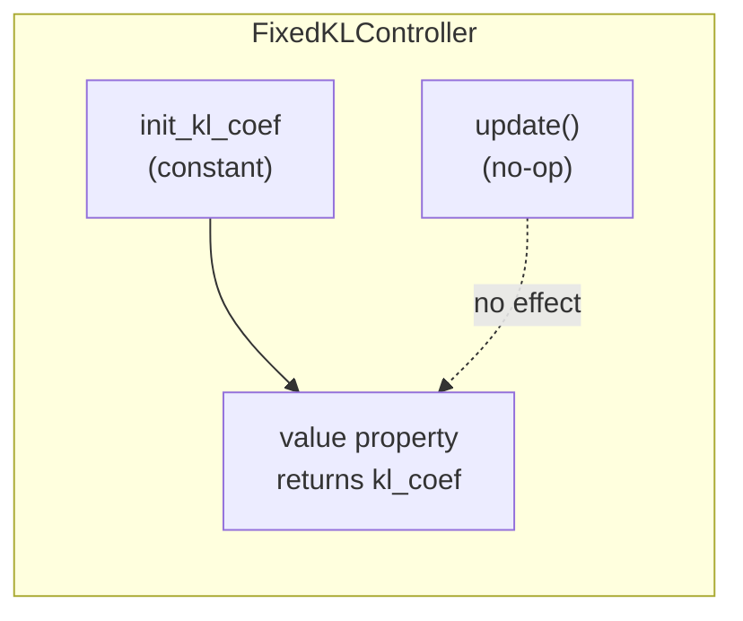
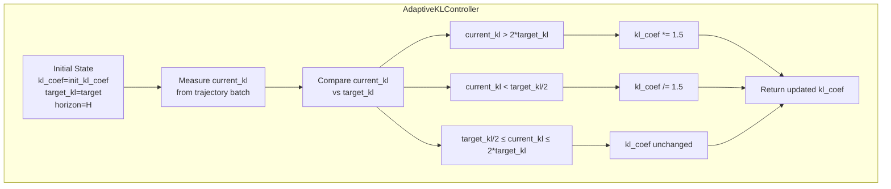
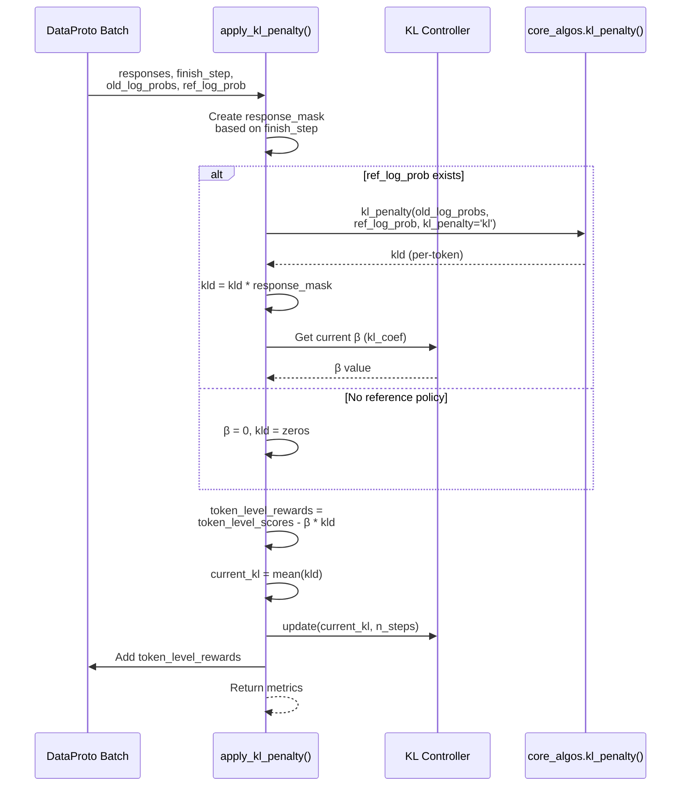
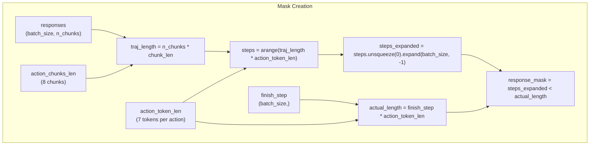
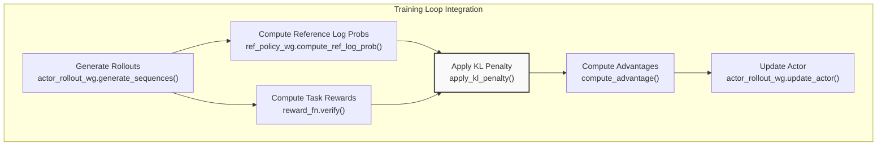
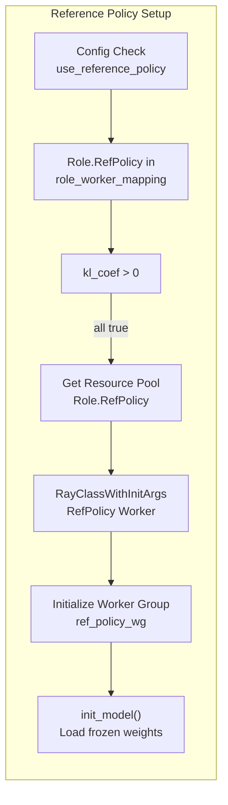
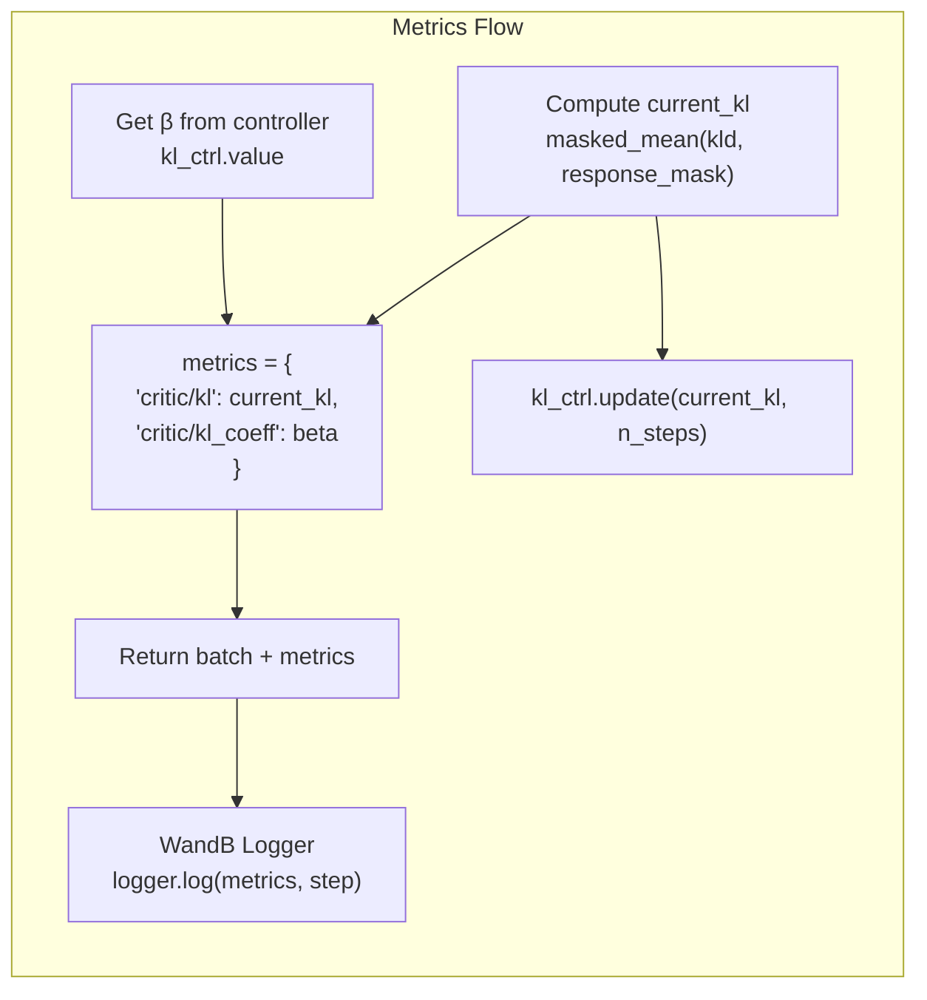

<!-- source: DeepWiki mcp.deepwiki.com · repo PRIME-RL/SimpleVLA-RL · page 3.4 KL Divergence Control · fetched 2026-10-30 -->

# KL Divergence Control

<details>
<summary>Relevant source files</summary>

The following files were used as context for generating this wiki page:

- [.gitignore](.gitignore)
- [verl/trainer/config/ppo_trainer.yaml](verl/trainer/config/ppo_trainer.yaml)
- [verl/trainer/ppo/ray_trainer.py](verl/trainer/ppo/ray_trainer.py)

</details>


**Purpose**: This page documents the KL divergence penalty mechanism used in SimpleVLA-RL to constrain policy updates during PPO training. KL divergence control prevents the trained policy from deviating too far from a reference policy, improving training stability and preventing catastrophic forgetting of pre-trained capabilities.

**Scope**: This page covers the KL penalty computation, controller types (fixed vs adaptive), and how the penalty is integrated into the reward signal. For information about how rewards are shaped before KL penalty application, see [Advantage Estimation](#3.3). For the overall PPO training loop, see [PPO Training Loop](#3.1).

---

## Overview

KL divergence control adds a penalty term to the reward signal based on the Kullback-Leibler (KL) divergence between the current policy and a reference policy. This regularization technique is critical for preventing the policy from making overly aggressive updates that could degrade performance or lose important pre-trained behaviors.

The KL penalty is applied per-token during trajectory rollouts, then incorporated into advantage estimation:

```
token_level_reward = task_reward - β * KL(π_current || π_ref)
```

where `β` is the KL coefficient controlled by either a fixed or adaptive controller.

**Sources**: [verl/trainer/ppo/ray_trainer.py:85-120]()

---

## KL Controller Types

### Fixed KL Controller

The `FixedKLController` maintains a constant KL coefficient throughout training. This is the simplest approach and is suitable when you have a good estimate of the appropriate penalty strength.



**Configuration** (from `ppo_trainer.yaml`):
```yaml
algorithm:
  kl_ctrl:
    type: fixed
    kl_coef: 0.001
```

### Adaptive KL Controller

The `AdaptiveKLController` dynamically adjusts the KL coefficient based on observed KL divergence during training. It increases the coefficient when KL divergence is too high and decreases it when KL is too low, aiming to maintain a target KL divergence.



**Configuration** (from `ppo_trainer.yaml`):
```yaml
algorithm:
  kl_ctrl:
    type: adaptive
    kl_coef: 0.001      # Initial coefficient
    target_kl: 0.01     # Target KL divergence
    horizon: 10000      # Adjustment horizon
```

**Sources**: [verl/trainer/ppo/ray_trainer.py:276-288](), [verl/trainer/config/ppo_trainer.yaml:236-239]()

---

## KL Penalty Computation

### Computing KL Divergence

The `apply_kl_penalty` function computes KL divergence between the current policy's log probabilities and the reference policy's log probabilities. The computation is masked to only consider valid tokens (before episode termination).



The key steps:

1. **Response Masking**: Create a mask based on `finish_step` to identify valid tokens in each trajectory
2. **KL Computation**: Calculate per-token KL divergence using `core_algos.kl_penalty`
3. **Masking**: Apply the response mask to exclude padding and post-termination tokens
4. **Penalty Application**: Subtract `β * kld` from task rewards
5. **Controller Update**: Update the KL controller with the batch's average KL divergence

**Sources**: [verl/trainer/ppo/ray_trainer.py:85-120]()

---

## Response Masking

Response masking is critical for accurate KL computation in robotics tasks where trajectories have variable lengths. The mask ensures KL penalties are only computed for actual robot actions, not padding tokens.



**Example**:
- Trajectory has 8 action chunks
- Each chunk has 7 tokens
- Robot terminates at chunk 5
- `finish_step = 5`
- `actual_length = 5 * 7 = 35 tokens`
- Mask: `[1,1,1,...1 (35 times), 0,0,0,... (21 times)]`

**Sources**: [verl/trainer/ppo/ray_trainer.py:88-97]()

---

## Integration with Training Loop

The KL penalty is applied during the advantage computation phase of the PPO training loop, after rollout generation but before policy updates.



### Code Flow

| Step | Location | Purpose |
|------|----------|---------|
| 1. Reference Policy Check | [ray_trainer.py:611-616]() | Check if reference policy is enabled |
| 2. Compute Reference Log Probs | [ray_trainer.py:614]() | Get `ref_log_prob` from reference policy |
| 3. Apply KL Penalty | [ray_trainer.py:642-647]() | Compute KL and apply penalty to rewards |
| 4. Compute Advantages | [ray_trainer.py:649-654]() | Use penalized rewards for advantage estimation |

**Sources**: [verl/trainer/ppo/ray_trainer.py:611-655]()

---

## Reference Policy

The reference policy is a frozen copy of the initial pre-trained VLA model. It provides the baseline log probabilities for KL divergence computation.

### Reference Policy Initialization



### Configuration Options

| Parameter | Location | Description |
|-----------|----------|-------------|
| `use_reference_policy` | [ray_trainer.py:272]() | Boolean flag to enable reference policy |
| `Role.RefPolicy` | [ray_trainer.py:425-430]() | Worker role for reference policy |
| `kl_coef` | [ppo_trainer.yaml:239]() | Must be > 0 to enable KL control |

**When Reference Policy is Disabled**:
- `β = 0` (no KL penalty)
- `kld = zeros_like(response_mask)`
- Training proceeds without regularization

**Sources**: [verl/trainer/ppo/ray_trainer.py:272-288](), [verl/trainer/ppo/ray_trainer.py:425-430]()

---

## Metrics and Logging

The `apply_kl_penalty` function returns two key metrics that are logged to WandB:

| Metric | Key | Description |
|--------|-----|-------------|
| Current KL | `critic/kl` | Average KL divergence across the batch |
| KL Coefficient | `critic/kl_coeff` | Current β value (adaptive or fixed) |



**Sources**: [verl/trainer/ppo/ray_trainer.py:111-119]()

---

## Configuration Examples

### Minimal Configuration (No KL Control)

```yaml
algorithm:
  kl_ctrl:
    type: fixed
    kl_coef: 0.0  # Disables KL penalty
```

No reference policy will be created, and training proceeds without regularization.

### Fixed KL Penalty

```yaml
algorithm:
  kl_ctrl:
    type: fixed
    kl_coef: 0.001  # Constant penalty
```

Suitable for fine-tuning where you know the appropriate penalty strength.

### Adaptive KL Penalty

```yaml
algorithm:
  kl_ctrl:
    type: adaptive
    kl_coef: 0.001      # Starting coefficient
    target_kl: 0.01     # Target divergence
    horizon: 10000      # Adjustment window
```

Recommended for longer training runs where the appropriate penalty strength may change over time.

**Sources**: [verl/trainer/config/ppo_trainer.yaml:236-239]()

---

## Implementation Details

### Key Functions and Classes

| Entity | Location | Purpose |
|--------|----------|---------|
| `apply_kl_penalty` | [ray_trainer.py:85-120]() | Main function for computing and applying KL penalty |
| `FixedKLController` | `core_algos` module | Fixed coefficient controller |
| `AdaptiveKLController` | `core_algos` module | Adaptive coefficient controller |
| `core_algos.kl_penalty` | `core_algos` module | Core KL divergence computation |
| `masked_mean` | `verl.utils.torch_functional` | Masked averaging utility |

### Token-Level vs Sequence-Level KL

The KL divergence is computed at the **token level** (per action token), not at the sequence level. This provides finer-grained control over policy deviation and is more appropriate for long robotic trajectories.

```
Per-token KL: KL(π_θ(a_t|s_t) || π_ref(a_t|s_t))
Total penalty: sum_t β * KL_t (for valid tokens only)
```

**Sources**: [verl/trainer/ppo/ray_trainer.py:85-120]()

---

## Best Practices

### Choosing KL Coefficient

| Scenario | Recommended `kl_coef` | Controller Type |
|----------|----------------------|-----------------|
| Fine-tuning pre-trained model | 0.001 - 0.01 | Fixed or Adaptive |
| Training from scratch | 0.0 (disabled) | N/A |
| Strong regularization needed | 0.01 - 0.1 | Adaptive |
| Minimal constraint | 0.0001 - 0.001 | Fixed |

### Monitoring KL Divergence

Watch the `critic/kl` metric during training:
- **Too low** (< 0.001): Policy barely deviating; increase `kl_coef` or lower `target_kl`
- **Too high** (> 0.1): Excessive regularization; decrease `kl_coef` or increase `target_kl`
- **Optimal range**: 0.01 - 0.05 for most VLA fine-tuning tasks

### Adaptive vs Fixed

- **Use Adaptive**: When training for many epochs (>10) or uncertain about penalty strength
- **Use Fixed**: When you have established hyperparameters from prior experiments

**Sources**: [verl/trainer/ppo/ray_trainer.py:276-288](), [verl/trainer/config/ppo_trainer.yaml:236-239]()

---

