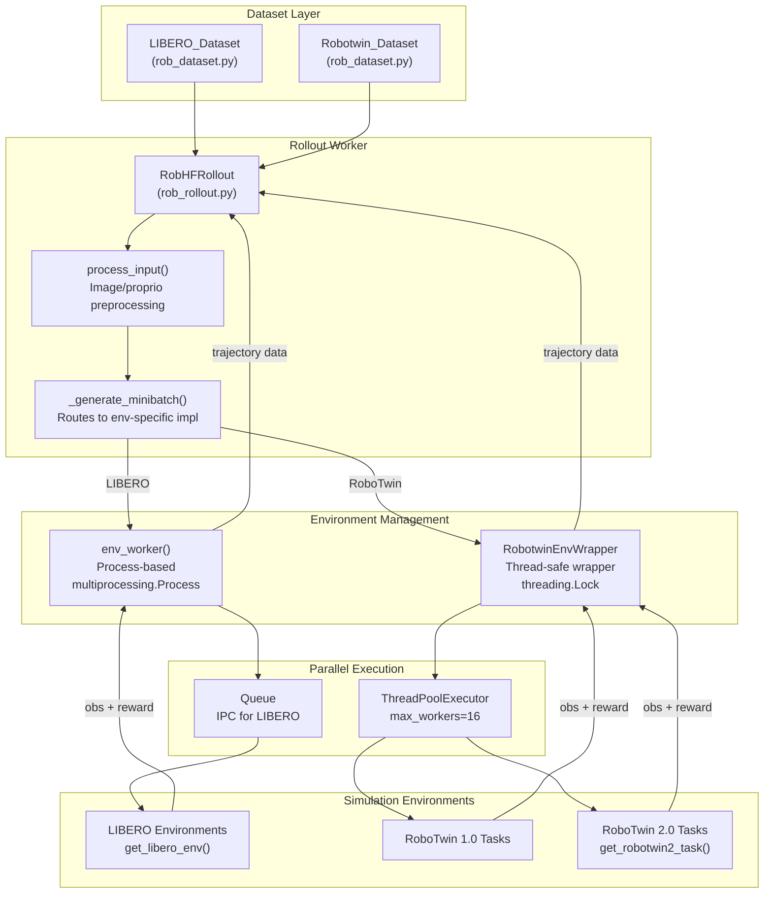
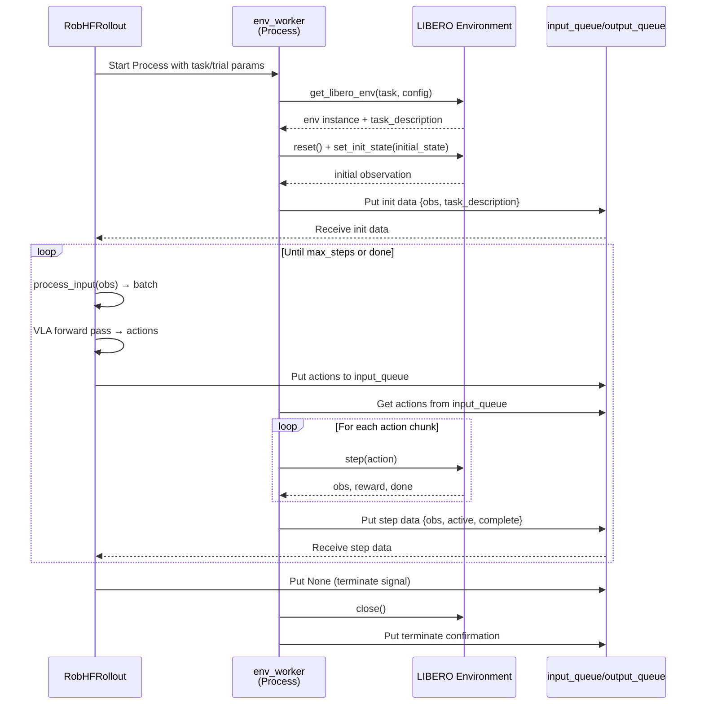
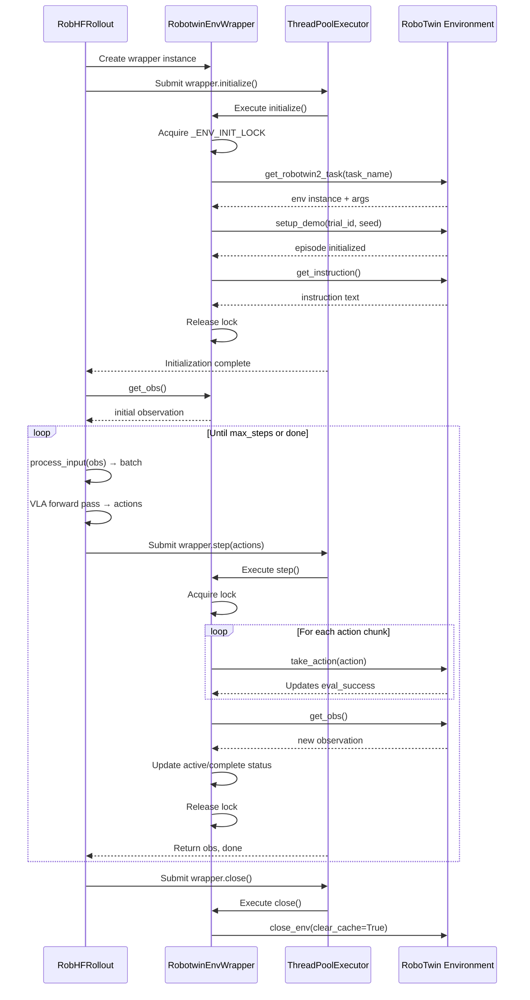
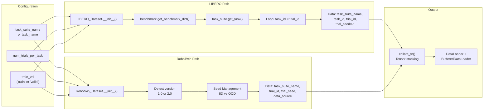
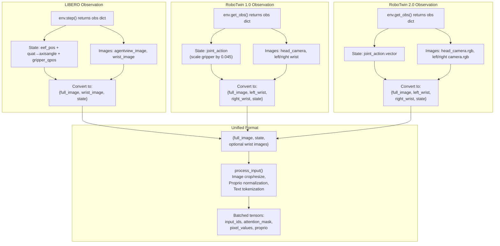

<!-- source: DeepWiki mcp.deepwiki.com · repo PRIME-RL/SimpleVLA-RL · page 4 Benchmarks and Environments · fetched 2026-10-30 -->

# Benchmarks and Environments

<details>
<summary>Relevant source files</summary>

The following files were used as context for generating this wiki page:

- [README.md](README.md)
- [verl/utils/dataset/rob_dataset.py](verl/utils/dataset/rob_dataset.py)
- [verl/workers/rollout/rob_rollout.py](verl/workers/rollout/rob_rollout.py)

</details>


This page documents the simulation benchmarks supported by SimpleVLA-RL and how they integrate with the training pipeline. SimpleVLA-RL currently supports two major robotic manipulation benchmarks: **LIBERO** and **RoboTwin** (versions 1.0 and 2.0). These benchmarks provide diverse task suites for training and evaluating Vision-Language-Action models using binary (0/1) outcome rewards.

For detailed information about specific benchmarks, see [LIBERO Benchmark](#4.1) and [RoboTwin Benchmark](#4.2). For information about how rollout workers interact with these environments, see [Rollout Workers](#4.3). For dataset construction and data loading, see [Dataset Classes](#5.1).

## Supported Benchmarks Overview

SimpleVLA-RL supports two primary benchmark families, each with distinct characteristics for robotic manipulation tasks:

### Benchmark Comparison

| Feature | LIBERO | RoboTwin 1.0 | RoboTwin 2.0 |
|---------|--------|--------------|--------------|
| **Task Suites** | libero-10, libero-90, libero-spatial, libero-object, libero-goal | 17 predefined tasks | 21 predefined tasks |
| **Seed Management** | Fixed seed (-1) per trial | Offset-based generation | Pre-collected feasible seeds |
| **Camera Views** | 2 (head, wrist) | 3 (head, left wrist, right wrist) | 3 (head, left wrist, right wrist) |
| **Action Dimensions** | 7D (xyz + quat + gripper) | 14D (dual-arm) | 7D per arm (dual-arm) |
| **Action Chunks** | 8 | Not specified | 5 |
| **Parallel Execution** | multiprocessing (Process-based) | Threading (ThreadPoolExecutor) | Threading (ThreadPoolExecutor) |
| **Max Episode Steps** | 512 | Task-dependent | 75-800 (task-dependent) |
| **Normalization Type** | bounds/bounds_q99 | bounds/bounds_q99 | bounds/bounds_q99 |

**Sources:** [verl/workers/rollout/rob_rollout.py:429-456](), [verl/utils/dataset/rob_dataset.py:65-219]()

## System Architecture

The benchmark environments integrate with the training system through a multi-layer architecture that separates data generation, environment management, and action execution:



**Sources:** [verl/workers/rollout/rob_rollout.py:424-502](), [verl/utils/dataset/rob_dataset.py:38-256]()

## Environment Lifecycle

Environments in SimpleVLA-RL follow different lifecycle patterns depending on the benchmark:

### LIBERO Environment Lifecycle



**Sources:** [verl/workers/rollout/rob_rollout.py:772-886](), [verl/workers/rollout/rob_rollout.py:334-420]()

### RoboTwin Environment Lifecycle



**Sources:** [verl/workers/rollout/rob_rollout.py:604-770](), [verl/workers/rollout/rob_rollout.py:233-331]()

## Task Selection and Configuration

Benchmark tasks are selected and configured through the dataset classes, which generate training and validation samples:

### Task Suite Names

**LIBERO Suites:**
- `libero_10`: 10 diverse manipulation tasks
- `libero_90`: 90 tasks for comprehensive evaluation
- `libero_spatial`: Spatial reasoning tasks
- `libero_object`: Object manipulation tasks
- `libero_goal`: Goal-based tasks

**RoboTwin Tasks:**
RoboTwin 1.0 includes 17 tasks (e.g., `robotwin_block_hammer_beat`, `robotwin_dual_bottles_pick_easy`), while RoboTwin 2.0 includes 21 tasks (e.g., `robotwin2_click_bell`, `robotwin2_handover_mic`, `robotwin2_stack_blocks_two`).

**Sources:** [verl/utils/dataset/rob_dataset.py:83-133](), [README.md:52]()

### Dataset Construction Flow



**Sources:** [verl/utils/dataset/rob_dataset.py:65-219]()

## Key Differences in Environment Interaction

### Parallel Execution Strategies

The choice of parallelization strategy reflects the characteristics of each benchmark:

**LIBERO (Process-based):**
- Uses `multiprocessing.Process` with `Queue` for inter-process communication
- Strong isolation between environment instances
- Suitable for environments that may have global state or C++ bindings
- Each worker process runs `env_worker()` function independently
- Communication via `input_queue` (for actions) and `output_queue` (for observations)

**RoboTwin (Thread-based):**
- Uses `ThreadPoolExecutor` with `threading.Lock` for synchronization
- Lightweight concurrency with shared memory
- `RobotwinEnvWrapper` ensures thread-safety with per-instance locks
- Global `_ENV_INIT_LOCK` prevents race conditions during initialization
- More efficient for environments with frequent small communications

**Sources:** [verl/workers/rollout/rob_rollout.py:64-70](), [verl/workers/rollout/rob_rollout.py:334-420](), [verl/workers/rollout/rob_rollout.py:233-331]()

### Observation Processing

Observations from both benchmarks are converted to a unified format by `_obs_to_input()`:



**Sources:** [verl/workers/rollout/rob_rollout.py:1085-1126](), [verl/workers/rollout/rob_rollout.py:504-595]()

## Environment-Specific Utilities

### LIBERO Utilities

LIBERO-specific helper functions are located in `verl/utils/libero_utils.py` and include:
- `get_libero_env()`: Creates LIBERO environment instances with appropriate configuration
- `get_libero_image()`: Extracts and processes head camera images
- `get_libero_wrist_image()`: Extracts wrist camera images
- `get_libero_dummy_action()`: Generates no-op actions for environment warm-up
- `normalize_gripper_action()`: Normalizes gripper commands
- `invert_gripper_action()`: Inverts gripper action convention
- `quat2axisangle()`: Converts quaternion to axis-angle representation
- `save_rollout_video()`: Saves validation videos

**Sources:** [verl/workers/rollout/rob_rollout.py:32-41]()

### RoboTwin Utilities

RoboTwin-specific functionality includes:
- `get_robotwin2_task()`: Loads and configures RoboTwin 2.0 tasks with embodiment settings
- `normalize_proprio()`: Normalizes proprioception data using task-specific statistics
- `encode_obs()`: Post-processes observations (currently a pass-through)
- `RobotwinEnvWrapper`: Thread-safe wrapper providing `initialize()`, `get_obs()`, `get_instruction()`, `step()`, and `close()` methods

**Sources:** [verl/workers/rollout/rob_rollout.py:153-331]()

## Maximum Episode Steps Configuration

Each task has a predefined maximum number of steps, configured in `RobHFRollout.__init__()`:

```python
self.max_steps = {
    "libero_spatial": 512,
    "libero_object": 512,
    "libero_goal": 512,
    "libero_10": 512,
    "libero_90": 512,
    "robotwin2_click_bell": 200,
    "robotwin2_handover_mic": 200,
    "robotwin2_shake_bottle": 75,
    "robotwin2_put_bottles_dustbin": 800,
    # ... (21 RoboTwin 2.0 tasks total)
}
```

These limits prevent infinite loops and ensure consistent episode lengths across training runs. The actual episode may terminate earlier if the task is completed (`done=True`) or fails.

**Sources:** [verl/workers/rollout/rob_rollout.py:429-456]()

## Integration with Training Pipeline

The benchmark environments integrate into the PPO training loop through the following flow:

1. **Dataset Generation**: `LIBERO_Dataset` or `Robotwin_Dataset` creates training samples with task/trial metadata
2. **Batch Loading**: `BufferedDataLoader` fetches batches and manages excess samples from filtering
3. **Rollout Generation**: `RobHFRollout.generate_sequences()` creates environment instances, runs VLA inference, collects trajectories
4. **Reward Collection**: Binary rewards (0/1) are extracted from environment completion status
5. **Trajectory Return**: Complete episodes with observations, actions, and rewards are returned to the trainer

For details on the training loop, see [PPO Training Loop](#3.1). For data pipeline details, see [Data Pipeline](#5).

**Sources:** [verl/trainer/ppo/ray_trainer.py:68-82](), [verl/workers/rollout/rob_rollout.py:490-502]()

---

