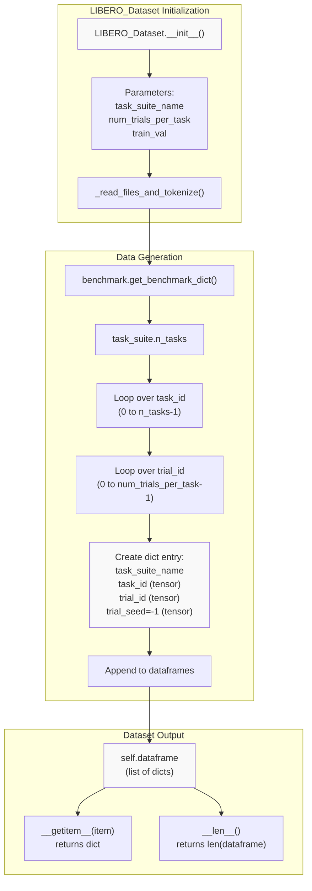
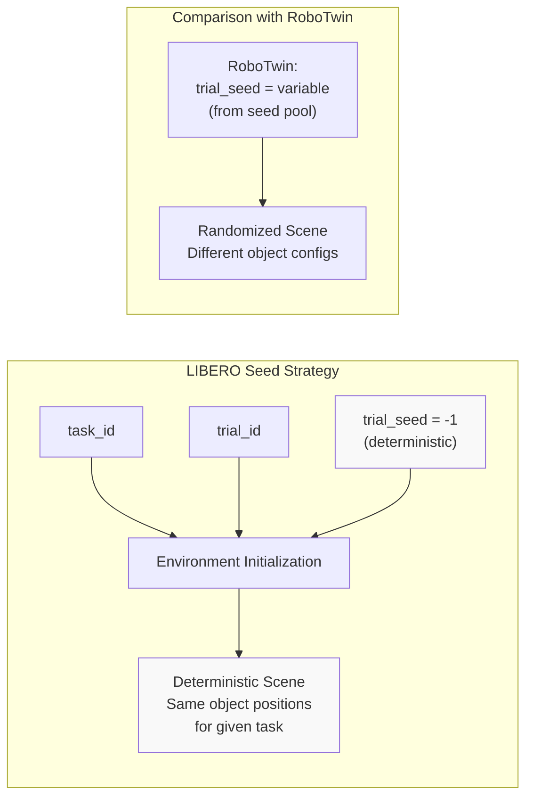
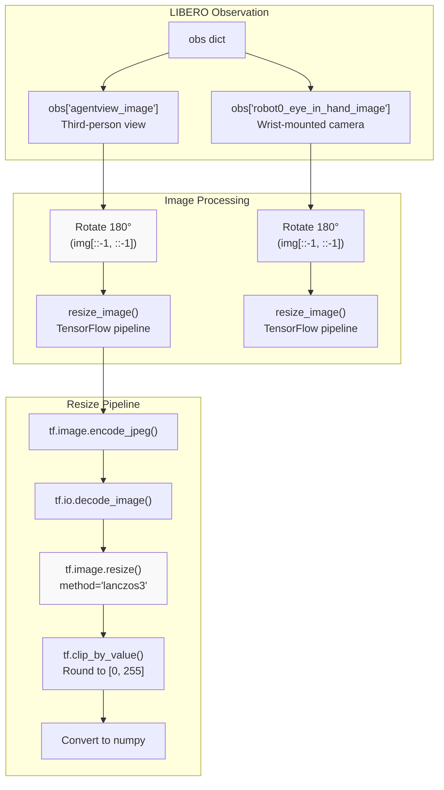
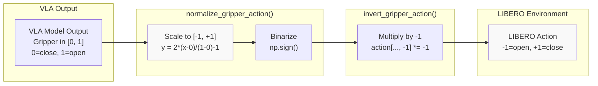
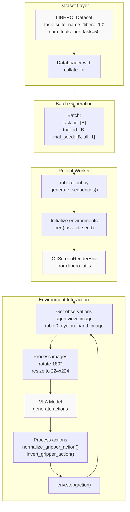

<!-- source: DeepWiki mcp.deepwiki.com · repo PRIME-RL/SimpleVLA-RL · page 4.1 LIBERO Benchmark · fetched 2026-10-30 -->

# LIBERO Benchmark

<details>
<summary>Relevant source files</summary>

The following files were used as context for generating this wiki page:

- [examples/run_openvla_oft_rl_libero.sh](examples/run_openvla_oft_rl_libero.sh)
- [verl/utils/dataset/rob_dataset.py](verl/utils/dataset/rob_dataset.py)
- [verl/utils/libero_utils.py](verl/utils/libero_utils.py)

</details>


## Purpose and Scope

This page documents the **LIBERO benchmark** integration in SimpleVLA-RL, including task suite structures, dataset management, environment utilities, and LIBERO-specific configurations. LIBERO (Language-grounded Benchmarks for Robot learning) provides manipulation tasks with natural language instructions across multiple difficulty levels and task categories.

For information about the RoboTwin benchmark, see [RoboTwin Benchmark](#4.2). For details on how rollout workers interact with environments during training, see [Rollout Workers](#4.3). For dataset loading mechanics shared across benchmarks, see [Dataset Classes](#5.1).

---

## LIBERO Task Suites

LIBERO organizes tasks into five distinct suites, each designed to evaluate different aspects of robot manipulation capabilities:

| Suite Name | Number of Tasks | Description | Key in Config |
|------------|----------------|-------------|---------------|
| **LIBERO-10** (LIBERO-Long) | 10 | Long-horizon manipulation tasks requiring multiple steps | `libero_10` |
| **LIBERO-90** | 90 | Large-scale diverse manipulation tasks | `libero_90` |
| **LIBERO-Spatial** | 10 | Tasks focusing on spatial reasoning | `libero_spatial` |
| **LIBERO-Object** | 10 | Tasks emphasizing object manipulation | `libero_object` |
| **LIBERO-Goal** | 10 | Tasks with varied goal specifications | `libero_goal` |

The task suite is selected via the `data.task_suite_name` configuration parameter and determines which benchmark tasks will be used during training and evaluation.

**Sources:** [verl/utils/dataset/rob_dataset.py:83-102](), [examples/run_openvla_oft_rl_libero.sh:15-16]()

---

## Dataset Architecture

### LIBERO_Dataset Class

The `LIBERO_Dataset` class manages LIBERO task data for training and validation. It generates a structured dataset of task trials without loading actual trajectory data, as trajectories are collected online during RL training.



**Dataset Entry Structure**

Each dataset entry is a dictionary containing:
- `task_suite_name`: String identifying the LIBERO suite (e.g., `"libero_10"`)
- `task_id`: `torch.int64` tensor with shape `[1]`, value in range `[0, n_tasks-1]`
- `trial_id`: `torch.int64` tensor with shape `[1]`, value in range `[0, num_trials_per_task-1]`
- `trial_seed`: `torch.int64` tensor with shape `[1]`, fixed value `-1` (indicates deterministic environment initialization)

**Sources:** [verl/utils/dataset/rob_dataset.py:65-109]()

---

## Deterministic Seed Management

Unlike RoboTwin, LIBERO uses **deterministic environment initialization** with a fixed seed value of `-1`. This means:

1. All LIBERO environments are initialized with the same seed configuration
2. Object positions and scene layouts are deterministic for a given task
3. The environment behavior depends only on the `task_id`, not on variable seeds
4. Both training and validation use the same seed strategy

This deterministic approach simplifies LIBERO data generation but provides less scene variation compared to RoboTwin's seed-based randomization.



**Sources:** [verl/utils/dataset/rob_dataset.py:96]()

---

## Environment Utilities

The `verl/utils/libero_utils.py` module provides LIBERO-specific utilities for environment initialization, image processing, and action handling.

### Environment Initialization

The `get_libero_env()` function initializes a LIBERO simulation environment:

```python
def get_libero_env(task, model_family, resolution=256)
```

**Parameters:**
- `task`: LIBERO task object containing language description and BDDL file path
- `model_family`: Model identifier (e.g., `"openvla"`)
- `resolution`: Camera resolution (default: 256x256 pixels)

**Returns:**
- `env`: `OffScreenRenderEnv` instance for off-screen rendering
- `task_description`: Natural language instruction string

**Key Implementation Details:**
- Retrieves BDDL (Behavior Domain Definition Language) file path from task configuration
- Initializes environment with specified camera resolution
- Sets deterministic seed (`env.seed(0)`) for reproducible object positions

**Sources:** [verl/utils/libero_utils.py:22-31]()

---

## Image Processing Pipeline

LIBERO environments provide multiple camera views that must be preprocessed before being fed to VLA models.

### Camera Views and Extraction



**Image Rotation**: LIBERO images must be rotated 180 degrees (`img[::-1, ::-1]`) to match the preprocessing applied during VLA model training. This ensures consistency between training and deployment.

**Resize Method**: The system uses TensorFlow's Lanczos3 interpolation (`method="lanczos3"`) to maintain visual quality during resizing. The image is first JPEG-encoded and decoded to match the RLDS dataset builder format used during training.

**Sources:** [verl/utils/libero_utils.py:39-76]()

---

## Action Space and Processing

### Action Space Structure

LIBERO uses a **7-dimensional action space**:

| Dimension | Description | Range |
|-----------|-------------|-------|
| 0-2 | End-effector position (x, y, z) | Continuous |
| 3-6 | End-effector orientation (quaternion) | Continuous |
| 6 | Gripper state | Binary: -1 (open) / +1 (close) |

The platform is configured via `ROBOT_PLATFORM=LIBERO` environment variable, which sets action dimension to 7 and chunk length to 8 via the `constants.py` module.

**Sources:** [examples/run_openvla_oft_rl_libero.sh:9](), [examples/run_openvla_oft_rl_libero.sh:38-39]()

### Gripper Action Processing

LIBERO requires specific gripper action transformations:



**`normalize_gripper_action()`**: Converts gripper action from `[0, 1]` range (dataset convention) to `[-1, +1]` range. With `binarize=True`, applies sign function to produce binary values.

**`invert_gripper_action()`**: Flips gripper action sign because LIBERO uses opposite convention (`-1`=open, `+1`=close) compared to RLDS dataloader (`0`=close, `1`=open).

**Sources:** [verl/utils/libero_utils.py:156-215]()

### Quaternion Utilities

The `quat2axisangle()` function converts quaternion orientation to axis-angle representation:

- **Input**: `(x, y, z, w)` quaternion (4D)
- **Output**: `(ax, ay, az)` axis-angle exponential coordinates (3D)
- **Implementation**: Copied from robosuite for compatibility

This utility is used when converting between different rotation representations in the action space.

**Sources:** [verl/utils/libero_utils.py:94-118]()

---

## Configuration and Execution

### Training Script Configuration

The example training script `examples/run_openvla_oft_rl_libero.sh` demonstrates LIBERO-specific configuration:

**Key Parameters:**

| Parameter | Value | Purpose |
|-----------|-------|---------|
| `ROBOT_PLATFORM` | `LIBERO` | Sets platform-specific constants |
| `DATASET_NAME` | `libero_10`, `libero_90`, etc. | Selects task suite |
| `data.num_trials_per_task` | `50` | Number of trials per task in dataset |
| `actor_rollout_ref.model.action_chunks_len` | `8` | Temporal action sequence length for LIBERO |
| `actor_rollout_ref.rollout.unnorm_key` | `$DATASET_NAME` | Specifies unnormalization scheme |

**Environment Variable:**
```bash
export ROBOT_PLATFORM=LIBERO
```

This environment variable must be set before training to ensure the `constants.py` module configures LIBERO-specific parameters (action dimensions, chunk length, normalization bounds).

**Sources:** [examples/run_openvla_oft_rl_libero.sh:9](), [examples/run_openvla_oft_rl_libero.sh:15-16](), [examples/run_openvla_oft_rl_libero.sh:26](), [examples/run_openvla_oft_rl_libero.sh:38-39](), [examples/run_openvla_oft_rl_libero.sh:62-64]()

---

## Data Collation

The `collate_fn()` function combines dataset entries into batches:

**Functionality:**
1. Separates dictionary entries into tensors and non-tensors
2. Stacks tensors along batch dimension using `torch.stack()`
3. Converts non-tensor lists to `numpy.array` with `dtype=object`
4. Returns combined dictionary with both tensor and array types

This collation strategy allows batching of mixed data types, including task metadata (tensors) and variable-length information (object arrays).

**Sources:** [verl/utils/dataset/rob_dataset.py:38-62]()

---

## Validation and Video Logging

The `save_rollout_video()` function creates MP4 videos of task rollouts for visualization and debugging:

**Function Signature:**
```python
def save_rollout_video(rollout_images, exp_name, task_name, step_idx, success)
```

**Parameters:**
- `rollout_images`: List of image frames from episode
- `exp_name`: Experiment name for organizing videos
- `task_name`: Task identifier
- `step_idx`: Training step number
- `success`: Boolean indicating task completion

**Output Location:**
```
./rollouts/{exp_name}/step={step_idx}--task={task_name}--success={success}--ran={random_id}.mp4
```

Videos are saved at 30 FPS and provide visual verification of policy behavior during validation phases.

**Sources:** [verl/utils/libero_utils.py:217-229]()

---

## Integration with Training Pipeline

### Dataset to Rollout Flow



**Key Integration Points:**

1. **Dataset Generation**: `LIBERO_Dataset` creates metadata entries without loading trajectories
2. **Batch Collation**: `collate_fn()` combines entries into batched tensors
3. **Environment Creation**: Rollout worker uses `get_libero_env()` to initialize environments
4. **Image Processing**: Uses `get_libero_image()` and `resize_image()` for preprocessing
5. **Action Processing**: Applies `normalize_gripper_action()` and `invert_gripper_action()` to model outputs
6. **Execution**: Sends processed actions to LIBERO environment via `env.step()`

**Sources:** [verl/utils/dataset/rob_dataset.py:65-109](), [verl/utils/libero_utils.py:22-76](), [verl/utils/libero_utils.py:156-215]()

---

## Summary

The LIBERO benchmark integration in SimpleVLA-RL provides:

- **Five task suites** (`libero_10`, `libero_90`, `libero_spatial`, `libero_object`, `libero_goal`) covering diverse manipulation scenarios
- **Deterministic seed management** with fixed `trial_seed=-1` for reproducible environments
- **Comprehensive image processing** with 180° rotation and TensorFlow-based resizing
- **7D action space** with position, quaternion orientation, and binary gripper
- **Gripper action transformations** to handle convention differences between VLA models and LIBERO environments
- **Video logging utilities** for visualizing and debugging policy rollouts
- **Seamless integration** with the PPO training pipeline through standardized dataset and rollout interfaces

---

