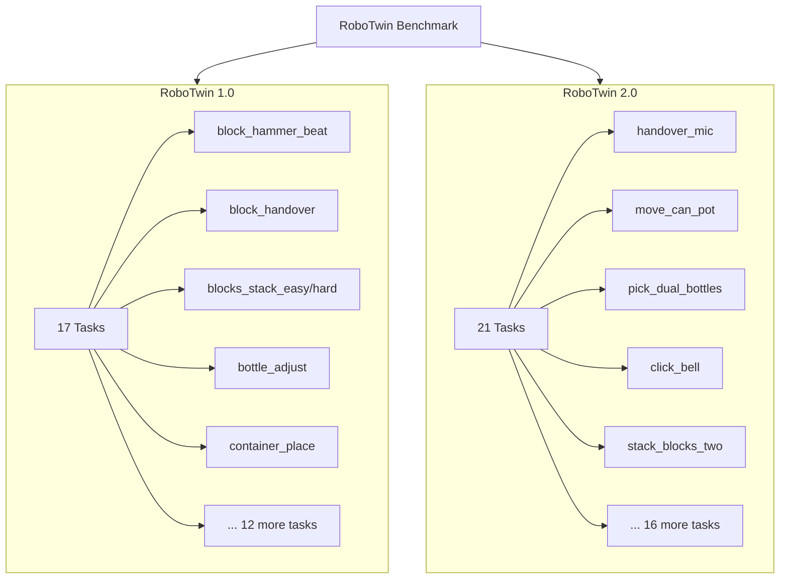
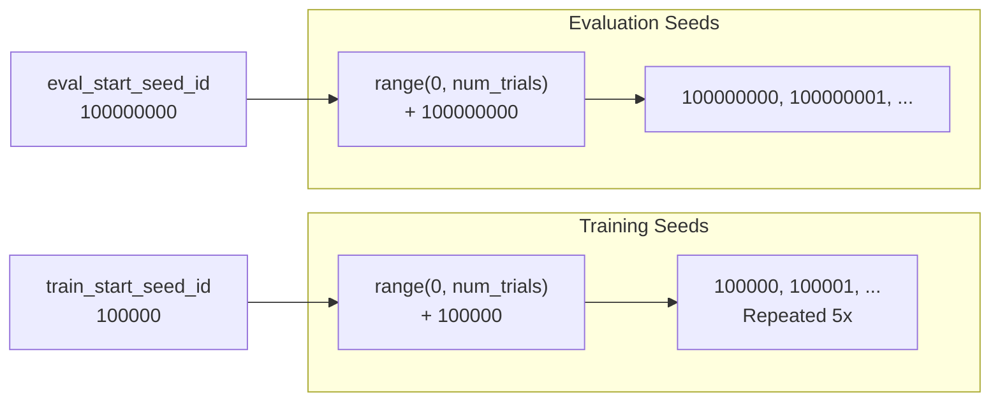
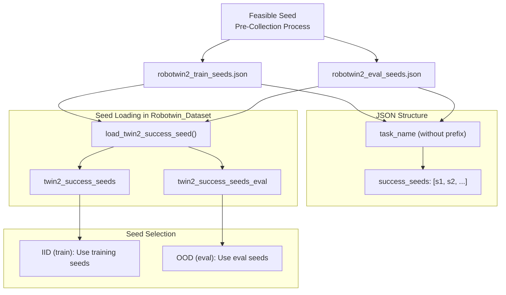
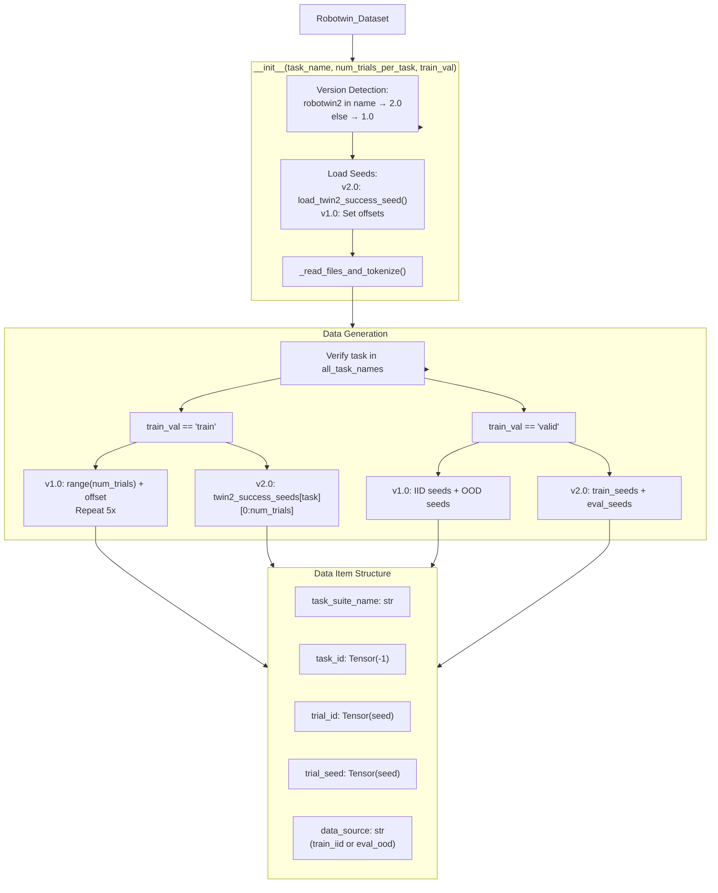
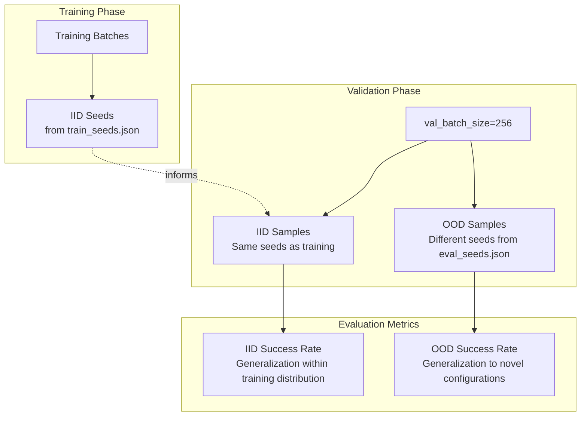
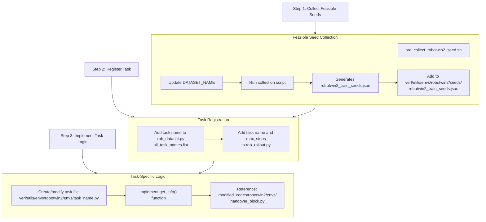

<!-- source: DeepWiki mcp.deepwiki.com · repo PRIME-RL/SimpleVLA-RL · page 4.2 RoboTwin Benchmark · fetched 2026-10-30 -->

# RoboTwin Benchmark

<details>
<summary>Relevant source files</summary>

The following files were used as context for generating this wiki page:

- [SETUP.md](SETUP.md)
- [examples/run_openvla_oft_rl_twin2.sh](examples/run_openvla_oft_rl_twin2.sh)
- [verl/utils/dataset/rob_dataset.py](verl/utils/dataset/rob_dataset.py)

</details>


This document covers the RoboTwin benchmark integration in SimpleVLA-RL, including both RoboTwin 1.0 and 2.0 versions. It explains task structure, seed management strategies, dataset implementation, and the process for extending the benchmark with new tasks. For information about the LIBERO benchmark, see [LIBERO Benchmark](#4.1). For details on how rollout workers interact with these environments, see [Rollout Workers](#4.3).

## Overview

RoboTwin is a bimanual robot manipulation benchmark that provides diverse long-horizon tasks for training and evaluating vision-language-action models. SimpleVLA-RL supports both RoboTwin 1.0 (17 tasks) and RoboTwin 2.0 (21 tasks). Unlike LIBERO, RoboTwin requires sophisticated seed management because environment initializations can produce infeasible object configurations (e.g., objects placed beyond the robot's reach).

### Supported Versions and Tasks



**Sources:** [verl/utils/dataset/rob_dataset.py:119-133]()

The complete task lists are defined in the `Robotwin_Dataset` class:

| Version | Task Count | Task Name Prefix | Example Tasks |
|---------|------------|------------------|---------------|
| 1.0 | 17 | `robotwin_` | `robotwin_block_hammer_beat`, `robotwin_dual_bottles_pick_easy` |
| 2.0 | 21 | `robotwin2_` | `robotwin2_handover_mic`, `robotwin2_stack_blocks_two` |

## Seed Management Strategy

RoboTwin's seed management is critical for training efficiency. Each environment initialization uses a seed to randomize object placements, but not all seeds produce feasible configurations.

### RoboTwin 1.0: Offset-Based Seeds



**Sources:** [verl/utils/dataset/rob_dataset.py:142-143](), [verl/utils/dataset/rob_dataset.py:175-187]()

RoboTwin 1.0 uses a simple offset-based approach:
- **Training seeds**: Start at 100,000 and increment by trial index
- **Evaluation seeds**: Start at 100,000,000 to ensure non-overlapping configurations
- Training dataset repeats seeds 5× to ensure sufficient batches

This approach does not filter infeasible seeds, which can lead to wasted rollouts on unsolvable scenarios.

### RoboTwin 2.0: Feasible Seed Pre-Collection



**Sources:** [verl/utils/dataset/rob_dataset.py:146-164](), [SETUP.md:133-150]()

RoboTwin 2.0 employs a sophisticated seed management system:

1. **Pre-Collection Phase**: Before training, feasible seeds are collected by running multiple environment initializations and recording which seeds produce solvable configurations.

2. **Storage**: Seeds are stored in JSON files at `verl/utils/envs/robotwin2/seeds/`:
   - `robotwin2_train_seeds.json`: Seeds for IID training
   - `robotwin2_eval_seeds.json`: Seeds for OOD evaluation

3. **JSON Format**:
```json
{
  "task_name": {
    "success_seeds": [seed1, seed2, seed3, ...]
  }
}
```

4. **Loading**: The `load_twin2_success_seed()` method reads these files and populates dictionaries keyed by `robotwin2_` prefixed task names.

5. **Selection**: During dataset construction, seeds are selected from the appropriate list based on split (training vs validation) and evaluation mode (IID vs OOD).

## Dataset Implementation

The `Robotwin_Dataset` class manages task data generation for both RoboTwin versions.



**Sources:** [verl/utils/dataset/rob_dataset.py:111-219]()

### Key Implementation Details

**Version Detection** ([verl/utils/dataset/rob_dataset.py:113-116]()):
```python
if "robotwin2" in task_name:
    self.version = "2.0"
else:
    self.version = "1.0"
```

**Task Lists** ([verl/utils/dataset/rob_dataset.py:118-133]()):
- Version 1.0: 17 tasks stored in `self.all_task_names` with `robotwin_` prefix
- Version 2.0: 21 tasks stored in `self.all_task_names` with `robotwin2_` prefix

**Data Item Structure** ([verl/utils/dataset/rob_dataset.py:190-197]()):
Each item in the dataset contains:
- `task_suite_name`: Full task name (e.g., `robotwin2_handover_mic`)
- `task_id`: Always `-1` for RoboTwin (unlike LIBERO which uses task indices)
- `trial_id`: The seed value
- `trial_seed`: Duplicate of trial_id for compatibility
- `data_source`: Indicates split type (`{task_name}_train_iid` or `{task_name}_eval_ood`)

## Training and Evaluation Splits

RoboTwin 2.0 distinguishes between in-distribution (IID) and out-of-distribution (OOD) evaluation:



**Sources:** [verl/utils/dataset/rob_dataset.py:199-208](), [examples/run_openvla_oft_rl_twin2.sh:34]()

### Validation Dataset Construction

For RoboTwin 2.0 validation ([verl/utils/dataset/rob_dataset.py:170-208]()):
1. **IID Split**: Uses `num_trials_per_task` seeds from `twin2_success_seeds` (training seeds)
2. **OOD Split**: Uses `num_trials_per_task` seeds from `twin2_success_seeds_eval` (evaluation seeds)
3. Both splits are concatenated into a single validation dataset
4. The `data_source` field distinguishes between `train_iid` and `eval_ood` samples

This dual-split approach enables measuring both:
- **Overfitting**: Low IID success suggests insufficient training
- **Generalization**: Gap between IID and OOD success indicates generalization capability

## Configuration Parameters

RoboTwin-specific configuration parameters in training scripts:

| Parameter | Purpose | Example Value | Location |
|-----------|---------|---------------|----------|
| `data.task_suite_name` | Task selection | `robotwin2_handover_mic` | [examples/run_openvla_oft_rl_twin2.sh:26]() |
| `actor_rollout_ref.rollout.twin2_task_config` | Task difficulty | `demo_randomized` | [examples/run_openvla_oft_rl_twin2.sh:58]() |
| `actor_rollout_ref.rollout.twin2_instruction_type` | Instruction set | `seen` | [examples/run_openvla_oft_rl_twin2.sh:59]() |
| `actor_rollout_ref.rollout.unnorm_key` | Normalization statistics | `robotwin2_{task}_1k` | [examples/run_openvla_oft_rl_twin2.sh:66]() |
| `data.num_trials_per_task` | Seeds per task | 1000 (training), 128 (validation) | [examples/run_openvla_oft_rl_twin2.sh:27](), [verl/utils/dataset/rob_dataset.py:137]() |

**Sources:** [examples/run_openvla_oft_rl_twin2.sh:26-72]()

## Adding New Tasks

The process for extending RoboTwin 2.0 with additional tasks involves three steps:



**Sources:** [SETUP.md:133-165]()

### Step 1: Collect Feasible Seeds

Pre-collection ensures training only uses reachable object configurations:

1. Update `DATASET_NAME` in `pre_collect_robotwin2_seed.sh` to your target task
2. Execute the script: `sh pre_collect_robotwin2_seed.sh`
3. The script generates `robotwin2_train_seeds.json` in the project root
4. Merge the generated content into `verl/utils/envs/robotwin2/seeds/robotwin2_train_seeds.json`

This process typically requires running multiple environment initializations to identify which seeds produce solvable scenarios.

### Step 2: Register Task

Update two files to register the new task:

**rob_dataset.py** ([verl/utils/dataset/rob_dataset.py:122-133]()):
Add the task name (without `robotwin2_` prefix) to the `all_task_names` list in the version 2.0 section.

**rob_rollout.py** (referenced in [SETUP.md:155]()):
Add the task name and corresponding maximum episode steps mapping for environment configuration.

### Step 3: Implement Task-Specific Functions

Add a `get_info()` function in the task's environment file at `verl/utils/envs/robotwin2/envs/task_name.py`. This function provides task-specific metadata for rollout workers.

For implementation reference, see the example provided in `modified_codes/robotwin2/envs/handover_block.py` (mentioned in [SETUP.md:162-164]()).

## Differences from LIBERO

Key distinctions between RoboTwin and LIBERO integration:

| Aspect | LIBERO | RoboTwin |
|--------|--------|----------|
| **Task ID** | Sequential indices (0 to N-1) | Fixed at -1 |
| **Seed Management** | Fixed seed (-1), deterministic | Version-dependent (offsets or pre-collected) |
| **Feasibility** | All seeds assumed feasible | Requires seed pre-collection (v2.0) |
| **Parallelism** | Process-based (`multiprocessing.Process`) | Thread-based (`ThreadPoolExecutor`) |
| **Evaluation Splits** | Single validation set | IID and OOD splits |
| **Task Count** | 10/90/suite-specific | 17 (v1.0) or 21 (v2.0) |

**Sources:** [verl/utils/dataset/rob_dataset.py:65-110](), [verl/utils/dataset/rob_dataset.py:111-219]()

## Platform Configuration

RoboTwin requires setting the `ROBOT_PLATFORM` environment variable to `ALOHA`:

```bash
export ROBOT_PLATFORM=ALOHA
```

This configures platform-specific parameters like action dimensions (14D for bimanual), normalization bounds, and action chunk lengths (6-25 chunks). For details on platform configuration, see [Platform Configuration](#2.2).

**Sources:** [examples/run_openvla_oft_rl_twin2.sh:9]()

---

