<!-- source: DeepWiki mcp.deepwiki.com · repo PRIME-RL/SimpleVLA-RL · page 4.3 Rollout Workers · fetched 2026-10-30 -->

# Rollout Workers

<details>
<summary>Relevant source files</summary>

The following files were used as context for generating this wiki page:

- [README.md](README.md)
- [verl/workers/rollout/rob_rollout.py](verl/workers/rollout/rob_rollout.py)

</details>


## Purpose and Scope

This page documents the rollout worker system implemented in `rob_rollout.py`, which manages environment interactions, action generation, and trajectory collection during both training and evaluation. The rollout workers serve as the bridge between the VLA models and simulation environments, handling parallel execution, multi-modal input processing, and reward collection.

For information about the specific environments and task definitions, see [LIBERO Benchmark](#4.1) and [RoboTwin Benchmark](#4.2). For details on how rollouts are used in the training loop, see [PPO Training Loop](#3.1).

**Sources:** [verl/workers/rollout/rob_rollout.py:1-67]()

---

## Architecture Overview

The rollout system is centered on the `RobHFRollout` class, which implements the `BaseRollout` interface. The system uses benchmark-specific execution strategies and environment wrappers to handle the unique requirements of LIBERO and RoboTwin.

```mermaid
graph TB
    subgraph "Rollout System"
        RobHFRollout["RobHFRollout<br/>(Main Rollout Class)"]
        BaseRollout["BaseRollout<br/>(Base Interface)"]
        
        RobHFRollout -->|"inherits"| BaseRollout
    end
    
    subgraph "VLA Integration"
        Module["nn.Module<br/>(VLA Model)"]
        Processor["AutoProcessor<br/>(Text/Image Tokenization)"]
        
        RobHFRollout -->|"uses"| Module
        RobHFRollout -->|"uses"| Processor
    end
    
    subgraph "Environment Wrappers"
        RobotwinWrapper["RobotwinEnvWrapper<br/>(Thread-safe wrapper)"]
        LiberoWorker["env_worker<br/>(Process-based worker)"]
        
        RobHFRollout -->|"creates for RoboTwin"| RobotwinWrapper
        RobHFRollout -->|"spawns for LIBERO"| LiberoWorker
    end
    
    subgraph "Execution Pools"
        ThreadPool["ThreadPoolExecutor<br/>(max_workers=16)"]
        ProcessPool["multiprocessing.Process<br/>(one per environment)"]
        
        RobHFRollout -->|"manages"| ThreadPool
        RobHFRollout -->|"manages"| ProcessPool
    end
    
    subgraph "Helper Functions"
        ProcessInput["process_input()<br/>(Multi-modal preprocessing)"]
        GenerateOneStep["_generate_one_step()<br/>(VLA action generation)"]
        ObsToInput["_obs_to_input()<br/>(Observation conversion)"]
        
        RobHFRollout -->|"calls"| ProcessInput
        RobHFRollout -->|"calls"| GenerateOneStep
        RobHFRollout -->|"calls"| ObsToInput
    end
```

**Key Components:**

| Component | Type | Purpose |
|-----------|------|---------|
| `RobHFRollout` | Class | Main rollout orchestrator implementing `BaseRollout` |
| `RobotwinEnvWrapper` | Class | Thread-safe wrapper for RoboTwin environments |
| `env_worker` | Function | Process-based worker for LIBERO environments |
| `ThreadPoolExecutor` | Pool | Manages concurrent RoboTwin environments |
| `multiprocessing.Process` | Pool | Manages isolated LIBERO environments |

**Sources:** [verl/workers/rollout/rob_rollout.py:424-458](), [verl/workers/rollout/rob_rollout.py:233-331](), [verl/workers/rollout/rob_rollout.py:334-420]()

---

## Initialization and Configuration

The `RobHFRollout` class is initialized with a VLA model and configuration that specifies benchmark-specific parameters.

### Configuration Parameters

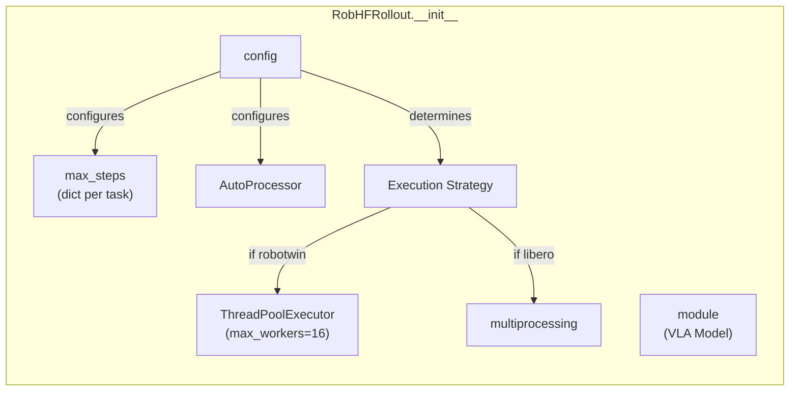

**Max Steps by Task:** The system defines maximum episode lengths for each task suite:

| Task Suite | Max Steps | Notes |
|------------|-----------|-------|
| `libero_*` | 512 | All LIBERO tasks |
| `robotwin2_click_bell` | 200 | Example RoboTwin task |
| `robotwin2_shake_bottle` | 75 | Shortest RoboTwin task |
| `robotwin2_put_bottles_dustbin` | 800 | Longest RoboTwin task |

**Sources:** [verl/workers/rollout/rob_rollout.py:424-473]()

---

## Execution Strategy: LIBERO vs RoboTwin

The rollout system uses fundamentally different execution strategies for LIBERO and RoboTwin based on their threading requirements and isolation needs.

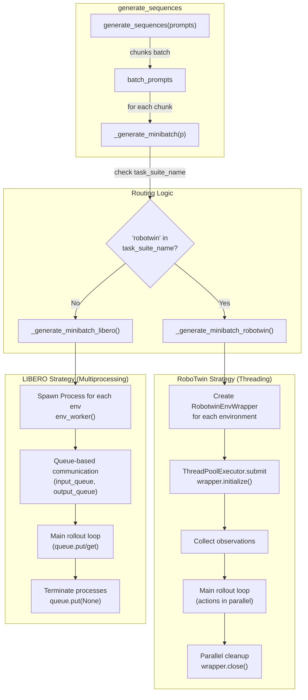

### Why Different Strategies?

| Aspect | LIBERO (Multiprocessing) | RoboTwin (Threading) |
|--------|--------------------------|----------------------|
| **Isolation** | Strong process isolation prevents MuJoCo conflicts | Thread-safe design allows shared memory |
| **Overhead** | Higher memory overhead per environment | Lower memory footprint |
| **Communication** | Queue-based IPC | Direct function calls with locks |
| **Lock Strategy** | N/A (separate processes) | `_ENV_INIT_LOCK` for initialization, per-wrapper locks |
| **Failure Handling** | Process crashes are isolated | Thread failures require careful exception handling |

**Sources:** [verl/workers/rollout/rob_rollout.py:490-502](), [verl/workers/rollout/rob_rollout.py:597-602](), [verl/workers/rollout/rob_rollout.py:604-770](), [verl/workers/rollout/rob_rollout.py:772-886]()

---

## Environment Wrappers

### RobotwinEnvWrapper (Thread-Safe)

The `RobotwinEnvWrapper` provides thread-safe access to RoboTwin environments, supporting both version 1.0 and 2.0.

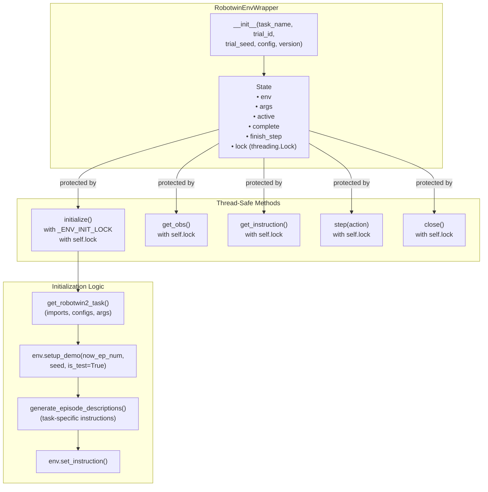

**Key Features:**
- **Global initialization lock (`_ENV_INIT_LOCK`)**: Prevents race conditions during environment creation
- **Per-instance lock (`self.lock`)**: Protects state updates and method calls
- **Error recovery**: Catches exceptions, clears CUDA cache, and retries operations
- **Version support**: Handles both RoboTwin 1.0 and 2.0 with different observation formats

**Sources:** [verl/workers/rollout/rob_rollout.py:69-70](), [verl/workers/rollout/rob_rollout.py:233-331]()

### env_worker (Process-Based for LIBERO)

The `env_worker` function runs in a separate process for each LIBERO environment, communicating via queues.

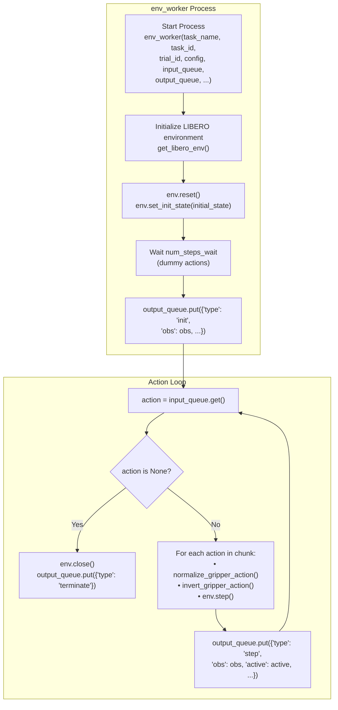

**Communication Protocol:**

| Direction | Message Type | Content |
|-----------|--------------|---------|
| Worker → Main | `'init'` | Initial observation, task description, metadata |
| Worker → Main | `'step'` | Step result, observation, completion status |
| Worker → Main | `'terminate'` | Confirmation of shutdown |
| Main → Worker | `action` | Action chunk to execute |
| Main → Worker | `None` | Shutdown signal |

**Sources:** [verl/workers/rollout/rob_rollout.py:334-420]()

---

## Multi-Modal Input Processing

The `process_input` method converts environment observations into the format required by VLA models, handling images, proprioception, and language prompts.

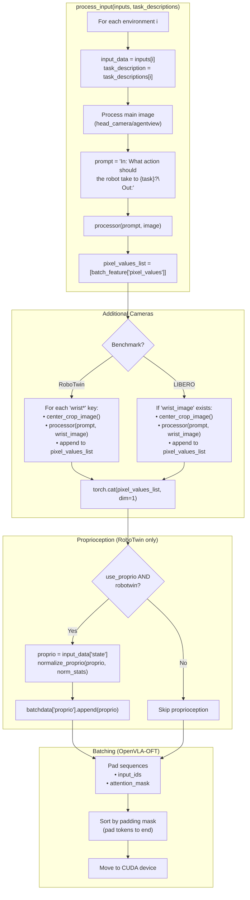

**Image Processing Steps:**

1. **Main camera**: Convert to PIL Image, optionally apply `center_crop_image` (crop scale 0.9)
2. **Wrist cameras**: Process additional camera views (1 for LIBERO, multiple for RoboTwin)
3. **Tokenization**: Use `AutoProcessor` to tokenize prompt and encode images
4. **Concatenation**: Concatenate pixel values from all camera views along dim=1

**Proprioception Normalization (RoboTwin):**

The system uses platform-specific normalization statistics from `norm_stats[unnorm_key]["proprio"]`:

```
normalized = 2 * (proprio - low) / (high - low) - 1
clipped to [-1.0, 1.0]
```

Normalization type is controlled by `ACTION_PROPRIO_NORMALIZATION_TYPE`:
- `"bounds"`: Use `min`/`max` statistics
- `"bounds_q99"`: Use `q01`/`q99` quantiles (more robust to outliers)

**Sources:** [verl/workers/rollout/rob_rollout.py:504-595](), [verl/workers/rollout/rob_rollout.py:129-149](), [verl/workers/rollout/rob_rollout.py:77-125]()

---

## Action Generation

The rollout worker delegates action generation to the VLA model through `_generate_one_step`, which routes to the appropriate implementation based on VLA type.

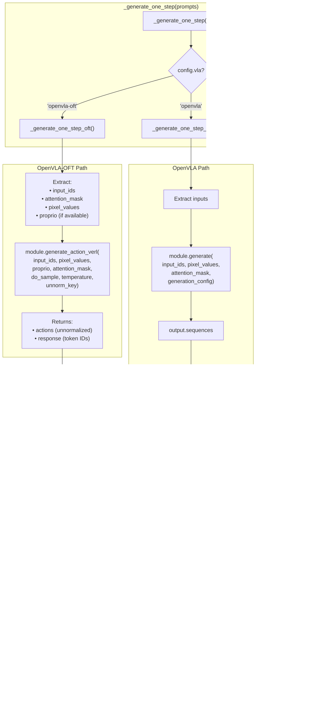

**Key Differences:**

| Aspect | OpenVLA-OFT | OpenVLA (Vanilla) |
|--------|-------------|-------------------|
| **Generation Method** | `generate_action_verl()` | `generate()` |
| **Action Format** | Direct action prediction | Token IDs → discretized → unnormalized |
| **Proprioception** | Supported as input | Not used |
| **Sampling** | Controlled by `do_sample`, `temperature` | Controlled by `GenerationConfig` (top_p, top_k, temperature) |
| **Output** | Unnormalized actions directly | Requires post-processing (discretization, binning, unnormalization) |

**Sources:** [verl/workers/rollout/rob_rollout.py:915-923](), [verl/workers/rollout/rob_rollout.py:925-978](), [verl/workers/rollout/rob_rollout.py:980-1083]()

---

## Rollout Execution Flow

### RoboTwin Rollout Flow

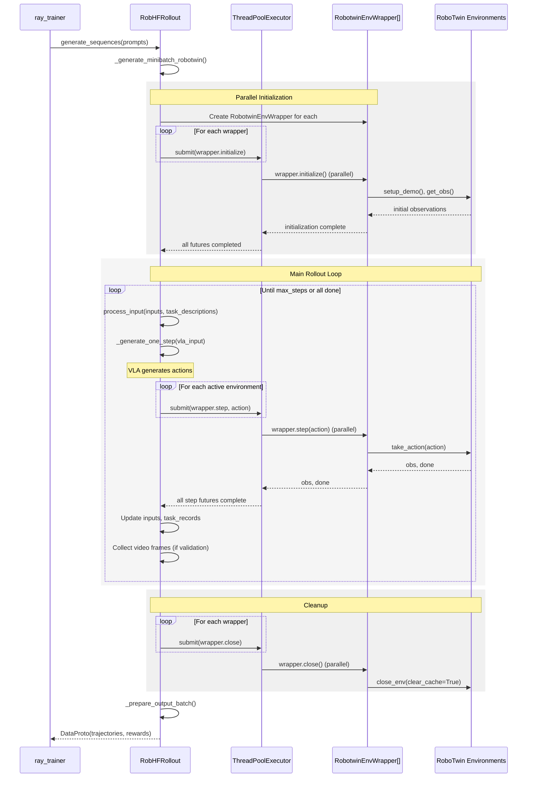

**Sources:** [verl/workers/rollout/rob_rollout.py:604-770]()

### LIBERO Rollout Flow

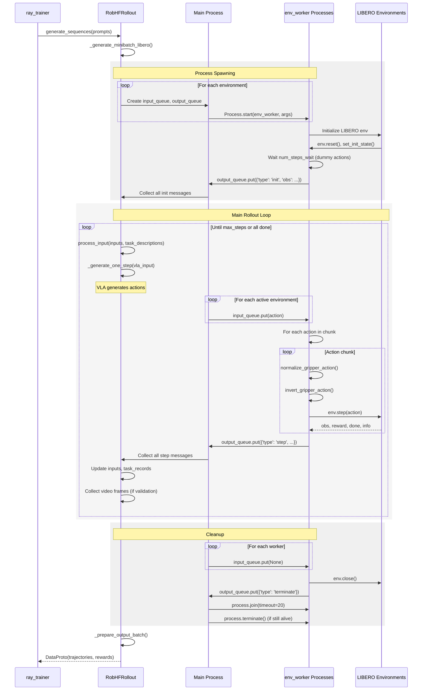

**Sources:** [verl/workers/rollout/rob_rollout.py:772-886]()

---

## Observation Conversion

The `_obs_to_input` method converts platform-specific observations into a unified format for VLA input processing.

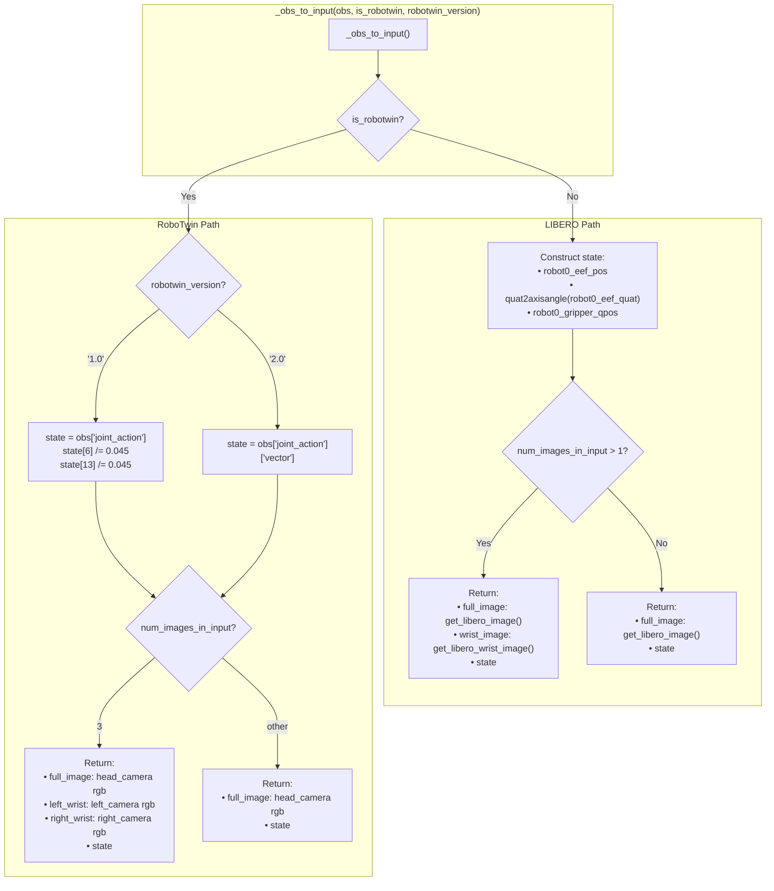

**State Representation:**

| Platform | State Components | Dimensions |
|----------|------------------|------------|
| LIBERO | End-effector position (3) + axis-angle orientation (3) + gripper state (2) | 8D |
| RoboTwin 1.0 | Joint actions with normalized gripper (indices 6, 13) | 14D |
| RoboTwin 2.0 | Joint action vector | Variable (task-dependent) |

**Image Sources:**

| Platform | Main Camera | Wrist Camera(s) |
|----------|-------------|-----------------|
| LIBERO | `agentview_image` (224x224) | `robot0_eye_in_hand_image` (224x224) |
| RoboTwin | `head_camera/rgb` | `left_camera/rgb`, `right_camera/rgb` |

**Sources:** [verl/workers/rollout/rob_rollout.py:1085-1126]()

---

## Output Batch Construction

After collecting the full trajectory, `_prepare_output_batch` structures the data into a format expected by the training loop.

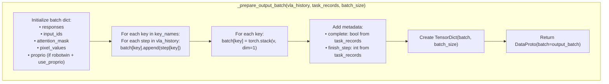

**Output Structure:**

The returned `DataProto` contains:

| Field | Shape | Description |
|-------|-------|-------------|
| `responses` | `[batch_size, num_steps, response_len]` | Generated token sequences |
| `input_ids` | `[batch_size, num_steps, max_prompt_length]` | Padded prompt tokens |
| `attention_mask` | `[batch_size, num_steps, max_prompt_length]` | Attention masks |
| `pixel_values` | `[batch_size, num_steps, num_cameras * 3, 224, 224]` | Encoded images |
| `proprio` | `[batch_size, num_steps, proprio_dim]` | Proprioception (RoboTwin only) |
| `action` | `[batch_size, num_steps, action_chunks_len, action_dim]` | Generated actions |
| `complete` | `[batch_size]` | Boolean success flags |
| `finish_step` | `[batch_size]` | Steps until completion/termination |

**Note on Stacking:** The `torch.stack(v, dim=1)` operation creates a time dimension (dim=1) where each step's data is stacked sequentially. This allows the training loop to compute advantages and losses across the full trajectory.

**Sources:** [verl/workers/rollout/rob_rollout.py:888-913]()

---

## Validation Video Recording

During validation rollouts (when `n_samples` is not specified in `meta_info`), the system records video frames and saves them for debugging and visualization.

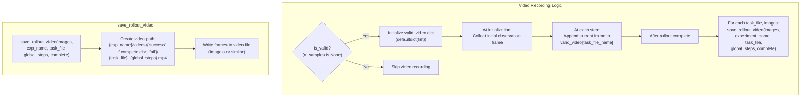

**Video Organization:**

Videos are saved in a directory structure that separates successful and failed rollouts:

```
{experiment_name}/
  videos/
    success/
      libero_10_task_0_trial_5_12000.mp4
      robotwin2_click_bell_trial_3_seed_42_12000.mp4
    fail/
      libero_10_task_2_trial_1_12000.mp4
      robotwin2_move_can_pot_trial_8_seed_99_12000.mp4
```

**Video Frame Sources:**

| Platform | Frame Source |
|----------|--------------|
| LIBERO | `obs["agentview_image"][::-1, ::-1]` (reversed for display) |
| RoboTwin | `obs['observation']['head_camera']['rgb']` |

**Sources:** [verl/workers/rollout/rob_rollout.py:615-617](), [verl/workers/rollout/rob_rollout.py:666-668](), [verl/workers/rollout/rob_rollout.py:726-729](), [verl/workers/rollout/rob_rollout.py:756-765](), [verl/workers/rollout/rob_rollout.py:873-882]()

---

## Memory Management and Cleanup

The rollout system implements careful memory management to prevent GPU memory leaks and handle environment cleanup.

### Cleanup Operations

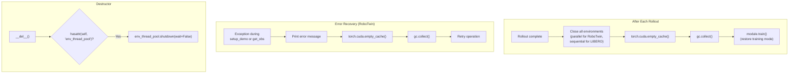

**Key Cleanup Points:**

1. **After environment initialization errors**: Clear CUDA cache, run garbage collection, retry
2. **After each rollout completion**: Close all environments, clear CUDA cache, run GC
3. **On RobHFRollout destruction**: Shutdown thread pool without waiting

**Environment-Specific Cleanup:**

| Platform | Cleanup Method | Notes |
|----------|----------------|-------|
| LIBERO | `env.close()` in worker process | May timeout (20s) and terminate forcefully |
| RoboTwin | `env.close_env(clear_cache=True)` | Clears internal caches, wrapped in exception handler |

**Sources:** [verl/workers/rollout/rob_rollout.py:261-267](), [verl/workers/rollout/rob_rollout.py:282-286](), [verl/workers/rollout/rob_rollout.py:741-753](), [verl/workers/rollout/rob_rollout.py:864-871](), [verl/workers/rollout/rob_rollout.py:1128-1131]()

---

## Configuration Summary

The rollout system is highly configurable through the `config` object. Key configuration parameters:

| Parameter | Type | Description |
|-----------|------|-------------|
| `task_suite_name` | str | Determines benchmark ("libero_*" or "robotwin*") |
| `vla` | str | VLA type ("openvla-oft" or "openvla") |
| `pretrained_checkpoint` | str | Path to VLA model checkpoint |
| `unnorm_key` | str | Key for action/proprio normalization statistics |
| `model_family` | str | LIBERO robot type (e.g., "panda") |
| `center_crop` | bool | Whether to apply center crop to images |
| `use_proprio` | bool | Whether to use proprioception (RoboTwin only) |
| `num_images_in_input` | int | Number of camera views (1-3) |
| `action_chunks_len` | int | Number of actions in temporal chunk |
| `num_steps_wait` | int | Wait steps before LIBERO rollout |
| `do_sample` | bool | Whether to sample actions (vs. greedy) |
| `temperature` | float | Sampling temperature |
| `max_prompt_length` | int | Maximum prompt length for padding |
| `experiment_name` | str | Name for organizing output videos |
| `val_micro_batch_size` | int | Batch size for validation rollouts |

**Sources:** [verl/workers/rollout/rob_rollout.py:424-458](), [README.md:112-127]()

---

