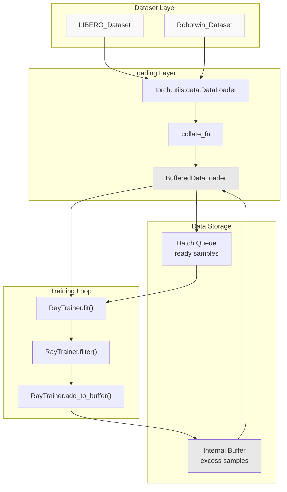
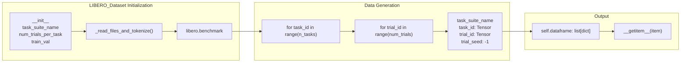
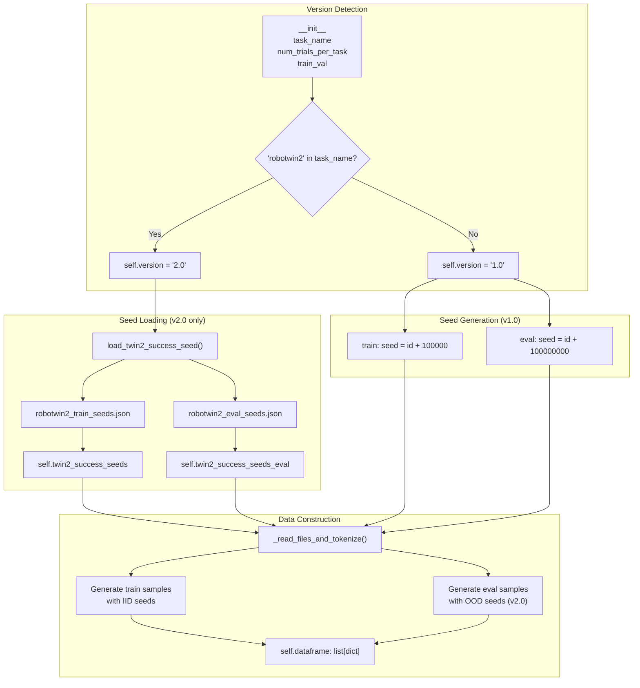
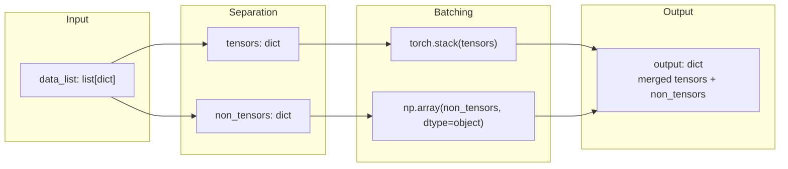
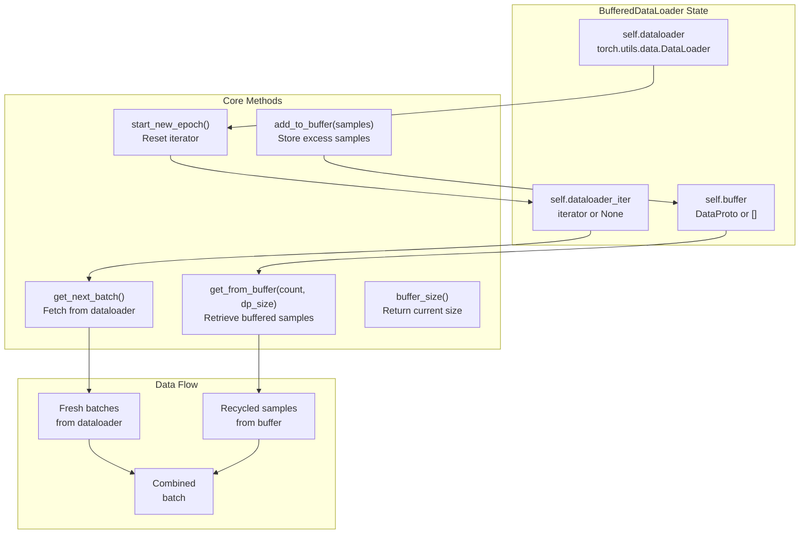
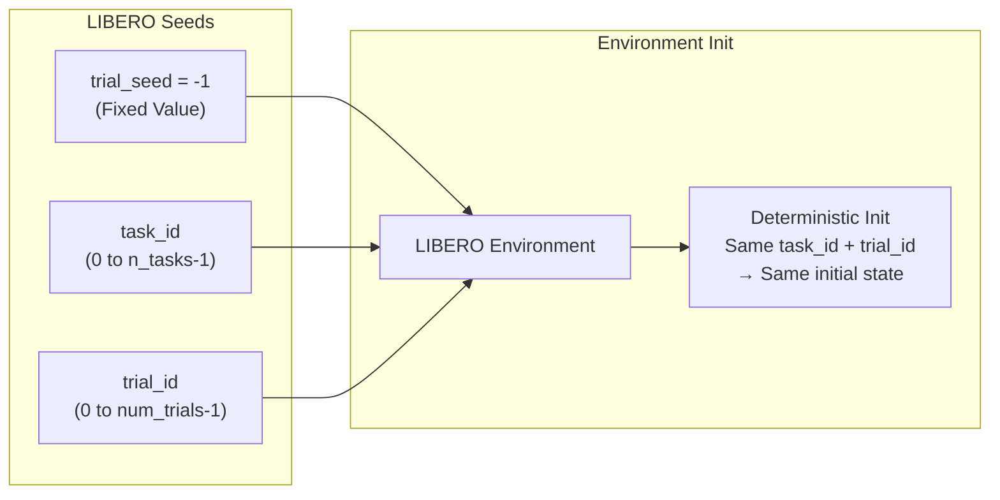
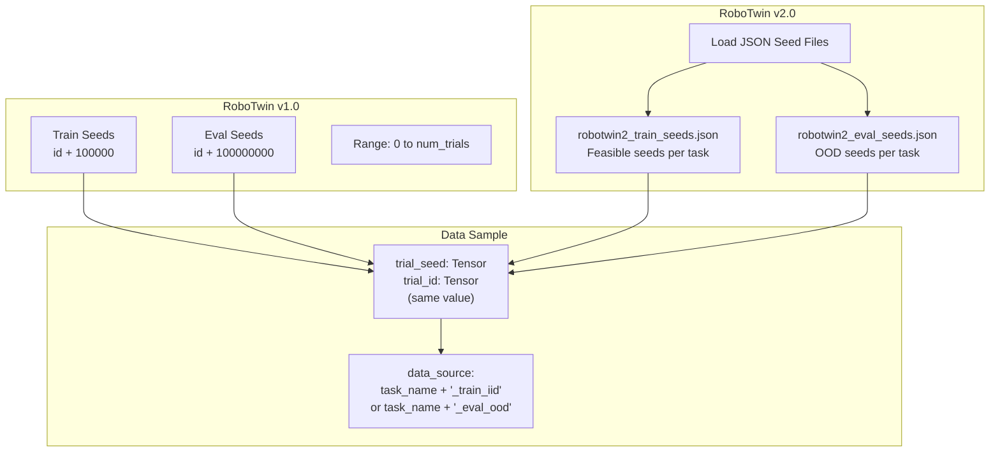
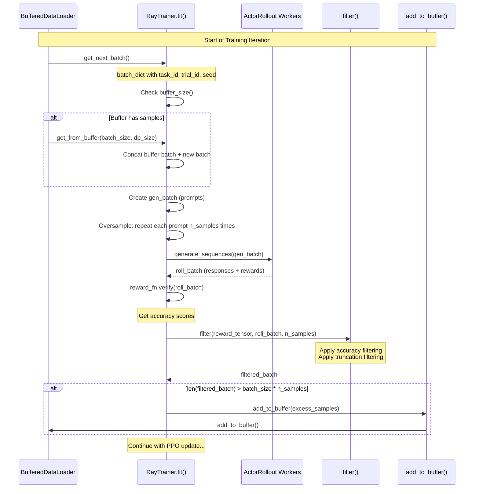

<!-- source: DeepWiki mcp.deepwiki.com · repo PRIME-RL/SimpleVLA-RL · page 5 Data Pipeline · fetched 2026-10-30 -->

# Data Pipeline

<details>
<summary>Relevant source files</summary>

The following files were used as context for generating this wiki page:

- [verl/trainer/ppo/ray_trainer.py](verl/trainer/ppo/ray_trainer.py)
- [verl/utils/dataset/rob_dataset.py](verl/utils/dataset/rob_dataset.py)

</details>


The data pipeline manages the creation, loading, and buffering of training samples throughout the PPO training process. It handles benchmark-specific dataset construction (LIBERO and RoboTwin), implements efficient sample buffering to reuse excess filtered samples, and manages environment seeds for reproducible initialization. The pipeline ensures a continuous flow of training data from task definitions to rollout collection while maintaining data efficiency through intelligent buffering.

For information about how rollout workers interact with environments, see [Rollout Workers](#4.3). For details on the training loop that consumes this pipeline, see [PPO Training Loop](#3.1).

## System Overview

The data pipeline consists of three main layers that work together to provide training samples:



**Data Pipeline Architecture**

The pipeline flows from dataset classes through loading/collation to the buffered dataloader, which interfaces with the training loop. Excess samples from filtering are recycled back into the buffer for future batches.

**Sources:** [verl/utils/dataset/rob_dataset.py:1-256](), [verl/trainer/ppo/ray_trainer.py:292-327](), [verl/trainer/ppo/ray_trainer.py:499-597]()

## Dataset Classes

Two dataset classes provide benchmark-specific data generation:

| Dataset Class | Purpose | Task Types | Seed Strategy |
|--------------|---------|-----------|---------------|
| `LIBERO_Dataset` | LIBERO benchmark tasks | libero-10, libero-90, libero-spatial, libero-object, libero-goal | Fixed seed (-1) |
| `Robotwin_Dataset` | RoboTwin benchmark tasks | RoboTwin 1.0 (17 tasks), RoboTwin 2.0 (21 tasks) | Version-specific: v1.0 uses offset-based, v2.0 uses pre-collected feasible seeds |

### LIBERO_Dataset



**LIBERO_Dataset Construction Flow**

The `LIBERO_Dataset` class initializes by loading the task suite from libero's benchmark module, then generates trial entries for each task. Each entry contains tensors for `task_id` and `trial_id`, with a fixed `trial_seed` of -1.

The class supports five task suites: `libero_10`, `libero_90`, `libero_spatial`, `libero_object`, and `libero_goal`. For each task in the suite, it creates `num_trials_per_task` entries. Both training and validation datasets use the same trial range (0 to `num_trials_per_task`), as LIBERO uses deterministic initialization with fixed seeds.

**Key Implementation Details:**
- Task suite selection: [verl/utils/dataset/rob_dataset.py:78-79]()
- Trial generation: [verl/utils/dataset/rob_dataset.py:84-98]()
- Data structure: Each item contains `task_suite_name` (string), `task_id` (tensor), `trial_id` (tensor), `trial_seed` (tensor with value -1)

**Sources:** [verl/utils/dataset/rob_dataset.py:65-109]()

### Robotwin_Dataset



**Robotwin_Dataset Construction Flow**

The `Robotwin_Dataset` class handles two versions with different seed management strategies. Version detection is based on the presence of "robotwin2" in the task name.

**Version 1.0 Seed Strategy:**
- Training seeds: Offset by 100,000 (e.g., trial 0 uses seed 100,000)
- Evaluation seeds: Offset by 100,000,000 for OOD testing
- Training dataset is repeated 5× to ensure sufficient batches
- Implementation: [verl/utils/dataset/rob_dataset.py:174-186]()

**Version 2.0 Seed Strategy:**
- Uses pre-collected "feasible seeds" loaded from JSON files
- Training: `robotwin2_train_seeds.json` contains IID seeds
- Evaluation: `robotwin2_eval_seeds.json` contains OOD seeds
- Seed loading: [verl/utils/dataset/rob_dataset.py:146-164]()
- Each task has a curated list of seeds known to produce solvable initial states

**Data Structure:**
Each entry contains:
- `task_suite_name`: Full task name (e.g., "robotwin2_handover_mic")
- `task_id`: Tensor with value -1 (not used for RoboTwin)
- `trial_id`: Tensor with seed value
- `trial_seed`: Tensor with seed value
- `data_source`: String identifying train_iid or eval_ood

**Sources:** [verl/utils/dataset/rob_dataset.py:111-219]()

## Data Loading and Collation

### collate_fn

The `collate_fn` separates tensors from non-tensors and batches them appropriately:



**collate_fn Processing Flow**

The function iterates through the data list and separates items by type:
- **Tensors** (torch.Tensor): Stacked along dimension 0 using `torch.stack`
- **Non-tensors** (strings, numbers, objects): Converted to numpy arrays with `dtype=object`

This allows the batch to contain both numeric tensors for model input and metadata like task names and data sources.

**Implementation:** [verl/utils/dataset/rob_dataset.py:38-62]()

**Sources:** [verl/utils/dataset/rob_dataset.py:38-62]()

### Dataloader Creation

The `RayTrainer._create_dataloader` method instantiates dataloaders based on the task suite:

```python
# Pseudo-code representation
if "libero" in task_suite_name:
    train_dataset = LIBERO_Dataset(task_suite_name, num_trials_per_task, "train")
    val_dataset = LIBERO_Dataset(task_suite_name, num_trials_per_task, "valid")
elif "robotwin" in task_suite_name:
    train_dataset = Robotwin_Dataset(task_suite_name, num_trials_per_task, "train")
    val_dataset = Robotwin_Dataset(task_suite_name, num_trials_per_task, "valid")
    
train_dataloader = BufferedDataLoader(DataLoader(
    dataset=train_dataset,
    batch_size=train_batch_size * oversample_factor,
    shuffle=True,
    drop_last=True,
    collate_fn=collate_fn
))
```

**Key Configuration:**
- Training batch size is multiplied by `oversample_factor` to enable filtering
- Shuffle is enabled for training, disabled or controlled for validation
- `drop_last=True` ensures consistent batch sizes
- Custom `collate_fn` handles mixed tensor/non-tensor data

**Sources:** [verl/trainer/ppo/ray_trainer.py:292-327]()

## BufferedDataLoader

The `BufferedDataLoader` wraps a standard PyTorch DataLoader and adds buffering capabilities to reuse excess samples from filtering:



**BufferedDataLoader Architecture**

### Key Operations

| Method | Purpose | Implementation |
|--------|---------|----------------|
| `start_new_epoch()` | Initialize iterator for new epoch | Creates `iter(self.dataloader)` |
| `get_next_batch()` | Fetch next batch from dataloader | Calls `next()` on iterator, raises StopIteration at end |
| `add_to_buffer(samples)` | Add excess samples to buffer | Concatenates with existing buffer using `DataProto.concat` |
| `get_from_buffer(count, dp_size)` | Retrieve samples from buffer | Slices requested count (aligned to dp_size), updates buffer |
| `buffer_size()` | Query current buffer size | Returns `len(self.buffer)` |

### Buffer Management Logic

The buffer stores `DataProto` objects that contain excess samples from filtering. When retrieving from the buffer:
1. Aligns count to `dp_size` (data parallel size) for distributed training
2. Slices the requested samples from the front of the buffer
3. Updates the buffer to contain only remaining samples

**Example Flow:**
```
Iteration 1: Oversample 128 prompts × 4 responses = 512 samples
             Filter to 100 samples (target: 64 × 4 = 256)
             Use 256 samples, buffer 100 - 64 = 36 samples
             
Iteration 2: Request batch, first retrieve 36 from buffer
             Need 64 prompts, already have 9, fetch 55 more
             Oversample 55 × 4 = 220 new samples
             ...
```

**Sources:** [verl/utils/dataset/rob_dataset.py:222-256]()

## Seed Management

Seed management differs significantly between LIBERO and RoboTwin due to their different environment characteristics:

### LIBERO Seed Strategy



**LIBERO Seed Management**

LIBERO uses a fixed seed of -1 for all trials. Environment initialization is deterministic based on `task_id` and `trial_id`. This means the same `(task_id, trial_id)` pair always produces the same initial state, ensuring reproducibility without explicit seed variation.

**Sources:** [verl/utils/dataset/rob_dataset.py:96]()

### RoboTwin Seed Strategy



**RoboTwin Seed Management**

**Version 1.0:**
- Training: Seeds offset by 100,000 to ensure uniqueness
- Evaluation: Seeds offset by 100,000,000 for OOD scenarios
- Simple arithmetic generation, no pre-validation

**Version 2.0:**
- Pre-collected feasible seeds stored in JSON files
- Training uses IID seeds from `robotwin2_train_seeds.json`
- Evaluation uses OOD seeds from `robotwin2_eval_seeds.json`
- Each seed is validated to produce a solvable initial state
- Prevents wasted rollouts on infeasible configurations

**Seed File Structure:**
```json
{
  "task_name": {
    "success_seeds": [seed1, seed2, seed3, ...]
  }
}
```

The JSON files are located at:
- Training: `verl/utils/envs/robotwin2/seeds/robotwin2_train_seeds.json`
- Evaluation: `verl/utils/envs/robotwin2/seeds/robotwin2_eval_seeds.json`

**Sources:** [verl/utils/dataset/rob_dataset.py:142-164](), [verl/utils/dataset/rob_dataset.py:169-188]()

## Data Flow in Training

The complete data flow from dataset to model update involves multiple stages:



**Training Loop Data Flow**

### Detailed Flow Stages

**1. Batch Retrieval** [verl/trainer/ppo/ray_trainer.py:504-526]()
   - Check if buffer has samples: `buffer_size() > 0`
   - If yes, retrieve with `get_from_buffer(batch_size, dp_size)`
   - Fetch next batch from dataloader with `get_next_batch()`
   - Concatenate buffer samples with new batch if applicable

**2. Oversampling** [verl/trainer/ppo/ray_trainer.py:537-541]()
   - Each prompt is repeated `n_samples` times
   - Creates list: `[[prompt_i] * n_samples for i in range(batch_size)]`
   - Enables filtering while maintaining target batch size

**3. Generation** [verl/trainer/ppo/ray_trainer.py:543-553]()
   - Pass batch to `actor_rollout_wg.generate_sequences()`
   - Workers perform environment rollouts
   - Returns responses with trajectory data and rewards

**4. Verification** [verl/trainer/ppo/ray_trainer.py:559-570]()
   - `reward_fn.verify(roll_batch)` computes accuracy scores
   - Returns tensor with shape `(batch_size * n_samples,)`
   - Logs metrics: accuracy distribution, format errors

**5. Filtering** [verl/trainer/ppo/ray_trainer.py:573-578]()
   - Filter by accuracy: keep prompts with mean accuracy in `[lower_bound, upper_bound]`
   - Filter by truncation: remove prompts where any response hit max length
   - Accuracy filtering: [verl/trainer/ppo/ray_trainer.py:768-778]()
   - Truncation filtering: [verl/trainer/ppo/ray_trainer.py:780-804]()

**6. Buffer Management** [verl/trainer/ppo/ray_trainer.py:594-597]()
   - If filtered batch exceeds target size, add excess to buffer
   - `add_to_buffer()` masks out excess prompts: [verl/trainer/ppo/ray_trainer.py:818-829]()
   - Buffer stores complete prompts (not individual samples)

### Filtering Algorithm Details

```python
# Pseudo-code for filtering logic
def filter(reward_tensor, batch, n_samples):
    # Reshape rewards: (batch_size * n_samples,) -> (num_prompts, n_samples)
    reward_matrix = reward_tensor.reshape(-1, n_samples)
    
    # Compute mean accuracy per prompt
    acc_tensor = reward_matrix.mean(dim=-1)  # (num_prompts,)
    
    # Accuracy mask
    acc_mask = (acc_tensor >= lower_bound) & (acc_tensor <= upper_bound)
    
    # Truncation mask
    response_lengths = response_mask.sum(-1).reshape(-1, n_samples)
    has_truncated = (response_lengths >= max_len).any(dim=-1)
    trunc_mask = ~has_truncated
    
    # Combined mask
    combined_mask = acc_mask & trunc_mask
    
    # Expand to all samples
    final_mask = combined_mask.repeat_interleave(n_samples)
    
    return batch.slice(final_mask)
```

**Why Filtering?**
- **Accuracy filtering**: Focus training on prompts with intermediate difficulty
- **Truncation filtering**: Exclude incomplete rollouts that may have poor quality
- **Efficiency**: Reuse successfully filtered samples via buffering

**Sources:** [verl/trainer/ppo/ray_trainer.py:499-597](), [verl/trainer/ppo/ray_trainer.py:755-829]()

## Configuration Parameters

Key data pipeline parameters from `ppo_trainer.yaml`:

| Parameter | Location | Purpose | Typical Value |
|-----------|----------|---------|---------------|
| `task_suite_name` | `data.task_suite_name` | Select benchmark/task | "libero_10", "robotwin2_handover_mic" |
| `num_trials_per_task` | `data.num_trials_per_task` | Trials per task in dataset | 50 for training |
| `train_batch_size` | `data.train_batch_size` | Target batch size after filtering | 64 |
| `val_batch_size` | `data.val_batch_size` | Validation batch size | 128 |
| `n_samples` | `data.n_samples` | Responses per prompt | 4 |
| `oversample_factor` | `data.oversample_factor` | Multiplier for initial batch size | 2.0 |
| `filter_accuracy` | `data.filter_accuracy` | Enable accuracy filtering | true/false |
| `accuracy_lower_bound` | `data.accuracy_lower_bound` | Min mean accuracy to keep | 0.0 |
| `accuracy_upper_bound` | `data.accuracy_upper_bound` | Max mean accuracy to keep | 1.0 |
| `filter_truncated` | `data.filter_truncated` | Enable truncation filtering | true/false |
| `max_response_length` | `data.max_response_length` | Max trajectory length | Task-dependent |

**Oversampling Calculation:**
```
initial_batch_size = train_batch_size * oversample_factor
samples_generated = initial_batch_size * n_samples
samples_needed = train_batch_size * n_samples

If filtering removes samples:
    excess = filtered_samples - samples_needed
    add excess to buffer for next iteration
```

**Sources:** [verl/trainer/ppo/ray_trainer.py:312-313]()

---

