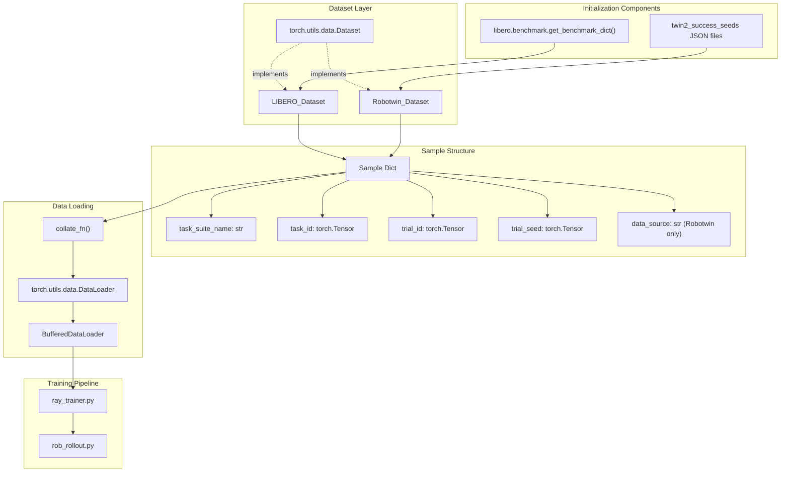
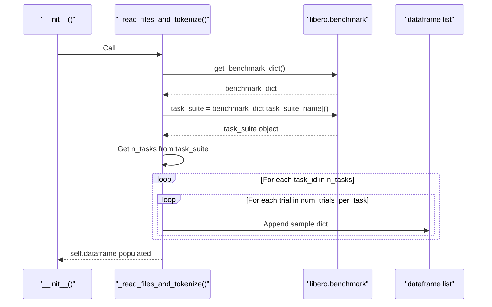
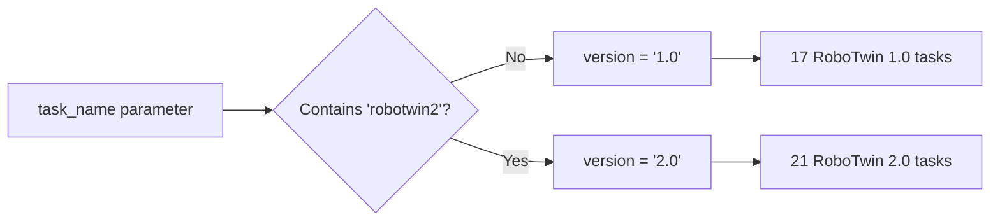
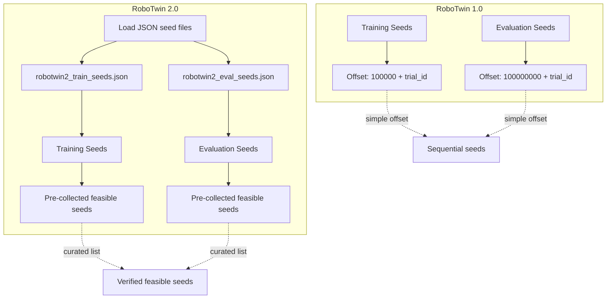
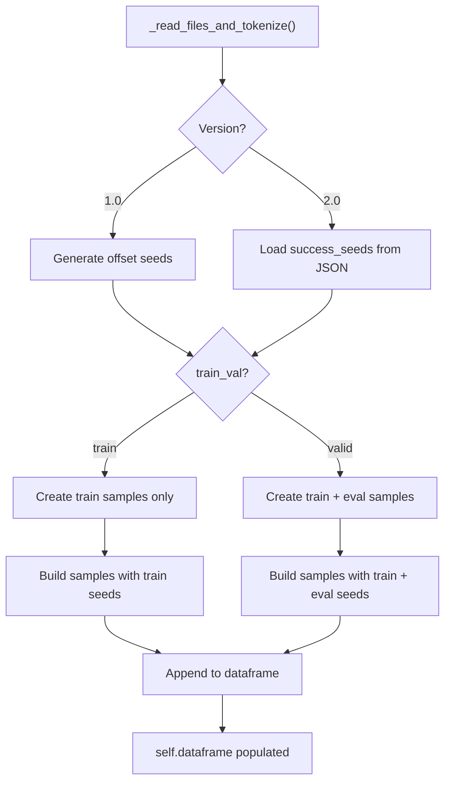
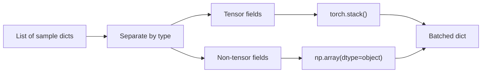
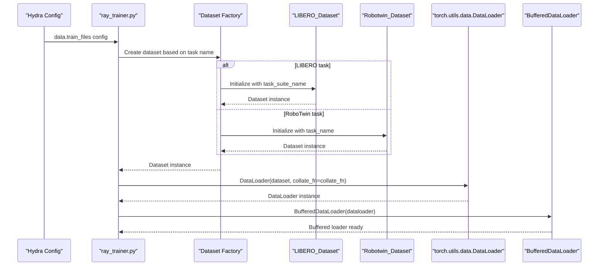

<!-- source: DeepWiki mcp.deepwiki.com · repo PRIME-RL/SimpleVLA-RL · page 5.1 Dataset Classes · fetched 2026-10-30 -->

# Dataset Classes

<details>
<summary>Relevant source files</summary>

The following files were used as context for generating this wiki page:

- [README.md](README.md)
- [verl/utils/dataset/rob_dataset.py](verl/utils/dataset/rob_dataset.py)

</details>


This page documents the dataset classes in SimpleVLA-RL that generate training and validation samples for reinforcement learning. These classes bridge the gap between benchmark task definitions and the training pipeline by providing structured data about task identifiers, trial IDs, and environment seeds.

For information about buffered data loading and sample management during training, see [Data Loading and Buffering](#5.2). For details on how seeds are managed and generated for each benchmark, see [Seed Management](#5.3).

## Overview

The dataset system provides two main classes:
- **`LIBERO_Dataset`**: Generates samples for LIBERO benchmark tasks
- **`Robotwin_Dataset`**: Generates samples for RoboTwin 1.0 and 2.0 tasks

Both classes implement the PyTorch `Dataset` interface and generate metadata that the rollout workers use to initialize environments. They do not load trajectory data or images; instead, they provide task identifiers and seeds that tell the rollout workers which environments to create and execute.

**Sources:** [verl/utils/dataset/rob_dataset.py:1-256]()

## Dataset Architecture

The following diagram shows the relationship between dataset classes, their role in the training pipeline, and the key functions they use:



**Sources:** [verl/utils/dataset/rob_dataset.py:65-256](), [verl/trainer/ppo/ray_trainer.py](), [verl/workers/rollout/rob_rollout.py]()

## LIBERO_Dataset

The `LIBERO_Dataset` class generates training samples for the LIBERO benchmark, which includes multiple task suites with varying numbers of manipulation tasks.

### Initialization

```python
LIBERO_Dataset(
    task_suite_name: str,
    num_trials_per_task: int = 50,
    train_val: str = "train"
)
```

**Parameters:**

| Parameter | Type | Description |
|-----------|------|-------------|
| `task_suite_name` | `str` | Name of LIBERO suite: `"libero_10"`, `"libero_90"`, `"libero_goal"`, `"libero_object"`, or `"libero_spatial"` |
| `num_trials_per_task` | `int` | Number of trials to generate per task (default: 50) |
| `train_val` | `str` | Dataset split: `"train"` or `"valid"` |

**Sources:** [verl/utils/dataset/rob_dataset.py:66-75]()

### Sample Generation Process

The dataset initialization follows this workflow:



**Sources:** [verl/utils/dataset/rob_dataset.py:77-102]()

### Data Structure

Each sample returned by `__getitem__()` contains:

| Field | Type | Value | Description |
|-------|------|-------|-------------|
| `task_suite_name` | `str` | e.g., `"libero_10"` | Identifier for the LIBERO suite |
| `task_id` | `torch.Tensor` | `[0, n_tasks)` | Integer task index within the suite |
| `trial_id` | `torch.Tensor` | `[0, num_trials_per_task)` | Trial number for this task |
| `trial_seed` | `torch.Tensor` | `-1` | Fixed seed value for LIBERO (deterministic initialization) |

**Key Characteristics:**
- **Deterministic seeds**: LIBERO uses `trial_seed = -1` for all samples, relying on task and trial IDs for environment initialization
- **Cross-product generation**: Creates `n_tasks × num_trials_per_task` samples
- **Same structure for train/valid**: Both splits use the same trial ranges

**Sources:** [verl/utils/dataset/rob_dataset.py:83-99]()

### Example

For `libero_10` with `num_trials_per_task=50`:
- Total samples: 10 tasks × 50 trials = 500 samples
- Sample structure:
  ```python
  {
      "task_suite_name": "libero_10",
      "task_id": torch.tensor([3]),      # Task 3 of 10
      "trial_id": torch.tensor([17]),    # Trial 17 of 50
      "trial_seed": torch.tensor([-1])   # Fixed seed
  }
  ```

**Sources:** [verl/utils/dataset/rob_dataset.py:83-99]()

## Robotwin_Dataset

The `Robotwin_Dataset` class handles both RoboTwin 1.0 and 2.0 tasks, with significantly different seed management strategies between versions.

### Initialization

```python
Robotwin_Dataset(
    task_name: str,
    num_trials_per_task: int = 50,
    train_val: str = "train"
)
```

**Parameters:**

| Parameter | Type | Description |
|-----------|------|-------------|
| `task_name` | `str` | Task name with version prefix: `"robotwin_*"` or `"robotwin2_*"` |
| `num_trials_per_task` | `int` | Number of trials per task (default: 50, overridden to 128 for validation) |
| `train_val` | `str` | Dataset split: `"train"` or `"valid"` |

**Sources:** [verl/utils/dataset/rob_dataset.py:112-144]()

### Version Detection and Task Names

The constructor automatically detects the RoboTwin version from the task name prefix:



**RoboTwin 1.0 Tasks** (17 tasks):
- `robotwin_block_hammer_beat`, `robotwin_block_handover`, `robotwin_blocks_stack_easy`, etc.

**RoboTwin 2.0 Tasks** (21 tasks):
- `robotwin2_handover_mic`, `robotwin2_move_can_pot`, `robotwin2_pick_dual_bottles`, etc.

**Sources:** [verl/utils/dataset/rob_dataset.py:113-133]()

### Seed Management by Version

The seed management strategy differs substantially between versions:



**Version 1.0:**
- **Training seeds**: `100000 + trial_id` (offset-based generation)
- **Evaluation seeds**: `100000000 + trial_id` (different offset for OOD evaluation)
- **No pre-validation**: Seeds are generated programmatically

**Version 2.0:**
- **Pre-collected seeds**: Loads from `robotwin2_train_seeds.json` and `robotwin2_eval_seeds.json`
- **Feasibility guarantee**: Only includes seeds where task completion is possible
- **IID vs OOD**: Training seeds are IID (in-distribution), evaluation seeds are OOD (out-of-distribution)

**Sources:** [verl/utils/dataset/rob_dataset.py:139-164]()

### Sample Generation

The `_read_files_and_tokenize()` method generates samples differently based on version and split:



**Sources:** [verl/utils/dataset/rob_dataset.py:166-213]()

### Data Structure

Each sample contains:

| Field | Type | Value | Description |
|-------|------|-------|-------------|
| `task_suite_name` | `str` | e.g., `"robotwin2_handover_mic"` | Full task name with version prefix |
| `task_id` | `torch.Tensor` | `-1` | Not used for RoboTwin (task identified by name) |
| `trial_id` | `torch.Tensor` | Seed value | The actual environment seed |
| `trial_seed` | `torch.Tensor` | Seed value | Duplicate of trial_id for consistency |
| `data_source` | `str` | `"{task}_train_iid"` or `"{task}_eval_ood"` | Distinguishes IID training from OOD evaluation |

**Key Differences from LIBERO:**
- `task_id` is always `-1` (task identified by name)
- `trial_id` and `trial_seed` contain the actual environment seed (not indices)
- `data_source` field distinguishes training IID from evaluation OOD samples

**Sources:** [verl/utils/dataset/rob_dataset.py:189-208]()

### Example

For `robotwin2_handover_mic` with `num_trials_per_task=50` in validation mode:

```python
# Training IID sample
{
    "task_suite_name": "robotwin2_handover_mic",
    "task_id": torch.tensor([-1]),
    "trial_id": torch.tensor([12345]),  # From train_seeds.json
    "trial_seed": torch.tensor([12345]),
    "data_source": "robotwin2_handover_mic_train_iid"
}

# Evaluation OOD sample  
{
    "task_suite_name": "robotwin2_handover_mic",
    "task_id": torch.tensor([-1]),
    "trial_id": torch.tensor([67890]),  # From eval_seeds.json
    "trial_seed": torch.tensor([67890]),
    "data_source": "robotwin2_handover_mic_eval_ood"
}
```

**Sources:** [verl/utils/dataset/rob_dataset.py:189-208]()

## Collate Function

The `collate_fn` utility combines multiple samples into a batch for dataloader consumption. It separates tensor and non-tensor data:



**Behavior:**
- **Tensor fields** (e.g., `task_id`, `trial_id`, `trial_seed`): Stacked along dimension 0 using `torch.stack()`
- **Non-tensor fields** (e.g., `task_suite_name`, `data_source`): Converted to NumPy object arrays

**Example:**

```python
# Input: 2 samples
samples = [
    {"task_id": torch.tensor([0]), "task_suite_name": "libero_10"},
    {"task_id": torch.tensor([1]), "task_suite_name": "libero_10"}
]

# Output: batched
batch = {
    "task_id": torch.tensor([[0], [1]]),  # Stacked tensors
    "task_suite_name": np.array(["libero_10", "libero_10"], dtype=object)  # Object array
}
```

**Sources:** [verl/utils/dataset/rob_dataset.py:38-62]()

## Comparison Summary

The following table summarizes the key differences between the dataset classes:

| Feature | LIBERO_Dataset | Robotwin_Dataset (1.0) | Robotwin_Dataset (2.0) |
|---------|----------------|------------------------|------------------------|
| **Task Identification** | `task_suite_name` + `task_id` | `task_suite_name` only | `task_suite_name` only |
| **Seed Strategy** | Fixed `-1` | Offset-based generation | Pre-collected feasible seeds |
| **Training Seeds** | N/A (uses `-1`) | `100000 + trial_id` | From `robotwin2_train_seeds.json` |
| **Evaluation Seeds** | N/A (uses `-1`) | `100000000 + trial_id` | From `robotwin2_eval_seeds.json` |
| **IID/OOD Distinction** | No | No (same offset scheme) | Yes (`data_source` field) |
| **Validation Batch Size** | `num_trials_per_task` | `num_trials_per_task` | 128 (hardcoded override) |
| **Number of Tasks** | Varies by suite (10, 90, etc.) | 17 | 21 |
| **Sample Duplication** | None | 5× repeat for training | None |
| **External Dependencies** | `libero.benchmark` | None | JSON seed files |

**Sources:** [verl/utils/dataset/rob_dataset.py:65-219]()

## Usage in Training Pipeline

Both dataset classes are instantiated by the training pipeline and wrapped in PyTorch DataLoaders:



The datasets provide metadata that rollout workers use to:
1. Initialize the correct environment (via `task_suite_name` or `task_id`)
2. Set the random seed (via `trial_seed`)
3. Track evaluation distribution (via `data_source`)

**Sources:** [verl/utils/dataset/rob_dataset.py:1-256](), [verl/trainer/ppo/ray_trainer.py]()

---

