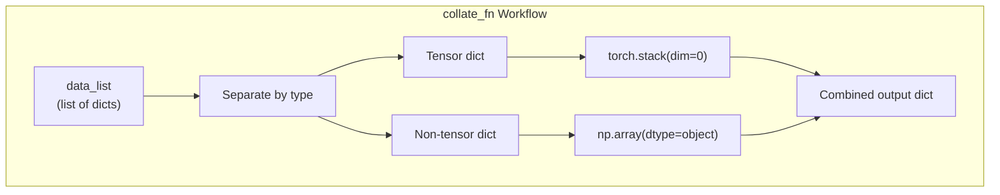
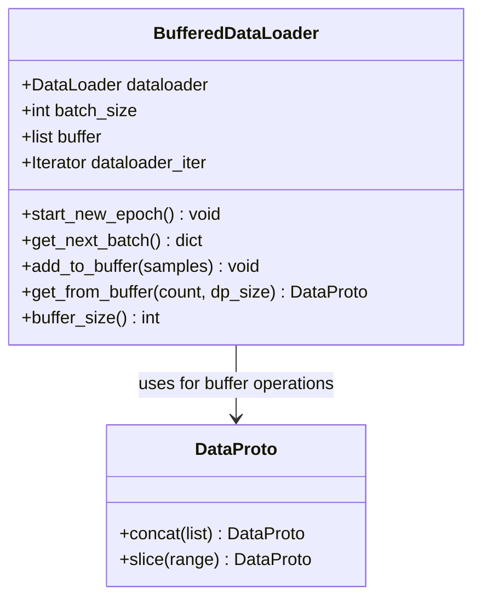
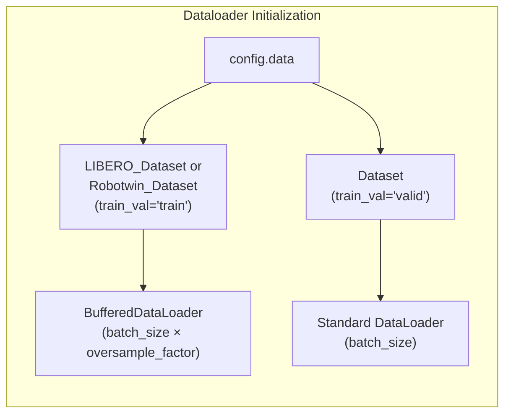
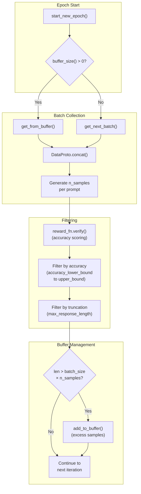
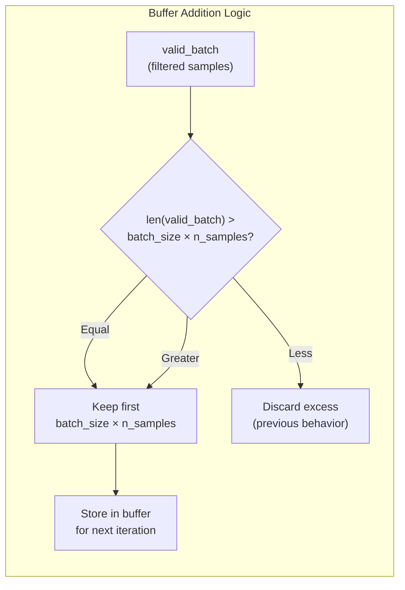
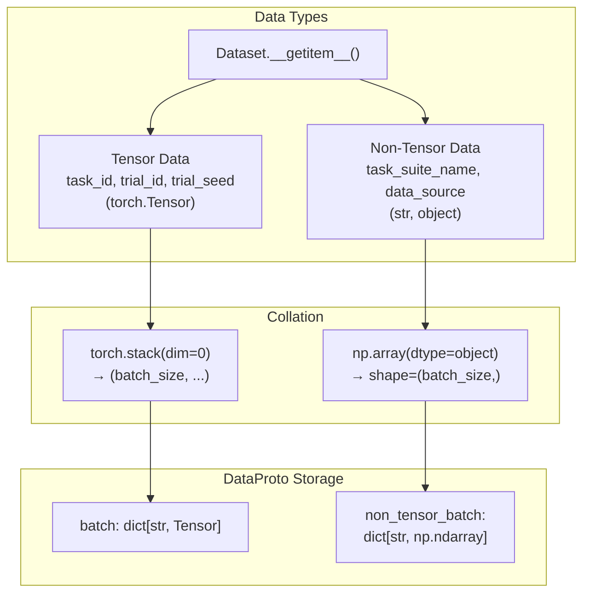

<!-- source: DeepWiki mcp.deepwiki.com · repo PRIME-RL/SimpleVLA-RL · page 5.2 Data Loading and Buffering · fetched 2026-10-30 -->

# Data Loading and Buffering

<details>
<summary>Relevant source files</summary>

The following files were used as context for generating this wiki page:

- [verl/trainer/ppo/ray_trainer.py](verl/trainer/ppo/ray_trainer.py)
- [verl/utils/dataset/rob_dataset.py](verl/utils/dataset/rob_dataset.py)

</details>


## Purpose and Scope

This page documents the data loading and buffering infrastructure that manages training batches throughout the PPO training loop. It covers the `BufferedDataLoader` class, the `collate_fn` batch assembly function, and how excess samples from filtering are recycled for efficient data utilization.

For information about the dataset classes that generate training samples, see [Dataset Classes](#5.1). For details on seed management strategies, see [Seed Management](#5.3).

---

## Overview

The SimpleVLA-RL data pipeline implements a sophisticated buffering mechanism to handle the **oversampling and filtering** strategy used in PPO training. The system generates more rollouts than needed (`batch_size × n_samples × oversample_factor`), filters them based on accuracy and truncation criteria, and stores excess valid samples in a buffer for reuse in subsequent iterations. This approach maximizes data efficiency when working with expensive environment rollouts.

**Key Design Principles:**
- **Oversampling:** Generate more samples than required to ensure sufficient high-quality data after filtering
- **Buffer recycling:** Excess filtered samples are saved rather than discarded
- **Tensor/non-tensor separation:** Different handling for PyTorch tensors vs. metadata objects
- **Batch alignment:** All operations maintain alignment with distributed training parallelism (`dp_size`)

---

## Core Components

### collate_fn: Batch Assembly

The `collate_fn` function separates batch data into tensor and non-tensor dictionaries, applying appropriate aggregation for each type.

**Implementation:** [verl/utils/dataset/rob_dataset.py:38-62]()



**Separation Logic:**

| Data Type | Storage Container | Aggregation Method | Example Keys |
|-----------|-------------------|-------------------|--------------|
| `torch.Tensor` | `tensors` dict | `torch.stack(val, dim=0)` | `task_id`, `trial_id`, `trial_seed` |
| Other types | `non_tensors` dict | `np.array(val, dtype=object)` | `task_suite_name`, `data_source` |

**Key Behavior:**
- All tensor values are stacked along dimension 0 to create batch tensors
- Non-tensor values (strings, etc.) are stored as NumPy object arrays
- Both dictionaries are merged into a single output dict

**Sources:** [verl/utils/dataset/rob_dataset.py:38-62]()

---

### BufferedDataLoader: Efficient Sample Management

The `BufferedDataLoader` class wraps a standard PyTorch `DataLoader` and adds buffering functionality to store and retrieve excess samples.

**Class Definition:** [verl/utils/dataset/rob_dataset.py:222-256]()



**Method Details:**

| Method | Purpose | Return Type | Key Logic |
|--------|---------|-------------|-----------|
| `start_new_epoch()` | Initialize iterator for new epoch | `void` | Creates new iterator from `self.dataloader` |
| `get_next_batch()` | Fetch next batch from dataloader | `dict` | Raises `StopIteration` when exhausted |
| `add_to_buffer(samples)` | Store excess samples | `void` | Uses `DataProto.concat()` to merge with existing buffer |
| `get_from_buffer(count, dp_size)` | Retrieve samples from buffer | `DataProto` | Aligns count to `dp_size` for distributed training |
| `buffer_size()` | Query buffer length | `int` | Returns `len(self.buffer)` |

**Buffer Alignment Logic:**

The `get_from_buffer()` method ensures retrieved samples align with data parallelism requirements:

```python
# From verl/utils/dataset/rob_dataset.py:247-252
if count > self.buffer_size():
    count = (self.buffer_size() // dp_size) * dp_size
samples = self.buffer.slice(range(0, count))
self.buffer = self.buffer.slice(range(count, self.buffer_size()))
```

This prevents uneven batch distribution across workers in distributed training.

**Sources:** [verl/utils/dataset/rob_dataset.py:222-256]()

---

## Integration with Training Loop

### Dataloader Creation

The trainer creates both training and validation dataloaders with different configurations:

**Location:** [verl/trainer/ppo/ray_trainer.py:292-327]()



**Training Dataloader Configuration:**
- **Batch size:** `train_batch_size × oversample_factor` (typically 1.5-2.0×)
- **Shuffle:** `True` for randomization
- **Drop last:** `True` to ensure consistent batch sizes
- **Wrapper:** `BufferedDataLoader` for recycling

**Validation Dataloader Configuration:**
- **Batch size:** `val_batch_size` (no oversampling)
- **Wrapper:** Standard PyTorch `DataLoader` (no buffering needed)

**Sources:** [verl/trainer/ppo/ray_trainer.py:292-327]()

---

### Buffer Usage in Training Loop

The training loop coordinates buffer usage with batch generation and filtering:

```mermaid
sequenceDiagram
    participant Loop as Training Loop
    participant Buffer as BufferedDataLoader
    participant Gen as Rollout Generation
    participant Filter as Filtering
    
    Loop->>Buffer: start_new_epoch()
    
    loop Until batch_size × n_samples collected
        alt Buffer has samples
            Buffer->>Loop: get_from_buffer(batch_size, dp_size)
        end
        
        Buffer->>Loop: get_next_batch()
        Loop->>Gen: generate_sequences(prompts)
        Gen-->>Loop: rollout batch
        Loop->>Filter: filter(batch, n_samples)
        Filter-->>Loop: filtered_batch
        
        alt Collected > target
            Loop->>Buffer: add_to_buffer(excess_samples)
        end
    end
```

**Buffer Priority Logic:** [verl/trainer/ppo/ray_trainer.py:504-526]()

The loop checks the buffer **before** requesting new batches:

```python
# Line 504-505
if self.train_dataloader.buffer_size() > 0:
    buffer_batch = self.train_dataloader.get_from_buffer(batch_size, self.actor_rollout_wg.world_size)
```

If buffer samples exist, they are prepended to the newly generated batch:

```python
# Line 524-526
if len(buffer_batch) > 0:
    newbatch = DataProto.concat([buffer_batch, newbatch])
    buffer_batch = []
```

**Sources:** [verl/trainer/ppo/ray_trainer.py:499-597]()

---

## Batch Processing Workflow

### End-to-End Data Flow



**Sources:** [verl/trainer/ppo/ray_trainer.py:499-597](), [verl/trainer/ppo/ray_trainer.py:755-829]()

---

### Filtering Mechanism

The `filter()` method removes low-quality samples before they enter the training batch:

**Implementation:** [verl/trainer/ppo/ray_trainer.py:755-816]()

**Filtering Criteria:**

| Filter Type | Condition | Configuration |
|-------------|-----------|---------------|
| **Accuracy** | `accuracy_lower_bound ≤ mean_accuracy ≤ accuracy_upper_bound` | `config.data.filter_accuracy` |
| **Truncation** | `max(response_lengths) < max_response_length` | `config.data.filter_truncated` |

**Accuracy Filtering Logic:**

```python
# Reshape to (num_prompts, n_samples) and compute mean per prompt
reward_matrix = reward_tensor.sum(-1).reshape(-1, n_samples)
acc_tensor = torch.mean(reward_matrix, dim=-1)

# Apply bounds
acc_mask = (acc_tensor >= self.config.data.accuracy_lower_bound) & \
           (acc_tensor <= self.config.data.accuracy_upper_bound)
```

**Truncation Filtering Logic:**

```python
# Calculate response lengths per sample
response_lengths = response_mask.sum(-1).reshape(-1, n_samples)

# Check if ANY response in the group hit max length
has_truncated = (response_lengths >= max_len).any(dim=-1)

# Keep only prompts where NO response was truncated
trunc_mask = ~has_truncated
```

**Mask Combination and Application:**

```python
# Combine both masks at prompt level
combined_mask = acc_mask & trunc_mask

# Expand to sample level (each prompt has n_samples responses)
final_mask = combined_mask.repeat_interleave(n_samples)

# Apply mask to batch
filtered_batch = batch.slice(final_mask)
```

**Sources:** [verl/trainer/ppo/ray_trainer.py:755-816]()

---

### Excess Sample Recycling

When filtering produces more samples than needed, excess samples are added to the buffer for reuse:

**Implementation:** [verl/trainer/ppo/ray_trainer.py:818-829]()



**Calculation:**

```python
# Line 819: Compute number of excess prompts
buffer_length = len(batch) // n_samples - batch_size

# Line 824-826: Create mask to keep only batch_size prompts
buffer_mask = torch.ones(buffer_length + batch_size, dtype=torch.bool)
buffer_mask[batch_size:] = False  # Mark excess as False
buffer_mask = buffer_mask.repeat_interleave(n_samples)  # Expand to sample level

# Slice to keep only needed samples, discarding excess
batch = batch.slice(buffer_mask)
```

**Note:** The current implementation **discards** excess samples rather than buffering them. The commented-out code (lines 820-823) suggests the original design intended to extract and buffer excess prompts, but the actual implementation just truncates the batch.

**Sources:** [verl/trainer/ppo/ray_trainer.py:594-597](), [verl/trainer/ppo/ray_trainer.py:818-829]()

---

## Tensor vs Non-Tensor Handling

The data pipeline maintains separation between tensor and non-tensor data throughout processing:



**Storage Locations:**

| Data Category | Storage Field | Data Type | Example Keys |
|---------------|---------------|-----------|--------------|
| Tensor data | `DataProto.batch` | `dict[str, torch.Tensor]` | `task_id`, `trial_id`, `responses`, `attention_mask` |
| Non-tensor data | `DataProto.non_tensor_batch` | `dict[str, np.ndarray]` | `task_suite_name`, `data_source`, `uid` |
| Metadata | `DataProto.meta_info` | `dict` | `eos_token_id`, `n_samples`, `validate` |

**Why Separate Storage?**

1. **GPU operations:** Tensor data can be moved to GPU and used in model computations
2. **Serialization:** Object arrays require different serialization for Ray distributed execution
3. **Type safety:** Prevents accidental tensor operations on non-numeric metadata
4. **Efficiency:** Avoids unnecessary tensor conversions for string identifiers

**Sources:** [verl/utils/dataset/rob_dataset.py:38-62]()

---

## Configuration Parameters

The buffering behavior is controlled by several configuration parameters in `ppo_trainer.yaml`:

| Parameter | Location | Purpose | Typical Value |
|-----------|----------|---------|---------------|
| `train_batch_size` | `config.data.train_batch_size` | Base batch size for training | 8-32 |
| `val_batch_size` | `config.data.val_batch_size` | Batch size for validation | 32-128 |
| `oversample_factor` | `config.data.oversample_factor` | Multiplier for oversampling | 1.5-2.0 |
| `n_samples` | `config.data.n_samples` | Responses per prompt | 4-16 |
| `filter_accuracy` | `config.data.filter_accuracy` | Enable accuracy filtering | `true`/`false` |
| `accuracy_lower_bound` | `config.data.accuracy_lower_bound` | Minimum avg accuracy | 0.0-0.5 |
| `accuracy_upper_bound` | `config.data.accuracy_upper_bound` | Maximum avg accuracy | 0.5-1.0 |
| `filter_truncated` | `config.data.filter_truncated` | Enable truncation filtering | `true`/`false` |
| `max_response_length` | `config.data.max_response_length` | Max response tokens | 512-2048 |

**Example Calculation:**

For `train_batch_size=16`, `n_samples=8`, `oversample_factor=1.5`:
- **Initial generation:** 16 × 1.5 = 24 prompts
- **Total rollouts:** 24 × 8 = 192 sequences
- **After filtering:** Variable (depends on filter criteria)
- **Target size:** 16 × 8 = 128 sequences
- **Excess:** Filtered count - 128 → added to buffer

**Sources:** [verl/trainer/ppo/ray_trainer.py:292-334](), [verl/trainer/ppo/ray_trainer.py:312-316]()

---

