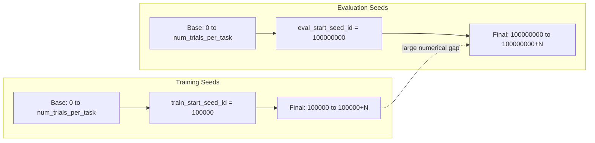
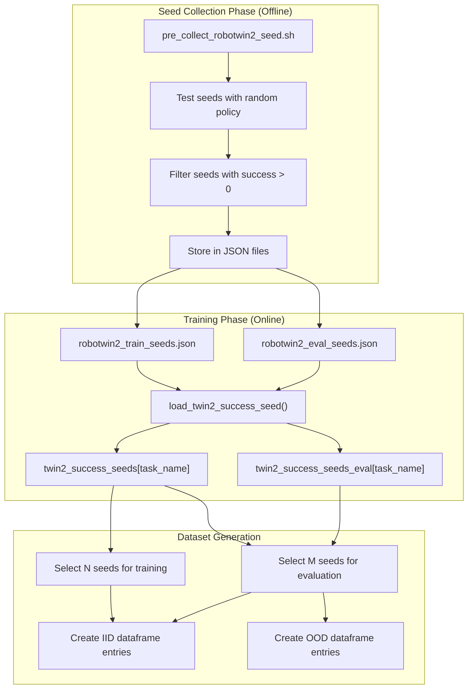
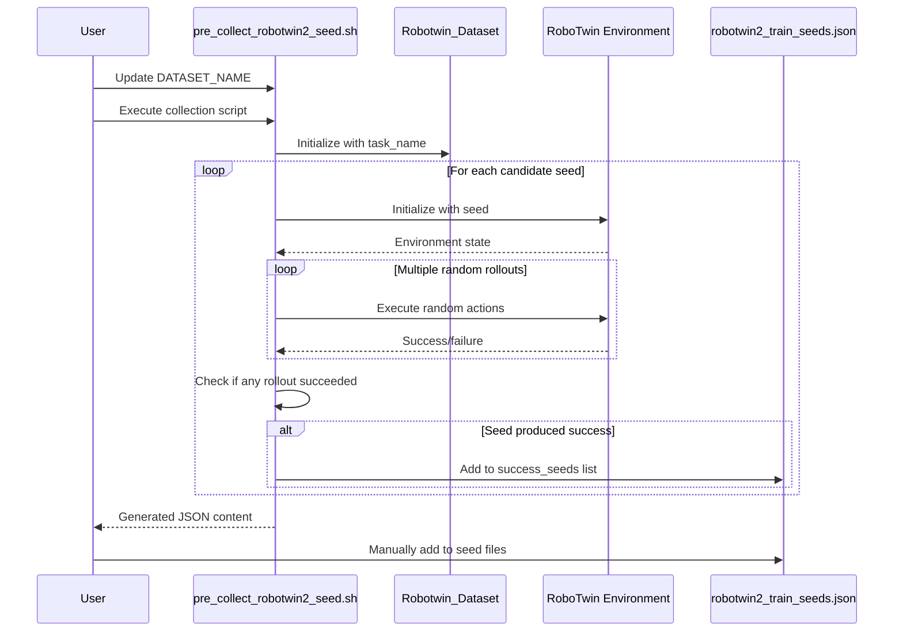
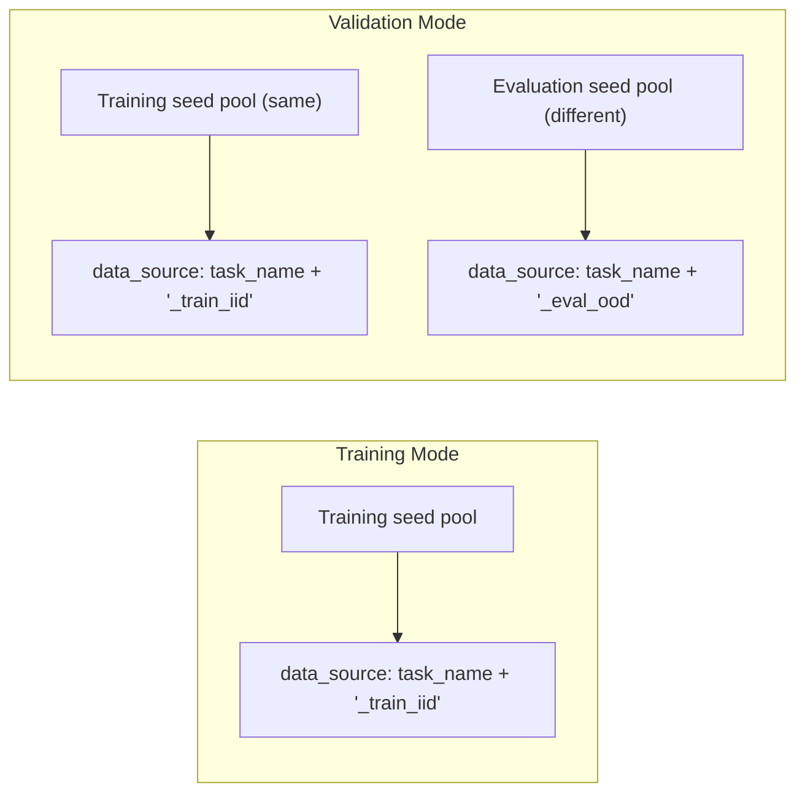

<!-- source: DeepWiki mcp.deepwiki.com · repo PRIME-RL/SimpleVLA-RL · page 5.3 Seed Management · fetched 2026-10-30 -->

# Seed Management

<details>
<summary>Relevant source files</summary>

The following files were used as context for generating this wiki page:

- [SETUP.md](SETUP.md)
- [verl/utils/dataset/rob_dataset.py](verl/utils/dataset/rob_dataset.py)

</details>


## Purpose and Scope

This document explains how trial seeds are managed in SimpleVLA-RL to initialize environment states during training and evaluation. Seed management strategies differ significantly between LIBERO and RoboTwin benchmarks, with RoboTwin 2.0 requiring sophisticated pre-collection of feasible seeds to ensure training efficiency. 

For information about how datasets use these seeds to generate training samples, see [Dataset Classes](#5.1). For details on how rollout workers execute episodes with these seeds, see [Rollout Workers](#4.3).

---

## Seed Management Overview

Seeds control the random initialization of simulation environments, affecting object placements, starting configurations, and task variations. Proper seed management ensures:

1. **Reproducibility**: Identical seeds produce identical environment initializations
2. **Data Efficiency**: Pre-validated seeds avoid wasted rollouts on infeasible configurations
3. **Distribution Control**: Separate seed pools enable IID vs OOD evaluation

The framework implements three distinct seed management strategies based on benchmark requirements:

| Benchmark | Seed Strategy | Configuration | Purpose |
|-----------|---------------|---------------|---------|
| **LIBERO** | Fixed deterministic | `trial_seed = -1` | Simple, reproducible trials |
| **RoboTwin 1.0** | Offset-based generation | Train: 100000+, Eval: 100000000+ | Separate train/eval distributions |
| **RoboTwin 2.0** | Pre-collected feasible seeds | JSON seed files | Avoid infeasible object placements |

Sources: [verl/utils/dataset/rob_dataset.py:65-219]()

---

## Seed Generation Workflow

```mermaid
graph TB
    subgraph "LIBERO Seed Management"
        LiberoDS["LIBERO_Dataset.__init__()"]
        LiberoRead["_read_files_and_tokenize()"]
        LiberoSeed["trial_seed = -1<br/>(fixed)"]
        LiberoData["dataframe entries<br/>task_id, trial_id, trial_seed"]
    end
    
    subgraph "RoboTwin 1.0 Seed Management"
        Twin1DS["Robotwin_Dataset.__init__()<br/>version=1.0"]
        Twin1Offset["train_start_seed_id = 100000<br/>eval_start_seed_id = 100000000"]
        Twin1Gen["seeds = range(0, num_trials) + offset"]
        Twin1Data["dataframe entries<br/>trial_seed = computed seed"]
    end
    
    subgraph "RoboTwin 2.0 Seed Management"
        Twin2DS["Robotwin_Dataset.__init__()<br/>version=2.0"]
        Twin2Load["load_twin2_success_seed()"]
        Twin2JSON["robotwin2_train_seeds.json<br/>robotwin2_eval_seeds.json"]
        Twin2Seeds["twin2_success_seeds[task_name]"]
        Twin2Data["dataframe entries<br/>trial_seed = pre-collected seed"]
    end
    
    LiberoDS --> LiberoRead
    LiberoRead --> LiberoSeed
    LiberoSeed --> LiberoData
    
    Twin1DS --> Twin1Offset
    Twin1Offset --> Twin1Gen
    Twin1Gen --> Twin1Data
    
    Twin2DS --> Twin2Load
    Twin2Load --> Twin2JSON
    Twin2JSON --> Twin2Seeds
    Twin2Seeds --> Twin2Data
    
    style LiberoSeed fill:#f9f9f9
    style Twin2JSON fill:#f9f9f9
    style Twin1Offset fill:#f9f9f9
```



**Seed Generation Workflow by Benchmark Type**

This diagram shows how each benchmark generates trial seeds during dataset initialization. LIBERO uses a constant fixed seed, RoboTwin 1.0 computes seeds by adding offsets to sequential ranges, and RoboTwin 2.0 loads pre-validated seeds from JSON configuration files.

Sources: [verl/utils/dataset/rob_dataset.py:77-103](), [verl/utils/dataset/rob_dataset.py:141-144](), [verl/utils/dataset/rob_dataset.py:146-164]()

---

## LIBERO Seed Strategy

LIBERO uses a **fixed deterministic seed** approach for maximum simplicity and reproducibility. All trials use `trial_seed = -1`, which instructs the LIBERO benchmark to initialize environments deterministically based solely on the task and trial IDs.

### Implementation

The `LIBERO_Dataset` class creates dataset entries with fixed seeds:

```python
# From rob_dataset.py:92-98
data = {
    "task_suite_name": self.task_suite_name,
    "task_id": torch.tensor(task_id, dtype=torch.int64).unsqueeze(0),
    "trial_id": torch.tensor(i, dtype=torch.int64).unsqueeze(0),
    "trial_seed": torch.tensor(-1, dtype=torch.int64).unsqueeze(0)
}
```

### Characteristics

- **No seed variation**: All episodes for a given task/trial combination are identical
- **Deterministic evaluation**: Results are perfectly reproducible across runs
- **Simple implementation**: No seed management infrastructure required
- **Task-level variation**: Different tasks provide environmental diversity

This approach works well for LIBERO because the benchmark's tasks are carefully designed with appropriate difficulty levels and the framework relies on task diversity rather than seed randomization for training robustness.

Sources: [verl/utils/dataset/rob_dataset.py:92-98]()

---

## RoboTwin 1.0 Offset-Based Seeds

RoboTwin 1.0 implements an **offset-based seed generation** strategy that creates separate seed distributions for training and evaluation through large numerical offsets.

### Offset Configuration



**Offset-Based Seed Separation for RoboTwin 1.0**

Sources: [verl/utils/dataset/rob_dataset.py:142-143]()

### Implementation Details

The `Robotwin_Dataset` class for version 1.0 generates seeds with offsets:

```python
# Training seeds (lines 175-176)
seeds = list(range(0, int(self.num_trials_per_task))) * 5
seeds = [s + self.train_start_seed_id for s in seeds]

# Evaluation seeds (lines 184-187)
seeds = list(range(0, int(self.num_trials_per_task)))
seeds = [s + self.train_start_seed_id for s in seeds]
seeds_eval = list(range(0, int(self.num_trials_per_task)))
seeds_eval = [s + self.eval_start_seed_id for s in seeds_eval]
```

### Key Features

| Aspect | Training | Evaluation |
|--------|----------|------------|
| **Seed Range** | 100,000 - 100,000+N | 100,000 - 100,000+N (IID)<br/>100,000,000 - 100,000,000+N (OOD) |
| **Repetition** | 5x repetition for dataset size | No repetition |
| **Distribution** | In-distribution (IID) | Both IID and OOD available |

The large offset (100,000,000) between IID and OOD seeds ensures no overlap between training and out-of-distribution evaluation environments.

Sources: [verl/utils/dataset/rob_dataset.py:142-143](), [verl/utils/dataset/rob_dataset.py:174-187]()

---

## RoboTwin 2.0 Feasible Seed Management

RoboTwin 2.0 introduces **pre-collected feasible seeds** to address a critical challenge: many randomly generated seeds produce infeasible object configurations (e.g., objects placed beyond robot arm reach, unstable positions, or physically impossible arrangements).

### The Feasibility Problem

Without pre-validation, the training process would:
1. Sample a random seed
2. Initialize the environment
3. Discover the task is impossible
4. Waste computational resources on a zero-reward trajectory

For RL training efficiency, RoboTwin 2.0 pre-collects seeds that produce solvable task configurations.

### Feasible Seed Architecture



**Feasible Seed Collection and Usage Pipeline for RoboTwin 2.0**

Sources: [verl/utils/dataset/rob_dataset.py:146-164](), [SETUP.md:133-165]()

### JSON Seed Files

Feasible seeds are stored in JSON format with task-specific entries:

**File Structure:**
- `verl/utils/envs/robotwin2/seeds/robotwin2_train_seeds.json`: Training seeds (IID)
- `verl/utils/envs/robotwin2/seeds/robotwin2_eval_seeds.json`: Evaluation seeds (OOD)

**Format:**
```json
{
  "task_name": {
    "success_seeds": [seed1, seed2, seed3, ...]
  }
}
```

### Loading Process

The `load_twin2_success_seed()` method loads and validates these seeds:

```python
# From rob_dataset.py:146-164
def load_twin2_success_seed(self):
    self.twin2_success_seeds = {}
    self.twin2_success_seeds_eval = {}
    
    # Load evaluation seeds
    eval_seeds_path = os.path.join(base_dir, 
        "envs/robotwin2/seeds/robotwin2_eval_seeds.json")
    with open(eval_seeds_path, 'r', encoding='utf-8') as f:
        data = json.load(f)
        for task_name, task_data in data.items():
            self.twin2_success_seeds_eval["robotwin2_" + task_name] = 
                task_data['success_seeds']
    
    # Load training seeds
    train_seeds_path = os.path.join(base_dir,
        "envs/robotwin2/seeds/robotwin2_train_seeds.json")
    # Similar loading logic...
```

Sources: [verl/utils/dataset/rob_dataset.py:146-164]()

### Seed Selection During Dataset Generation

When creating dataset entries, RoboTwin 2.0 selects from pre-validated seeds:

```python
# Training: use first N training seeds (lines 172-173)
suc_seeds = self.twin2_success_seeds[self.task_name]
seeds = [suc_seeds[k] for k in range(int(self.num_trials_per_task))]

# Evaluation IID: same seeds as training (lines 179-180)
suc_seeds = self.twin2_success_seeds[self.task_name]
seeds = [suc_seeds[k] for k in range(int(self.num_trials_per_task))]

# Evaluation OOD: different seed pool (lines 181-182)
suc_seeds_eval = self.twin2_success_seeds_eval[self.task_name]
seeds_eval = [suc_seeds_eval[k] for k in range(int(self.num_trials_per_task))]
```

Sources: [verl/utils/dataset/rob_dataset.py:171-182]()

---

## Seed Collection Process for New Tasks

To add support for new RoboTwin 2.0 tasks, you must collect feasible seeds following this workflow:

### Step-by-Step Collection



**Feasible Seed Collection Workflow**

### Collection Configuration

1. **Update the collection script** [`pre_collect_robotwin2_seed.sh`]():
   ```bash
   # Set target task name
   DATASET_NAME="robotwin2_your_task_name"
   ```

2. **Run the collection process**:
   ```bash
   sh pre_collect_robotwin2_seed.sh
   ```

3. **Move generated seeds**: The script outputs `robotwin2_train_seeds.json` in the SimpleVLA-RL directory. Add the JSON content to:
   ```
   SimpleVLA-RL/verl/utils/envs/robotwin2/seeds/robotwin2_train_seeds.json
   ```

Sources: [SETUP.md:136-150]()

### Task Registration Requirements

After collecting seeds, register the task in two locations:

1. **Dataset registration** in [`verl/utils/dataset/rob_dataset.py:122-133`]():
   - Add task name to `self.all_task_names` list with `"robotwin2_"` prefix

2. **Rollout configuration** in [`verl/workers/rollout/rob_rollout.py`]():
   - Add task name with corresponding `max_steps` parameter

3. **Task-specific implementation** in [`verl/utils/envs/robotwin2/envs/task_name.py`]():
   - Implement `get_info()` function for reward computation
   - See reference: [`modified_codes/robotwin2/envs/handover_block.py`]()

Sources: [SETUP.md:153-164]()

---

## IID vs OOD Data Source Labeling

The dataset tracks whether each sample comes from in-distribution (IID) or out-of-distribution (OOD) seed pools through the `data_source` field.

### Data Source Assignment



**Data Source Labeling Strategy**

### Implementation

When creating dataframe entries, the dataset assigns labels:

```python
# IID samples (training seeds) - line 189-196
data = {
    "task_suite_name": self.task_name,
    "task_id": torch.tensor(-1, dtype=torch.int64).unsqueeze(0),
    "trial_id": torch.tensor(i, dtype=torch.int64).unsqueeze(0),
    "trial_seed": torch.tensor(i, dtype=torch.int64).unsqueeze(0),
    "data_source": self.task_name + "_train_iid"
}

# OOD samples (evaluation seeds) - line 200-207
data = {
    "task_suite_name": self.task_name,
    "task_id": torch.tensor(-1, dtype=torch.int64).unsqueeze(0),
    "trial_id": torch.tensor(i, dtype=torch.int64).unsqueeze(0),
    "trial_seed": torch.tensor(i, dtype=torch.int64).unsqueeze(0),
    "data_source": self.task_name + "_eval_ood"
}
```

This labeling enables:
- **Training monitoring**: Track performance on familiar seed distributions
- **Generalization testing**: Measure how well policies transfer to unseen configurations
- **Experiment logging**: Separate IID vs OOD metrics in WandB logs

Sources: [verl/utils/dataset/rob_dataset.py:189-208]()

---

## Seed Management Summary Table

| Feature | LIBERO | RoboTwin 1.0 | RoboTwin 2.0 |
|---------|--------|--------------|--------------|
| **Seed Strategy** | Fixed constant | Offset-based | Pre-collected feasible |
| **Seed Value** | Always -1 | 100000+ (train)<br/>100000000+ (eval) | Task-specific lists from JSON |
| **Determinism** | Fully deterministic | Pseudo-random via offsets | Curated deterministic set |
| **IID/OOD Split** | Not applicable | Large offset separation | Separate JSON files |
| **Setup Effort** | None | None | Requires seed collection |
| **Training Efficiency** | High (simple) | High (valid seeds assumed) | Highest (no infeasible trials) |
| **Code Location** | [rob_dataset.py:92-98]() | [rob_dataset.py:142-187]() | [rob_dataset.py:139-182]() |

Sources: [verl/utils/dataset/rob_dataset.py:65-219]()

---

