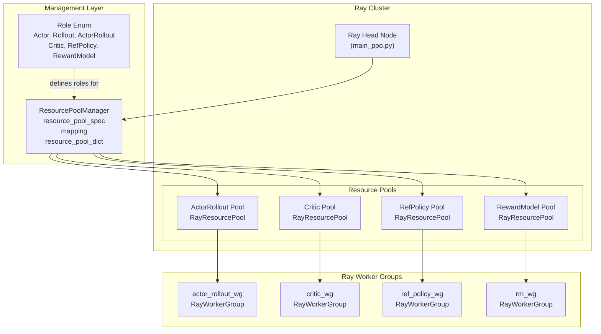
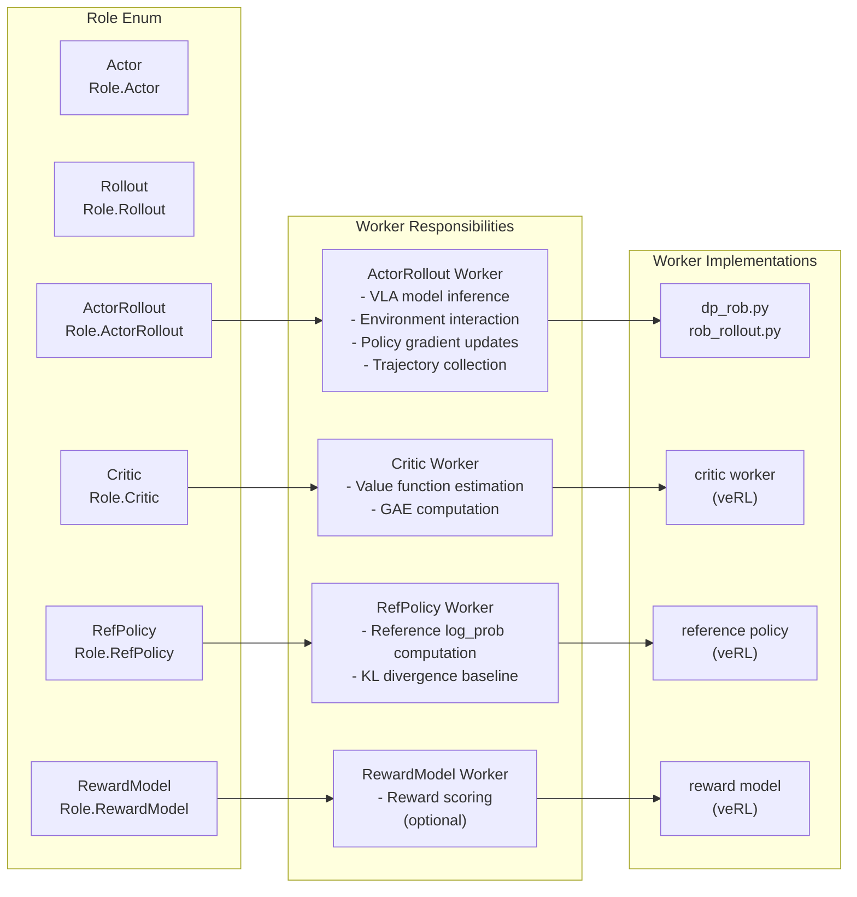
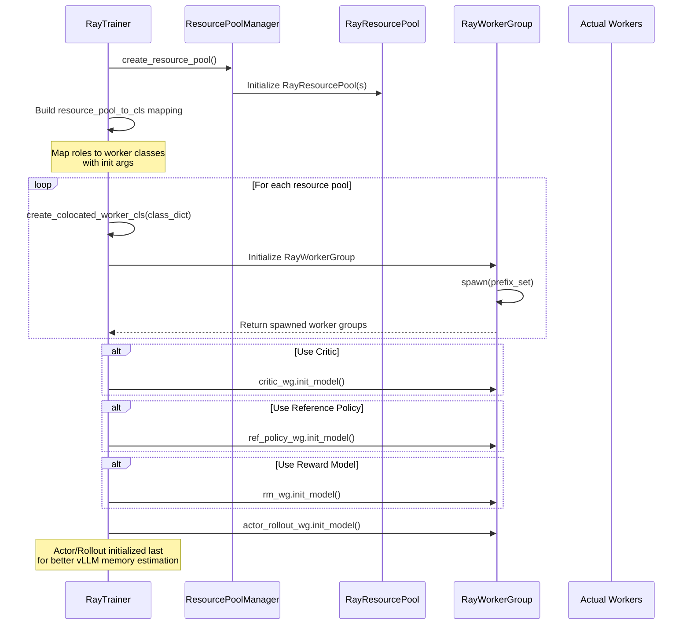
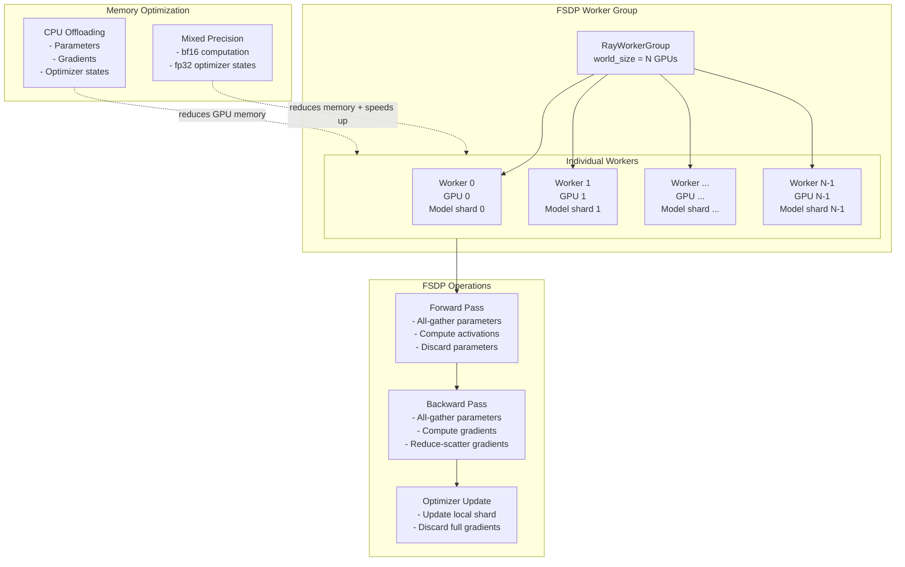
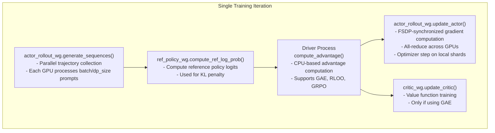

<!-- source: DeepWiki mcp.deepwiki.com · repo PRIME-RL/SimpleVLA-RL · page 6 Distributed Training · fetched 2026-10-30 -->

# Distributed Training

<details>
<summary>Relevant source files</summary>

The following files were used as context for generating this wiki page:

- [README.md](README.md)
- [align.json](align.json)
- [verl/trainer/ppo/ray_trainer.py](verl/trainer/ppo/ray_trainer.py)

</details>


## Purpose and Scope

This page documents the distributed training infrastructure in SimpleVLA-RL, which leverages Ray for orchestrating multi-GPU and multi-node training. The system uses Ray's resource pooling to manage different worker types (ActorRollout, Critic, RefPolicy, RewardModel) and employs PyTorch's Fully Sharded Data Parallel (FSDP) to enable training of large Vision-Language-Action models that exceed single-GPU memory capacity.

For information about the overall training loop orchestration, see [PPO Training Loop](#3.1). For details on the actual policy update mechanics, see [Policy Updates and Actor](#3.2). For environment interaction specifics, see [Rollout Workers](#4.3).

---

## Ray Cluster Architecture

SimpleVLA-RL builds on veRL's Ray-based distributed infrastructure to coordinate training across multiple GPUs and nodes. The system organizes computational resources into pools that are dynamically allocated to different worker roles based on the training configuration.



**Sources:** [verl/trainer/ppo/ray_trainer.py:42-53](), [verl/trainer/ppo/ray_trainer.py:55-79](), [README.md:46-48]()

The Ray cluster is initialized in `main_ppo.py`, which serves as the entry point for distributed training. The `RayTrainer` class in [verl/trainer/ppo/ray_trainer.py:247-830]() manages the lifecycle of all worker groups and coordinates their interactions during training.

---

## Resource Pool Management

The `ResourcePoolManager` dataclass [verl/trainer/ppo/ray_trainer.py:55-79]() is responsible for creating and mapping Ray resource pools to worker roles. Each resource pool represents a collection of GPU resources that can be allocated to worker groups.

### ResourcePoolManager Structure

| Field | Type | Purpose |
|-------|------|---------|
| `resource_pool_spec` | `dict[str, list[int]]` | Specification of which processes run on which nodes |
| `mapping` | `dict[Role, str]` | Maps worker roles to resource pool names |
| `resource_pool_dict` | `dict[str, RayResourcePool]` | Instantiated resource pools |

### Resource Pool Creation

The `create_resource_pool()` method [verl/trainer/ppo/ray_trainer.py:65-74]() instantiates `RayResourcePool` objects based on the specification:

```python
resource_pool = RayResourcePool(
    process_on_nodes=process_on_nodes,
    use_gpu=True,
    max_colocate_count=1,  # Recommended for FSDP backend
    name_prefix=resource_pool_name
)
```

The `max_colocate_count=1` setting merges all worker groups into a single process per resource pool, which is the recommended configuration for FSDP to maximize memory efficiency and minimize communication overhead.

### Role-to-Pool Mapping

The `get_resource_pool()` method [verl/trainer/ppo/ray_trainer.py:76-78]() retrieves the appropriate resource pool for a given role, enabling flexible resource allocation strategies where different roles can share or have dedicated GPU resources.

**Sources:** [verl/trainer/ppo/ray_trainer.py:55-79](), [verl/trainer/ppo/ray_trainer.py:393-467]()

---

## Worker Roles and Responsibilities

The system defines worker roles through the `Role` enum [verl/trainer/ppo/ray_trainer.py:42-53](), which determines the computational responsibilities of each worker group.



**Sources:** [verl/trainer/ppo/ray_trainer.py:42-53](), [verl/trainer/ppo/ray_trainer.py:264-274]()

### Hybrid Engine Mode

SimpleVLA-RL operates in "hybrid engine" mode [verl/trainer/ppo/ray_trainer.py:264-269](), which combines the Actor and Rollout roles into a single `ActorRollout` worker group. This design decision reduces communication overhead and memory transfer between policy updates and trajectory collection.

The hybrid engine assertion [verl/trainer/ppo/ray_trainer.py:265]() ensures that `Role.ActorRollout` is present in the worker mapping, as this is currently the only supported configuration.

### Conditional Worker Creation

Not all worker roles are required for every training configuration:

- **Critic Worker**: Only created when using GAE advantage estimation [verl/trainer/ppo/ray_trainer.py:410-422]()
- **Reference Policy Worker**: Only created when KL divergence control is enabled [verl/trainer/ppo/ray_trainer.py:425-430]()
- **Reward Model Worker**: Optional, for learned reward functions [verl/trainer/ppo/ray_trainer.py:433-437]()

**Sources:** [verl/trainer/ppo/ray_trainer.py:264-274](), [verl/trainer/ppo/ray_trainer.py:410-437]()

---

## Worker Group Instantiation

The `init_workers()` method [verl/trainer/ppo/ray_trainer.py:393-467]() orchestrates the creation and initialization of all worker groups required for training.



**Sources:** [verl/trainer/ppo/ray_trainer.py:393-467]()

### Worker Class Specification

Workers are instantiated using `RayClassWithInitArgs` [verl/trainer/ppo/ray_trainer.py:402-405](), which wraps the worker class with its configuration:

```python
actor_rollout_cls = RayClassWithInitArgs(
    cls=self.role_worker_mapping[Role.ActorRollout],
    config=self.config.actor_rollout_ref,
    role='actor_rollout'
)
```

The `role_worker_mapping` dictionary maps each `Role` to its corresponding worker implementation class (e.g., `FSDPWorker` from `verl/workers/fsdp_workers.py`).

### Colocated Worker Pattern

The `create_colocated_worker_cls()` function [verl/trainer/ppo/ray_trainer.py:446]() enables multiple worker types to share the same Ray actors, reducing memory overhead and inter-process communication. All workers in the same resource pool are colocated, with `max_colocate_count=1` ensuring they run in the same process space.

### Worker Initialization Order

The actor/rollout worker is initialized last [verl/trainer/ppo/ray_trainer.py:466-467]() to allow vLLM (if used) to make a more accurate estimate of available KV cache memory after other models have been loaded.

**Sources:** [verl/trainer/ppo/ray_trainer.py:393-467](), [verl/trainer/ppo/ray_trainer.py:440-451]()

---

## FSDP Integration and Memory Optimization

SimpleVLA-RL uses PyTorch's Fully Sharded Data Parallel (FSDP) to enable training of large VLA models by sharding model parameters, gradients, and optimizer states across multiple GPUs.

### FSDP Worker Architecture



**Sources:** [README.md:48](), [verl/workers/fsdp_workers.py]()

### Data Parallelism with FSDP

The `actor_rollout_wg.world_size` [verl/trainer/ppo/ray_trainer.py:484]() represents the total number of GPUs participating in training. For tensor model parallelism (if enabled), the data parallel size is calculated as:

```python
dp_size = self.actor_rollout_wg.world_size // self.config.actor_rollout_ref.rollout.tensor_model_parallel_size
```

This allows the system to support both data parallelism (multiple replicas processing different data) and tensor parallelism (single model split across GPUs).

### Sharding Strategy

FSDP supports multiple sharding strategies:

| Strategy | Parameters | Gradients | Optimizer States | Memory Efficiency |
|----------|-----------|-----------|------------------|-------------------|
| `FULL_SHARD` | Sharded | Sharded | Sharded | Highest |
| `SHARD_GRAD_OP` | Replicated | Sharded | Sharded | Medium |
| `NO_SHARD` | Replicated | Replicated | Replicated | Lowest (DDP) |

SimpleVLA-RL uses `FULL_SHARD` by default to maximize memory efficiency for large VLA models.

### CPU Offloading

To further reduce GPU memory usage, FSDP can offload components to CPU:

- **Parameter Offloading**: Parameters are stored on CPU and moved to GPU only during forward/backward passes
- **Gradient Offloading**: Gradients are immediately moved to CPU after computation
- **Optimizer State Offloading**: Optimizer momentum and variance buffers reside on CPU

The offloading configuration is specified in the model configuration under `actor_rollout_ref.model.fsdp_config`.

**Sources:** [README.md:48](), [verl/trainer/ppo/ray_trainer.py:484](), [verl/workers/fsdp_workers.py]()

---

## Environment Variables for Distributed Training

The `align.json` configuration file [align.json:1-14]() sets critical environment variables for distributed training:

| Variable | Value | Purpose |
|----------|-------|---------|
| `NCCL_DEBUG` | `WARN` | Controls NCCL (NVIDIA Collective Communications Library) logging verbosity for multi-GPU communication |
| `RAY_memory_monitor_refresh_ms` | `0` | Disables Ray's memory monitoring refresh to reduce overhead |
| `VLLM_ATTENTION_BACKEND` | `XFORMERS` | Selects XFormers as the attention implementation for vLLM (if used) |
| `PYTORCH_CUDA_ALLOC_CONF` | `expandable_segments:True` | Enables PyTorch's expandable CUDA memory segments to reduce fragmentation |
| `TOKENIZERS_PARALLELISM` | `true` | Enables parallel tokenization |
| `WANDB_API_KEY` | User-provided | Authentication for Weights & Biases experiment tracking |

These environment variables are loaded by `main_ppo.py` before initializing the Ray cluster.

**Sources:** [align.json:1-14](), [README.md:116]()

---

## Configuration Example

Here is a typical configuration for distributed training on 2 nodes with 8 GPUs each:

```yaml
# Resource allocation
actor_rollout_ref:
  rollout:
    tensor_model_parallel_size: 1  # No tensor parallelism
    name: fsdp
  
  model:
    fsdp_config:
      sharding_strategy: "FULL_SHARD"
      cpu_offload: false  # Keep on GPU for speed
      mixed_precision: true  # Use bf16
  
  actor:
    optim:
      lr: 1e-5
      total_training_steps: 1000  # Computed dynamically

# Training configuration  
trainer:
  total_epochs: 3
  save_freq: 100
  test_freq: 50
  
data:
  train_batch_size: 32
  n_samples: 8  # Responses per prompt
```

The shell script would specify:

```bash
NUM_NODES=2
NUM_GPUS=8
```

This results in 16 total GPUs being utilized, with the model sharded via FSDP across all GPUs in each worker group.

**Sources:** [README.md:119-135](), [verl/trainer/ppo/ray_trainer.py:329-334]()

---

## Worker Communication Patterns



**Sources:** [verl/trainer/ppo/ray_trainer.py:549](), [verl/trainer/ppo/ray_trainer.py:614-616](), [verl/trainer/ppo/ray_trainer.py:649-654](), [verl/trainer/ppo/ray_trainer.py:662-671]()

The training loop follows a gather-compute-update pattern:

1. **Generation Phase** [verl/trainer/ppo/ray_trainer.py:549](): Worker group generates trajectories in parallel, with data automatically distributed across GPUs
2. **Reference Policy Phase** [verl/trainer/ppo/ray_trainer.py:614-616](): If KL control is enabled, compute reference log probabilities
3. **Advantage Computation** [verl/trainer/ppo/ray_trainer.py:649-654](): Centralized computation on the driver process
4. **Policy Update** [verl/trainer/ppo/ray_trainer.py:662-671](): FSDP-synchronized gradient computation and optimizer step

All worker group methods automatically handle data distribution and collection across the distributed workers.

**Sources:** [verl/trainer/ppo/ray_trainer.py:469-716]()

---

