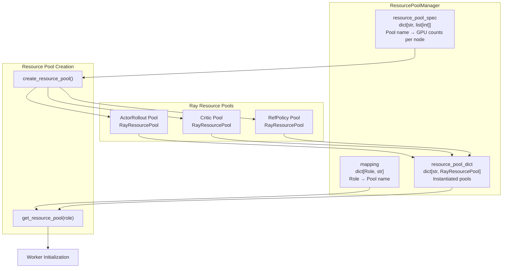
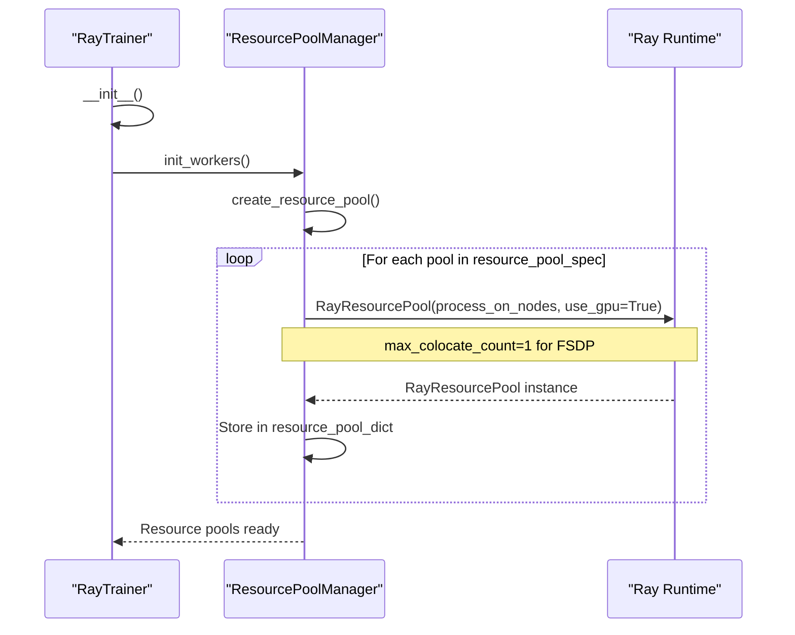
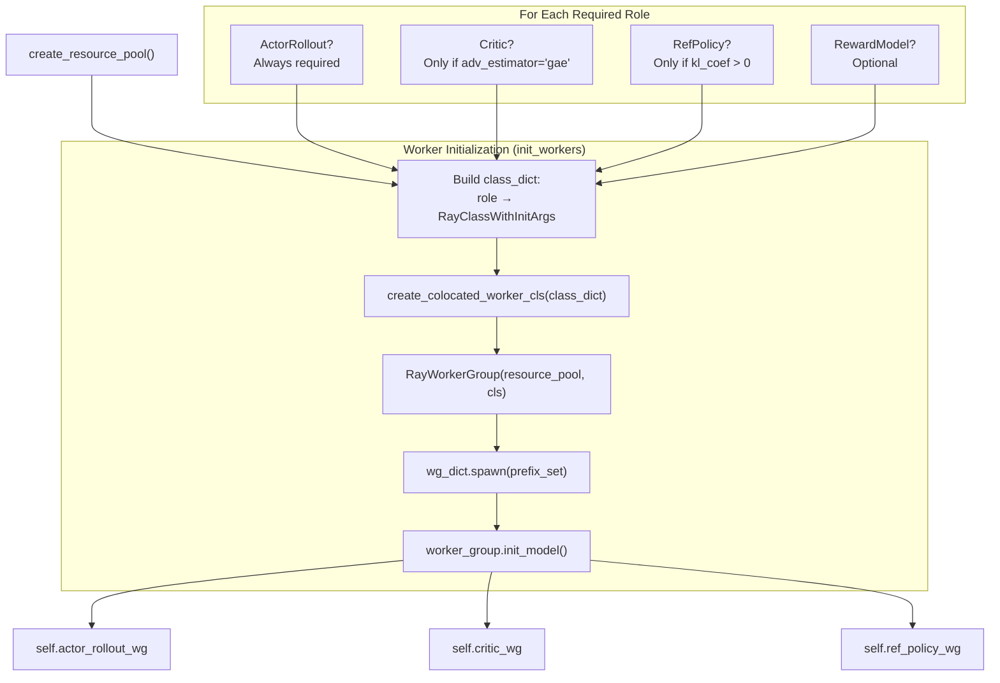
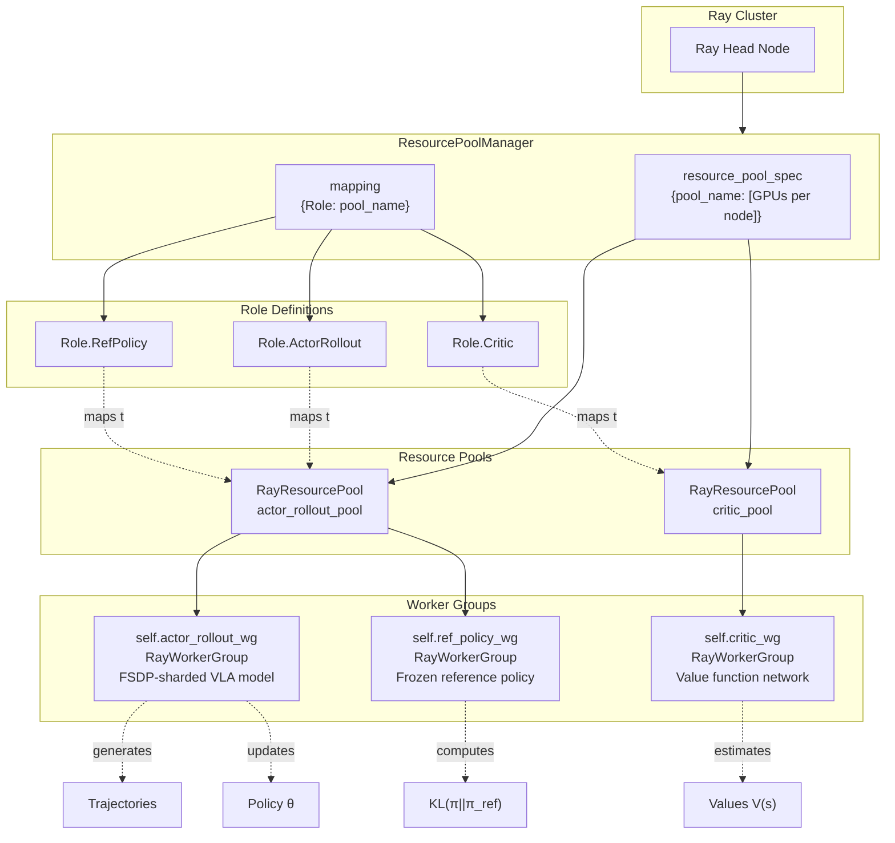

<!-- source: DeepWiki mcp.deepwiki.com · repo PRIME-RL/SimpleVLA-RL · page 6.1 Ray Infrastructure · fetched 2026-10-30 -->

# Ray Infrastructure

<details>
<summary>Relevant source files</summary>

The following files were used as context for generating this wiki page:

- [README.md](README.md)
- [verl/trainer/ppo/ray_trainer.py](verl/trainer/ppo/ray_trainer.py)

</details>


## Purpose and Scope

This document explains how SimpleVLA-RL uses Ray for distributed training infrastructure. It covers Ray cluster initialization, resource pool architecture, role-based worker organization, and how the training system allocates compute resources across multiple GPUs and nodes. For information about worker group implementations and FSDP memory optimization, see [Worker Groups and Roles](#6.2) and [FSDP and Memory Optimization](#6.3).

**Sources:** [README.md:1-214](), [verl/trainer/ppo/ray_trainer.py:1-830]()

---

## Ray Cluster Overview

SimpleVLA-RL leverages Ray's distributed execution framework to orchestrate training across multiple GPUs and nodes. The system initializes a Ray cluster at startup and organizes compute resources into **resource pools**, each dedicated to specific roles in the training pipeline (actor/rollout, critic, reference policy, reward model).

### System Entry Point

The main entry point `verl/trainer/main_ppo.py` performs two critical initialization steps:

1. **Ray cluster initialization** - Sets up the distributed execution environment
2. **RobRewardManager creation** - Distributes reward computation across workers

After initialization, control flows to `ray_trainer.py`, which manages the resource pool and worker group lifecycle.

**Sources:** [README.md:64-66](), [README.md:129-133]()

---

## Role-Based Architecture

The training system defines multiple **roles** that represent different computational responsibilities. Each role corresponds to a specific type of worker that performs distinct operations during training.

### Role Enumeration

```python
class Role(Enum):
    Actor = 0
    Rollout = 1
    ActorRollout = 2
    Critic = 3
    RefPolicy = 4
    RewardModel = 5
    ActorRolloutRef = 6
```

| Role | Purpose | Required |
|------|---------|----------|
| `ActorRollout` | Combined policy updates and trajectory collection (hybrid engine mode) | Yes |
| `Actor` | Policy gradient computation and model updates (non-hybrid mode) | Conditional |
| `Rollout` | Environment interaction and trajectory generation (non-hybrid mode) | Conditional |
| `Critic` | Value function estimation for GAE advantage computation | Only with `adv_estimator='gae'` |
| `RefPolicy` | Reference policy for KL divergence penalty | Only when `kl_coef > 0` |
| `RewardModel` | Process reward model for dense rewards | Optional |

**Note:** SimpleVLA-RL currently operates exclusively in **hybrid engine mode**, where `ActorRollout` workers handle both policy updates and environment rollouts. This reduces inter-process communication overhead.

**Sources:** [verl/trainer/ppo/ray_trainer.py:42-52](), [verl/trainer/ppo/ray_trainer.py:264-268]()

### Role-to-Worker Mapping

The system maintains a mapping from roles to worker class implementations:

```
role_worker_mapping: dict[Role, WorkerType]
```

This mapping is provided during trainer initialization and defines which worker class handles each role. For example:
- `Role.ActorRollout` → `FSDPWorker` (from `fsdp_workers.py`)
- `Role.Critic` → `CriticWorker`
- `Role.RefPolicy` → `FSDPWorker` (with `role='ref'`)

**Sources:** [verl/trainer/ppo/ray_trainer.py:249-274]()

---

## Resource Pool Architecture

Ray organizes compute resources into **resource pools**, which are collections of GPUs that can be shared by multiple worker groups. The `ResourcePoolManager` class orchestrates this organization.

### ResourcePoolManager Structure



**Sources:** [verl/trainer/ppo/ray_trainer.py:55-78]()

### Resource Pool Specification

The `resource_pool_spec` dictionary defines how many GPUs are allocated per node for each pool:

```python
resource_pool_spec: dict[str, list[int]]
# Example:
{
    "actor_rollout_pool": [8, 8],  # 8 GPUs on node 0, 8 GPUs on node 1
    "critic_pool": [4],             # 4 GPUs on node 0
}
```

Each `list[int]` specifies the number of GPUs (`process_on_nodes`) available on consecutive nodes in the cluster.

**Sources:** [verl/trainer/ppo/ray_trainer.py:61-74]()

### Role-to-Pool Mapping

The `mapping` dictionary connects roles to their designated resource pools:

```python
mapping: dict[Role, str]
# Example:
{
    Role.ActorRollout: "actor_rollout_pool",
    Role.Critic: "critic_pool",
    Role.RefPolicy: "actor_rollout_pool",  # Can share pools
}
```

Multiple roles can share the same resource pool by mapping to the same pool name.

**Sources:** [verl/trainer/ppo/ray_trainer.py:62-78]()

---

## Resource Pool Creation

The `ResourcePoolManager` creates `RayResourcePool` instances during initialization. This process happens early in the trainer's lifecycle, before any workers are instantiated.

### Creation Process



**Sources:** [verl/trainer/ppo/ray_trainer.py:393-395](), [verl/trainer/ppo/ray_trainer.py:65-74]()

### RayResourcePool Parameters

Each `RayResourcePool` is created with the following parameters:

```python
RayResourcePool(
    process_on_nodes=[8, 8],      # GPU allocation per node
    use_gpu=True,                  # Enable GPU resources
    max_colocate_count=1,          # Number of WorkerGroups per pool
    name_prefix="actor_rollout"    # Human-readable identifier
)
```

**Key Parameter: `max_colocate_count`**
- **FSDP backend** (used by SimpleVLA-RL): Set to `1` to merge all workers into a single `WorkerGroup` for efficient tensor sharding
- **Megatron backend**: Can use `>1` to maintain separate `WorkerGroup` instances for different models

**Sources:** [verl/trainer/ppo/ray_trainer.py:66-74]()

---

## Worker Group Instantiation

After resource pools are created, the trainer instantiates worker groups for each role. This process involves creating Ray actor classes and spawning worker instances.

### Initialization Sequence



**Sources:** [verl/trainer/ppo/ray_trainer.py:393-467]()

### Class Dictionary Construction

For each role, the system creates a `RayClassWithInitArgs` wrapper that packages the worker class with its configuration:

```python
# Example for ActorRollout role
actor_rollout_cls = RayClassWithInitArgs(
    cls=self.role_worker_mapping[Role.ActorRollout],  # Worker class
    config=self.config.actor_rollout_ref,              # Configuration
    role='actor_rollout'                               # Role identifier
)
```

Multiple roles sharing a resource pool are grouped into a `class_dict`:

```python
resource_pool_to_cls = {
    resource_pool_1: {
        'actor_rollout': actor_rollout_cls,
        'ref': ref_policy_cls,  # Shares same pool
    },
    resource_pool_2: {
        'critic': critic_cls,
    }
}
```

**Sources:** [verl/trainer/ppo/ray_trainer.py:397-437](), [verl/trainer/ppo/ray_trainer.py:444-451]()

### Colocated Worker Classes

When multiple roles share a resource pool, `create_colocated_worker_cls()` merges them into a single Ray actor class. This allows the roles to share GPU memory efficiently:

```python
worker_dict_cls = create_colocated_worker_cls(class_dict={
    'actor_rollout': actor_rollout_cls,
    'ref': ref_policy_cls,
})
```

The resulting `worker_dict_cls` is a Ray actor that contains both the actor/rollout worker and reference policy worker as attributes.

**Sources:** [verl/trainer/ppo/ray_trainer.py:446]()

### Worker Group Spawning

The `RayWorkerGroup` is instantiated with the resource pool and colocated worker class, then spawned:

```python
wg_dict = RayWorkerGroup(
    resource_pool=resource_pool,
    ray_cls_with_init=worker_dict_cls
)

# Spawn individual worker groups with name prefixes
spawn_wg = wg_dict.spawn(prefix_set={'actor_rollout', 'ref'})
# Returns: {
#   'actor_rollout': WorkerGroup instance,
#   'ref': WorkerGroup instance,
# }
```

**Sources:** [verl/trainer/ppo/ray_trainer.py:447-449]()

### Model Initialization Order

Workers must initialize their models in a specific order to enable VLLM's accurate KV cache memory estimation:

```python
# 1. Initialize critic first (if used)
if self.use_critic:
    self.critic_wg.init_model()

# 2. Initialize reference policy (if used)
if self.use_reference_policy:
    self.ref_policy_wg.init_model()

# 3. Initialize reward model (if used)
if self.use_rm:
    self.rm_wg.init_model()

# 4. Initialize actor/rollout LAST
# This allows VLLM to accurately estimate remaining memory for KV cache
self.actor_rollout_wg.init_model()
```

**Sources:** [verl/trainer/ppo/ray_trainer.py:453-467]()

---

## Configuration Examples

### Single-Node Configuration

For a single node with 8 GPUs:

```yaml
# Resource pool specification
resource_pool_spec:
  actor_rollout_pool: [8]  # All 8 GPUs for actor/rollout

# Role mapping
mapping:
  ActorRollout: "actor_rollout_pool"
  RefPolicy: "actor_rollout_pool"  # Share the same pool
```

**Environment variables:**
- `NUM_NODES=1`
- `NUM_GPUS=8`

**Sources:** [README.md:132-133]()

### Multi-Node Configuration

For 2 nodes with 8 GPUs each:

```yaml
# Resource pool specification
resource_pool_spec:
  actor_rollout_pool: [8, 8]  # 8 GPUs per node across 2 nodes

# Role mapping
mapping:
  ActorRollout: "actor_rollout_pool"
```

**Environment variables:**
- `NUM_NODES=2`
- `NUM_GPUS=8`

**Sources:** [README.md:133]()

---

## Role Instantiation Logic

The trainer conditionally instantiates roles based on algorithm configuration:

### ActorRollout (Always Required)

```python
if self.hybrid_engine:
    resource_pool = self.resource_pool_manager.get_resource_pool(Role.ActorRollout)
    actor_rollout_cls = RayClassWithInitArgs(
        cls=self.role_worker_mapping[Role.ActorRollout],
        config=self.config.actor_rollout_ref,
        role='actor_rollout'
    )
    self.resource_pool_to_cls[resource_pool]['actor_rollout'] = actor_rollout_cls
```

**Sources:** [verl/trainer/ppo/ray_trainer.py:400-407]()

### Critic (Conditional)

```python
if self.config.algorithm.adv_estimator == 'gae':
    resource_pool = self.resource_pool_manager.get_resource_pool(Role.Critic)
    critic_cls = RayClassWithInitArgs(
        cls=self.role_worker_mapping[Role.Critic],
        config=self.config.critic
    )
    self.resource_pool_to_cls[resource_pool]['critic'] = critic_cls
    self.use_critic = True
elif self.config.algorithm.adv_estimator in ['rloo', 'grpo', 'reinforce_plus_plus']:
    self.use_critic = False
```

The critic is only instantiated when using Generalized Advantage Estimation (GAE), which requires value function estimates. Other advantage estimators (RLOO, GRPO) compute advantages without a critic.

**Sources:** [verl/trainer/ppo/ray_trainer.py:410-422]()

### Reference Policy (Conditional)

```python
if self.use_reference_policy:
    resource_pool = self.resource_pool_manager.get_resource_pool(Role.RefPolicy)
    ref_policy_cls = RayClassWithInitArgs(
        self.role_worker_mapping[Role.RefPolicy],
        config=self.config.actor_rollout_ref,
        role='ref'
    )
    self.resource_pool_to_cls[resource_pool]['ref'] = ref_policy_cls
```

Where:
```python
self.use_reference_policy = (
    Role.RefPolicy in role_worker_mapping and 
    config.algorithm.kl_ctrl.kl_coef > 0
)
```

The reference policy is only instantiated when KL divergence penalty is enabled (`kl_coef > 0`).

**Sources:** [verl/trainer/ppo/ray_trainer.py:272](), [verl/trainer/ppo/ray_trainer.py:425-430]()

### Reward Model (Optional)

```python
if self.use_rm:
    resource_pool = self.resource_pool_manager.get_resource_pool(Role.RewardModel)
    rm_cls = RayClassWithInitArgs(
        self.role_worker_mapping[Role.RewardModel],
        config=self.config.reward_model
    )
    self.resource_pool_to_cls[resource_pool]['rm'] = rm_cls
```

The reward model role is optional and rarely used in SimpleVLA-RL, as the system primarily relies on environment-provided binary rewards processed by `RobRewardManager`.

**Sources:** [verl/trainer/ppo/ray_trainer.py:273](), [verl/trainer/ppo/ray_trainer.py:433-437]()

---

## System Architecture Diagram

The following diagram shows the complete Ray infrastructure architecture, mapping roles to resource pools and worker groups:



**Sources:** [verl/trainer/ppo/ray_trainer.py:55-78](), [verl/trainer/ppo/ray_trainer.py:393-467]()

---

## Worker Group References

After initialization, the trainer maintains references to worker groups as instance attributes:

| Attribute | Type | Condition | Purpose |
|-----------|------|-----------|---------|
| `self.actor_rollout_wg` | `RayWorkerGroup` | Always | Policy updates and trajectory collection |
| `self.critic_wg` | `RayWorkerGroup` | `adv_estimator='gae'` | Value function estimation |
| `self.ref_policy_wg` | `RayWorkerGroup` | `kl_coef > 0` | Reference log probabilities for KL penalty |
| `self.rm_wg` | `RayWorkerGroup` | Optional | Process reward model scoring |

These worker groups are used throughout the training loop (see [PPO Training Loop](#3.1)) to:
- Generate environment rollouts: `self.actor_rollout_wg.generate_sequences()`
- Update policy parameters: `self.actor_rollout_wg.update_actor()`
- Compute value estimates: `self.critic_wg.compute_values()`
- Calculate reference probabilities: `self.ref_policy_wg.compute_ref_log_prob()`

**Sources:** [verl/trainer/ppo/ray_trainer.py:453-467]()

---

## Summary

The Ray infrastructure in SimpleVLA-RL provides a flexible, scalable foundation for distributed VLA training:

1. **Entry Point**: `main_ppo.py` initializes the Ray cluster and reward manager
2. **Resource Organization**: `ResourcePoolManager` allocates GPUs into named pools
3. **Role-Based Design**: Different computational responsibilities (actor, critic, reference) are separated into roles
4. **Worker Instantiation**: `RayWorkerGroup` instances are created per role, sharing resource pools when appropriate
5. **Hybrid Engine**: The `ActorRollout` role combines policy updates and rollouts for efficiency
6. **Conditional Instantiation**: Critic, reference policy, and reward model workers are only created when required by the algorithm configuration

This architecture enables SimpleVLA-RL to efficiently scale across multiple GPUs and nodes while maintaining clear separation of concerns between different training components.

**Sources:** [README.md:46-48](), [verl/trainer/ppo/ray_trainer.py:1-830]()

---

