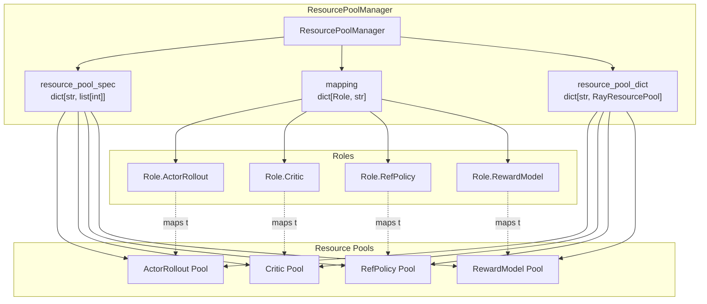
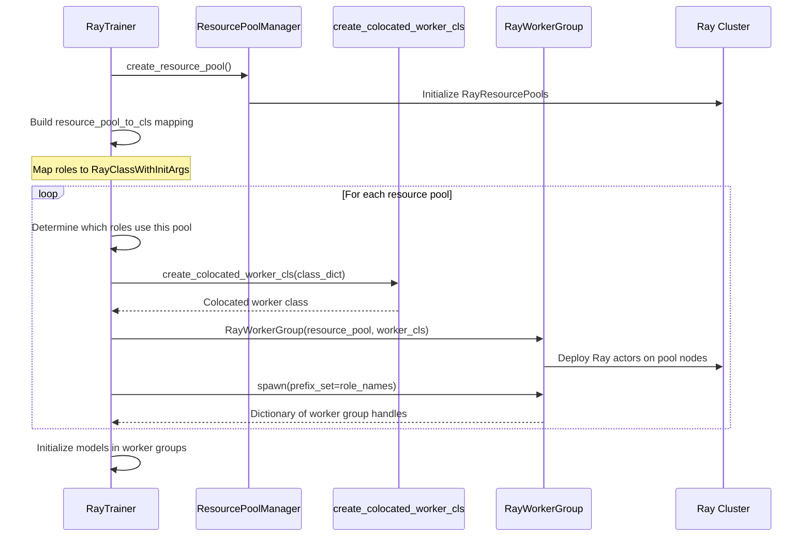
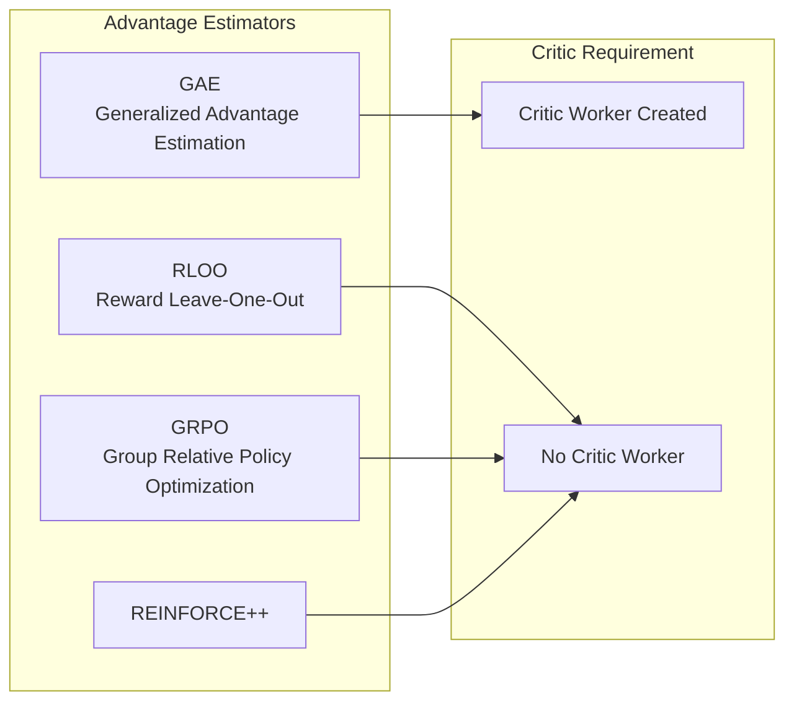
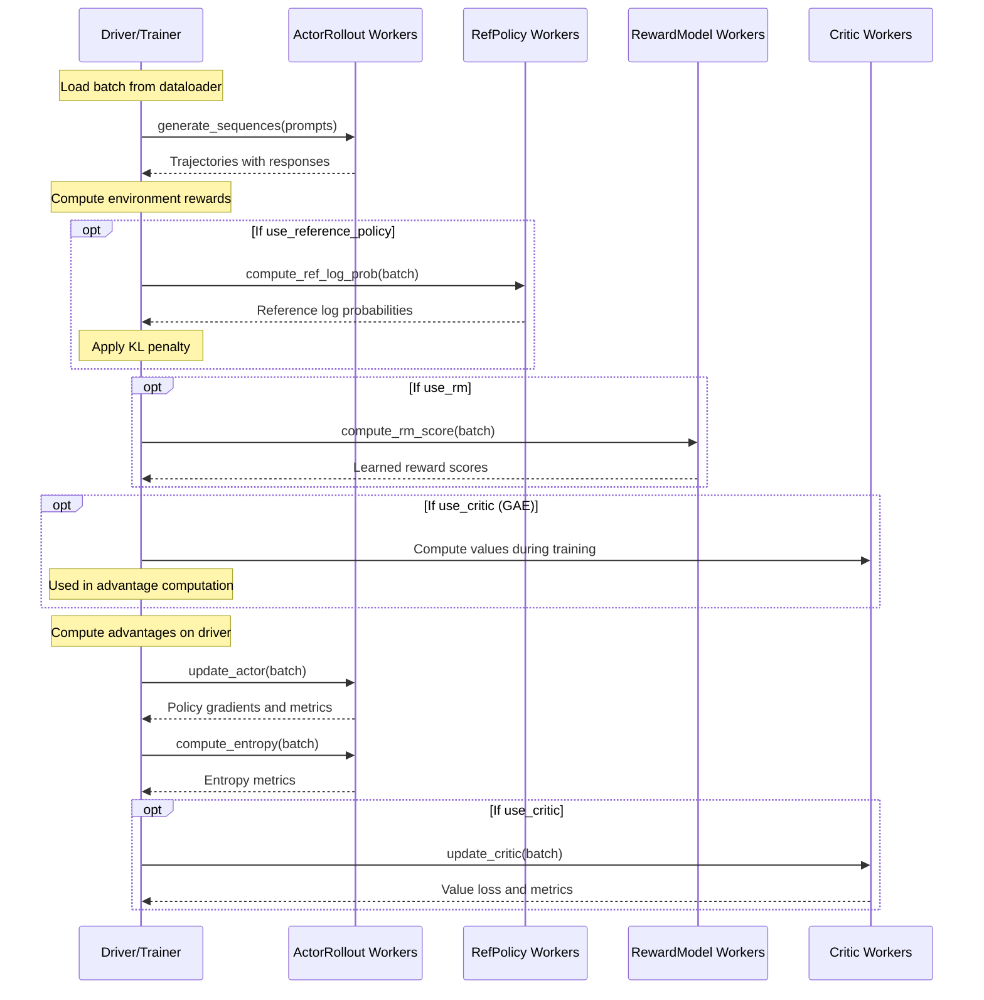
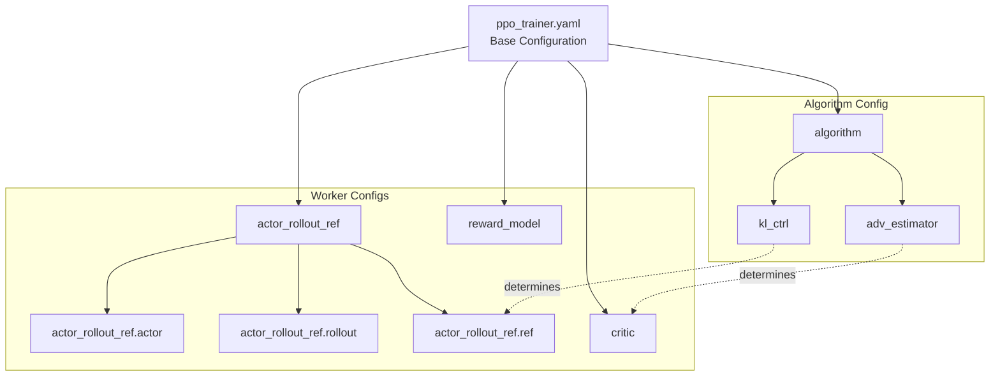

<!-- source: DeepWiki mcp.deepwiki.com · repo PRIME-RL/SimpleVLA-RL · page 6.2 Worker Groups and Roles · fetched 2026-10-30 -->

# Worker Groups and Roles

<details>
<summary>Relevant source files</summary>

The following files were used as context for generating this wiki page:

- [.gitignore](.gitignore)
- [verl/trainer/config/ppo_trainer.yaml](verl/trainer/config/ppo_trainer.yaml)
- [verl/trainer/ppo/ray_trainer.py](verl/trainer/ppo/ray_trainer.py)

</details>


This page documents the role-based worker architecture in SimpleVLA-RL's distributed training system. It explains how different worker roles (ActorRollout, Critic, RefPolicy, RewardModel) are defined, instantiated, and managed through Ray's resource pooling mechanism. For information about Ray cluster setup and resource allocation, see [Ray Infrastructure](#6.1). For details on FSDP sharding within workers, see [FSDP and Memory Optimization](#6.3).

## Role-Based Worker Architecture

SimpleVLA-RL organizes distributed computation into distinct roles, each responsible for a specific aspect of the PPO training pipeline. This design allows flexible resource allocation and enables different components to scale independently.

### Role Enumeration

The system defines seven worker roles through the `Role` enum:

```python
class Role(Enum):
    Actor = 0           # Policy network for training updates
    Rollout = 1         # Environment interaction for trajectory collection
    ActorRollout = 2    # Combined actor and rollout (hybrid engine mode)
    Critic = 3          # Value function estimation
    RefPolicy = 4       # Reference policy for KL divergence
    RewardModel = 5     # Optional learned reward model
    ActorRolloutRef = 6 # Combined actor, rollout, and reference
```

**Sources:** [verl/trainer/ppo/ray_trainer.py:42-53]()

### Role Purpose and Responsibilities

| Role | Primary Function | Required | Memory Profile |
|------|-----------------|----------|----------------|
| `ActorRollout` | Policy inference + gradient updates + trajectory collection | Always (in hybrid mode) | High GPU (model weights + activations) |
| `Critic` | Value function estimation for GAE | Only if `adv_estimator='gae'` | High GPU (separate model) |
| `RefPolicy` | Compute reference log probabilities for KL penalty | Only if `kl_coef > 0` | High GPU (frozen model) |
| `RewardModel` | Learned reward scoring | Only if explicitly enabled | High GPU (separate model) |

**Sources:** [verl/trainer/ppo/ray_trainer.py:42-53](), [verl/trainer/config/ppo_trainer.yaml:1-258]()

## Resource Pool Mapping

The `ResourcePoolManager` class manages the mapping between worker roles and Ray resource pools, enabling flexible GPU allocation across different components.



### ResourcePoolManager Implementation

The `ResourcePoolManager` dataclass encapsulates the resource allocation strategy:

```python
@dataclass
class ResourcePoolManager:
    resource_pool_spec: dict[str, list[int]]      # Pool name → GPU node assignments
    mapping: dict[Role, str]                       # Role → Pool name
    resource_pool_dict: dict[str, RayResourcePool] # Instantiated pools
```

The `create_resource_pool` method instantiates Ray resource pools based on the specification:

- `process_on_nodes`: List of node IDs where workers should be placed
- `use_gpu`: Always `True` for VLA training
- `max_colocate_count`: Set to `1` for FSDP (all workers in same process), `>1` for Megatron

**Sources:** [verl/trainer/ppo/ray_trainer.py:56-79]()

## Worker Group Instantiation

Worker groups are instantiated through a multi-step process that maps roles to worker classes, creates colocated worker dictionaries, and spawns Ray actors.



### Worker Instantiation Code Flow

The `init_workers` method orchestrates worker group creation:

**1. Create Resource Pools**
```python
self.resource_pool_manager.create_resource_pool()
self.resource_pool_to_cls = {pool: {} for pool in ...}
```

**2. Map Roles to Worker Classes**

For hybrid engine mode (the standard configuration), ActorRollout is created:

```python
if self.hybrid_engine:
    resource_pool = self.resource_pool_manager.get_resource_pool(Role.ActorRollout)
    actor_rollout_cls = RayClassWithInitArgs(
        cls=self.role_worker_mapping[Role.ActorRollout],
        config=self.config.actor_rollout_ref,
        role='actor_rollout'
    )
    self.resource_pool_to_cls[resource_pool]['actor_rollout'] = actor_rollout_cls
```

**3. Create Colocated Workers and Spawn**

Workers that share a resource pool are colocated in the same Ray actor process:

```python
for resource_pool, class_dict in self.resource_pool_to_cls.items():
    worker_dict_cls = create_colocated_worker_cls(class_dict=class_dict)
    wg_dict = self.ray_worker_group_cls(
        resource_pool=resource_pool,
        ray_cls_with_init=worker_dict_cls
    )
    spawn_wg = wg_dict.spawn(prefix_set=class_dict.keys())
    all_wg.update(spawn_wg)
    self.wg_dicts.append(wg_dict)
```

**4. Initialize Models**

Workers are initialized in a specific order to optimize VLLM cache allocation:

```python
if self.use_critic:
    self.critic_wg = all_wg['critic']
    self.critic_wg.init_model()

if self.use_reference_policy:
    self.ref_policy_wg = all_wg['ref']
    self.ref_policy_wg.init_model()

# Actor/rollout initialized last for better KV cache estimation
self.actor_rollout_wg = all_wg['actor_rollout']
self.actor_rollout_wg.init_model()
```

**Sources:** [verl/trainer/ppo/ray_trainer.py:393-468]()

## Conditional Worker Creation

Different training configurations require different worker roles. The system conditionally instantiates workers based on algorithm settings and training objectives.

### Hybrid Engine Mode

SimpleVLA-RL uses **hybrid engine mode** by default, where actor (policy training) and rollout (trajectory collection) are combined in a single worker group:

```python
self.hybrid_engine = config.actor_rollout_ref.hybrid_engine
assert self.hybrid_engine, 'Currently, only support hybrid engine'

if self.hybrid_engine:
    assert Role.ActorRollout in role_worker_mapping
```

This mode is more efficient than separate actor and rollout workers because:
- Reduces inter-process communication overhead
- Shares model weights between generation and training
- Simplifies memory management with FSDP

**Sources:** [verl/trainer/ppo/ray_trainer.py:264-269]()

### Advantage Estimator Dependencies

The choice of advantage estimator determines whether a critic network is needed:



The instantiation logic:

```python
if self.config.algorithm.adv_estimator == 'gae':
    resource_pool = self.resource_pool_manager.get_resource_pool(Role.Critic)
    critic_cls = RayClassWithInitArgs(
        cls=self.role_worker_mapping[Role.Critic],
        config=self.config.critic
    )
    self.resource_pool_to_cls[resource_pool]['critic'] = critic_cls
    self.use_critic = True
elif self.config.algorithm.adv_estimator in ['rloo', 'grpo', 'reinforce_plus_plus']:
    self.use_critic = False
```

**Advantage Estimator Characteristics:**

| Estimator | Requires Critic | Requires Multiple Samples | Variance | Bias |
|-----------|----------------|---------------------------|----------|------|
| GAE | Yes | No | Low | Medium |
| RLOO | No | Yes | Medium | Low |
| GRPO | No | Yes | Medium | Low |
| REINFORCE++ | No | No | High | Low |

**Sources:** [verl/trainer/ppo/ray_trainer.py:410-422](), [verl/trainer/config/ppo_trainer.yaml:227-236]()

### KL Divergence Control

Reference policy workers are created when KL divergence regularization is enabled:

```python
self.use_reference_policy = (
    Role.RefPolicy in role_worker_mapping and 
    config.algorithm.kl_ctrl.kl_coef > 0
)

if self.use_reference_policy:
    resource_pool = self.resource_pool_manager.get_resource_pool(Role.RefPolicy)
    ref_policy_cls = RayClassWithInitArgs(
        self.role_worker_mapping[Role.RefPolicy],
        config=self.config.actor_rollout_ref,
        role='ref'
    )
    self.resource_pool_to_cls[resource_pool]['ref'] = ref_policy_cls
```

The reference policy serves as a frozen baseline to prevent the policy from diverging too far from its initial behavior. It computes log probabilities that are used in the KL penalty term:

```python
if self.use_reference_policy:
    ref_log_prob = self.ref_policy_wg.compute_ref_log_prob(batch)
    batch = batch.union(ref_log_prob)
```

**KL Controller Types:**

| Type | Behavior | Configuration |
|------|----------|---------------|
| `fixed` | Constant KL coefficient | `kl_coef` value |
| `adaptive` | Adjusts coefficient based on observed KL | `init_kl_coef`, `target_kl`, `horizon` |

**Sources:** [verl/trainer/ppo/ray_trainer.py:272-288](), [verl/trainer/ppo/ray_trainer.py:425-430](), [verl/trainer/ppo/ray_trainer.py:611-616]()

### Reward Model Workers

Reward model workers provide learned reward scores as an alternative or supplement to rule-based rewards:

```python
self.use_rm = Role.RewardModel in role_worker_mapping

if self.use_rm:
    resource_pool = self.resource_pool_manager.get_resource_pool(Role.RewardModel)
    rm_cls = RayClassWithInitArgs(
        self.role_worker_mapping[Role.RewardModel],
        config=self.config.reward_model
    )
    self.resource_pool_to_cls[resource_pool]['rm'] = rm_cls
```

The reward model is optional and typically used when:
- Training on tasks with sparse or ambiguous success criteria
- Learning from human preferences
- Combining multiple reward sources

**Sources:** [verl/trainer/ppo/ray_trainer.py:273](), [verl/trainer/ppo/ray_trainer.py:433-437]()

## Worker Interaction During Training

During the training loop, different worker groups are invoked at specific stages to perform their designated functions.



### Training Loop Worker Calls

**Generation Phase:**
```python
gen_batch_output = self.actor_rollout_wg.generate_sequences(prompts=gen_batch)
```

**Reference Policy (if enabled):**
```python
if self.use_reference_policy:
    ref_log_prob = self.ref_policy_wg.compute_ref_log_prob(batch)
    batch = batch.union(ref_log_prob)
```

**Reward Model (if enabled):**
```python
if self.use_rm:
    reward_model_tensor = self.rm_wg.compute_rm_score(batch)
    batch = batch.union(reward_model_tensor)
```

**Actor Update:**
```python
if self.config.trainer.critic_warmup <= global_steps:
    actor_output = self.actor_rollout_wg.update_actor(batch)
    entropy_output = self.actor_rollout_wg.compute_entropy(data=batch)
```

**Sources:** [verl/trainer/ppo/ray_trainer.py:549](), [verl/trainer/ppo/ray_trainer.py:611-616](), [verl/trainer/ppo/ray_trainer.py:618-627](), [verl/trainer/ppo/ray_trainer.py:662-671]()

## Worker Group Configuration Summary

The following table summarizes how worker groups are configured through `ppo_trainer.yaml`:

| Worker Type | Config Section | Key Parameters |
|-------------|---------------|----------------|
| ActorRollout | `actor_rollout_ref` | `hybrid_engine`, `model.vla`, `actor.fsdp_config`, `rollout.tensor_model_parallel_size` |
| Critic | `critic` | `model.path`, `ppo_mini_batch_size`, `fsdp_config`, `optim.lr` |
| RefPolicy | `actor_rollout_ref.ref` | `fsdp_config`, `log_prob_micro_batch_size` |
| RewardModel | `reward_model` | `model.path`, `mini_batch_size`, `rm_coef`, `prime_*` settings |

**Configuration Hierarchy:**



**Sources:** [verl/trainer/config/ppo_trainer.yaml:24-224]()

## Role-Worker Mapping

The `role_worker_mapping` dictionary passed to `RayTrainer.__init__` specifies which worker class implements each role. This mapping is typically constructed in the main training script:

```python
role_worker_mapping = {
    Role.ActorRollout: fsdp_workers.ActorRolloutWorker,
    Role.Critic: fsdp_workers.CriticWorker,
    Role.RefPolicy: fsdp_workers.ReferenceWorker,
    Role.RewardModel: fsdp_workers.RewardModelWorker,
}
```

Each worker class must implement the `Worker` interface and provide role-specific methods:
- **ActorRollout**: `generate_sequences`, `update_actor`, `compute_entropy`, `init_model`, `save_checkpoint`
- **Critic**: `compute_values`, `update_critic`, `init_model`, `save_checkpoint`
- **RefPolicy**: `compute_ref_log_prob`, `init_model`
- **RewardModel**: `compute_rm_score`, `init_model`, `save_checkpoint`

**Sources:** [verl/trainer/ppo/ray_trainer.py:252]()

---

