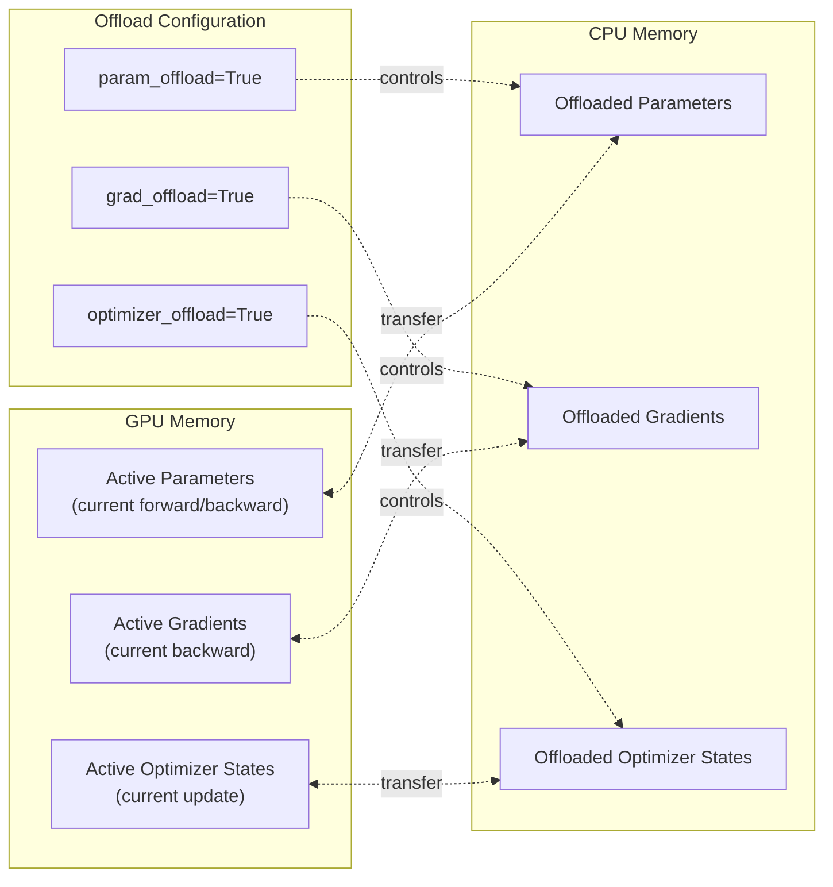
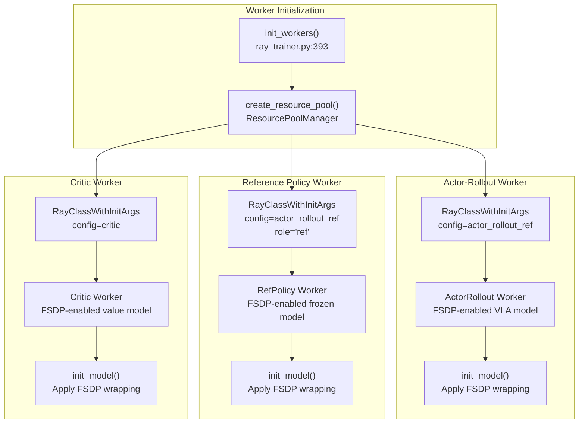
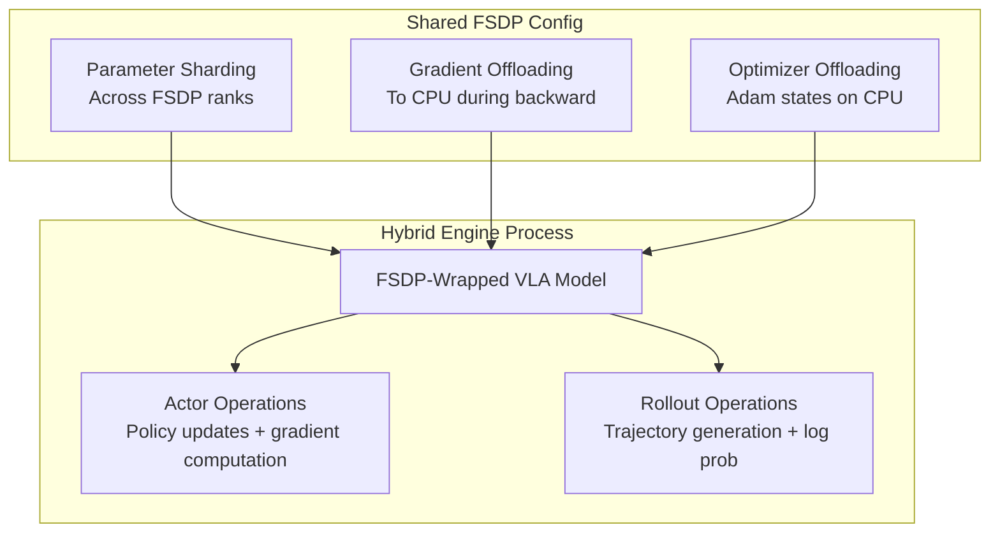

<!-- source: DeepWiki mcp.deepwiki.com · repo PRIME-RL/SimpleVLA-RL · page 6.3 FSDP and Memory Optimization · fetched 2026-10-30 -->

# FSDP and Memory Optimization

<details>
<summary>Relevant source files</summary>

The following files were used as context for generating this wiki page:

- [.gitignore](.gitignore)
- [examples/run_openvla_oft_rl_libero.sh](examples/run_openvla_oft_rl_libero.sh)
- [verl/trainer/config/ppo_trainer.yaml](verl/trainer/config/ppo_trainer.yaml)
- [verl/trainer/ppo/ray_trainer.py](verl/trainer/ppo/ray_trainer.py)

</details>


This page documents the Fully Sharded Data Parallel (FSDP) implementation and memory optimization strategies used in SimpleVLA-RL to enable training of large Vision-Language-Action models across distributed GPU resources. FSDP partitions model parameters, gradients, and optimizer states across multiple GPUs to reduce per-GPU memory requirements while maintaining training efficiency.

For information about the broader distributed training infrastructure, see [Ray Infrastructure](#6.1). For details on worker groups and role-based execution, see [Worker Groups and Roles](#6.2).

---

## FSDP Configuration Architecture

The system uses a hierarchical configuration approach where FSDP settings can be specified globally and overridden per component (actor, reference policy, critic). FSDP is integrated into PyTorch's native distributed training mechanisms and supports selective offloading of parameters, gradients, and optimizer states to CPU memory.

```mermaid
graph TB
    subgraph "Configuration Hierarchy"
        BaseConfig["ppo_trainer.yaml<br/>Base FSDP Config"]
        ScriptOverrides["run_*.sh<br/>Script Overrides"]
        RuntimeConfig["Runtime Configuration"]
    end
    
    subgraph "FSDP Components"
        ActorFSDP["Actor FSDP<br/>actor.fsdp_config"]
        RefFSDP["Reference Policy FSDP<br/>ref.fsdp_config"]
        CriticFSDP["Critic FSDP<br/>critic.model.fsdp_config"]
    end
    
    subgraph "Offloading Strategy"
        ParamOffload["param_offload<br/>Model parameters → CPU"]
        GradOffload["grad_offload<br/>Gradients → CPU"]
        OptimOffload["optimizer_offload<br/>Optimizer states → CPU"]
    end
    
    subgraph "Wrap Policy"
        MinParams["min_num_params<br/>Layer grouping threshold"]
        TransformerLayer["transformer_layer_cls_to_wrap<br/>Specific layer classes"]
    end
    
    BaseConfig --> RuntimeConfig
    ScriptOverrides --> RuntimeConfig
    
    RuntimeConfig --> ActorFSDP
    RuntimeConfig --> RefFSDP
    RuntimeConfig --> CriticFSDP
    
    ActorFSDP --> ParamOffload
    ActorFSDP --> GradOffload
    ActorFSDP --> OptimOffload
    ActorFSDP --> Wrap Policy
    
    RefFSDP --> ParamOffload
    RefFSDP --> Wrap Policy
    
    CriticFSDP --> ParamOffload
    CriticFSDP --> GradOffload
    CriticFSDP --> OptimOffload
    CriticFSDP --> Wrap Policy
```

**Sources:** [verl/trainer/config/ppo_trainer.yaml:65-79](), [examples/run_openvla_oft_rl_libero.sh:45-47]()

---

## FSDP Configuration Parameters

### Actor FSDP Configuration

The actor network uses FSDP to partition the VLA model during policy updates. Configuration is specified under `actor_rollout_ref.actor.fsdp_config`.

| Parameter | Type | Default | Description |
|-----------|------|---------|-------------|
| `param_offload` | bool | `False` | Offload model parameters to CPU when not in use |
| `grad_offload` | bool | `False` | Offload gradients to CPU during backward pass |
| `optimizer_offload` | bool | `False` | Offload optimizer states to CPU |
| `min_num_params` | int | `0` | Minimum parameters per FSDP unit (0 = auto-detect) |
| `fsdp_size` | int | `-1` | FSDP world size (-1 = use all available GPUs) |

**Configuration Example:**
```yaml
# From ppo_trainer.yaml
actor_rollout_ref:
  actor:
    fsdp_config:
      wrap_policy:
        min_num_params: 0
      param_offload: False
      grad_offload: False
      optimizer_offload: False
      fsdp_size: -1
```

**Typical Override for Memory Constrained Training:**
```bash
# From run_openvla_oft_rl_libero.sh
actor_rollout_ref.actor.fsdp_config.param_offload=False \
actor_rollout_ref.actor.fsdp_config.grad_offload=True \
actor_rollout_ref.actor.fsdp_config.optimizer_offload=True
```

This configuration keeps model parameters on GPU for fast forward/backward passes while offloading gradients and optimizer states to CPU, reducing GPU memory usage by approximately 2-3x for large models.

**Sources:** [verl/trainer/config/ppo_trainer.yaml:65-72](), [examples/run_openvla_oft_rl_libero.sh:45-47]()

---

### Reference Policy FSDP Configuration

The reference policy is used for KL divergence computation and typically has more aggressive offloading since it's only used for forward passes (no gradients needed).

| Parameter | Type | Default | Description |
|-----------|------|---------|-------------|
| `param_offload` | bool | `False` | Offload reference model parameters to CPU |
| `min_num_params` | int | `0` | Minimum parameters per FSDP unit |
| `fsdp_size` | int | `-1` | FSDP world size |

**Configuration Example:**
```yaml
# From ppo_trainer.yaml
actor_rollout_ref:
  ref:
    fsdp_config:
      param_offload: False
      wrap_policy:
        min_num_params: 0
      fsdp_size: -1
    log_prob_micro_batch_size: 128
```

**Typical Override for Memory Savings:**
```bash
actor_rollout_ref.ref.fsdp_config.param_offload=True
```

Since the reference policy is frozen and only used for forward passes during log probability computation, parameter offloading has minimal performance impact while significantly reducing memory usage.

**Sources:** [verl/trainer/config/ppo_trainer.yaml:73-79](), [examples/run_openvla_oft_rl_libero.sh:74]()

---

### Critic FSDP Configuration

The critic network (value function) uses FSDP when the `gae` advantage estimator is selected. Configuration mirrors the actor setup but can be independently tuned.

| Parameter | Type | Default | Description |
|-----------|------|---------|-------------|
| `param_offload` | bool | Inherits from actor | Offload critic parameters to CPU |
| `grad_offload` | bool | Inherits from actor | Offload critic gradients to CPU |
| `optimizer_offload` | bool | Inherits from actor | Offload critic optimizer states to CPU |
| `min_num_params` | int | `0` | Minimum parameters per FSDP unit |
| `fsdp_size` | int | `-1` | FSDP world size |

**Configuration Example:**
```yaml
# From ppo_trainer.yaml
critic:
  model:
    fsdp_config:
      param_offload: ${actor_rollout_ref.actor.fsdp_config.param_offload}
      grad_offload: ${actor_rollout_ref.actor.fsdp_config.grad_offload}
      optimizer_offload: ${actor_rollout_ref.actor.fsdp_config.optimizer_offload}
      wrap_policy:
        min_num_params: 0
      fsdp_size: -1
```

The critic configuration defaults to inheriting from the actor configuration using OmegaConf variable interpolation, ensuring consistent memory optimization strategies across components.

**Sources:** [verl/trainer/config/ppo_trainer.yaml:143-150]()

---

## Offloading Strategies



### Parameter Offloading (`param_offload`)

When enabled, FSDP offloads inactive model parameter shards to CPU memory. During forward/backward passes, only the currently needed parameters are transferred to GPU.

**Memory Impact:**
- Reduces GPU memory by ~1/N for N GPUs (parameter sharding)
- Additional CPU memory required: Full model size per GPU
- Performance cost: PCIe bandwidth for parameter transfers

**Use Case:** Enable for very large models (>7B parameters) where GPU memory is severely constrained and training speed can be sacrificed.

**Sources:** [verl/trainer/config/ppo_trainer.yaml:69](), [examples/run_openvla_oft_rl_libero.sh:45]()

---

### Gradient Offloading (`grad_offload`)

Gradients are offloaded to CPU immediately after computation during the backward pass. Gradient synchronization happens on CPU, then gradients are transferred back for optimizer step.

**Memory Impact:**
- Reduces GPU memory by gradient tensor size (~1x model size)
- Moderate performance cost: gradient transfers occur during backward pass

**Use Case:** Recommended as first optimization when GPU memory is limited. Provides good memory savings with acceptable performance trade-off.

**Sources:** [verl/trainer/config/ppo_trainer.yaml:70](), [examples/run_openvla_oft_rl_libero.sh:46]()

---

### Optimizer State Offloading (`optimizer_offload`)

Optimizer states (e.g., Adam momentum and variance buffers) are stored in CPU memory. During parameter updates, states are transferred to GPU, updated, and transferred back.

**Memory Impact:**
- Reduces GPU memory by ~2x model size for Adam optimizer
- Lower performance cost than parameter offloading (transfers occur less frequently)

**Use Case:** Highly recommended for large models. Optimizer states often consume more memory than parameters themselves.

**Sources:** [verl/trainer/config/ppo_trainer.yaml:71](), [examples/run_openvla_oft_rl_libero.sh:47]()

---

## Component-Specific FSDP Initialization

The worker initialization process in `ray_trainer.py` sets up FSDP-enabled workers for different roles. Each component receives its own FSDP configuration from the merged config.



### Worker Initialization Sequence

1. **Resource Pool Creation** ([verl/trainer/ppo/ray_trainer.py:395]()): `ResourcePoolManager.create_resource_pool()` allocates GPU resources based on the resource specification.

2. **Actor-Rollout Worker Setup** ([verl/trainer/ppo/ray_trainer.py:400-405]()):
```python
if self.hybrid_engine:
    resource_pool = self.resource_pool_manager.get_resource_pool(Role.ActorRollout)
    actor_rollout_cls = RayClassWithInitArgs(
        cls=self.role_worker_mapping[Role.ActorRollout],
        config=self.config.actor_rollout_ref,
        role='actor_rollout'
    )
    self.resource_pool_to_cls[resource_pool]['actor_rollout'] = actor_rollout_cls
```

3. **Reference Policy Worker Setup** ([verl/trainer/ppo/ray_trainer.py:425-430]()):
```python
if self.use_reference_policy:
    resource_pool = self.resource_pool_manager.get_resource_pool(Role.RefPolicy)
    ref_policy_cls = RayClassWithInitArgs(
        self.role_worker_mapping[Role.RefPolicy],
        config=self.config.actor_rollout_ref,
        role='ref'
    )
    self.resource_pool_to_cls[resource_pool]['ref'] = ref_policy_cls
```

4. **Critic Worker Setup** ([verl/trainer/ppo/ray_trainer.py:410-413]()):
```python
if self.config.algorithm.adv_estimator == 'gae':
    resource_pool = self.resource_pool_manager.get_resource_pool(Role.Critic)
    critic_cls = RayClassWithInitArgs(
        cls=self.role_worker_mapping[Role.Critic],
        config=self.config.critic
    )
    self.resource_pool_to_cls[resource_pool]['critic'] = critic_cls
    self.use_critic = True
```

5. **Model Initialization** ([verl/trainer/ppo/ray_trainer.py:453-467]()):
```python
if self.use_critic:
    self.critic_wg.init_model()

if self.use_reference_policy:
    self.ref_policy_wg.init_model()

# Initialize actor-rollout last for better VLLM memory estimation
self.actor_rollout_wg.init_model()
```

The actor-rollout worker is initialized last to allow VLLM to accurately estimate KV cache memory requirements after other models are loaded.

**Sources:** [verl/trainer/ppo/ray_trainer.py:393-467]()

---

## Memory Optimization Best Practices

### Configuration Matrix by GPU Memory

The following table provides recommended FSDP configurations based on available GPU memory and model size:

| GPU Memory | Model Size | `param_offload` | `grad_offload` | `optimizer_offload` | Notes |
|------------|------------|-----------------|----------------|---------------------|-------|
| 80GB (A100) | 7B | `False` | `False` | `False` | No offloading needed |
| 80GB (A100) | 13B | `False` | `True` | `True` | Offload grads+optimizer only |
| 40GB (A100) | 7B | `False` | `True` | `True` | Standard configuration |
| 40GB (A100) | 13B | `True` | `True` | `True` | Full offloading |
| 24GB (RTX 3090/4090) | 7B | `False` | `True` | `True` | Minimum viable |
| 24GB (RTX 3090/4090) | 13B | `True` | `True` | `True` | Full offloading + reduce batch size |

### PyTorch CUDA Allocator Settings

The training scripts configure the PyTorch CUDA allocator to use expandable memory segments, reducing memory fragmentation:

```bash
# From run_openvla_oft_rl_libero.sh
export PYTORCH_CUDA_ALLOC_CONF=expandable_segments:True
```

This setting allows PyTorch to more efficiently manage GPU memory by expanding memory segments dynamically rather than allocating fixed-size blocks.

**Sources:** [examples/run_openvla_oft_rl_libero.sh:5]()

---

### Gradient Checkpointing

Gradient checkpointing trades computation for memory by recomputing activations during backward pass instead of storing them. This is controlled by `enable_gradient_checkpointing` in the model configuration:

```yaml
# From ppo_trainer.yaml
actor_rollout_ref:
  model:
    enable_gradient_checkpointing: False
```

**Memory Impact:**
- Reduces activation memory by ~50-70%
- Increases training time by ~20-30%

**Use Case:** Enable when FSDP offloading alone is insufficient. Particularly effective for models with large hidden dimensions.

**Typical Override:**
```bash
actor_rollout_ref.model.enable_gradient_checkpointing=True
```

**Sources:** [verl/trainer/config/ppo_trainer.yaml:34](), [examples/run_openvla_oft_rl_libero.sh:53]()

---

## FSDP and Hybrid Engine Mode

SimpleVLA-RL operates in "hybrid engine" mode where the actor and rollout workers are colocated in the same process:

```python
# From ray_trainer.py:264
self.hybrid_engine = config.actor_rollout_ref.hybrid_engine
assert self.hybrid_engine, 'Currently, only support hybrid engine'
```

This design decision has important implications for FSDP:

1. **Single FSDP Instance:** The VLA model is wrapped with FSDP once and used for both policy updates (actor) and trajectory generation (rollout).

2. **Memory Sharing:** Actor and rollout operations share the same GPU memory pool, reducing total memory requirements.

3. **Configuration Consistency:** FSDP settings under `actor_rollout_ref.actor.fsdp_config` apply to both actor and rollout operations.



**Sources:** [verl/trainer/ppo/ray_trainer.py:264-265](), [verl/trainer/ppo/ray_trainer.py:400-405]()

---

## Interaction with VLLM Memory Management

When using VLLM for rollout generation, GPU memory is shared between FSDP model parameters and VLLM's KV cache. The `gpu_memory_utilization` parameter controls how much GPU memory VLLM reserves:

```yaml
# From ppo_trainer.yaml
actor_rollout_ref:
  rollout:
    gpu_memory_utilization: 0.5  # Reserve 50% for VLLM KV cache
```

**Memory Allocation Strategy:**

1. FSDP allocates memory for model parameters, gradients (if not offloaded), and optimizer states (if not offloaded)
2. VLLM reserves `gpu_memory_utilization * available_memory` for KV cache
3. Remaining memory is used for activation tensors and temporary buffers

**Tuning Guidelines:**

| Offloading Configuration | Recommended `gpu_memory_utilization` |
|-------------------------|-------------------------------------|
| No offloading | 0.3 - 0.5 |
| Gradient + Optimizer offload | 0.5 - 0.7 |
| Full offloading | 0.7 - 0.9 |

**Typical Override:**
```bash
# From run_openvla_oft_rl_libero.sh
actor_rollout_ref.rollout.gpu_memory_utilization=0.9
```

**Sources:** [verl/trainer/config/ppo_trainer.yaml:110](), [examples/run_openvla_oft_rl_libero.sh:72]()

---

## Complete Configuration Example

Here is a complete working configuration for training a 7B VLA model on 8x A100 40GB GPUs with memory optimization:

```bash
# Environment setup
export PYTORCH_CUDA_ALLOC_CONF=expandable_segments:True
export NCCL_DEBUG=WARN

# FSDP configuration
actor_rollout_ref.actor.fsdp_config.param_offload=False \
actor_rollout_ref.actor.fsdp_config.grad_offload=True \
actor_rollout_ref.actor.fsdp_config.optimizer_offload=True \

# Reference policy - aggressive offloading
actor_rollout_ref.ref.fsdp_config.param_offload=True \

# Model configuration
actor_rollout_ref.model.enable_gradient_checkpointing=False \

# VLLM memory management
actor_rollout_ref.rollout.gpu_memory_utilization=0.9 \

# Batch sizes tuned for memory
actor_rollout_ref.actor.ppo_mini_batch_size=128 \
actor_rollout_ref.actor.ppo_micro_batch_size=8 \
data.train_batch_size=64
```

This configuration:
- Keeps model parameters on GPU for fast computation
- Offloads gradients and optimizer states to CPU, saving ~3x memory
- Aggressively offloads reference policy (read-only, minimal perf impact)
- Allocates 90% of free GPU memory to VLLM KV cache
- Uses small micro batch size (8) to fit within remaining GPU memory

**Sources:** [examples/run_openvla_oft_rl_libero.sh:1-91]()

---

