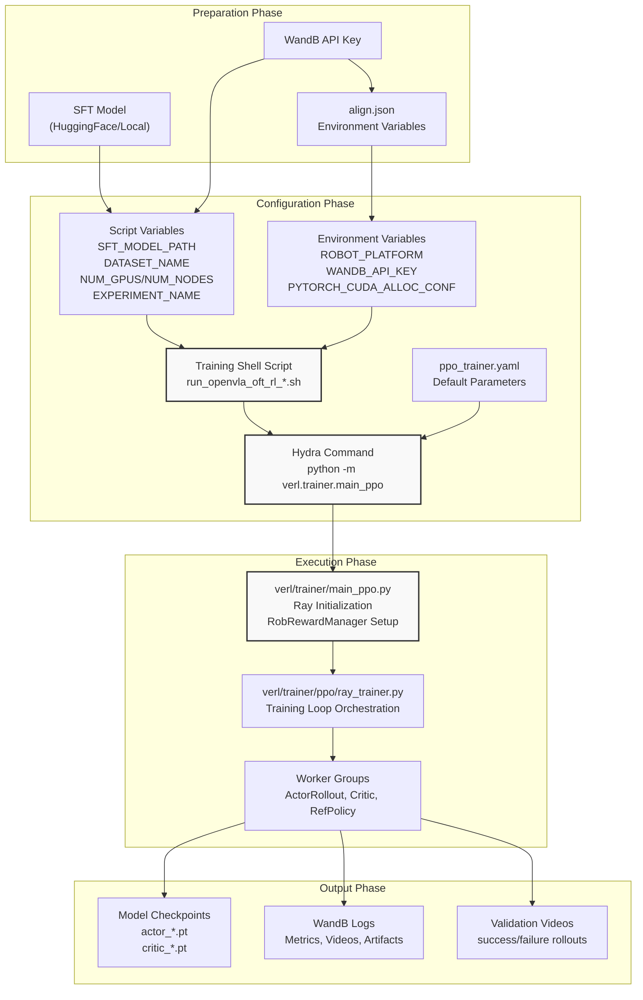
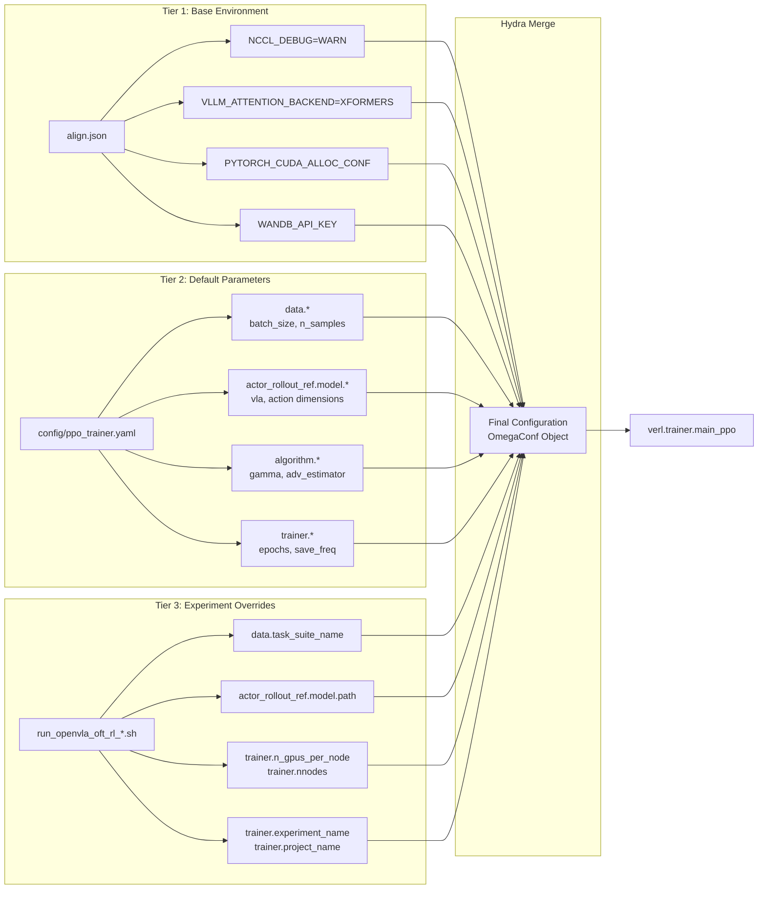

<!-- source: DeepWiki mcp.deepwiki.com · repo PRIME-RL/SimpleVLA-RL · page 7 Running Experiments · fetched 2026-10-30 -->

# Running Experiments

<details>
<summary>Relevant source files</summary>

The following files were used as context for generating this wiki page:

- [README.md](README.md)
- [examples/run_openvla_oft_rl_libero.sh](examples/run_openvla_oft_rl_libero.sh)
- [examples/run_openvla_oft_rl_twin2.sh](examples/run_openvla_oft_rl_twin2.sh)

</details>


This page provides practical guidance on configuring and executing training experiments in SimpleVLA-RL. It covers the complete workflow from preparing prerequisites to launching training and evaluation runs.

For detailed information about specific aspects of experiment execution:
- Example training scripts walkthrough: see [Example Training Scripts](#7.1)
- Configuration file hierarchy and Hydra merging: see [Configuration Files](#7.2)
- Checkpoint management and validation: see [Checkpointing and Evaluation](#7.3)
- WandB integration and metrics: see [Experiment Tracking](#7.4)

For information about the underlying training infrastructure, see [Training with PPO](#3) and [Distributed Training](#6).

## Prerequisites

Before running experiments, ensure the following prerequisites are satisfied:

### 1. Environment Setup

The conda environment must be properly configured with all dependencies. Refer to `SETUP.md` for detailed installation instructions including:
- Python environment and packages
- LIBERO and RoboTwin benchmark installations
- GPU drivers and CUDA configuration

### 2. SFT Model Availability

SimpleVLA-RL requires a **Supervised Fine-Tuned (SFT)** VLA model as the starting point for RL training. Available options:

| Model Type | Source | Available Variants |
|------------|--------|-------------------|
| **OpenVLA-OFT SFT** | [SimpleVLA-RL Collection](https://huggingface.co/collections/Haozhan72/simplevla-rl-6833311430cd9df52aeb1f86) | `libero-10` (traj1/trajall), `libero-goal/object/spatial` (traj1), `Robotwin2.0` tasks (traj1000) |
| **OpenVLA SFT** | [OpenVLA Hub](https://huggingface.co/openvla) | Pre-trained OpenVLA models |
| **Custom Models** | User fine-tuning | Any VLA model compatible with the framework |

The SFT model path will be specified via the `SFT_MODEL_PATH` variable in training scripts.

### 3. WandB Configuration

Weights & Biases (WandB) is used for experiment tracking. Configure your API key in two locations:
1. **System environment**: Export `WANDB_API_KEY` in your shell or set in [align.json]()
2. **Script override**: Verify the `WANDB_API_KEY` variable in training scripts matches your key

Sources: [README.md:92-127](), [examples/run_openvla_oft_rl_libero.sh:1-22](), [examples/run_openvla_oft_rl_twin2.sh:1-23]()

## Experiment Lifecycle Overview

The following diagram illustrates the complete lifecycle of a training experiment, from configuration to outputs:



**Lifecycle Phases:**

1. **Preparation**: Gather SFT model, configure WandB credentials, prepare environment files
2. **Configuration**: Set platform-specific environment variables, define experiment parameters, construct Hydra command
3. **Execution**: Initialize Ray cluster via `main_ppo.py`, orchestrate training through `ray_trainer.py`, distribute work across worker groups
4. **Output**: Generate checkpoints at specified intervals, log metrics and videos to WandB, save validation rollouts

Sources: [README.md:111-155](), [examples/run_openvla_oft_rl_libero.sh](), [examples/run_openvla_oft_rl_twin2.sh]()

## Configuration Architecture

SimpleVLA-RL uses a three-tier configuration system managed by Hydra:



**Configuration Precedence**: Tier 3 (script overrides) > Tier 2 (YAML defaults) > Tier 1 (environment variables)

Sources: [examples/run_openvla_oft_rl_libero.sh:1-94](), [examples/run_openvla_oft_rl_twin2.sh:1-98]()

## Launching Training Experiments

### Basic Training Command Structure

Training experiments are launched via shell scripts that invoke the main PPO trainer with Hydra parameter overrides:

```bash
HYDRA_FULL_ERROR=1 python -u -m verl.trainer.main_ppo \
    data.task_suite_name=<DATASET> \
    actor_rollout_ref.model.path=<SFT_MODEL_PATH> \
    trainer.experiment_name=<NAME> \
    trainer.val_only=False \
    [additional overrides...]
```

The `HYDRA_FULL_ERROR=1` environment variable ensures full error stack traces are displayed for debugging.

### Benchmark-Specific Training Examples

#### LIBERO Training

```bash
# Set required environment variables
export ROBOT_PLATFORM=LIBERO
export WANDB_API_KEY='your_wandb_key'

# Configure experiment
EXPERIMENT_NAME='libero10_baseline'
SFT_MODEL_PATH='/path/to/sft_model'
CKPT_PATH='/path/to/checkpoints'
DATASET_NAME='libero_10'  # Options: libero_10, libero_90, libero_spatial, etc.

# Launch training
bash examples/run_openvla_oft_rl_libero.sh
```

Key LIBERO parameters from [examples/run_openvla_oft_rl_libero.sh:25-94]():
- `data.task_suite_name`: Task suite selection (`libero_10`, `libero_90`, `libero_spatial`, `libero_object`, `libero_goal`)
- `data.num_trials_per_task=50`: Number of training trials per task
- `actor_rollout_ref.model.action_chunks_len=8`: LIBERO uses 8 action chunks
- `actor_rollout_ref.rollout.center_crop=True`: Enable center cropping for LIBERO

#### RoboTwin 2.0 Training

```bash
# Set required environment variables
export ROBOT_PLATFORM=ALOHA  # RoboTwin uses ALOHA platform
export WANDB_API_KEY='your_wandb_key'

# Configure experiment
EXPERIMENT_NAME='twin2_lift_pot_rl'
SFT_MODEL_PATH='/path/to/sft_model'
DATASET_NAME='TASK_NAME'  # See examples/robotwin2_tasks_info.txt
TRAJ_MINI_BATCH_SIZE=8    # Task-specific value from robotwin2_tasks_info.txt

# Launch training
bash examples/run_openvla_oft_rl_twin2.sh
```

Key RoboTwin 2.0 parameters from [examples/run_openvla_oft_rl_twin2.sh:25-96]():
- `data.task_suite_name=robotwin2_<TASK>`: Task selection with `robotwin2_` prefix
- `data.num_trials_per_task=1000`: RoboTwin uses more trials (pre-collected feasible seeds)
- `actor_rollout_ref.model.action_chunks_len=25`: RoboTwin uses 25 action chunks
- `actor_rollout_ref.rollout.use_proprio=True`: Enable proprioception for RoboTwin
- `actor_rollout_ref.rollout.twin2_task_config=demo_randomized`: Task configuration mode
- `actor_rollout_ref.rollout.twin2_instruction_type=seen`: Instruction type (seen/unseen)

Sources: [examples/run_openvla_oft_rl_libero.sh](), [examples/run_openvla_oft_rl_twin2.sh]()

### Critical Parameters Quick Reference

The following table summarizes the most critical parameters that typically require modification:

| Parameter | Purpose | LIBERO Example | RoboTwin Example |
|-----------|---------|----------------|------------------|
| `data.task_suite_name` | Dataset/task selection | `libero_10` | `robotwin2_lift_pot` |
| `data.num_trials_per_task` | Training samples per task | `50` | `1000` |
| `data.train_batch_size` | Batch size for training | `64` | `64` |
| `data.n_samples` | Rollouts per prompt | `8` | `8` |
| `actor_rollout_ref.model.path` | SFT checkpoint location | `/path/to/libero_sft` | `/path/to/twin2_sft` |
| `actor_rollout_ref.model.action_chunks_len` | Temporal action sequence length | `8` | `25` |
| `actor_rollout_ref.actor.optim.lr` | Learning rate | `5e-6` | `5e-6` |
| `actor_rollout_ref.rollout.temperature` | Action sampling temperature | `1.6` | `1.6` |
| `trainer.n_gpus_per_node` | GPUs per node | `8` | `8` |
| `trainer.nnodes` | Number of nodes | `1` or `2` | `1` or `2` |
| `trainer.save_freq` | Checkpoint save frequency (epochs) | `25` | `20` |
| `trainer.test_freq` | Validation frequency (epochs) | `4` | `4` |
| `trainer.total_epochs` | Total training epochs | `100` | `100` |

Sources: [examples/run_openvla_oft_rl_libero.sh:24-91](), [examples/run_openvla_oft_rl_twin2.sh:25-95]()

## Launching Evaluation Experiments

To evaluate a trained model, modify the training script to enable validation-only mode:

### Evaluation Configuration

Set the following parameter in your training script:

```bash
trainer.val_only=True
```

This activates evaluation mode, which:
1. Skips policy updates and gradient computation
2. Loads the specified checkpoint for evaluation
3. Runs validation rollouts across the evaluation dataset
4. Records success rates and saves validation videos

### Checkpoint Selection

Specify which checkpoint to evaluate by setting the model path to the checkpoint directory:

```bash
SFT_MODEL_PATH='/path/to/checkpoints/epoch_75/actor'  # Evaluate epoch 75
```

The evaluation will use the actor weights from the specified checkpoint directory.

### Example Evaluation Command

```bash
# LIBERO evaluation
export ROBOT_PLATFORM=LIBERO
EXPERIMENT_NAME='libero10_eval_epoch75'
SFT_MODEL_PATH='/path/to/checkpoints/epoch_75/actor'

# Modify the training script or override directly
bash examples/run_openvla_oft_rl_libero.sh \
    trainer.val_only=True \
    actor_rollout_ref.model.path=$SFT_MODEL_PATH
```

For detailed information on checkpoint management and validation modes, see [Checkpointing and Evaluation](#7.3).

Sources: [README.md:146-155](), [examples/run_openvla_oft_rl_libero.sh:85](), [examples/run_openvla_oft_rl_twin2.sh:89]()

## Multi-Node Training Setup

SimpleVLA-RL supports distributed training across multiple nodes using Ray. The framework has been tested on configurations with 1-2 nodes, each with 8 NVIDIA A800 GPUs (80GB memory).

### Multi-Node Configuration

To scale training across multiple nodes, adjust the following parameters:

```bash
NUM_NODES=2           # Number of compute nodes
NUM_GPUS=8            # GPUs per node (total GPUs = NUM_NODES * NUM_GPUS)

# Pass to Hydra
trainer.nnodes=$NUM_NODES
trainer.n_gpus_per_node=$NUM_GPUS
actor_rollout_ref.actor.ppo_micro_batch_size=$NUM_GPUS  # Often set to NUM_GPUS
```

### Resource Pool Distribution

The Ray cluster distributes worker groups across available GPUs based on the resource pool configuration. Each role (ActorRollout, Critic, RefPolicy, RewardModel) is assigned to specific resource pools.

For distributed training details including FSDP sharding and memory optimization, see [Distributed Training](#6).

Sources: [examples/run_openvla_oft_rl_libero.sh:18-21,80-81](), [examples/run_openvla_oft_rl_twin2.sh:19-22,84-85](), [README.md:129-135]()

## Common Workflow Patterns

### 1. Initial Training from SFT

```bash
# Start from SFT checkpoint
SFT_MODEL_PATH='/path/to/sft_checkpoint'
EXPERIMENT_NAME='initial_rl_run'

# Run with default parameters
bash examples/run_openvla_oft_rl_libero.sh
```

### 2. Resume Training from RL Checkpoint

```bash
# Resume from previous RL checkpoint
SFT_MODEL_PATH='/path/to/rl_checkpoint/epoch_50/actor'
EXPERIMENT_NAME='resumed_rl_run'
actor_rollout_ref.model.resume=True  # Enable resume mode
```

### 3. Hyperparameter Sweep

```bash
# Sweep over learning rates
for LR in 1e-6 5e-6 1e-5; do
    EXPERIMENT_NAME="libero10_lr${LR}"
    bash examples/run_openvla_oft_rl_libero.sh \
        actor_rollout_ref.actor.optim.lr=$LR
done
```

### 4. Validation-Only Evaluation

```bash
# Evaluate specific checkpoint
SFT_MODEL_PATH='/path/to/checkpoint/epoch_75/actor'
EXPERIMENT_NAME='eval_epoch75'

bash examples/run_openvla_oft_rl_libero.sh \
    trainer.val_only=True \
    data.val_batch_size=500  # Larger batch for comprehensive evaluation
```

Sources: [examples/run_openvla_oft_rl_libero.sh](), [examples/run_openvla_oft_rl_twin2.sh]()

## Next Steps

- **Understand example scripts**: See [Example Training Scripts](#7.1) for detailed walkthrough of script parameters
- **Master configuration system**: See [Configuration Files](#7.2) for Hydra configuration hierarchy
- **Manage checkpoints**: See [Checkpointing and Evaluation](#7.3) for checkpoint saving and validation strategies
- **Monitor experiments**: See [Experiment Tracking](#7.4) for WandB integration and metrics visualization

Sources: [README.md:90-155](), [examples/run_openvla_oft_rl_libero.sh](), [examples/run_openvla_oft_rl_twin2.sh]()

---

