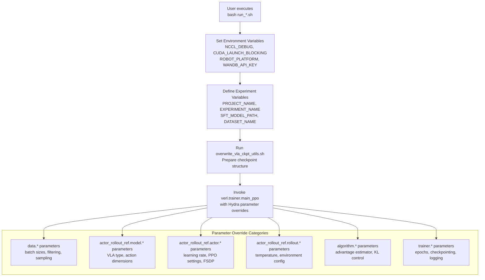
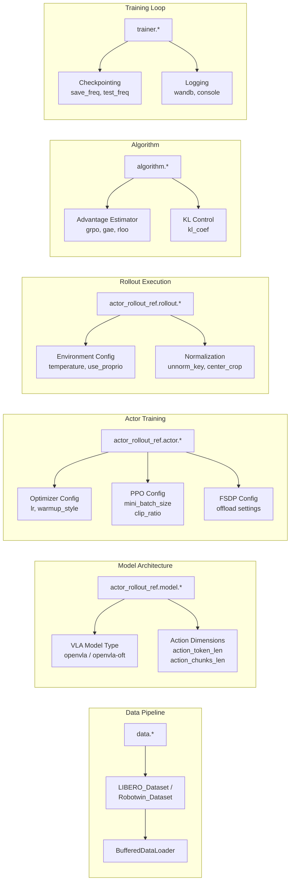
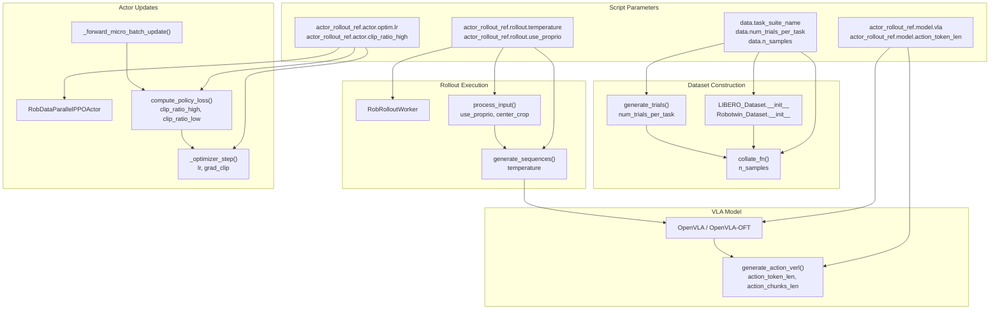

<!-- source: DeepWiki mcp.deepwiki.com · repo PRIME-RL/SimpleVLA-RL · page 7.1 Example Training Scripts · fetched 2026-10-30 -->

# Example Training Scripts

<details>
<summary>Relevant source files</summary>

The following files were used as context for generating this wiki page:

- [examples/run_openvla_oft_rl_libero.sh](examples/run_openvla_oft_rl_libero.sh)
- [examples/run_openvla_oft_rl_twin2.sh](examples/run_openvla_oft_rl_twin2.sh)
- [verl/workers/actor/dp_rob.py](verl/workers/actor/dp_rob.py)

</details>


This page provides a detailed walkthrough of the example training scripts included in SimpleVLA-RL, explaining their structure, key parameters, and how to adapt them for new experiments. These scripts serve as templates for launching PPO-based reinforcement learning experiments on LIBERO and RoboTwin benchmarks.

For information about the underlying configuration system and how parameters are merged, see [Configuration Files](#7.2). For details on checkpoint management and evaluation modes, see [Checkpointing and Evaluation](#7.3).

## Overview

SimpleVLA-RL provides two primary example scripts:

- **[examples/run_openvla_oft_rl_libero.sh]()** - Template for training on LIBERO benchmark tasks
- **[examples/run_openvla_oft_rl_twin2.sh]()** - Template for training on RoboTwin 2.0 benchmark tasks

Both scripts follow a common pattern: setting environment variables, defining experiment-specific parameters, and invoking the Hydra-based training entry point with extensive parameter overrides.

**Sources:** [examples/run_openvla_oft_rl_libero.sh:1-94](), [examples/run_openvla_oft_rl_twin2.sh:1-98]()

## Script Execution Flow



**Sources:** [examples/run_openvla_oft_rl_libero.sh:1-94](), [examples/run_openvla_oft_rl_twin2.sh:1-98]()

## LIBERO Training Script

The LIBERO script ([examples/run_openvla_oft_rl_libero.sh]()) is optimized for training on the LIBERO benchmark, which features shorter trajectory lengths and simpler manipulation tasks.

### Environment Configuration

```bash
export NCCL_DEBUG=WARN 
export WANDB_API_KEY='YOUR WANDB KEY'
export PYTORCH_CUDA_ALLOC_CONF=expandable_segments:True
export TOKENIZERS_PARALLELISM=true
export CUDA_LAUNCH_BLOCKING=1
export TORCH_USE_CUDA_DSA=1
export ROBOT_PLATFORM=LIBERO
```

| Variable | Purpose | LIBERO Value |
|----------|---------|--------------|
| `NCCL_DEBUG` | Control NCCL logging verbosity for multi-GPU communication | `WARN` |
| `WANDB_API_KEY` | Authentication for experiment tracking | User-provided |
| `PYTORCH_CUDA_ALLOC_CONF` | Enable expandable CUDA memory segments | `expandable_segments:True` |
| `TOKENIZERS_PARALLELISM` | Enable parallel tokenization | `true` |
| `CUDA_LAUNCH_BLOCKING` | Synchronous CUDA kernel launches for debugging | `1` |
| `TORCH_USE_CUDA_DSA` | Enable CUDA device-side assertions | `1` |
| `ROBOT_PLATFORM` | Platform-specific action normalization and dimensions | `LIBERO` |

**Sources:** [examples/run_openvla_oft_rl_libero.sh:3-9]()

### Experiment Variables

```bash
PROJECT_NAME='SimpleVLA-RL'
EXPERIMENT_NAME='vla-lib10_model10j_lr10_tmp16_nsample8_clip08-128_batch64_ppominibs128_node2'
SFT_MODEL_PATH="YOUR SFT_MODEL_PATH"
CKPT_PATH="THE PATH YOU WANT TO SAVE YOUR CKPT"
DATASET_NAME="libero_10"
VLA_NAME="openvla-oft"
NUM_GPUS=8
NUM_NODES=1
ALIGN_PATH="YOUR PATH TO SimpleVLA-RL/align.json"
```

| Variable | Description | LIBERO Example |
|----------|-------------|----------------|
| `DATASET_NAME` | LIBERO task suite identifier | `libero_10`, `libero_90`, `libero_spatial`, `libero_object`, `libero_goal` |
| `VLA_NAME` | VLA model variant | `openvla-oft` or `openvla` |
| `SFT_MODEL_PATH` | Path to supervised fine-tuned model checkpoint | User-provided HuggingFace path |
| `NUM_GPUS` | GPUs per node for distributed training | `8` |
| `NUM_NODES` | Number of nodes in Ray cluster | `1` or `2` |

**Sources:** [examples/run_openvla_oft_rl_libero.sh:10-21]()

### LIBERO-Specific Parameter Overrides

The script invokes `verl.trainer.main_ppo` with extensive Hydra overrides. Key LIBERO-specific configurations:

#### Data Parameters

```bash
data.task_suite_name=$DATASET_NAME \
data.num_trials_per_task=50 \
data.n_samples=8 \
data.filter_accuracy=True \
data.accuracy_lower_bound=0.1 \
data.accuracy_upper_bound=0.9 \
data.train_batch_size=64 \
data.val_batch_size=496 \
```

- `num_trials_per_task=50`: Generate 50 training episodes per task in the suite
- `n_samples=8`: Oversample each prompt with 8 rollouts, then filter
- `filter_accuracy=True`: Enable accuracy-based filtering
- `accuracy_lower_bound=0.1`, `accuracy_upper_bound=0.9`: Keep samples with success rates between 10-90%

**Sources:** [examples/run_openvla_oft_rl_libero.sh:25-33]()

#### Model Parameters

```bash
actor_rollout_ref.model.path=$SFT_MODEL_PATH \
actor_rollout_ref.model.vla=$VLA_NAME \
actor_rollout_ref.model.action_token_len=7 \
actor_rollout_ref.model.action_chunks_len=8 \
```

- `action_token_len=7`: LIBERO uses 7-dimensional actions (3 xyz + 4 quaternion)
- `action_chunks_len=8`: Predict 8 future action steps per observation

**Sources:** [examples/run_openvla_oft_rl_libero.sh:36-39]()

#### Actor Training Parameters

```bash
actor_rollout_ref.actor.optim.lr=5e-6 \
actor_rollout_ref.actor.ppo_mini_batch_size=128 \
actor_rollout_ref.actor.ppo_micro_batch_size=$NUM_GPUS \
actor_rollout_ref.actor.traj_mini_batch_size=16 \
actor_rollout_ref.actor.clip_ratio_high=0.28 \
actor_rollout_ref.actor.clip_ratio_low=0.2 \
actor_rollout_ref.actor.grad_clip=1 \
```

- `traj_mini_batch_size=16`: Process 16 trajectory steps per gradient update (memory optimization)
- `clip_ratio_high=0.28`, `clip_ratio_low=0.2`: Asymmetric PPO clipping for stability

**Sources:** [examples/run_openvla_oft_rl_libero.sh:40-52]()

#### Rollout Parameters

```bash
actor_rollout_ref.rollout.use_proprio=False \
actor_rollout_ref.rollout.temperature=1.6 \
actor_rollout_ref.rollout.center_crop=True \
actor_rollout_ref.rollout.unnorm_key=$DATASET_NAME \
```

- `use_proprio=False`: LIBERO doesn't use proprioceptive state in observations
- `temperature=1.6`: Higher temperature encourages exploration during rollouts
- `unnorm_key=libero_10`: Use LIBERO-specific action denormalization statistics

**Sources:** [examples/run_openvla_oft_rl_libero.sh:57-67]()

## RoboTwin 2.0 Training Script

The RoboTwin 2.0 script ([examples/run_openvla_oft_rl_twin2.sh]()) handles more complex, longer-horizon manipulation tasks with feasible seed management.

### RoboTwin-Specific Configuration

```bash
export ROBOT_PLATFORM=ALOHA
DATASET_NAME=TASK_NAME_YOU_SELECT
TRAJ_MINI_BATCH_SIZE=8
```

- `ROBOT_PLATFORM=ALOHA`: Use ALOHA normalization bounds (RoboTwin uses ALOHA robot)
- `TRAJ_MINI_BATCH_SIZE`: Task-dependent value from `examples/robotwin2_tasks_info.txt`

**Sources:** [examples/run_openvla_oft_rl_twin2.sh:9-17]()

### RoboTwin-Specific Parameter Overrides

#### Data Parameters

```bash
data.task_suite_name=robotwin2_$DATASET_NAME \
data.num_trials_per_task=1000 \
data.val_batch_size=256 \
```

- `num_trials_per_task=1000`: RoboTwin uses more trials due to feasible seed pre-collection
- Task name is prefixed with `robotwin2_` for dataset class routing

**Sources:** [examples/run_openvla_oft_rl_twin2.sh:26-34]()

#### Model Parameters

```bash
actor_rollout_ref.model.action_token_len=14 \
actor_rollout_ref.model.action_chunks_len=25 \
```

- `action_token_len=14`: RoboTwin uses 14D actions (7D per arm for bimanual robot)
- `action_chunks_len=25`: Longer temporal prediction horizon for complex tasks

**Sources:** [examples/run_openvla_oft_rl_twin2.sh:39-40]()

#### Rollout Parameters

```bash
actor_rollout_ref.rollout.twin2_task_config=demo_randomized \
actor_rollout_ref.rollout.twin2_instruction_type=seen \
actor_rollout_ref.rollout.use_proprio=True \
actor_rollout_ref.rollout.unnorm_key=robotwin2_${DATASET_NAME}_1k \
```

- `twin2_task_config=demo_randomized`: Use randomized object placements
- `twin2_instruction_type=seen`: Use training language instructions (vs. unseen for zero-shot)
- `use_proprio=True`: Include proprioceptive state in observations
- `unnorm_key=robotwin2_${DATASET_NAME}_1k`: Task-specific denormalization statistics

**Sources:** [examples/run_openvla_oft_rl_twin2.sh:58-66]()

## Parameter Categories and Their Effects



**Sources:** [examples/run_openvla_oft_rl_libero.sh:24-92](), [examples/run_openvla_oft_rl_twin2.sh:25-95]()

### Critical Parameters Reference

| Parameter | LIBERO | RoboTwin 2.0 | Effect on Training |
|-----------|--------|--------------|-------------------|
| `data.num_trials_per_task` | `50` | `1000` | Total training episodes generated |
| `data.n_samples` | `8` | `8` | Oversampling factor per prompt |
| `data.accuracy_lower_bound` | `0.1` | `0.1` | Minimum success rate for filtering |
| `data.accuracy_upper_bound` | `0.9` | `0.9` | Maximum success rate for filtering |
| `actor_rollout_ref.model.action_token_len` | `7` | `14` | Action space dimensionality |
| `actor_rollout_ref.model.action_chunks_len` | `8` | `25` | Temporal action prediction horizon |
| `actor_rollout_ref.actor.traj_mini_batch_size` | `16` | `8` (task-dependent) | Memory/compute tradeoff |
| `actor_rollout_ref.rollout.use_proprio` | `False` | `True` | Include proprioceptive observations |
| `actor_rollout_ref.rollout.temperature` | `1.6` | `1.6` | Exploration vs exploitation |
| `algorithm.adv_estimator` | `grpo` | `grpo` | Advantage estimation method |

**Sources:** [examples/run_openvla_oft_rl_libero.sh:25-91](), [examples/run_openvla_oft_rl_twin2.sh:26-95]()

## Adapting Scripts for New Experiments

### Step 1: Set Platform-Specific Variables

```bash
# For LIBERO tasks
export ROBOT_PLATFORM=LIBERO
DATASET_NAME="libero_90"  # or libero_spatial, libero_object, libero_goal

# For RoboTwin tasks
export ROBOT_PLATFORM=ALOHA
DATASET_NAME="TASK_NAME"  # from examples/robotwin2_tasks_info.txt
TRAJ_MINI_BATCH_SIZE=8    # task-specific value
```

**Sources:** [examples/run_openvla_oft_rl_libero.sh:9-16](), [examples/run_openvla_oft_rl_twin2.sh:9-17]()

### Step 2: Configure Model Paths

```bash
# Point to your supervised fine-tuned model
SFT_MODEL_PATH="path/to/your/sft/checkpoint"

# HuggingFace models available at:
# https://huggingface.co/collections/Haozhan72/simplevla-rl-6833311430cd9df52aeb1f86

# Set checkpoint save location
CKPT_PATH="/path/to/save/checkpoints"
```

**Sources:** [examples/run_openvla_oft_rl_libero.sh:13-14](), [examples/run_openvla_oft_rl_twin2.sh:13-14]()

### Step 3: Adjust Compute Resources

```bash
# Single-node training
NUM_GPUS=8
NUM_NODES=1

# Multi-node training (requires Ray cluster setup)
NUM_GPUS=8
NUM_NODES=2
```

Update micro-batch sizes based on GPU memory:

```bash
actor_rollout_ref.actor.ppo_micro_batch_size=$NUM_GPUS \
actor_rollout_ref.rollout.val_micro_batch_size=8 \
```

**Sources:** [examples/run_openvla_oft_rl_libero.sh:18-20](), [examples/run_openvla_oft_rl_libero.sh:43-58]()

### Step 4: Tune FSDP Offloading

For memory-constrained environments, adjust FSDP offloading:

```bash
# Aggressive memory saving (slower)
actor_rollout_ref.actor.fsdp_config.param_offload=True \
actor_rollout_ref.actor.fsdp_config.grad_offload=True \
actor_rollout_ref.actor.fsdp_config.optimizer_offload=True \

# Performance-optimized (requires more memory)
actor_rollout_ref.actor.fsdp_config.param_offload=False \
actor_rollout_ref.actor.fsdp_config.grad_offload=False \
actor_rollout_ref.actor.fsdp_config.optimizer_offload=False \
```

**Sources:** [examples/run_openvla_oft_rl_libero.sh:45-47]()

### Step 5: Configure Training Schedule

```bash
trainer.total_epochs=100 \        # Total training epochs
trainer.save_freq=25 \            # Checkpoint every N epochs
trainer.test_freq=4 \             # Validation every N epochs
trainer.val_before_train=True \   # Run validation before first training
```

**Sources:** [examples/run_openvla_oft_rl_libero.sh:82-91]()

### Step 6: Adjust Hyperparameters

Common tuning parameters:

```bash
# Learning rate
actor_rollout_ref.actor.optim.lr=5e-6 \

# PPO clipping (asymmetric for stability)
actor_rollout_ref.actor.clip_ratio_high=0.28 \
actor_rollout_ref.actor.clip_ratio_low=0.2 \

# Temperature (higher = more exploration)
actor_rollout_ref.rollout.temperature=1.6 \

# Advantage estimator
algorithm.adv_estimator=grpo \  # or gae, rloo, reinforce_pp, remax
```

**Sources:** [examples/run_openvla_oft_rl_libero.sh:40-86]()

## Parameter-to-Code Mapping

The following diagram shows how script parameters map to code entities in the training pipeline:



**Sources:** [examples/run_openvla_oft_rl_libero.sh:24-92](), [verl/workers/actor/dp_rob.py:39-531]()

### Key Code Entity Mappings

| Script Parameter | Code Location | Code Entity |
|------------------|---------------|-------------|
| `data.task_suite_name` | Dataset classes | `LIBERO_Dataset.__init__()`, `Robotwin_Dataset.__init__()` |
| `data.num_trials_per_task` | Dataset generation | Trial generation loops in dataset classes |
| `data.n_samples` | Data loading | `collate_fn()` oversampling logic |
| `actor_rollout_ref.model.vla` | Model instantiation | VLA model class selection |
| `actor_rollout_ref.model.action_token_len` | [verl/workers/actor/dp_rob.py:122]() | `self.config.action_token_len` |
| `actor_rollout_ref.model.action_chunks_len` | [verl/workers/actor/dp_rob.py:165-166]() | Reshaping in `_forward_micro_batch()` |
| `actor_rollout_ref.rollout.temperature` | [verl/workers/actor/dp_rob.py:159-225]() | `logits.div(temperature)` |
| `actor_rollout_ref.rollout.use_proprio` | [verl/workers/actor/dp_rob.py:121-141]() | Conditional `proprio` processing |
| `actor_rollout_ref.actor.clip_ratio_high` | [verl/workers/actor/dp_rob.py:446-503]() | `compute_policy_loss()` arguments |
| `actor_rollout_ref.actor.clip_ratio_low` | [verl/workers/actor/dp_rob.py:446-503]() | `compute_policy_loss()` arguments |
| `actor_rollout_ref.actor.traj_mini_batch_size` | [verl/workers/actor/dp_rob.py:480-495]() | Trajectory splitting loop |
| `algorithm.adv_estimator` | Algorithm configuration | Advantage estimator class selection |

**Sources:** [verl/workers/actor/dp_rob.py:39-531]()

## Common Modifications

### Changing VLA Model Type

To switch from OpenVLA-OFT to vanilla OpenVLA:

```bash
VLA_NAME="openvla"

# Update model-specific parameters
actor_rollout_ref.model.vla=$VLA_NAME \
```

The actor code handles both variants through conditional logic in [verl/workers/actor/dp_rob.py:146-196]().

**Sources:** [examples/run_openvla_oft_rl_libero.sh:17-37](), [verl/workers/actor/dp_rob.py:146-196]()

### Enabling Validation-Only Mode

To run evaluation without training:

```bash
trainer.val_only=True \
trainer.total_epochs=1 \
```

This mode loads a checkpoint and runs only the validation loop.

**Sources:** [examples/run_openvla_oft_rl_libero.sh:85]()

### Adjusting Oversampling Strategy

Modify the oversampling and filtering parameters:

```bash
data.n_samples=16 \               # More rollouts per prompt
data.oversample_factor=2 \        # Additional oversampling multiplier
data.accuracy_lower_bound=0.2 \   # Stricter filtering
data.accuracy_upper_bound=0.8 \
```

**Sources:** [examples/run_openvla_oft_rl_libero.sh:27-31]()

### Disabling Gradient Checkpointing

For faster training with more memory:

```bash
actor_rollout_ref.model.enable_gradient_checkpointing=False \
```

**Sources:** [examples/run_openvla_oft_rl_libero.sh:53]()

## Experiment Naming Best Practices

Use descriptive experiment names that encode key hyperparameters:

```bash
# Template: {dataset}_{model}_{lr}_{temp}_nsample{n}_clip{low}-{high}_batch{size}
EXPERIMENT_NAME='lib10_oft_lr5e6_tmp16_nsample8_clip02-028_batch64_node2'
```

This naming convention makes it easy to identify experiments in WandB and checkpoint directories.

**Sources:** [examples/run_openvla_oft_rl_libero.sh:11](), [examples/run_openvla_oft_rl_twin2.sh:11]()

---

