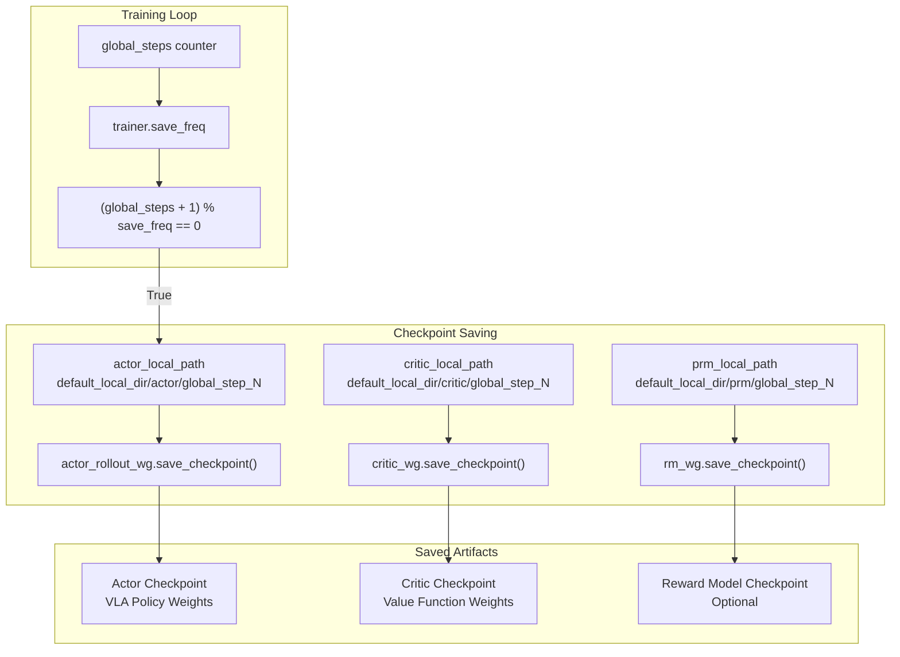
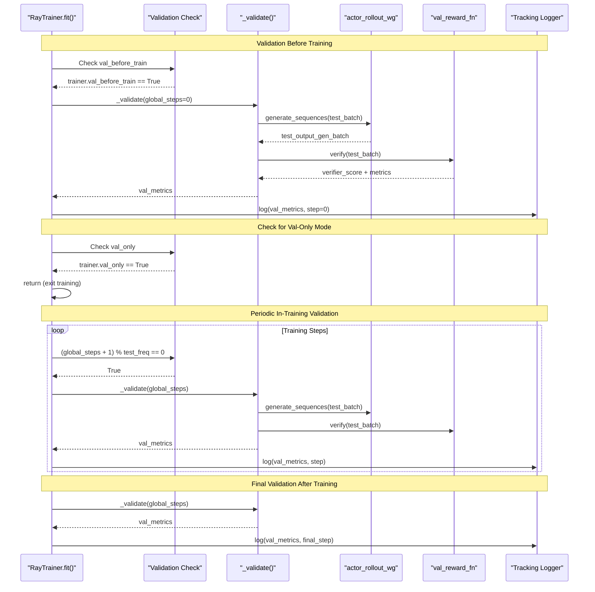
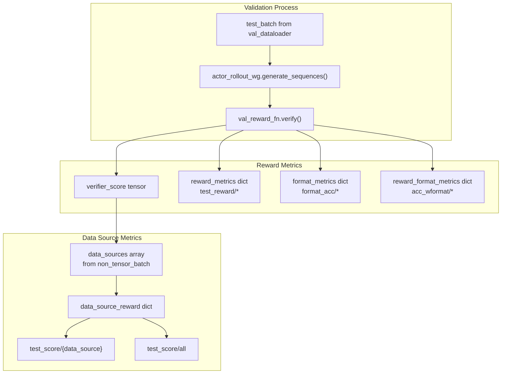
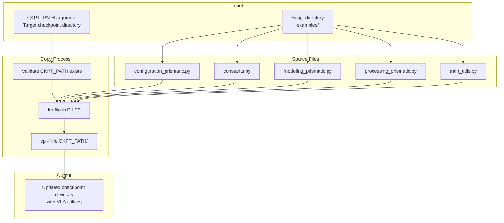
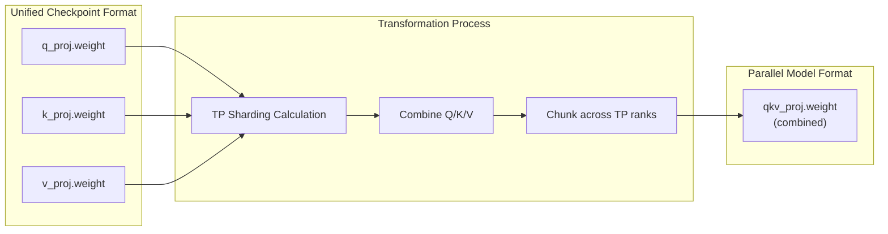
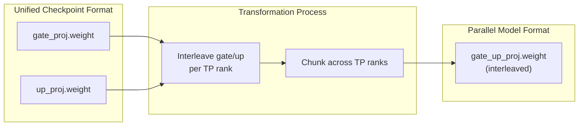

<!-- source: DeepWiki mcp.deepwiki.com · repo PRIME-RL/SimpleVLA-RL · page 7.3 Checkpointing and Evaluation · fetched 2026-10-30 -->

# Checkpointing and Evaluation

<details>
<summary>Relevant source files</summary>

The following files were used as context for generating this wiki page:

- [README.md](README.md)
- [examples/overwrite_vla_ckpt_utils.sh](examples/overwrite_vla_ckpt_utils.sh)
- [verl/trainer/ppo/ray_trainer.py](verl/trainer/ppo/ray_trainer.py)

</details>


This document covers checkpoint management and model evaluation in SimpleVLA-RL. The system provides two main capabilities: periodic checkpoint saving during training, and flexible evaluation modes for validating trained VLA models on robotic tasks.

Related documentation: See [Training with PPO](#3) for the main training loop context, and [Experiment Tracking](#7.4) for metrics logging.

## System Overview

The checkpointing and evaluation system operates within the PPO training loop, providing three key functions: (1) periodic saving of actor, critic, and reward model checkpoints during training, (2) in-training validation at specified intervals, and (3) dedicated evaluation mode for testing trained models.

**Checkpoint Saving Flow During Training**



Sources: [verl/trainer/ppo/ray_trainer.py:690-708]()

## Checkpoint Saving During Training

The `RayTrainer.fit()` method implements checkpoint saving at regular intervals controlled by `trainer.save_freq`. When enabled (`save_freq > 0`), checkpoints are saved whenever `(global_steps + 1) % save_freq == 0`.

**Checkpoint Directory Structure**

```
default_local_dir/
├── actor/
│   ├── global_step_0/
│   ├── global_step_100/
│   └── global_step_200/
├── critic/
│   ├── global_step_0/
│   └── global_step_100/
└── prm/
    ├── global_step_0/
    └── global_step_100/
```

The system saves checkpoints for multiple components based on training configuration:

| Component | Condition | Worker Group | Path Pattern |
|-----------|-----------|--------------|--------------|
| Actor (VLA Policy) | Always | `actor_rollout_wg` | `{default_local_dir}/actor/global_step_{N}` |
| Critic (Value Function) | `use_critic == True` | `critic_wg` | `{default_local_dir}/critic/global_step_{N}` |
| Reward Model | `use_rm == True` | `rm_wg` | `{default_local_dir}/prm/global_step_{N}` |

Sources: [verl/trainer/ppo/ray_trainer.py:690-708]()

## Validation Modes

SimpleVLA-RL supports two validation modes: periodic in-training validation and dedicated evaluation-only mode. Both modes use the validation dataloader and reward function to assess model performance.

**Validation Flow**



Sources: [verl/trainer/ppo/ray_trainer.py:336-391](), [verl/trainer/ppo/ray_trainer.py:490-496](), [verl/trainer/ppo/ray_trainer.py:673-679](), [verl/trainer/ppo/ray_trainer.py:712-716]()

### In-Training Validation

During training, validation runs when `(global_steps + 1) % test_freq == 0`. The validation process:

1. Iterates through `val_dataloader` batches
2. Sets `do_sample=False` for deterministic generation
3. Generates rollouts using `actor_rollout_wg.generate_sequences()`
4. Computes rewards using `val_reward_fn.verify()`
5. Logs metrics by data source and overall average

**Validation Batch Configuration**

```python
test_batch.meta_info = {
    'eos_token_id': self.tokenizer.eos_token_id,
    'pad_token_id': self.tokenizer.pad_token_id,
    'recompute_log_prob': False,
    'do_sample': False,          # Deterministic generation
    'validate': True,             # Validation mode flag
    'global_steps': global_steps  # Current training step
}
```

Sources: [verl/trainer/ppo/ray_trainer.py:343-350](), [verl/trainer/ppo/ray_trainer.py:673-679]()

### Evaluation-Only Mode

To run pure evaluation without training, set `trainer.val_only=True` in the configuration. This mode:

1. Runs initial validation before training (`val_before_train=True`)
2. Immediately returns after validation, skipping all training
3. Useful for testing trained checkpoints loaded via `SFT_MODEL_PATH`

**Example: Running Evaluation**

```bash
# In examples/run_openvla_oft_rl_libero.sh
bash examples/run_openvla_oft_rl_libero.sh

# Or override at command line
python -m verl.trainer.main_ppo \
    trainer.val_only=True \
    actor_rollout_ref.model.path=/path/to/checkpoint
```

Sources: [README.md:146-154](), [verl/trainer/ppo/ray_trainer.py:490-496]()

## Validation Metrics

The `_validate()` method computes and logs comprehensive metrics organized by task suite and reward components. All metrics are aggregated across validation batches and logged to WandB.

**Validation Metric Categories**



**Logged Metrics Structure**

| Metric Key | Description | Source |
|------------|-------------|--------|
| `test_reward/{metric_name}` | Task-specific reward components | `reward_fn.verify()` |
| `format_acc/{metric_name}` | Format/parsing accuracy | `reward_fn.verify()` |
| `acc_wformat/{metric_name}` | Accuracy with format filtering | `reward_fn.verify()` |
| `test_score/{data_source}` | Average reward per data source | Aggregated by `data_source` |
| `test_score/all` | Overall average across all sources | Mean of all validation rewards |

Sources: [verl/trainer/ppo/ray_trainer.py:336-391](), [verl/trainer/ppo/ray_trainer.py:358-390]()

## Checkpoint File Management

SimpleVLA-RL provides utilities for managing VLA checkpoint files, particularly for ensuring compatibility with custom VLA implementations.

### Overwriting VLA Checkpoint Utils

The `overwrite_vla_ckpt_utils.sh` script copies VLA-specific utility files into a checkpoint directory. This is necessary when checkpoints need to be loaded independently of the training codebase.

**VLA Checkpoint Utils Script**



**Files Copied to Checkpoint**

| File | Purpose |
|------|---------|
| `configuration_prismatic.py` | VLA model configuration class |
| `constants.py` | Platform-specific constants (LIBERO, RoboTwin, ALOHA) |
| `modeling_prismatic.py` | VLA model architecture implementation |
| `processing_prismatic.py` | Multi-modal input processor |
| `train_utils.py` | Training utilities and helper functions |

**Usage Example**

```bash
# Overwrite checkpoint utils after saving
bash examples/overwrite_vla_ckpt_utils.sh /path/to/checkpoint/actor/global_step_100

# Output:
# ✓ Successfully overwrite: configuration_prismatic.py
# ✓ Successfully overwrite: constants.py
# ✓ Successfully overwrite: modeling_prismatic.py
# ✓ Successfully overwrite: processing_prismatic.py
# ✓ Successfully overwrite: train_utils.py
# File overwrite completed!
```

Sources: [examples/overwrite_vla_ckpt_utils.sh:1-46]()

## Special Weight Handling

The checkpoint system includes specialized functions for handling complex weight transformations required by the parallel model architecture.

### QKV Projection Handling

The QKV projections require special handling because the unified checkpoint stores separate Q, K, and V weight matrices, but the parallel model uses a combined QKV matrix for efficiency.



### Gate/Up Projection Handling

The MLP gate and up projections are similarly combined into a single `gate_up_proj` weight matrix in the parallel model.



The interleaving pattern for gate/up projections ensures that each tensor parallel rank gets both gate and up weights for its assigned intermediate dimension slice, maintaining the correct computation flow in the parallel MLP implementation.

Sources: [verl/models/llama/megatron/checkpoint_utils/llama_loader.py:224-276](), [verl/models/llama/megatron/checkpoint_utils/llama_loader.py:278-355](), [verl/models/llama/megatron/checkpoint_utils/llama_saver.py:214-265](), [verl/models/llama/megatron/checkpoint_utils/llama_saver.py:267-340]()

---

