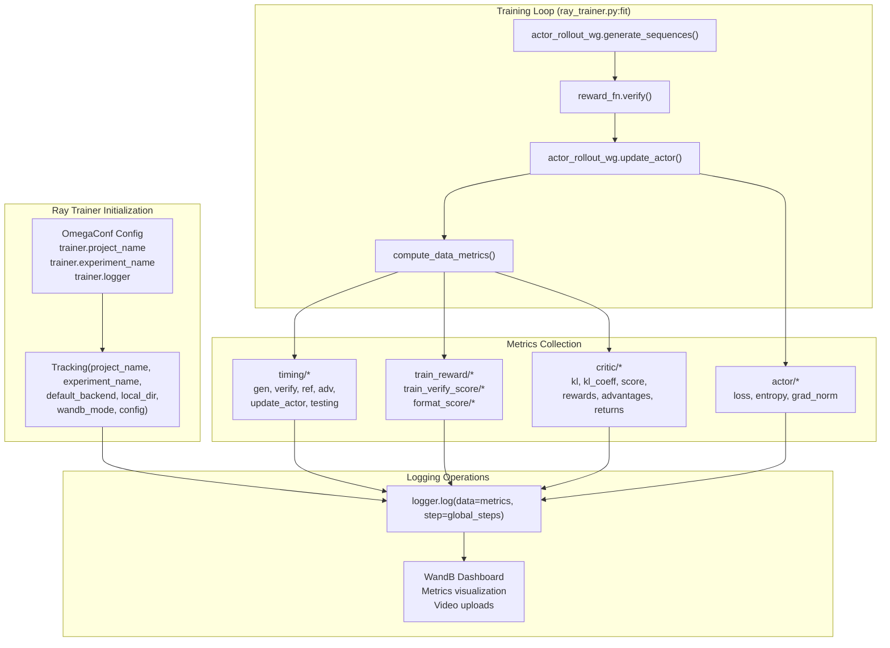
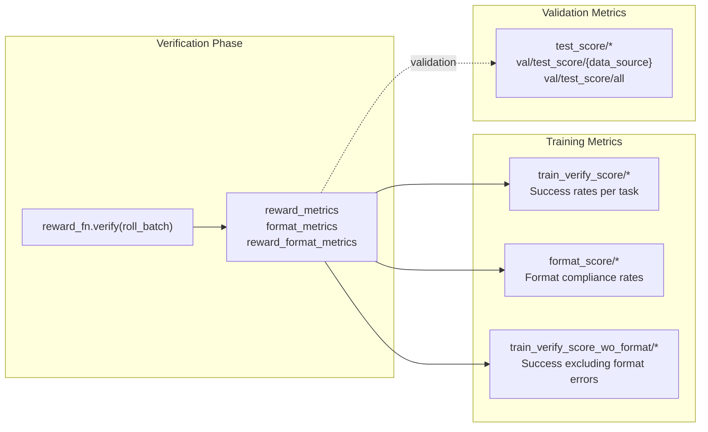
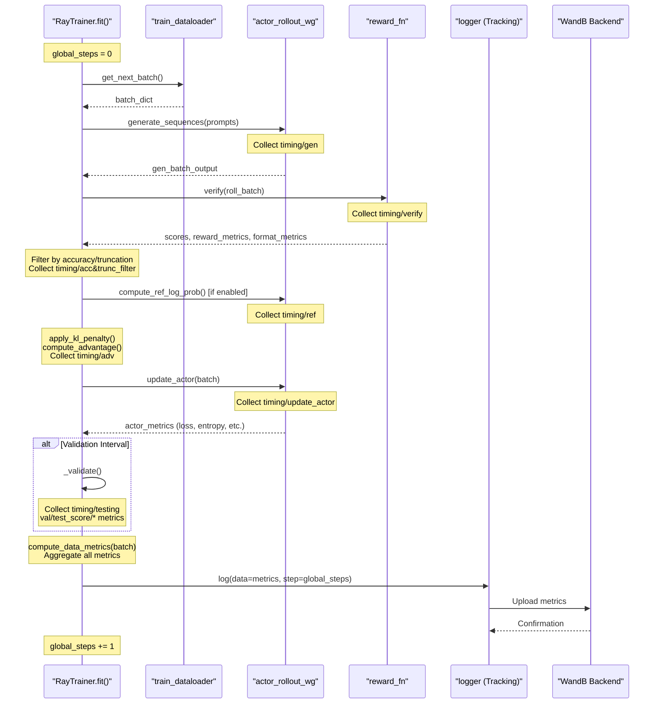

<!-- source: DeepWiki mcp.deepwiki.com · repo PRIME-RL/SimpleVLA-RL · page 7.4 Experiment Tracking · fetched 2026-10-30 -->

# Experiment Tracking

<details>
<summary>Relevant source files</summary>

The following files were used as context for generating this wiki page:

- [README.md](README.md)
- [align.json](align.json)
- [verl/trainer/ppo/ray_trainer.py](verl/trainer/ppo/ray_trainer.py)

</details>


This page documents the experiment tracking infrastructure in SimpleVLA-RL, including WandB integration, metrics logging, and monitoring capabilities. The tracking system captures comprehensive training metrics, validation results, timing information, and rollout videos to enable detailed analysis of RL training progress.

For information about checkpoint saving and model persistence, see [Checkpointing and Evaluation](#7.3). For details on the overall training configuration system, see [Configuration Files](#7.2).

---

## Overview

SimpleVLA-RL uses [Weights & Biases (WandB)](https://wandb.ai) as its primary experiment tracking backend. The tracking system is initialized at the start of training and logs metrics at regular intervals throughout the PPO training loop. All metrics are organized into logical categories (timing, rewards, critic statistics, actor updates) and can be visualized in real-time through the WandB dashboard.

**Sources:** [README.md:116-116](), [verl/trainer/ppo/ray_trainer.py:473-481]()

---

## Configuration Setup

### Environment Variables

The WandB API key must be configured in `align.json` before running experiments:

```json
{
  "env_vars": {
    "WANDB_API_KEY": "YOUR WANDB_API_KEY"
  }
}
```

This environment variable is loaded when the training script launches and authenticates the WandB client.

**Sources:** [align.json:8-8]()

### Trainer Configuration

Experiment tracking parameters are specified in the trainer configuration (typically `ppo_trainer.yaml` or overridden in run scripts):

| Parameter | Description | Default |
|-----------|-------------|---------|
| `trainer.project_name` | WandB project name for grouping experiments | - |
| `trainer.experiment_name` | Unique name for this specific run | - |
| `trainer.logger` | Backend type (e.g., `"wandb"`) | `"wandb"` |
| `trainer.default_local_dir` | Local directory for logs and checkpoints | - |
| `trainer.wandb_mode` | WandB sync mode (`"online"`, `"offline"`, `"disabled"`) | `"online"` |

Example shell script configuration:

```bash
EXPERIMENT_NAME="libero-10-rl-run1"
PROJECT_NAME="SimpleVLA-RL"
```

**Sources:** [verl/trainer/ppo/ray_trainer.py:476-481](), [README.md:121-121]()

---

## Tracking System Architecture



**Tracking System Data Flow**

The `Tracking` class from `verl.utils.tracking` is instantiated at the beginning of the `fit()` method and serves as the central logging interface throughout training.

**Sources:** [verl/trainer/ppo/ray_trainer.py:473-481]()

---

## Metrics Categories

### Training Metrics Structure

Metrics are organized into hierarchical namespaces using forward slashes. The main categories are:

#### 1. Timing Metrics (`timing/*`)

These metrics track the duration of major training operations:

| Metric | Description | Source |
|--------|-------------|--------|
| `timing/gen` | Time for trajectory generation (rollout) | [ray_trainer.py:520-555]() |
| `timing/verify` | Time for reward computation | [ray_trainer.py:559-570]() |
| `timing/acc&trunc_filter` | Time for filtering responses | [ray_trainer.py:573-578]() |
| `timing/ref` | Time for reference policy log-prob computation | [ray_trainer.py:613-616]() |
| `timing/reward_model` | Time for reward model scoring (if used) | [ray_trainer.py:618-629]() |
| `timing/adv` | Time for advantage computation | [ray_trainer.py:631-655]() |
| `timing/update_actor` | Time for policy gradient update | [ray_trainer.py:662-667]() |
| `timing/testing` | Time for validation | [ray_trainer.py:674-678]() |

**Sources:** [verl/trainer/ppo/ray_trainer.py:507-512](), [verl/trainer/ppo/ray_trainer.py:555-687]()

#### 2. Reward and Score Metrics



**Reward Metrics Collection Flow**

The reward function returns multiple metric dictionaries:
- `reward_metrics`: Task-specific success rates
- `format_metrics`: Action format compliance
- `reward_format_metrics`: Success rates excluding format errors

**Sources:** [verl/trainer/ppo/ray_trainer.py:560-607](), [verl/trainer/ppo/ray_trainer.py:359-391]()

#### 3. Critic Statistics (`critic/*`)

The `compute_data_metrics()` function computes statistics over the batch:

| Metric Category | Metrics | Description |
|-----------------|---------|-------------|
| **KL Divergence** | `critic/kl`<br/>`critic/kl_coeff` | KL divergence from reference policy and penalty coefficient |
| **Scores** | `critic/score/mean`<br/>`critic/score/max`<br/>`critic/score/min` | Raw environment rewards (before KL penalty) |
| **Rewards** | `critic/rewards/mean`<br/>`critic/rewards/max`<br/>`critic/rewards/min` | Shaped rewards (after KL penalty) |
| **Advantages** | `critic/advantages/mean`<br/>`critic/advantages/max`<br/>`critic/advantages/min` | Advantage estimates from GAE/RLOO/GRPO |
| **Returns** | `critic/returns/mean`<br/>`critic/returns/max`<br/>`critic/returns/min` | Computed returns (targets for value function) |

**Sources:** [verl/trainer/ppo/ray_trainer.py:213-245](), [verl/trainer/ppo/ray_trainer.py:683-683]()

#### 4. Actor Update Metrics

The actor worker returns metrics during policy updates:

- `actor/loss`: PPO clipped surrogate loss
- `actor/entropy`: Policy entropy (encourages exploration)
- `actor/grad_norm`: Gradient norm (for monitoring training stability)
- `actor/learning_rate`: Current learning rate
- `actor/approx_kl`: Approximate KL divergence (policy change)

These metrics are computed in `dp_rob.py` during the `update_actor()` call and returned in the output DataProto's `meta_info['metrics']`.

**Sources:** [verl/trainer/ppo/ray_trainer.py:662-671]()

---

## Logging Flow

### Training Loop Logging Sequence



**Training Step Logging Sequence**

Metrics are accumulated in a `defaultdict(list)` throughout each training iteration, then aggregated and logged once per training step.

**Sources:** [verl/trainer/ppo/ray_trainer.py:498-710]()

### Validation Logging

Validation occurs at intervals specified by `trainer.test_freq`:

1. **Validation Trigger**: `(global_steps + 1) % config.trainer.test_freq == 0`
2. **Validation Execution**: Call `_validate(global_steps)` method
3. **Metrics Collection**:
   - Per-task success rates: `test_score/{task_suite_name}`
   - Overall success rate: `test_score/all`
   - Format compliance: `format_acc/*`
   - Success excluding format errors: `acc_wformat/*`
4. **Namespace Prefix**: All validation metrics are prefixed with `val/`

Example validation metrics:
```
val/test_score/libero-10: 0.85
val/test_score/all: 0.85
val/format_acc/libero-10: 0.92
val/acc_wformat/libero-10: 0.83
```

**Sources:** [verl/trainer/ppo/ray_trainer.py:336-391](), [verl/trainer/ppo/ray_trainer.py:673-679]()

---

## Metric Aggregation and Filtering

### Accuracy and Truncation Distribution Logging

During the filtering phase, the trainer logs distribution statistics using Python's `Counter`:

```python
# Accuracy distribution
acc_tensor = torch.mean(reward_matrix, dim=-1)
counts = Counter(acc_tensor.tolist())
print("Accuracy distribution:", " ".join(f"{k:.2f}:{v}" for k, v in sorted(counts.items())))

# Truncation distribution  
truncated_counts = Counter(has_truncated.tolist())
print("Truncation distribution:", 
      f"Truncated: {truncated_counts[True] if True in truncated_counts else 0}, "
      f"Non-truncated: {truncated_counts[False] if False in truncated_counts else 0}")
```

These distributions help diagnose sampling quality and guide hyperparameter tuning for filtering thresholds.

**Sources:** [verl/trainer/ppo/ray_trainer.py:769-799]()

### Metrics Reduction

The `reduce_metrics()` function aggregates metrics across multiple batches or workers:

```python
def reduce_metrics(metrics: dict):
    for key, val in metrics.items():
        metrics[key] = np.mean(val)
    return metrics
```

This is applied to:
- Actor output metrics: [ray_trainer.py:668]()
- Entropy output metrics: [ray_trainer.py:669]()

**Sources:** [verl/trainer/ppo/ray_trainer.py:207-210]()

---

## Implementation Details

### Tracking Class Initialization

The `Tracking` class is instantiated in the `fit()` method:

```python
from verl.utils.tracking import Tracking
from omegaconf import OmegaConf

logger = Tracking(
    project_name=self.config.trainer.project_name,
    experiment_name=self.config.trainer.experiment_name,
    default_backend=self.config.trainer.logger,  # e.g., "wandb"
    local_dir=self.config.trainer.default_local_dir,
    wandb_mode=self.config.trainer.wandb_mode,  # "online", "offline", or "disabled"
    config=OmegaConf.to_container(self.config, resolve=True)
)
```

The full Hydra configuration is serialized and uploaded to WandB, enabling full reproducibility.

**Sources:** [verl/trainer/ppo/ray_trainer.py:473-481]()

### Logging API

The `logger.log()` method is called at strategic points:

| Location | Purpose | Step Value |
|----------|---------|------------|
| Before training | Initial validation metrics (if `val_before_train=True`) | `global_steps=0` |
| Each training step | Training metrics and periodic validation | `global_steps` |
| After training | Final validation metrics | Final `global_steps` |

**API signature:**
```python
logger.log(data: dict, step: int)
```

- `data`: Dictionary of metric name → value mappings
- `step`: Global training step (increments once per batch of rollouts)

**Sources:** [verl/trainer/ppo/ray_trainer.py:494](), [verl/trainer/ppo/ray_trainer.py:679](), [verl/trainer/ppo/ray_trainer.py:688](), [verl/trainer/ppo/ray_trainer.py:716]()

### Video Logging

Video recording is handled in the rollout workers (documented in [Rollout Workers](#4.3)). Videos are saved locally and can be uploaded to WandB as artifacts. The validation flag `meta_info['validate']` triggers video saving:

```python
test_batch.meta_info = {
    'validate': True,
    'global_steps': global_steps
}
```

Videos are saved to the experiment directory and can be viewed in the WandB dashboard under the "Media" tab.

**Sources:** [verl/trainer/ppo/ray_trainer.py:343-350]()

---

## Monitoring Training Progress

### Key Metrics to Watch

**During Training:**

1. **`critic/rewards/mean`**: Should generally increase over time
2. **`actor/entropy`**: Should decrease as policy becomes more confident
3. **`critic/kl`**: Should stay below `kl_ctrl.target_kl` (if using adaptive controller)
4. **`train_verify_score/*`**: Task-specific success rates during training
5. **`timing/*`**: Identify bottlenecks (e.g., if `timing/gen` dominates)

**During Validation:**

1. **`val/test_score/all`**: Overall validation success rate
2. **`val/format_acc/*`**: Format compliance (should be close to 1.0)
3. **`val/acc_wformat/*`**: True success rate excluding format errors

### Common Patterns

| Pattern | Interpretation | Action |
|---------|----------------|--------|
| Rewards increase but validation flat | Overfitting to training seeds | Increase seed diversity |
| High entropy throughout training | Insufficient exploration signal | Check reward shaping, increase `n_samples` |
| KL divergence rapidly increases | Policy diverging from reference | Increase `kl_ctrl.kl_coef` |
| Format accuracy drops | Model producing invalid actions | Check action bounds, normalization |

**Sources:** [verl/trainer/ppo/ray_trainer.py:213-245](), [verl/trainer/ppo/ray_trainer.py:336-391]()

---

## Integration with Checkpointing

Checkpoints are saved at intervals specified by `trainer.save_freq`. The checkpoint step aligns with the `global_steps` used in metric logging, making it easy to correlate saved models with performance metrics:

```python
if self.config.trainer.save_freq > 0 and (global_steps + 1) % self.config.trainer.save_freq == 0:
    actor_local_path = os.path.join(self.config.trainer.default_local_dir, 'actor',
                                    f'global_step_{global_steps}')
    self.actor_rollout_wg.save_checkpoint(actor_local_path, actor_remote_path)
```

In WandB, you can navigate to a specific global step in the metrics timeline and identify the corresponding checkpoint directory.

For more details on checkpoint management, see [Checkpointing and Evaluation](#7.3).

**Sources:** [verl/trainer/ppo/ray_trainer.py:690-708]()

---

