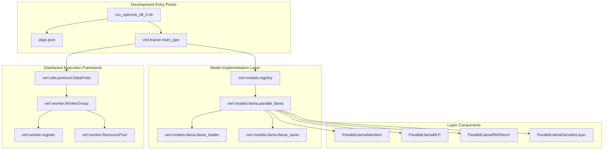
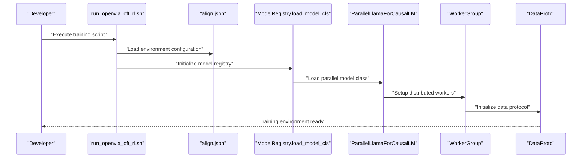
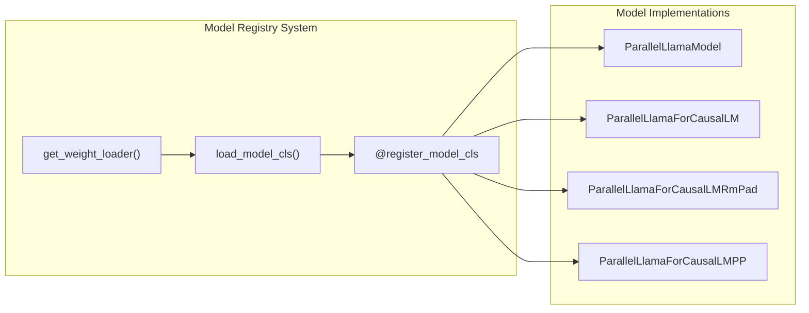
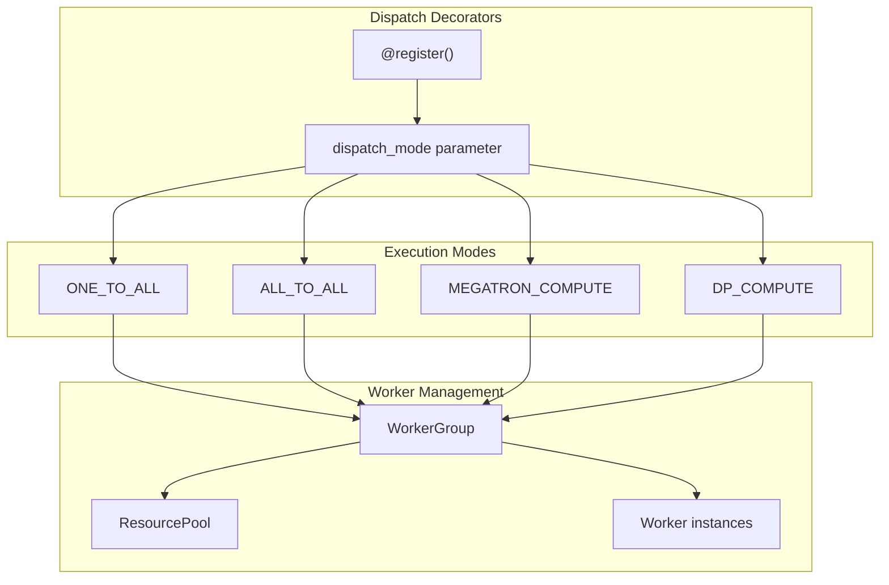
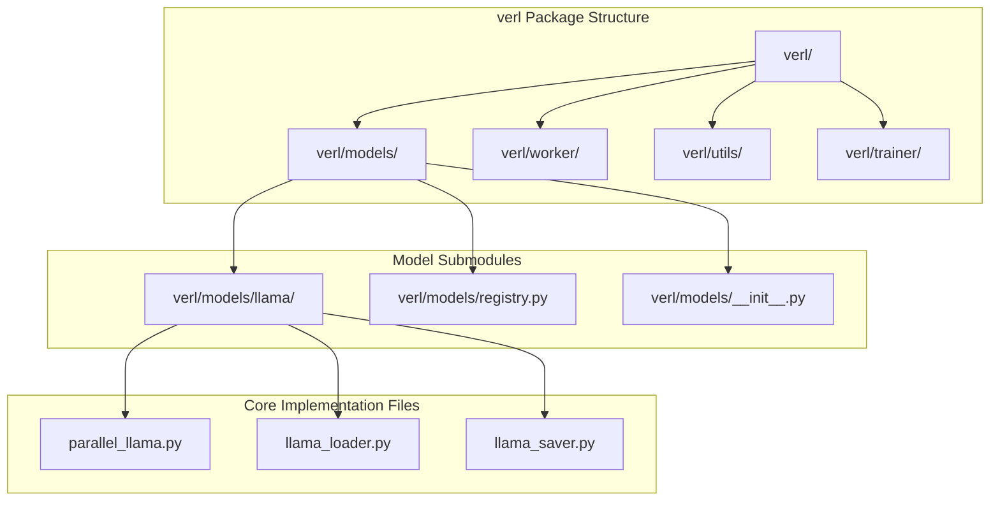

<!-- source: DeepWiki mcp.deepwiki.com · repo PRIME-RL/SimpleVLA-RL · page 8 Development · fetched 2026-10-30 -->

# Development

Relevant source files

The following files were used as context for generating this wiki page:

- [README.md](README.md)
- [SETUP.md](SETUP.md)

This section provides information for developers contributing to the SimpleVLA-RL project, including development environment setup, code organization, and architectural patterns. For detailed information about the project's internal structure and module organization, see [Project Structure](#5.1). For contribution guidelines and licensing information, see [Contributing](#5.2).

## Development Environment Overview

The SimpleVLA-RL codebase is designed for large-scale distributed training of Vision-Language-Action models using reinforcement learning. The development environment must support multi-GPU and multi-node training configurations with various distributed computing frameworks.

### Ignored Development Artifacts

The project excludes several types of development artifacts from version control, indicating the nature of the development workflow:

| Artifact Type | Examples | Purpose |
|---------------|----------|---------|
| Model Files | `**/*.pt`, `**/*.ckpt` | PyTorch model checkpoints |
| Training Outputs | `**/outputs`, `**/rollouts`, `**/wandb` | Training logs and experiment data |
| Build Artifacts | `**/_build/`, `build/`, `dist/` | Compiled packages and documentation |
| Data Files | `**/*.parquet`, `**/*.tar.gz` | Large datasets and compressed archives |
| Local Logs | `logs`, `log`, `outputs` | Development and debugging logs |

Sources: [.gitignore:1-127]()

## Core Development Architecture

The codebase follows a modular architecture with clear separation of concerns between training orchestration, model implementation, and distributed execution systems.

### Primary Development Components

Sources: Based on high-level system architecture diagrams and inferred module structure

### Development Data Flow Pattern

Sources: Based on training pipeline flow and system component relationships

## Key Development Patterns

### Model Registration Pattern

The codebase uses a registry pattern for dynamic model loading, allowing developers to add new model architectures without modifying core training logic:

Sources: Based on model registry architecture and parallel model variants

### Distributed Execution Pattern

The veRL framework implements a decorator-based pattern for distributed function execution:

Sources: Based on distributed execution framework and dispatch mechanism patterns

## Development Environment Requirements

### Framework Dependencies

The project integrates with several major frameworks that developers need to understand:

| Framework | Purpose | Integration Point |
|-----------|---------|-------------------|
| Megatron-LM | Model parallelization | `ParallelLlama*` classes |
| PyTorch | Deep learning backend | All model and training components |
| Hugging Face | Model loading/saving | Weight loader registry |
| veRL | RL training framework | Core training loop |
| LIBERO | Robotics environment | Environment integration |
| Weights & Biases | Experiment tracking | Training metrics logging |

### Development File Structure

The codebase follows a hierarchical module organization:

Sources: [verl/models/__init__.py:1-14]()

## License and Development Rights

The project is released under the MIT License, providing broad permissions for development and distribution. The license grants developers the right to use, modify, publish, distribute, sublicense, and sell copies of the software without restriction, subject to including the copyright notice and license text in all copies.

The copyright is held by PRIME-RL as of 2025, indicating active development and maintenance of the codebase.

Sources: [LICENSE:1-22]()

---

