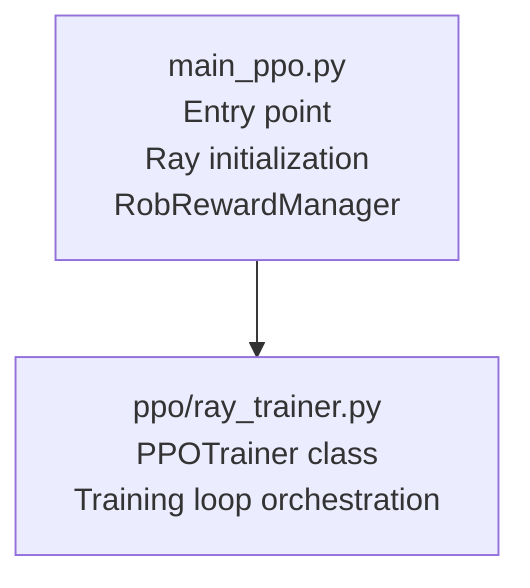
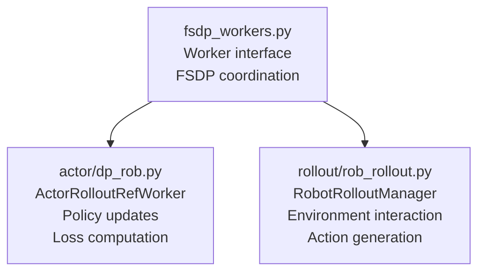
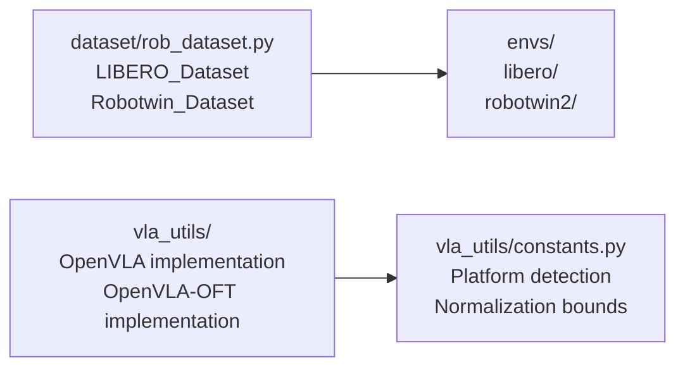
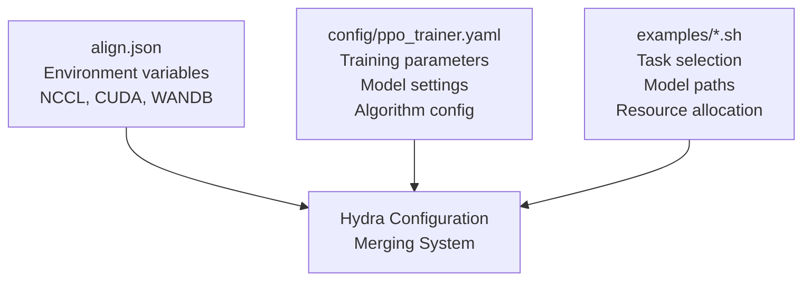
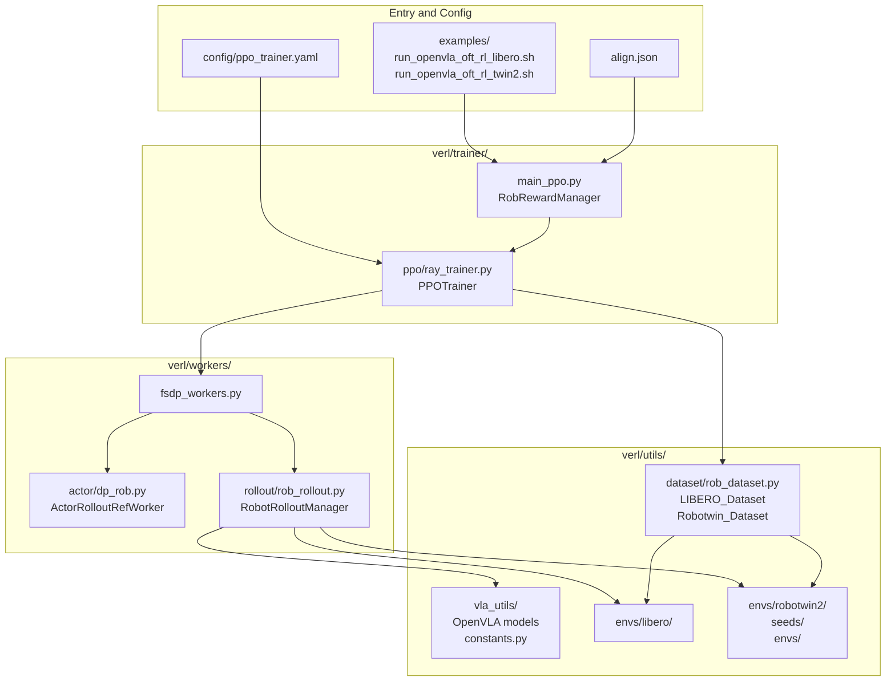

<!-- source: DeepWiki mcp.deepwiki.com · repo PRIME-RL/SimpleVLA-RL · page 8.1 Project Structure · fetched 2026-10-30 -->

# Project Structure

<details>
<summary>Relevant source files</summary>

The following files were used as context for generating this wiki page:

- [README.md](README.md)
- [SETUP.md](SETUP.md)

</details>


This document explains how the SimpleVLA-RL repository is organized, mapping high-level system components to their code locations. The codebase extends the veRL framework with VLA-specific components for robotic manipulation tasks.

## Repository Root Structure

The SimpleVLA-RL repository follows this top-level organization:

```
SimpleVLA-RL/
├── verl/                          # Core framework code
│   ├── trainer/                   # Training orchestration
│   ├── workers/                   # Distributed workers
│   └── utils/                     # Utilities and datasets
├── examples/                      # Example training scripts
│   ├── run_openvla_oft_rl_libero.sh
│   └── run_openvla_oft_rl_twin2.sh
├── config/                        # Hydra configuration files
│   └── ppo_trainer.yaml
├── align.json                     # Environment variables
├── README.md                      # Project documentation
├── SETUP.md                       # Installation guide
└── copy_overwrite_robotwin2.sh   # RoboTwin setup script
```

**Directory Structure**: SimpleVLA-RL extends veRL with robotics-specific components while maintaining separation from external dependencies (veRL, OpenVLA-OFT, LIBERO, RoboTwin are installed as separate packages at the same directory level).

Sources: [README.md:1-214](), [SETUP.md:120-131]()

## Core Package Organization

SimpleVLA-RL's codebase is organized into several key packages that implement different aspects of the VLA RL training system:

### Training Infrastructure (`verl/trainer/`)

**Main Entry Point and Training Loop**



| File | Primary Classes/Functions | Purpose |
|------|---------------------------|---------|
| `main_ppo.py` | `RobRewardManager`, `main()` | Initializes Ray cluster, sets up reward distribution |
| `ppo/ray_trainer.py` | `PPOTrainer` | Data loading, rollout collection, advantage computation, model updates, checkpointing |

Sources: [README.md:64-70]()

### Worker Layer (`verl/workers/`)

**Distributed Worker Implementation**



| Directory/File | Key Components | Purpose |
|----------------|----------------|---------|
| `fsdp_workers.py` | `generate_sequences()`, `compute_entropy()`, `update_actor()` | Core worker functions called by trainer |
| `actor/dp_rob.py` | `ActorRolloutRefWorker`, `compute_log_prob()`, `compute_entropy()` | RL loss computation, policy gradient updates |
| `rollout/rob_rollout.py` | `RobotRolloutManager`, parallel environment execution | VLA rollout, trajectory collection, video saving |

Sources: [README.md:72-82]()

### Utilities and Data (`verl/utils/`)

**Dataset and VLA Model Support**



| Directory/File | Key Components | Purpose |
|----------------|----------------|---------|
| `dataset/rob_dataset.py` | `LIBERO_Dataset`, `Robotwin_Dataset`, `BufferedDataLoader` | Task loading, batch construction, sample buffering |
| `vla_utils/` | OpenVLA, OpenVLA-OFT model classes | VLA model implementations from official codebases |
| `vla_utils/constants.py` | Platform constants (LIBERO, RoboTwin, ALOHA) | Action dimensions, normalization statistics |
| `envs/libero/` | LIBERO environment wrappers | LIBERO-specific utilities |
| `envs/robotwin2/` | RoboTwin 2.0 task implementations, seed management | RoboTwin-specific utilities |

Sources: [README.md:83-88]()

## Configuration and Examples

**Configuration Hierarchy**



| File/Directory | Purpose | Key Settings |
|----------------|---------|--------------|
| `align.json` | System-level environment variables | `NCCL_DEBUG`, `VLLM_ATTENTION_BACKEND`, `PYTORCH_CUDA_ALLOC_CONF`, `WANDB_API_KEY` |
| `config/ppo_trainer.yaml` | Default training parameters | Data batch sizes, model configuration, PPO hyperparameters, logging settings |
| `examples/run_openvla_oft_rl_libero.sh` | LIBERO training script | Task suite selection, checkpoint paths, GPU allocation |
| `examples/run_openvla_oft_rl_twin2.sh` | RoboTwin 2.0 training script | Task selection, seed management, resource configuration |

Sources: [README.md:113-127](), [README.md:136-154]()

## Complete File Organization

**Full Code Structure Mapping**



Sources: [README.md:64-88]()

## External Dependencies Structure

SimpleVLA-RL integrates with several external repositories that must be installed separately:

**Expected Directory Layout**

```
workspace/
├── SimpleVLA-RL/          # This repository
├── verl/                  # veRL framework (v0.2 or v0.3)
├── openvla-oft/           # OpenVLA-OFT models
├── LIBERO/                # LIBERO benchmark (optional)
└── RoboTwin/              # RoboTwin 2.0 benchmark (optional)
```

| External Dependency | Installation | Integration Point |
|---------------------|-------------|-------------------|
| **veRL** | `pip install -e verl/` | Core distributed training infrastructure, inherited by all `verl/` modules |
| **OpenVLA-OFT** | `pip install -e openvla-oft/` | VLA model implementations in `verl/utils/vla_utils/` |
| **LIBERO** | `pip install -e LIBERO/` | Environment interface in `verl/utils/envs/libero/` |
| **RoboTwin** | `bash script/_install.sh` | Environment interface in `verl/utils/envs/robotwin2/` |
| **Flash Attention** | `pip install flash-attn` | Required for efficient VLA training |
| **Ray** | Installed with veRL | Distributed execution backend |

Sources: [SETUP.md:1-165](), [README.md:46-48]()

## Key File Descriptions

### Training Infrastructure

**`verl/trainer/main_ppo.py`**
- Entry point for RL training
- Initializes Ray cluster for distributed execution
- Creates `RobRewardManager` for reward distribution across workers
- Delegates to `PPOTrainer` for main training loop

**`verl/trainer/ppo/ray_trainer.py`**
- Implements `PPOTrainer` class
- Orchestrates: data loading from datasets → rollout collection → filtering → advantage computation → policy updates → evaluation → checkpointing
- Supports multiple advantage estimators (GAE, GRPO, RLOO, REINFORCE++, REMAX)
- Implements oversampling/filtering strategy for sample efficiency

### Worker Layer

**`verl/workers/fsdp_workers.py`**
- Defines core worker interface functions
- `generate_sequences()`: Collects rollouts from environments
- `compute_entropy()`: Computes policy entropy for exploration
- `update_actor()`: Updates policy network with PPO loss
- Coordinates FSDP model sharding across workers

**`verl/workers/actor/dp_rob.py`**
- `ActorRolloutRefWorker` class: Combines actor and rollout functionality
- Implements PPO loss with clipping: `L = min(ratio * advantage, clip(ratio) * advantage) - entropy_coef * entropy`
- `compute_log_prob()`: Computes log probabilities for actions
- Handles gradient computation and optimizer steps

**`verl/workers/rollout/rob_rollout.py`**
- `RobotRolloutManager` class: Manages environment interactions
- Creates parallel environments (multiprocessing for LIBERO, threading for RoboTwin)
- `process_input()`: Preprocesses observations (images, proprioception, language)
- Generates VLA actions through model inference
- Collects trajectories with binary (0/1) rewards
- Saves rollout videos for validation

### Data and Utilities

**`verl/utils/dataset/rob_dataset.py`**
- `LIBERO_Dataset`: Generates (task_id, trial_id, seed) tuples for LIBERO tasks
- `Robotwin_Dataset`: Manages feasible seed selection for RoboTwin 2.0
- `BufferedDataLoader`: Buffers excess samples from filtering for reuse
- `collate_fn`: Stacks tensors and converts metadata to numpy arrays

**`verl/utils/vla_utils/constants.py`**
- Platform detection: Determines if running LIBERO, RoboTwin, or ALOHA
- Defines action dimensions per platform (7D for LIBERO/RoboTwin, 14D for ALOHA)
- Provides normalization bounds (`BOUNDS`, `BOUNDS_Q99`) for proprioception
- Configures action chunk sizes (8 for LIBERO, 5 for RoboTwin, 6-25 for ALOHA)

**`verl/utils/envs/libero/`**
- LIBERO environment wrappers and utilities
- Task suite definitions (libero-10, libero-90, spatial, object, goal)

**`verl/utils/envs/robotwin2/`**
- RoboTwin 2.0 task implementations
- `seeds/robotwin2_train_seeds.json`: Pre-collected feasible training seeds
- `seeds/robotwin2_eval_seeds.json`: Pre-collected evaluation seeds
- `envs/`: Task-specific environment files with `get_info()` functions

Sources: [README.md:64-88](), [SETUP.md:133-165]()

## Development Structure

For developers working on the codebase, the key extension points are:

- **New Model Architectures**: Add to `verl/models/` with corresponding registry entries
- **Custom RL Algorithms**: Extend `verl/trainer/` components
- **Data Protocol Extensions**: Implement new `DataProto` variants in `verl/protocol/`
- **Distributed Execution Modes**: Add dispatch modes to `verl/single_controller/`
- **Checkpoint Formats**: Implement loaders/savers in model-specific utilities

The modular design allows for independent development of each subsystem while maintaining clear interfaces for integration.

Sources: [verl/__init__.py:1-28](), [verl/models/__init__.py:1-14](), [verl/models/llama/__init__.py:1]()

---

