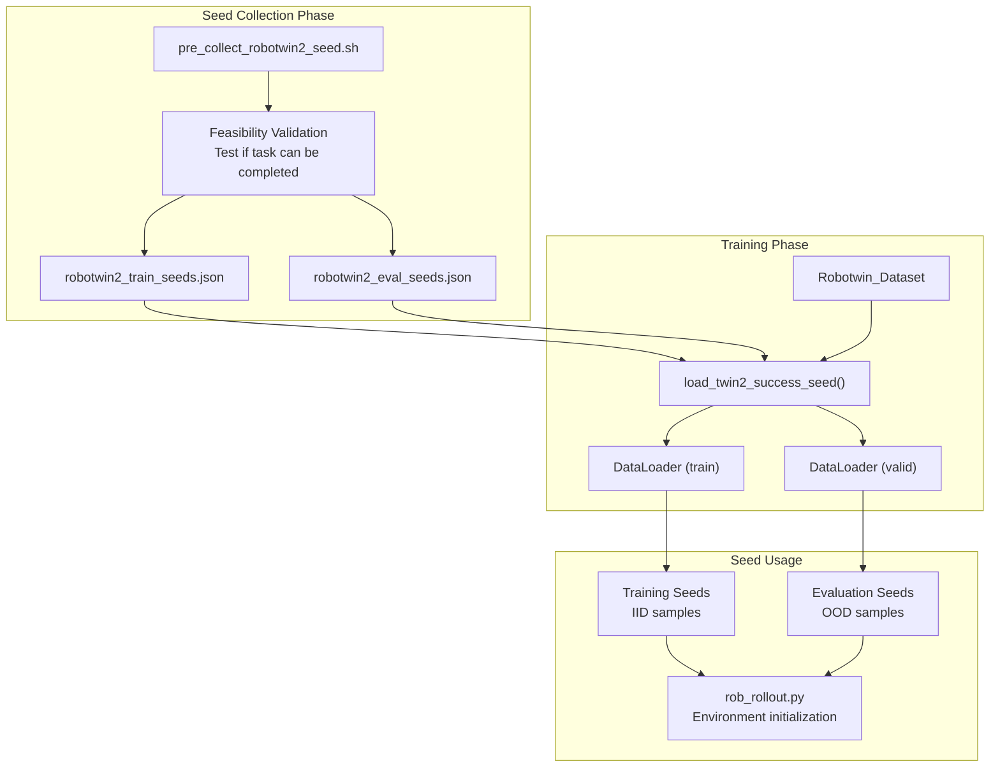
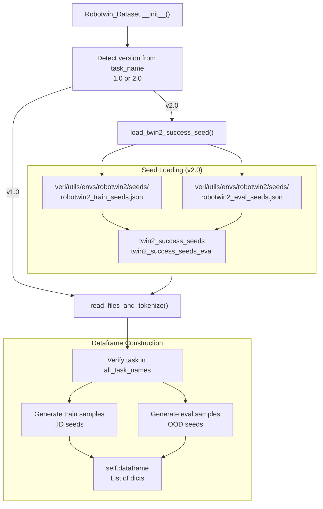
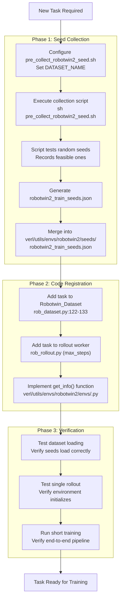

<!-- source: DeepWiki mcp.deepwiki.com · repo PRIME-RL/SimpleVLA-RL · page 8.2 Adding New Tasks · fetched 2026-10-30 -->

# Adding New Tasks

<details>
<summary>Relevant source files</summary>

The following files were used as context for generating this wiki page:

- [SETUP.md](SETUP.md)
- [verl/utils/dataset/rob_dataset.py](verl/utils/dataset/rob_dataset.py)

</details>


## Purpose and Scope

This page provides step-by-step instructions for integrating new tasks into SimpleVLA-RL, specifically focusing on RoboTwin 2.0 tasks. The process involves collecting feasible environment seeds, registering tasks in the dataset and rollout systems, and implementing task-specific logic.

For information about the existing LIBERO and RoboTwin benchmark structures, see [Benchmarks and Environments](#4). For details on how datasets load and manage seeds, see [Seed Management](#5.3).

---

## Overview

Adding a new RoboTwin task requires four main steps:

| Step | Component | Purpose |
|------|-----------|---------|
| 1 | **Seed Collection** | Pre-collect feasible environment initialization seeds |
| 2 | **Dataset Registration** | Add task to `Robotwin_Dataset` task list |
| 3 | **Rollout Registration** | Configure task parameters in rollout worker |
| 4 | **Task Implementation** | Implement task-specific logic (e.g., `get_info()`) |

The following sections detail each step with code references and examples.

**Sources:** [SETUP.md:133-165]()

---

## Why Feasible Seeds Matter for RoboTwin 2.0

RoboTwin 2.0 environments use random seeds to initialize object placements and configurations. However, not all seeds produce feasible scenarios—objects may spawn beyond the robot arm's reach or in physically impossible configurations. Training with infeasible seeds wastes computation on rollouts that can never succeed.

To optimize training efficiency, SimpleVLA-RL pre-collects **feasible seeds** during a separate validation phase. These seeds are stored in JSON files and used exclusively during training and evaluation, ensuring all rollouts have a reasonable chance of success.

### Seed Management Architecture



**Sources:** [verl/utils/dataset/rob_dataset.py:146-164](), [SETUP.md:136-151]()

---

## Step 1: Collecting Feasible Seeds

### Running the Collection Script

The seed collection script validates environment initialization seeds and stores successful ones for later use.

**Procedure:**

1. Update the `DATASET_NAME` variable in `pre_collect_robotwin2_seed.sh` with your target task name (e.g., `robotwin2_new_task`)

2. Execute the collection script:
   ```bash
   sh pre_collect_robotwin2_seed.sh
   ```

3. The script generates `robotwin2_train_seeds.json` in the SimpleVLA-RL root directory

4. Manually add the generated JSON content to:
   ```
   SimpleVLA-RL/verl/utils/envs/robotwin2/seeds/robotwin2_train_seeds.json
   ```

### Seed File Format

The JSON files follow this structure:

```json
{
  "task_name": {
    "success_seeds": [seed1, seed2, seed3, ...]
  }
}
```

Each task entry contains an array of validated integer seeds that produce feasible initial configurations.

**Sources:** [SETUP.md:136-151]()

---

## Step 2: Registering Tasks in the Dataset

After collecting feasible seeds, register the new task in the `Robotwin_Dataset` class.

### Modifying Task Name Lists

The `Robotwin_Dataset` class maintains lists of all supported task names for RoboTwin 1.0 and 2.0. Add your task to the appropriate list.

**Location:** [verl/utils/dataset/rob_dataset.py:122-133]()

**For RoboTwin 2.0 tasks:**

```python
elif self.version == "2.0":
    self.all_task_names = [ 
        "handover_mic",
        "move_can_pot",
        "pick_dual_bottles",
        # ... existing tasks ...
        "move_pillbottle_pad",
        "your_new_task"  # Add your task here (without robotwin2_ prefix)
    ]
    self.all_task_names = ["robotwin2_" + name for name in self.all_task_names]
```

**Note:** Task names are stored without the `robotwin2_` prefix in the list, which is automatically prepended during initialization.

### Dataset Initialization Flow



**Sources:** [verl/utils/dataset/rob_dataset.py:111-214]()

### Data Sample Structure

Each entry in the dataset's dataframe contains:

| Field | Type | Description |
|-------|------|-------------|
| `task_suite_name` | str | Full task name (e.g., `robotwin2_new_task`) |
| `task_id` | torch.Tensor | Set to -1 for RoboTwin tasks |
| `trial_id` | torch.Tensor | The seed value |
| `trial_seed` | torch.Tensor | The seed value (duplicate of trial_id) |
| `data_source` | str | Identifier like `robotwin2_new_task_train_iid` or `_eval_ood` |

**Sources:** [verl/utils/dataset/rob_dataset.py:189-208]()

---

## Step 3: Registering Tasks in Rollout Worker

The rollout worker needs to know the maximum episode length for each task to properly manage trajectory collection.

**Location:** `SimpleVLA-RL/verl/workers/rollout/rob_rollout.py` (file not provided in context)

**Required modifications:**

1. Add the task name to the task recognition logic
2. Specify the `max_steps` parameter for the task

**Example pattern (based on SETUP.md reference):**

```python
# In rob_rollout.py
if task_name == "robotwin2_new_task":
    max_steps = 150  # Adjust based on task complexity
```

Different tasks require different episode lengths based on their complexity. Common values:
- Simple manipulation: 100-150 steps
- Multi-step tasks: 200-300 steps
- Complex assembly: 300+ steps

**Sources:** [SETUP.md:155-156]()

---

## Step 4: Implementing Task-Specific Functions

RoboTwin 2.0 tasks require a `get_info()` function to provide task-specific information during environment execution.

### Implementation Location

Add the `get_info()` function in the task file:
```
SimpleVLA-RL/verl/utils/envs/robotwin2/envs/<task_name>.py
```

### Reference Implementation

The `get_info()` function structure can be found in:
```
SimpleVLA-RL/modified_codes/robotwin2/envs/handover_block.py
```

This function typically:
1. Extracts relevant environment state information
2. Computes task-specific metrics or conditions
3. Returns a dictionary of information for logging/debugging

**Sources:** [SETUP.md:158-165]()

---

## Complete Integration Workflow



**Sources:** [SETUP.md:133-165](), [verl/utils/dataset/rob_dataset.py:111-214]()

---

## Code Modification Checklist

Use this checklist to ensure all required modifications are complete:

- [ ] **Seed Collection**
  - [ ] Configure `pre_collect_robotwin2_seed.sh` with new task name
  - [ ] Execute collection script and generate JSON
  - [ ] Merge generated seeds into `robotwin2_train_seeds.json`
  - [ ] (Optional) Collect evaluation seeds for `robotwin2_eval_seeds.json`

- [ ] **Dataset Registration**
  - [ ] Add task name to `self.all_task_names` in `Robotwin_Dataset.__init__()`
  - [ ] Verify task name format (without `robotwin2_` prefix in list)
  - [ ] Test dataset initialization with new task

- [ ] **Rollout Worker Registration**
  - [ ] Add task name to `rob_rollout.py` recognition logic
  - [ ] Set appropriate `max_steps` for task complexity
  - [ ] Verify task-specific constants if needed

- [ ] **Task Implementation**
  - [ ] Create task file in `verl/utils/envs/robotwin2/envs/`
  - [ ] Implement `get_info()` function
  - [ ] Add any task-specific reward computation logic

- [ ] **Testing**
  - [ ] Test dataset loading and seed selection
  - [ ] Test single environment rollout
  - [ ] Verify training pipeline integration
  - [ ] Check WandB logging for new task metrics

**Sources:** [SETUP.md:133-165](), [verl/utils/dataset/rob_dataset.py:111-214]()

---

## Task Name Conventions

Follow these naming conventions for consistency:

| Component | Convention | Example |
|-----------|------------|---------|
| Task file | `<task_name>.py` | `handover_block.py` |
| Task list entry | Snake case, no prefix | `"handover_block"` |
| Full task name | `robotwin2_` prefix | `"robotwin2_handover_block"` |
| Seed JSON key | No prefix | `"handover_block"` |
| Data source | Full name + split + distribution | `"robotwin2_handover_block_train_iid"` |

**Sources:** [verl/utils/dataset/rob_dataset.py:122-133](), [verl/utils/dataset/rob_dataset.py:189-208]()

---

## Troubleshooting Common Issues

### Issue: Task Not Found in Dataset

**Symptom:** `ValueError` raised during dataset initialization

**Solution:** Verify task name is in `self.all_task_names` list at [verl/utils/dataset/rob_dataset.py:122-133]()

### Issue: No Feasible Seeds Available

**Symptom:** Dataset initialization succeeds but training fails to start rollouts

**Solution:** 
1. Check `robotwin2_train_seeds.json` contains entry for your task
2. Verify seed array is not empty
3. Re-run seed collection script with higher seed count

### Issue: Seed Loading Fails

**Symptom:** JSON parsing error or key not found

**Solution:**
1. Verify JSON file format matches expected structure
2. Check task name in JSON matches list entry (without `robotwin2_` prefix)
3. Ensure JSON file is in correct directory: `verl/utils/envs/robotwin2/seeds/`

**Sources:** [verl/utils/dataset/rob_dataset.py:146-164]()

---

