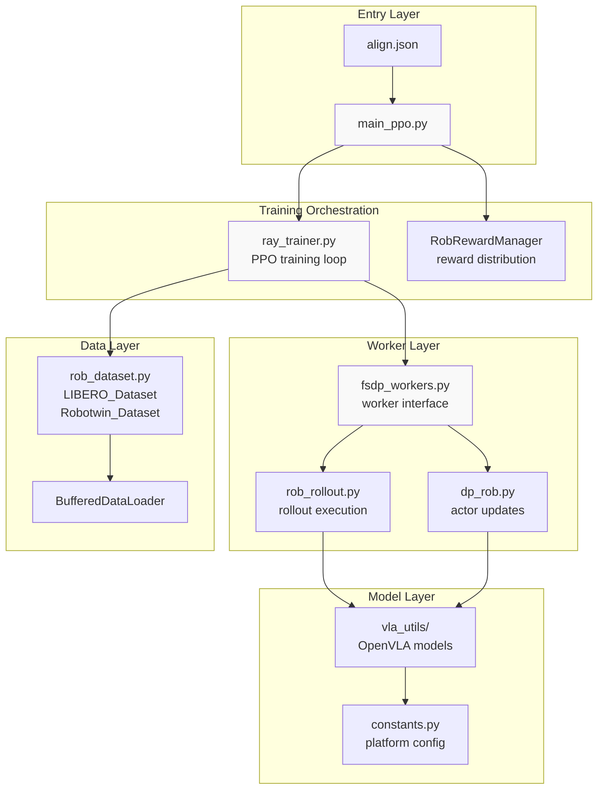
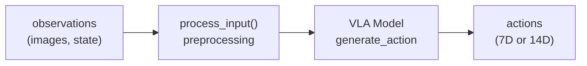
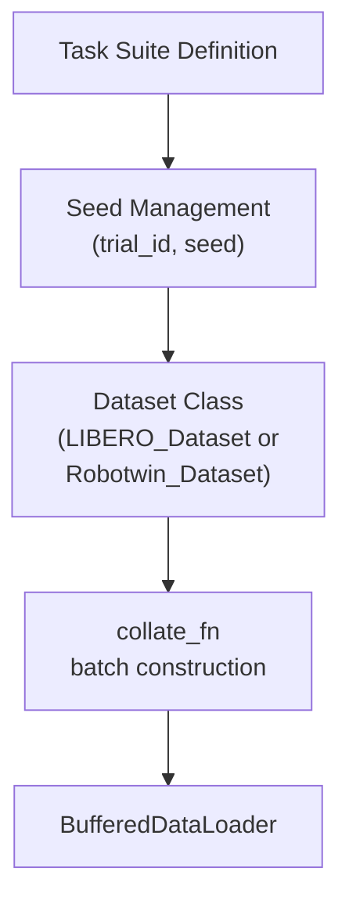
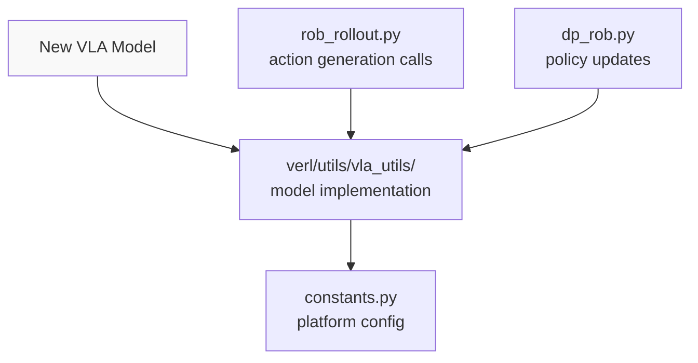

<!-- source: DeepWiki mcp.deepwiki.com · repo PRIME-RL/SimpleVLA-RL · page 8.3 Contributing · fetched 2026-10-30 -->

# Contributing

<details>
<summary>Relevant source files</summary>

The following files were used as context for generating this wiki page:

- [README.md](README.md)
- [SETUP.md](SETUP.md)

</details>


This page provides practical guidelines for contributing to the SimpleVLA-RL project. Whether you're fixing bugs, adding new features, or extending the framework with new models or environments, this guide will help you understand the contribution process.

For information about the overall project structure, see [Project Structure (8.1)](#8.1). For adding new tasks specifically, see [Adding New Tasks (8.2)](#8.2).

## License

SimpleVLA-RL is released under the MIT License. All contributions must be compatible with this license. By submitting a contribution, you agree to license your work under the same terms.

Sources: [LICENSE:1-22](), [README.md:1-214]()
</thinking>

## Getting Started with Contributing

### Development Environment Setup

Before contributing, ensure you have a working development environment. Follow the installation instructions in the setup guide to configure:

- **veRL framework** (v0.2 or v0.3 recommended)
- **PyTorch** 2.4.0 with CUDA 12.4
- **OpenVLA-OFT** for VLA model implementations
- **LIBERO** and/or **RoboTwin** for environment testing

See [Getting Started (1.1)](#1.1) for detailed installation instructions.

### Directory Structure

Your workspace should follow this structure:

```
your_workspace/
├── SimpleVLA-RL/       # Main repository
├── verl/               # veRL framework
├── openvla-oft/        # OpenVLA-OFT models
├── LIBERO/             # LIBERO benchmark (optional)
└── RoboTwin/           # RoboTwin benchmark (optional)
```

Sources: [SETUP.md:119-131](), [README.md:90-155]()

## Code Organization and Architecture

### Key Components and Their Locations

Understanding where different components live in the codebase is essential for contributing:

| Component | Location | Purpose |
|-----------|----------|---------|
| Training entry point | `verl/trainer/main_ppo.py` | Ray initialization, reward manager setup |
| PPO training loop | `verl/trainer/ppo/ray_trainer.py` | Data loading, rollouts, model updates |
| Worker interface | `verl/workers/fsdp_workers.py` | Core functions for model operations |
| Actor updates | `verl/workers/actor/dp_rob.py` | Policy loss computation, updates |
| Rollout execution | `verl/workers/rollout/rob_rollout.py` | Environment interaction, trajectory collection |
| Dataset handling | `verl/utils/dataset/rob_dataset.py` | LIBERO and RoboTwin dataset construction |
| VLA models | `verl/utils/vla_utils/` | OpenVLA and OpenVLA-OFT implementations |
| Platform constants | `verl/utils/vla_utils/constants.py` | Platform-specific configurations |

Sources: [README.md:60-88]()

### System Layer Architecture

**Diagram: Code Component Organization**



Sources: [README.md:64-88](), System Architecture Diagram

## Code Style and Standards

### Python Code Style

Follow standard Python coding conventions:

- **PEP 8** style guidelines for Python code
- **Type hints** for function parameters and return values
- **Docstrings** for classes and functions explaining purpose, parameters, and returns
- **Descriptive variable names** that reflect their purpose
- **Comments** for complex logic or non-obvious implementations

### VLA-Specific Patterns

When contributing VLA-related code, follow these established patterns:

#### Action Generation



**Implementation Pattern:**
- Preprocess observations using `process_input()` in `rob_rollout.py`
- Apply platform-specific normalization from `constants.py`
- Generate actions through VLA model's `generate_action()` or `generate_action_verl()`
- Unnormalize actions using platform-specific statistics

Sources: [verl/workers/rollout/rob_rollout.py](), [verl/utils/vla_utils/constants.py]()

#### Dataset Construction

**Pattern for Adding New Datasets:**



**Implementation Requirements:**
- Define task suite in `rob_dataset.py` dataset class
- Implement seed management (deterministic for LIBERO, pre-collected for RoboTwin)
- Create `collate_fn` for proper batch construction
- Return task metadata: `task_id`, `trial_id`, `seed`, `prompt`

Sources: [verl/utils/dataset/rob_dataset.py]()

#### Rollout Execution

**Pattern for Environment Interaction:**

| Component | Responsibility | Key Functions |
|-----------|---------------|---------------|
| `rob_rollout.py` | Environment orchestration | `generate_sequences()`, `env_worker()` |
| Environment wrappers | Parallel execution | LIBERO: `multiprocessing.Process`, RoboTwin: `ThreadPoolExecutor` |
| VLA models | Action generation | `generate_action()`, `generate_action_verl()` |

**Implementation Pattern:**
- Initialize parallel environments (process-based or thread-based)
- For each step: process observations → generate actions → execute in environment
- Collect trajectories with rewards
- Return structured data for advantage computation

Sources: [verl/workers/rollout/rob_rollout.py]()

## Extending the Framework

### Adding a New VLA Model

To add support for a new VLA model:

1. **Add model implementation** to `verl/utils/vla_utils/`
2. **Implement required methods**:
   - `generate_action()` or `generate_action_verl()` for action generation
   - Input processing for images, proprioception, and language
3. **Update platform constants** in `constants.py` if needed
4. **Register model** in the model loading pipeline
5. **Test** with both LIBERO and RoboTwin benchmarks

**Diagram: VLA Model Integration Points**



Sources: [verl/utils/vla_utils/](), [verl/workers/rollout/rob_rollout.py]()

### Adding a New Environment/Benchmark

To add support for a new simulation environment:

1. **Create dataset class** in `rob_dataset.py`:
   - Inherit from `torch.utils.data.Dataset`
   - Implement `__len__()` and `__getitem__()`
   - Define task suite and seed management

2. **Implement rollout worker**:
   - Add environment initialization in `rob_rollout.py`
   - Choose parallelization strategy (threading vs multiprocessing)
   - Implement observation processing and action execution

3. **Define platform constants**:
   - Add normalization statistics to `constants.py`
   - Specify action dimensions and chunk sizes
   - Configure max episode steps

4. **Update configuration**:
   - Add task names to `ppo_trainer.yaml`
   - Create example run scripts in `examples/`

**Required Implementation Functions:**

| Function | Location | Purpose |
|----------|----------|---------|
| Dataset `__getitem__()` | `rob_dataset.py` | Return task metadata |
| `get_env()` | `rob_rollout.py` | Initialize environment |
| `process_input()` | `rob_rollout.py` | Preprocess observations |
| `detect_robot_platform()` | `constants.py` | Platform detection |

Sources: [verl/utils/dataset/rob_dataset.py](), [verl/workers/rollout/rob_rollout.py](), [verl/utils/vla_utils/constants.py]()

### Adding RoboTwin Tasks

For detailed instructions on adding new RoboTwin 2.0 tasks, see [Adding New Tasks (8.2)](#8.2). The process includes:

1. **Collecting feasible seeds** using `pre_collect_robotwin2_seed.sh`
2. **Registering task names** in `rob_dataset.py` and `rob_rollout.py`
3. **Implementing `get_info()`** function for the task

Sources: [SETUP.md:133-165]()

## Testing and Validation

### Environment Testing

Before submitting contributions, ensure compatibility with:

- Multi-GPU training configurations
- Distributed worker setups
- Checkpoint loading and saving operations
- Integration with external dependencies (LIBERO, Weights & Biases)

### Code Validation

- Verify distributed execution patterns work with `DataProto` serialization
- Test model registry integration for new model implementations
- Validate checkpoint compatibility across different parallelization strategies
- Ensure proper resource cleanup in worker management code

## Documentation Requirements

### Code Documentation

- Document all `@register` decorated functions with clear dispatch mode specifications
- Include type hints for `DataProto` and related protocol classes
- Document model registry integration points and requirements
- Provide examples for new parallel model implementations

### Configuration Documentation

- Document any new configuration parameters in `align.json` format
- Explain environment variable requirements for distributed setups
- Document hardware requirements and scaling considerations

Sources: Based on project structure analysis and system component documentation needs