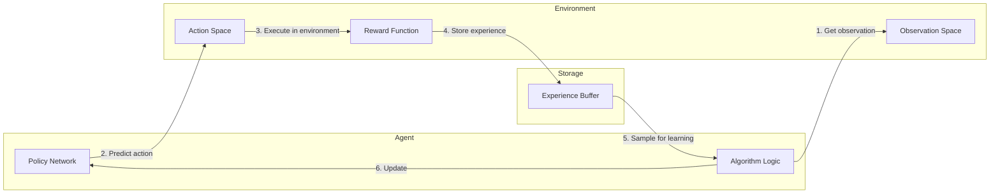
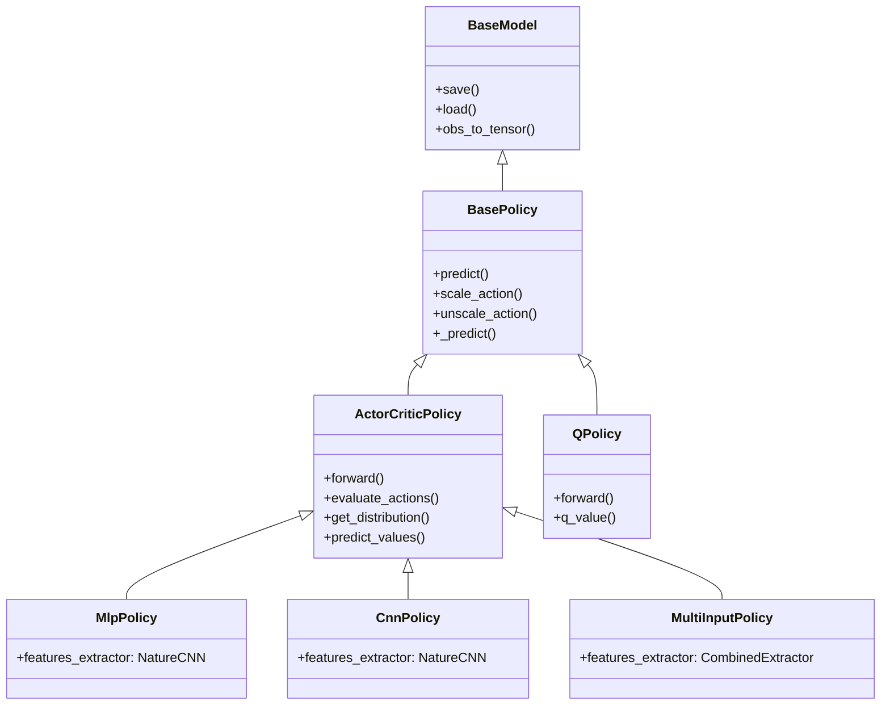
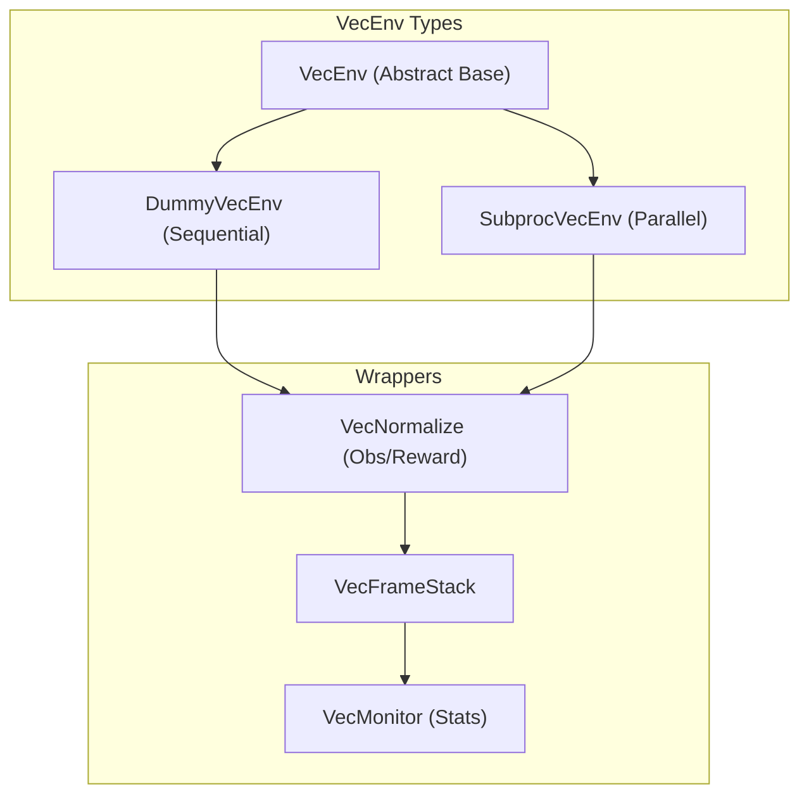
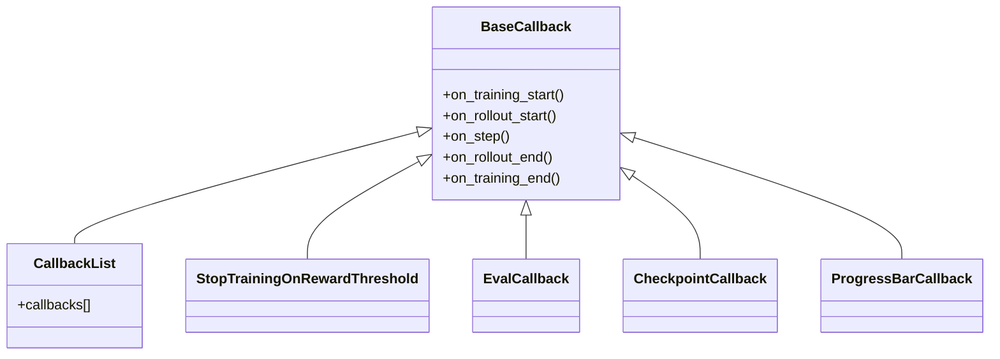
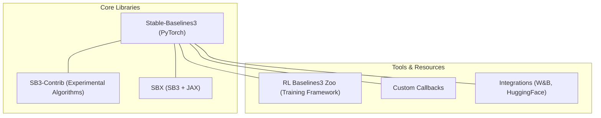

<!-- source: DeepWiki mcp.deepwiki.com · repo DLR-RM/stable-baselines3 · page 1 Overview · fetched 2026-10-14 -->

# Overview

<details>
<summary>Relevant source files</summary>

The following files were used as context for generating this wiki page:

- [README.md](README.md)
- [docs/guide/rl.md](docs/guide/rl.md)
- [docs/index.rst](docs/index.rst)
- [stable_baselines3/__init__.py](stable_baselines3/__init__.py)
- [stable_baselines3/version.txt](stable_baselines3/version.txt)

</details>


Stable Baselines3 (SB3) is a reliable, PyTorch-based implementation of reinforcement learning algorithms. This document provides a high-level overview of the library's architecture, components, and capabilities to help users understand how the different parts fit together.

For detailed installation instructions, see [Installation Guide](#1.1). For getting started with examples, see [Getting Started & Examples](#1.2).

## Purpose and Scope

SB3 aims to provide:
1. Clean, modular implementations of reinforcement learning algorithms
2. A common interface for training, prediction, and evaluation
3. Type-hinted, well-documented code for research and production use
4. Reliable performance with extensive testing

The library focuses on providing strong baseline implementations rather than cutting-edge research features. More experimental algorithms are available in the SB3-Contrib repository, while performance-optimized versions are available in SBX (SB3 + Jax).
Sources: [README.md:10-18](), [README.md:45-52]()

## Core Architecture

Stable Baselines3's architecture is designed around modularity and extensibility, with clear separation between algorithms, policies, and environment interactions.

### Component Relationships

```mermaid
graph TD
    subgraph "Core Components"
        BaseAlgorithm["BaseAlgorithm"]
        BasePolicy["BasePolicy"]
        VecEnv["VecEnv"]
        Buffers["Experience Buffers"]
        Callbacks["Callbacks"]
    end

    subgraph "Algorithm Types"
        OnPolicy["OnPolicyAlgorithm"]
        OffPolicy["OffPolicyAlgorithm"]
    end

    subgraph "Concrete Algorithms"
        PPO["PPO (stable_baselines3/ppo.py)"]
        A2C["A2C (stable_baselines3/a2c.py)"]
        DQN["DQN (stable_baselines3/dqn.py)"]
        SAC["SAC (stable_baselines3/sac.py)"]
        TD3["TD3 (stable_baselines3/td3.py)"]
        DDPG["DDPG (stable_baselines3/ddpg.py)"]
    end

    subgraph "Policy Types"
        AC["ActorCriticPolicy"]
        Q["QPolicy"]
    end

    subgraph "Buffers"
        ReplayBuffer["ReplayBuffer (stable_baselines3/common/buffers.py)"]
        RolloutBuffer["RolloutBuffer (stable_baselines3/common/buffers.py)"]
    end

    BaseAlgorithm --> OnPolicy
    BaseAlgorithm --> OffPolicy
    OnPolicy --> PPO
    OnPolicy --> A2C
    OffPolicy --> DQN
    OffPolicy --> SAC
    OffPolicy --> TD3
    OffPolicy --> DDPG

    BaseAlgorithm --> BasePolicy
    BasePolicy --> AC
    BasePolicy --> Q

    OnPolicy --> RolloutBuffer
    OffPolicy --> ReplayBuffer

    BaseAlgorithm --> VecEnv
    BaseAlgorithm --> Callbacks
```


Sources: [stable_baselines3/__init__.py:3-10]()

SB3's architecture follows a clear inheritance pattern, with all algorithms inheriting from a common `BaseAlgorithm` class, then specialized into on-policy and off-policy variants, before being implemented as concrete algorithms like `PPO`, `A2C`, and `DQN`.

### Training Data Flow



During training, the algorithm interacts with the environment to gather experiences, which are stored in buffers (replay buffer for off-policy algorithms or rollout buffer for on-policy algorithms). These experiences are then sampled to update the policy network through gradient descent.

## Implemented Algorithms

SB3 implements several widely-used reinforcement learning algorithms, with different characteristics and capabilities:

| Algorithm | Type | Action Space Support | Multi-Processing |
|-----------|------|----------------------|-----------------|
| A2C | On-Policy | Box, Discrete, MultiDiscrete, MultiBinary | ✅ |
| PPO | On-Policy | Box, Discrete, MultiDiscrete, MultiBinary | ✅ |
| DQN | Off-Policy | Discrete | ✅ |
| DDPG | Off-Policy | Box | ✅ |
| TD3 | Off-Policy | Box | ✅ |
| SAC | Off-Policy | Box | ✅ |
| HER | Off-Policy Wrapper | Box, Discrete (with goal) | ✅ |

SB3-Contrib provides additional algorithms including TRPO, TQC, QR-DQN, RecurrentPPO, and Maskable PPO.
Sources: [README.md:88-91]()

The algorithms are divided into two main categories:
- **On-policy algorithms** (`A2C`, `PPO`): Learn from current experiences, typically more sample-efficient but less data-efficient
- **Off-policy algorithms** (`DQN`, `SAC`, `TD3`, `DDPG`): Can learn from past experiences, typically more data-efficient but less sample-efficient

## Policy Architecture

Policies define how agents map observations to actions. SB3 provides several policy types to handle different types of observations and action spaces:



For each algorithm, SB3 provides pre-configured policies:
- `MlpPolicy`: For environments with vector observations
- `CnnPolicy`: For environments with image observations
- `MultiInputPolicy`: For environments with dictionary observations (mixing different types)

## Environment Interaction

SB3 uses vectorized environments (`VecEnv`) to handle multiple environments at once, enabling parallel execution and normalization:



The vectorized environment system provides:
- Standardized interface for all algorithms
- Support for parallel environment execution
- Observation and reward normalization
- Episode monitoring and statistics

## Callback System

SB3 uses callbacks to monitor, control and customize the training process:



Common callbacks include:
- `EvalCallback`: Periodically evaluate agent performance
- `CheckpointCallback`: Save models at regular intervals
- `ProgressBarCallback`: Display training progress
- `StopTrainingOnRewardThreshold`: Early stopping based on rewards

## SB3 Ecosystem

SB3 is part of a larger ecosystem of reinforcement learning tools:


Sources: [README.md:49-52](), [README.md:66-98]()

The ecosystem includes:
- **SB3**: Core reinforcement learning algorithms
- **SB3-Contrib**: Experimental algorithms (TRPO, QR-DQN, TQC, etc.)
- **SBX**: High-performance JAX implementations (up to 20x faster)
- **RL Baselines3 Zoo**: Training framework with hyperparameter tuning, logging, and pre-trained models

## Installation and Requirements

SB3 requires Python 3.10+ and PyTorch >= 2.8. The basic installation can be done via pip:
Sources: [README.md:103-105]()

```sh
pip install stable-baselines3
```

For additional features (Tensorboard, OpenCV, Atari support):

```sh
pip install 'stable-baselines3[extra]'
```
Sources: [README.md:114-117]()

For details, see [Installation Guide](#1.1).

## Version History

SB3 follows semantic versioning with regular releases. The current version is `2.9.2a0`.
Sources: [stable_baselines3/version.txt:1]()

While SB3 development is now focused on bug fixes and maintenance, new features and algorithms are primarily added to associated repositories like SB3-Contrib and SBX.
Sources: [README.md:49-52]()

## Summary

Stable Baselines3 provides a reliable, well-tested implementation of reinforcement learning algorithms in PyTorch. Its modular design allows for easy experimentation and extension, while its consistent interface simplifies the process of training and deploying reinforcement learning agents. The library is actively maintained and continues to evolve with new features and improvements.

---

