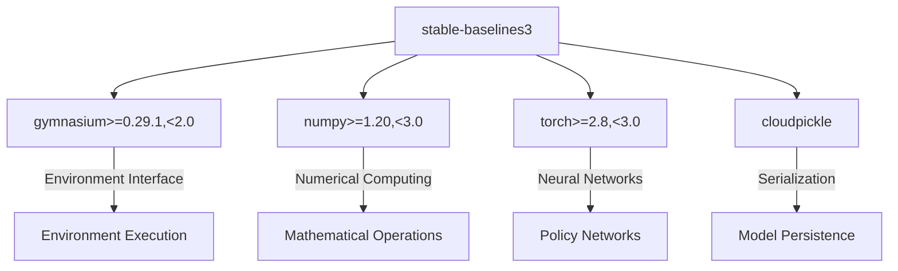
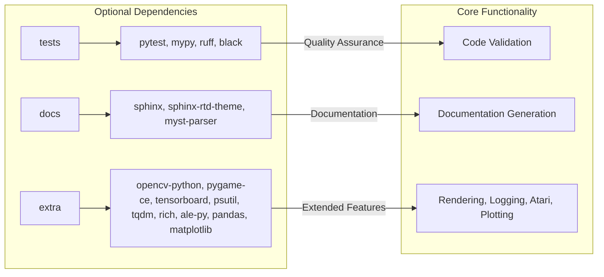
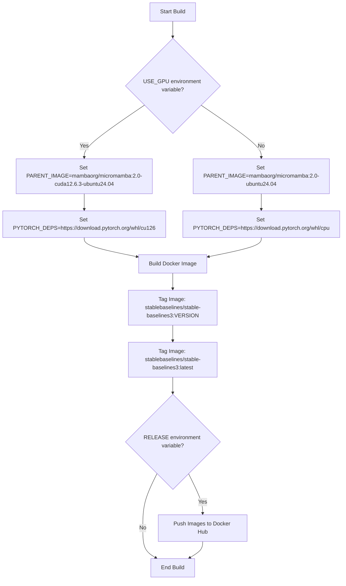
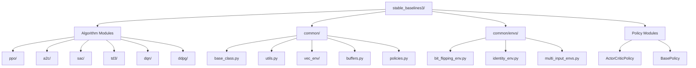

<!-- source: DeepWiki mcp.deepwiki.com · repo DLR-RM/stable-baselines3 · page 1.1 Installation Guide · fetched 2026-10-14 -->

# Installation Guide

<details>
<summary>Relevant source files</summary>

The following files were used as context for generating this wiki page:

- [.dockerignore](.dockerignore)
- [.readthedocs.yml](.readthedocs.yml)
- [Dockerfile](Dockerfile)
- [docs/conda_env.yml](docs/conda_env.yml)
- [docs/guide/install.md](docs/guide/install.md)
- [scripts/build_docker.sh](scripts/build_docker.sh)
- [scripts/run_docker_cpu.sh](scripts/run_docker_cpu.sh)
- [scripts/run_docker_gpu.sh](scripts/run_docker_gpu.sh)
- [setup.py](setup.py)
- [stable_baselines3/common/envs/__init__.py](stable_baselines3/common/envs/__init__.py)

</details>


This document provides comprehensive installation instructions for Stable-Baselines3, including system requirements, dependency management, and various installation methods. It covers standard pip installation, development setup, Docker configurations, and optional package installations.

For information about getting started with basic usage after installation, see [Getting Started & Examples](#1.2). For migration from previous versions, see the migration documentation in the SB3 ecosystem.

## Prerequisites and System Requirements

Stable-Baselines3 requires specific system prerequisites that must be met before installation:

### Core Requirements

| Component | Requirement | Notes |
|-----------|-------------|-------|
| Python | `>=3.10` | Minimum supported version [setup.py:140]() |
| PyTorch | `>=2.8,<3.0` | Deep learning backend [setup.py:84]() |
| Operating System | Windows, Linux, macOS | Full cross-platform support |

### Platform-Specific Considerations

**Windows Users**: We recommend using [miniforge](https://github.com/conda-forge/miniforge#windows) for Windows users for easier installation of Python packages and required libraries. You need an environment with Python version 3.10 or above. [docs/guide/install.md:9-11]() Some Atari environments may require additional DLL files and can produce vague error messages if dependencies are missing. [docs/guide/install.md:15-18]()

**Headless Systems**: For systems without X-server (e.g., Docker containers), `opencv-python-headless` is required instead of standard OpenCV packages. [docs/guide/install.md:39-41]()

Sources: [setup.py:138-155](), [docs/guide/install.md:9-18](), [docs/guide/install.md:39-41]()

## Installation Methods

### Stable Release Installation

The standard installation method uses pip to install the latest stable release from PyPI:

```bash
pip install 'stable-baselines3[extra]'
```
[docs/guide/install.md:24-26]()

**Note**: Some shells (like Zsh) require quotation marks around brackets, i.e. `pip install 'stable-baselines3[extra]'`. [docs/guide/install.md:28-30]()

For minimal installation without optional dependencies:
```bash
pip install stable-baselines3
```
[docs/guide/install.md:34-36]()

The `[extra]` suffix includes optional dependencies for enhanced functionality including TensorBoard logging, OpenCV, `ale-py` for Atari games, `psutil` for memory checking, `tqdm` and `rich` for progress bars, `pandas` and `matplotlib` for plotting. [setup.py:111-128]()

Sources: [docs/guide/install.md:24-36](), [setup.py:78-88](), [setup.py:111-128]()

### Development and Bleeding-Edge Versions

#### Bleeding-Edge Installation
Install directly from the main branch for latest features:

```bash
pip install git+https://github.com/DLR-RM/stable-baselines3
```
[docs/guide/install.md:46-48]()

With optional dependencies:
```bash
pip install "stable_baselines3[extra,tests,docs] @ git+https://github.com/DLR-RM/stable-baselines3"
```
[docs/guide/install.md:50-52]()

#### Development Installation
For contributors requiring editable installation with testing and documentation tools:

```bash
git clone https://github.com/DLR-RM/stable-baselines3 && cd stable-baselines3
pip install -e '.[docs,tests,extra]'
```
[docs/guide/install.md:59-62]()

Sources: [docs/guide/install.md:46-62]()

## Dependency Configuration

### Core Dependencies


Sources: [setup.py:81-87]()

### Optional Dependency Groups

The installation system supports several optional dependency groups defined in the `extras_require` configuration:


Sources: [setup.py:89-128]()

#### Tests Extra Package
```bash
pip install 'stable-baselines3[tests]'
```
Includes: `pytest`, `pytest-cov`, `mypy`, `ruff`, `black`. [setup.py:89-98]()

#### Documentation Extra Package  
```bash
pip install 'stable-baselines3[docs]'
```
Includes: `sphinx`, `sphinx-autobuild`, `sphinx-rtd-theme`, `sphinxcontrib.spelling`, `sphinx_copybutton`, `myst-parser`. [setup.py:100-110]()

#### Extra Features Package
```bash
pip install 'stable-baselines3[extra]'
```
Includes: `opencv-python`, `pygame-ce`, `tensorboard`, `psutil`, `tqdm`, `rich`, `ale-py`, `pillow`, `pandas`, `matplotlib`. [setup.py:112-128]()

Sources: [setup.py:89-128]()

## Docker Installation

### Pre-built Docker Images

Stable-Baselines3 provides official Docker images for development and testing:

**GPU Support** (requires [nvidia-docker](https://github.com/NVIDIA/nvidia-docker)):
```bash
docker pull stablebaselines/stable-baselines3
```
[docs/guide/install.md:77-79]()

**CPU Only**:
```bash
docker pull stablebaselines/stable-baselines3-cpu
```
[docs/guide/install.md:81-83]()

### Building Custom Images

The `Dockerfile` [Dockerfile:1-27]() defines the environment. The `scripts/build_docker.sh` [scripts/build_docker.sh:1-25]() script automates the build process.


Sources: [Dockerfile:1-27](), [scripts/build_docker.sh:1-25]()

**GPU Image**:
```bash
make docker-gpu
```
This command internally uses `scripts/build_docker.sh` with `USE_GPU=True`. [scripts/build_docker.sh:9]()

**CPU Image**:
```bash
make docker-cpu
```
This command internally uses `scripts/build_docker.sh` with `USE_GPU` not set to `True`. [scripts/build_docker.sh:13]()

Sources: [docs/guide/install.md:90-93](), [scripts/build_docker.sh:1-25]()

### Running Docker Containers

**GPU Container**:
```bash
docker run -it --runtime=nvidia --rm --network host --ipc=host \
  --name test --mount src="$(pwd)",target=/home/mamba/stable-baselines3,type=bind \
  stablebaselines/stable-baselines3 bash -c 'cd /home/mamba/stable-baselines3/ && pytest tests/'
```
[docs/guide/install.md:110-113]()
Or, with the shell file:
```bash
./scripts/run_docker_gpu.sh pytest tests/
```
[docs/guide/install.md:117-119]()

**CPU Container**:
```bash
docker run -it --rm --network host --ipc=host \
  --name test --mount src="$(pwd)",target=/home/mamba/stable-baselines3,type=bind \
  stablebaselines/stable-baselines3-cpu bash -c 'cd /home/mamba/stable-baselines3/ && pytest tests/'
```
[docs/guide/install.md:123-126]()
Or, with the shell file:
```bash
./scripts/run_docker_cpu.sh pytest tests/
```
[docs/guide/install.md:129-131]()

#### Docker Command Parameters

| Parameter | Purpose |
|-----------|---------|
| `docker run -it` | Create an instance of an image (=container), and run it interactively. [docs/guide/install.md:135-136]() |
| `--rm` | Remove the container once it exits/stops. [docs/guide/install.md:137-138]() |
| `--network host` | Don't use network isolation, allows TensorBoard/Visdom on host machine. [docs/guide/install.md:139-141]() |
| `--ipc=host` | Use the host system’s IPC namespace for shared memory segments, semaphores, and message queues. [docs/guide/install.md:142-145]() |
| `--name test` | Assign the name `test` to the container. [docs/guide/install.md:146-147]() |
| `--mount src=...` | Bind the local directory (`pwd`) to `/home/mamba/stable-baselines3` in the container. [docs/guide/install.md:148-150]() |
| `bash -c '...'` | Run a command inside the Docker image. [docs/guide/install.md:151-152]()

Sources: [docs/guide/install.md:108-152](), [scripts/run_docker_gpu.sh:1-12](), [scripts/run_docker_cpu.sh:1-11]()

## Installation Verification

### Basic Functionality Test

Create a simple test script to verify installation:

```python
import gymnasium

from stable_baselines3 import PPO

# Create environment
env = gymnasium.make("CartPole-v1", render_mode="human") # render_mode added for clarity

# Create agent
model = PPO("MlpPolicy", env, verbose=1)

# Quick training test
model.learn(total_timesteps=1000)
print("Installation successful!")

# Optional: Test prediction and step
vec_env = model.get_env()
obs = vec_env.reset()
for i in range(100):
    action, _states = model.predict(obs, deterministic=True)
    obs, rewards, dones, info = vec_env.step(action)
    vec_env.render()
```
This example is adapted from the `setup.py` quick example. [setup.py:45-64]()

### Package Structure Verification

After installation, the package structure should include:


Sources: [setup.py:78-80](), [stable_baselines3/common/envs/__init__.py:1-19]()

## Troubleshooting Common Issues

### Performance Issues

**Slow PyTorch Performance**: If experiencing significant slowdown after switching to PyTorch, try adjusting thread usage:

```python
import torch
torch.set_num_threads(1)
```

Or set environment variable:
```bash
export OMP_NUM_THREADS=1
```

### Environment-Specific Problems

**Atari Environment Issues**: On Windows, missing DLL files may cause vague errors. Ensure all Visual C++ redistributables are installed. [docs/guide/install.md:15-18]()

**Headless OpenCV**: For Docker or headless systems, `opencv-python-headless` is required. [docs/guide/install.md:39-41]()
```bash
pip install opencv-python-headless
```

### Import Errors

**Missing Optional Dependencies**: Install specific extras based on features needed:
```bash
pip install 'stable-baselines3[extra]'  # For full features
pip install 'stable-baselines3[tests]'  # For testing
pip install 'stable-baselines3[docs]'   # For documentation
```

Sources: [docs/guide/install.md:15-18](), [docs/guide/install.md:39-41]()

---

