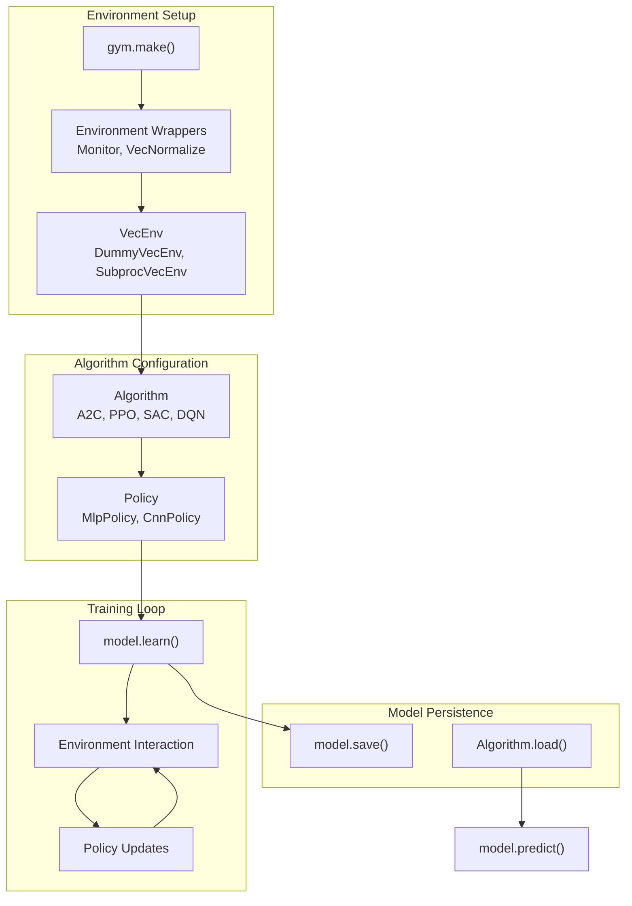
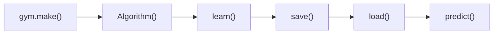
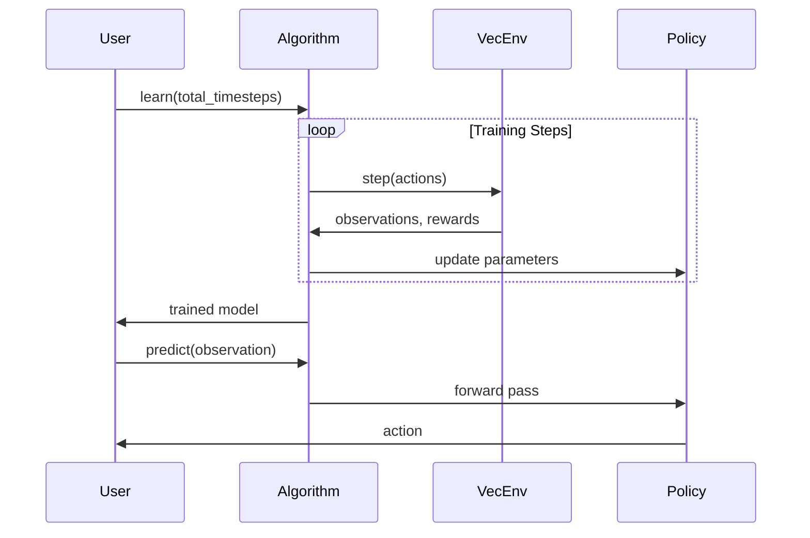

<!-- source: DeepWiki mcp.deepwiki.com · repo DLR-RM/stable-baselines3 · page 1.2 Getting Started & Examples · fetched 2026-10-14 -->

# Getting Started & Examples

<details>
<summary>Relevant source files</summary>

The following files were used as context for generating this wiki page:

- [README.md](README.md)
- [docs/guide/algos.md](docs/guide/algos.md)
- [docs/guide/examples.md](docs/guide/examples.md)
- [docs/guide/quickstart.md](docs/guide/quickstart.md)
- [docs/guide/rl.md](docs/guide/rl.md)
- [docs/guide/rl_tips.md](docs/guide/rl_tips.md)
- [docs/index.rst](docs/index.rst)

</details>


This page provides a practical introduction to using Stable-Baselines3 (SB3) with step-by-step examples and common usage patterns. It covers basic training workflows, core API usage, and essential examples to get you started with reinforcement learning experiments.

For installation instructions, see [Installation Guide](#1.1). For information about creating custom environments, see [Custom Environments](#5.3). For advanced training control and monitoring, see [Training & Monitoring](#7) and [Callback System](#7.1).

## Basic Training Workflow

The fundamental SB3 workflow involves four main components working together: algorithms, policies, environments, and training utilities.



Sources: [docs/guide/examples.md:65-103](), [docs/guide/quickstart.md:15-37]()

## Quick Start Example

The simplest way to train an RL agent follows a sklearn-like API pattern:



The basic pattern involves creating an environment, instantiating an algorithm with a policy, training with `learn()`, and using the trained model with `predict()`.

Sources: [docs/guide/quickstart.md:15-37](), [docs/guide/examples.md:65-103]()

## Core Usage Patterns

### Environment and Algorithm Setup

SB3 supports multiple environment types and automatically wraps single environments in vectorized containers:

| Environment Type | SB3 Class | Use Case |
|-----------------|-----------|----------|
| Single Process | `DummyVecEnv` | Simple environments, debugging |
| Multi Process | `SubprocVecEnv` | CPU parallelization |
| Normalized | `VecNormalize` | Continuous control tasks |
| Monitoring | `Monitor` | Training metrics collection |

The core algorithm classes follow a consistent interface:

| Algorithm Type | Classes | Action Space |
|---------------|---------|--------------|
| On-Policy | `A2C`, `PPO` | Discrete, Continuous |
| Off-Policy | `SAC`, `TD3`, `DDPG` | Continuous |
| Value-Based | `DQN` | Discrete |

Sources: [docs/guide/examples.md:116-160](), [docs/guide/algos.md:11-27]()

### Training and Evaluation Workflow



The training process involves the algorithm collecting experience from the environment and updating the policy. Evaluation uses the same `predict()` method but typically with `deterministic=True`.

Sources: [docs/guide/examples.md:94-102](), [docs/guide/examples.md:310-350]()

## Essential Examples

### Basic Training and Evaluation

The fundamental pattern for training any SB3 algorithm:

```python
# Create environment
env = gym.make("LunarLander-v3", render_mode="rgb_array")

# Instantiate the agent
# Note: you can enable multi-step replay buffer by passing `n_steps=3` for instance
model = DQN("MlpPolicy", env, verbose=1)
# Train the agent and display a progress bar
model.learn(total_timesteps=int(2e5), progress_bar=True)
# Save the agent
model.save("dqn_lunar")
del model  # delete trained model to demonstrate loading

# Load the trained agent
# NOTE: if you have loading issue, you can pass `print_system_info=True`
# to compare the system on which the model was trained vs the current one
# model = DQN.load("dqn_lunar", env=env, print_system_info=True)
model = DQN.load("dqn_lunar", env=env)

# Evaluate the agent
# NOTE: If you use wrappers with your environment that modify rewards,
#       this will be reflected here. To evaluate with original rewards,
#       wrap the environment in a "Monitor" wrapper before other wrappers.
mean_reward, std_reward = evaluate_policy(model, model.get_env(), n_eval_episodes=10)

# Enjoy trained agent
vec_env = model.get_env()
obs = vec_env.reset()
for i in range(1000):
    action, _states = model.predict(obs, deterministic=True)
    obs, rewards, dones, info = vec_env.step(action)
    vec_env.render("human")
```

This pattern works across all algorithms by changing the algorithm class (`DQN`, `PPO`, `SAC`, etc.) and appropriate policy type.

Sources: [docs/guide/examples.md:59-96]()

### Vectorized Environment Training

For improved performance, SB3 supports parallel environment execution:

```python
import gymnasium as gym

from stable_baselines3 import PPO
from stable_baselines3.common.vec_env import DummyVecEnv, SubprocVecEnv
from stable_baselines3.common.env_util import make_vec_env
from stable_baselines3.common.utils import set_random_seed

def make_env(env_id: str, rank: int, seed: int = 0):
    """
    Utility function for multiprocessed env.

    :param env_id: the environment ID
    :param num_env: the number of environments you wish to have in subprocesses
    :param seed: the initial seed for RNG
    :param rank: index of the subprocess
    """
    def _init():
        env = gym.make(env_id, render_mode="human")
        env.reset(seed=seed + rank)
        return env
    set_random_seed(seed)
    return _init

if __name__ == "__main__":
    env_id = "CartPole-v1"
    num_cpu = 4  # Number of processes to use
    # Create the vectorized environment
    vec_env = SubprocVecEnv([make_env(env_id, i) for i in range(num_cpu)])

    # Stable Baselines provides you with make_vec_env() helper
    # which does exactly the previous steps for you.
    # You can choose between `DummyVecEnv` (usually faster) and `SubprocVecEnv`
    # env = make_vec_env(env_id, n_envs=num_cpu, seed=0, vec_env_cls=SubprocVecEnv)

    model = PPO("MlpPolicy", vec_env, verbose=1)
    model.learn(total_timesteps=25_000)

    obs = vec_env.reset()
    for _ in range(1000):
        action, _states = model.predict(obs)
        obs, rewards, dones, info = vec_env.step(action)
        vec_env.render()
```

The `make_vec_env` utility automatically handles environment creation and vectorization. For off-policy algorithms, consider setting `gradient_steps=-1` for optimal sample efficiency.

Sources: [docs/guide/examples.md:116-151](), [docs/guide/examples.md:153-174]()

### Model Persistence

SB3 provides comprehensive save/load functionality:

```python
# Save the agent
model.save("dqn_lunar")
del model  # delete trained model to demonstrate loading

# Load the trained agent
# NOTE: if you have loading issue, you can pass `print_system_info=True`
# to compare the system on which the model was trained vs the current one
# model = DQN.load("dqn_lunar", env=env, print_system_info=True)
model = DQN.load("dqn_lunar", env=env)
```

The `load()` method recreates the model from scratch and should be called as a class method, not on an existing instance.

Sources: [docs/guide/examples.md:73-81]()

### Environment Normalization

For continuous control tasks, input normalization is often critical:

```python
# Create and normalize environment
vec_env = make_vec_env("HalfCheetahBulletEnv-v0", n_envs=1)
vec_env = VecNormalize(vec_env, norm_obs=True, norm_reward=True)

# Training
model = PPO("MlpPolicy", vec_env)
model.learn(total_timesteps=2000)

# Save normalization statistics
vec_env.save("vec_normalize.pkl")
```

The `VecNormalize` wrapper computes running statistics for observations and rewards, which must be saved and loaded separately from the model.

Sources: [docs/guide/examples.md:398-453]()

## Common Integration Patterns

### Dictionary Observations

For environments with complex observation spaces:

```python
# Multi-modal observations
env = SimpleMultiObsEnv(random_start=False)
model = PPO("MultiInputPolicy", env, verbose=1)
```

The `MultiInputPolicy` handles dictionary observation spaces automatically.

Sources: [docs/guide/examples.md:189-209]()

### Custom Callbacks

For training monitoring and control:

```python
# Evaluation during training
eval_callback = EvalCallback(
    eval_env, 
    best_model_save_path="./logs/",
    eval_freq=500,
    deterministic=True
)

model.learn(total_timesteps=5000, callback=eval_callback)
```

Callbacks provide hooks into the training loop for custom logic.

Sources: [docs/guide/examples.md:310-351]()

### Learning Rate Scheduling

For adaptive hyperparameters:

```python
def linear_schedule(initial_value: float) -> Callable[[float], float]:
    def func(progress_remaining: float) -> float:
        return progress_remaining * initial_value
    return func

model = PPO("MlpPolicy", "CartPole-v1", learning_rate=linear_schedule(0.001))
```

Schedules receive the remaining training progress as input.

Sources: [docs/guide/examples.md:530-572]()

This covers the essential patterns for getting started with SB3. For more advanced usage including custom policies, state-dependent exploration, and specialized algorithms, see the respective sections in [Advanced Usage](#9).

---

