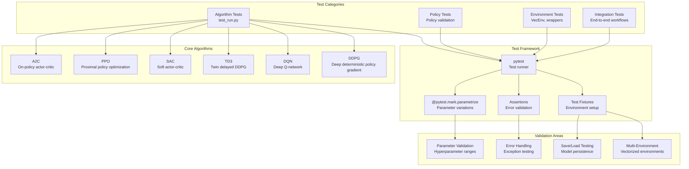
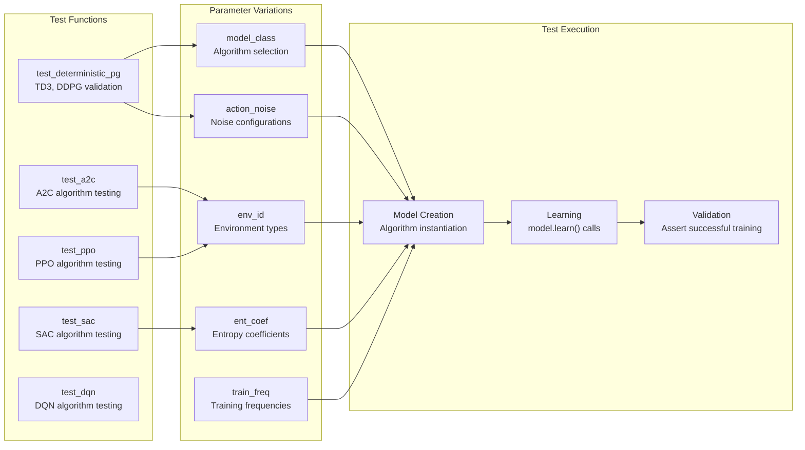
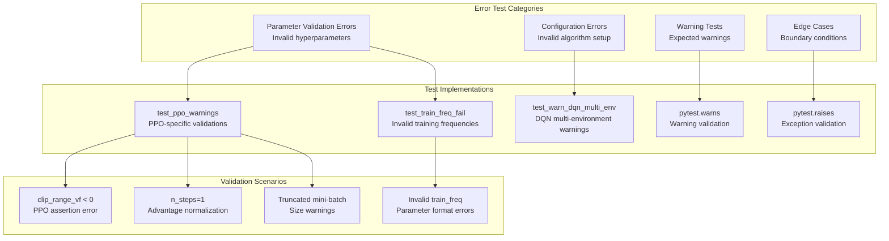
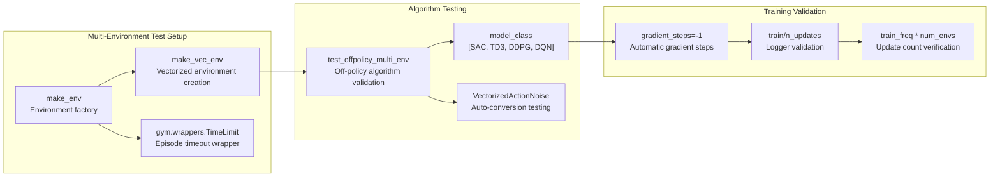

<!-- source: DeepWiki mcp.deepwiki.com · repo DLR-RM/stable-baselines3 · page 10 Testing & Quality Assurance · fetched 2026-10-14 -->

# Testing & Quality Assurance

<details>
<summary>Relevant source files</summary>

The following files were used as context for generating this wiki page:

- [.github/workflows/ci.yml](.github/workflows/ci.yml)
- [pyproject.toml](pyproject.toml)
- [scripts/run_tests.sh](scripts/run_tests.sh)
- [stable_baselines3/common/callbacks.py](stable_baselines3/common/callbacks.py)
- [tests/test_callbacks.py](tests/test_callbacks.py)
- [tests/test_identity.py](tests/test_identity.py)

</details>


## Purpose and Scope

This document covers the testing infrastructure and quality assurance practices within Stable-Baselines3. The testing system validates algorithm implementations, policy networks, environment integration, and edge case handling to ensure reliable reinforcement learning implementations. The scope includes unit tests, integration tests, parameterized testing frameworks, and validation procedures.

For development setup and contribution guidelines, see [Development & Contributing](#12). For algorithm-specific implementation details, see [Algorithms](#3).

## Test Infrastructure Overview

The Stable-Baselines3 testing infrastructure is built around pytest and provides comprehensive validation of all core components. The testing system validates algorithm correctness, parameter handling, environment integration, and error conditions.



Sources: [tests/test_run.py:1-246]()

## Test Suite Organization

The test suite is organized to cover various aspects of the Stable-Baselines3 library, including algorithm correctness, environment compatibility, and specific feature validation. Tests are located in the `tests/` directory and leverage `pytest` for execution.

For a detailed breakdown of the test suite structure, including smoke tests, identity tests, and environment coverage, see [Test Suite Organization](#10.1).

Sources: [tests/test_callbacks.py:1-301](), [tests/test_identity.py:1-54]()

## Algorithm Testing Framework

The core algorithm testing framework validates all major reinforcement learning algorithms through parameterized tests that cover different configurations and scenarios.

### Algorithm Test Structure



Sources: [tests/test_run.py:13-31](), [tests/test_run.py:34-37](), [tests/test_run.py:47-72](), [tests/test_run.py:75-87](), [tests/test_run.py:104-114]()

### Parameterized Testing Implementation

The testing framework uses `pytest.mark.parametrize` to systematically test different algorithm configurations:

| Test Function | Parameters | Purpose |
|---------------|------------|---------|
| `test_discrete` | `model_class`: [A2C, PPO, DQN], `env`: [IdentityEnv, IdentityEnvMultiDiscrete, IdentityEnvMultiBinary] | Validates discrete action space algorithms on identity environments [tests/test_identity.py:13-15]() |
| `test_continuous` | `model_class`: [A2C, PPO, SAC, DDPG, TD3] | Validates continuous action space algorithms on identity environments [tests/test_identity.py:35]() |
| `test_callbacks` | `model_class`: [A2C, PPO, SAC, TD3, DQN, DDPG] | Tests various callbacks with different algorithms [tests/test_callbacks.py:33]() |
| `test_callbacks_can_cancel_runs` | `model_class`: [A2C, SAC], `callback_false_value`: [False, np.bool_(0), th.tensor(0, dtype=th.bool)] | Verifies that callbacks can stop training early [tests/test_callbacks.py:147-160]() |
| `test_deterministic_pg` | `model_class`: [TD3, DDPG], `action_noise`: [NormalActionNoise, OrnsteinUhlenbeckActionNoise] | Validates deterministic policy gradient algorithms [tests/test_run.py:13-17]() |
| `test_a2c` | `env_id`: ["CartPole-v1", "Pendulum-v1"] | Tests A2C on discrete and continuous environments [tests/test_run.py:34]() |
| `test_ppo` | `env_id`: ["CartPole-v1", "Pendulum-v1"], `clip_range_vf`: [None, 0.2, -0.2] | Tests PPO with different value function clipping [tests/test_run.py:47-48]() |
| `test_sac` | `ent_coef`: ["auto", 0.01, "auto_0.01"] | Tests SAC with different entropy coefficient settings [tests/test_run.py:75]() |
| `test_train_freq` | `train_freq`: [4, (4, "step"), (1, "episode")] | Validates training frequency configurations [tests/test_run.py:117]() |

Sources: [tests/test_run.py:13-17](), [tests/test_run.py:34](), [tests/test_run.py:47-48](), [tests/test_run.py:75](), [tests/test_run.py:117](), [tests/test_identity.py:13-15](), [tests/test_identity.py:35](), [tests/test_callbacks.py:33](), [tests/test_callbacks.py:147-160]()

## Error Handling and Validation Testing

The testing framework includes comprehensive error handling validation to ensure algorithms properly validate inputs and handle edge cases.

### Error Condition Testing



Sources: [tests/test_run.py:137-149](), [tests/test_run.py:204-211](), [tests/test_run.py:214-246]()

### Specific Error Validation Examples

The testing framework validates specific error conditions:

- **PPO Assertions**: Tests that `clip_range_vf < 0` raises `AssertionError` [tests/test_run.py:50-60]()
- **Training Frequency Validation**: Tests that invalid `train_freq` formats raise `ValueError` [tests/test_run.py:137-149]()
- **Multi-Environment Warnings**: Validates that DQN warns when using multiple environments [tests/test_run.py:204-211]()
- **Advantage Normalization**: Tests edge cases where `n_steps=1` causes assertion errors [tests/test_run.py:222-223]()
- **Callback Cancellation**: Verifies that a callback returning `False` (or equivalent `np.bool_(0)`, `th.tensor(0, dtype=th.bool)`) correctly stops the training loop [tests/test_callbacks.py:160-166]()

Sources: [tests/test_run.py:50-60](), [tests/test_run.py:137-149](), [tests/test_run.py:204-211](), [tests/test_run.py:222-223](), [tests/test_callbacks.py:160-166]()

## Integration Testing

Integration tests validate end-to-end workflows including model persistence, multi-environment scenarios, and complex training configurations.

### Multi-Environment Testing



Sources: [tests/test_run.py:152-202]()

### Save/Load Testing Integration

The framework includes save/load testing to validate model persistence:

```python
# Save/load cycle validation in test_train_freq
model.save(tmp_path / "test_save.zip")
env = model.get_env()
model = SAC.load(tmp_path / "test_save.zip", env=env)
model.learn(total_timesteps=150)
```

Sources: [tests/test_run.py:129-134]()

## Quality Assurance Practices

### Test Coverage Areas

| Component | Test Coverage | Validation Method |
|-----------|---------------|-------------------|
| Algorithm Implementations | All core algorithms (A2C, PPO, SAC, TD3, DQN, DDPG) | Parameterized testing with multiple configurations |
| Policy Networks | Policy-specific parameters (`net_arch`, `n_critics`) | Configuration validation |
| Environment Integration | Single and multi-environment scenarios | Vectorized environment testing |
| Error Handling | Parameter validation and edge cases | Exception and warning testing |
| Persistence | Save/load functionality | Temporary file testing |
| Training Dynamics | Learning convergence and logging | Assertion-based validation |
| Callbacks | `BaseCallback` and its derivatives | Testing `on_step`, `on_training_start`, `on_training_end` lifecycle methods, and early stopping [stable_baselines3/common/callbacks.py:79-127]() |

Sources: [tests/test_run.py:1-246](), [stable_baselines3/common/callbacks.py:79-127]()

### Testing Best Practices

The testing framework follows several quality assurance practices:

1.  **Parameterized Testing**: Uses `@pytest.mark.parametrize` to test multiple configurations systematically.
2.  **Error Validation**: Explicitly tests error conditions with `pytest.raises` and `pytest.warns`.
3.  **Integration Testing**: Tests complete workflows including environment setup and model persistence.
4.  **Logging Validation**: Verifies training metrics and update counts through logger assertions.
5.  **Resource Management**: Uses temporary directories for file operations.
6.  **Test Markers**: Utilizes `pytest` markers, such as `expensive`, to categorize and selectively run tests [pyproject.toml:57-58](). This allows for faster feedback loops during development by excluding long-running tests.
7.  **Coverage Reporting**: Generates coverage reports to identify untested code paths [pyproject.toml:61-79]().

Sources: [tests/test_run.py:1-246](), [pyproject.toml:57-58](), [pyproject.toml:61-79]()

## CI, Linting & Type Checking

Stable-Baselines3 employs a robust Continuous Integration (CI) pipeline, linting, and type checking to maintain code quality and consistency.

For a detailed overview of the GitHub Actions workflows, `ruff`/`black`/`mypy` configurations, and release publishing process, see [CI, Linting & Type Checking](#10.2).

Sources: [.github/workflows/ci.yml:1-70](), [pyproject.toml:1-35]()

---

