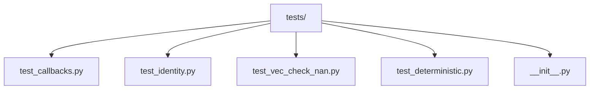
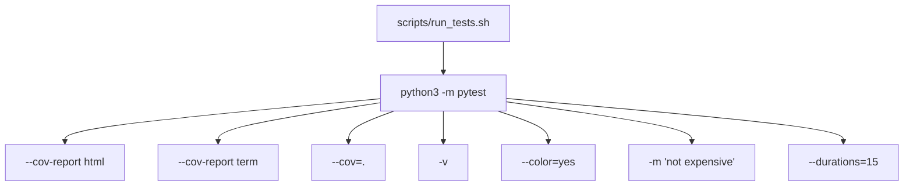

<!-- source: DeepWiki mcp.deepwiki.com · repo DLR-RM/stable-baselines3 · page 10.1 Test Suite Organization · fetched 2026-10-14 -->

# Test Suite Organization

<details>
<summary>Relevant source files</summary>

The following files were used as context for generating this wiki page:

- [LICENSE](LICENSE)
- [scripts/run_tests.sh](scripts/run_tests.sh)
- [stable_baselines3/common/callbacks.py](stable_baselines3/common/callbacks.py)
- [tests/__init__.py](tests/__init__.py)
- [tests/test_callbacks.py](tests/test_callbacks.py)
- [tests/test_deterministic.py](tests/test_deterministic.py)
- [tests/test_identity.py](tests/test_identity.py)
- [tests/test_vec_check_nan.py](tests/test_vec_check_nan.py)

</details>


The `stable-baselines3` test suite, located in the `tests/` directory, is designed to ensure the correctness, stability, and reproducibility of the codebase. It covers various aspects of the library, including algorithm functionality, environment interactions, and utility functions. This page details the structure of the test suite, the types of tests performed, and how they are executed.

## Test Suite Structure

The `tests/` directory contains several Python files, each focusing on specific components or aspects of the library. The primary testing framework used is `pytest`.


Sources: [tests/__init__.py:1-1](), [tests/test_callbacks.py:1-301](), [tests/test_identity.py:1-54](), [tests/test_vec_check_nan.py:1-59](), [tests/test_deterministic.py:1-40]()

### `test_callbacks.py`

This file contains tests for the callback system, which allows users to inject custom logic during the training process. It verifies the functionality of various callback types, including `CheckpointCallback`, `EvalCallback`, `StopTrainingOnMaxEpisodes`, `StopTrainingOnNoModelImprovement`, `StopTrainingOnRewardThreshold`, `EveryNTimesteps`, `LogEveryNTimesteps`, and `CallbackList`.

A key test in this file, `test_callbacks`, parametrizes across different reinforcement learning algorithms (`A2C`, `PPO`, `SAC`, `TD3`, `DQN`, `DDPG`) to ensure callbacks work consistently across them [tests/test_callbacks.py:33-79](). It also checks for proper access to local variables within callbacks and verifies that internal callback counters match the model's counters [tests/test_callbacks.py:81-89]().

Another important test, `test_callbacks_can_cancel_runs`, verifies that callbacks can abort training early by returning `False` from their `_on_step` method [tests/test_callbacks.py:146-169](). This is crucial for implementing early stopping mechanisms.

Sources: [tests/test_callbacks.py:10-20](), [tests/test_callbacks.py:33-79](), [tests/test_callbacks.py:81-89](), [tests/test_callbacks.py:146-169]()

### `test_identity.py`

This file focuses on "identity tests," which involve training agents on simple environments where the optimal policy is to directly output the observation or a transformation of it. These tests are crucial for verifying that the algorithms can learn basic mappings and that the core training loops are functioning correctly.

The `test_discrete` function parametrizes across `A2C`, `PPO`, and `DQN` algorithms and various discrete `IdentityEnv` variants (`IdentityEnv`, `IdentityEnvMultiDiscrete`, `IdentityEnvMultiBinary`) [tests/test_identity.py:13-15](). It trains the model for a set number of steps and then uses `evaluate_policy` to assert that the agent achieves a high reward threshold, indicating successful learning [tests/test_identity.py:28-29]().

Similarly, `test_continuous` tests `A2C`, `PPO`, `SAC`, `DDPG`, and `TD3` on `IdentityEnvBox`, a continuous action space environment [tests/test_identity.py:35-37](). It also evaluates the policy against a reward threshold [tests/test_identity.py:53-54]().

Sources: [tests/test_identity.py:13-15](), [tests/test_identity.py:28-29](), [tests/test_identity.py:35-37](), [tests/test_identity.py:53-54]()

### `test_vec_check_nan.py`

This file tests the `VecCheckNan` wrapper, which is designed to detect and raise errors when NaN (Not a Number) or Inf (Infinity) values appear in observations, rewards, or other environment outputs. This is important for debugging and preventing unstable training.

The `NanAndInfEnv` custom environment is defined to intentionally produce NaN or Inf values based on the action taken [tests/test_vec_check_nan.py:9-27](). The `test_check_nan` function then wraps this environment with `VecCheckNan` and asserts that `ValueError` exceptions are raised when NaN or Inf values are encountered, as expected [tests/test_vec_check_nan.py:40-56]().

Sources: [tests/test_vec_check_nan.py:9-27](), [tests/test_vec_check_nan.py:40-56]()

### `test_deterministic.py`

This file ensures that the training process is deterministic when a fixed seed is provided. Reproducibility is a critical aspect of scientific research and debugging in reinforcement learning.

The `test_deterministic_training_common` function parametrizes across all major algorithms (`A2C`, `DQN`, `PPO`, `SAC`, `TD3`) [tests/test_deterministic.py:11-12](). It trains each algorithm twice with the same seed and then compares the actions taken and rewards received during a subsequent evaluation phase [tests/test_deterministic.py:29-38](). The assertion `assert sum(results[0]) == sum(results[1])` and `assert sum(rewards[0]) == sum(rewards[1])` verify that the training and subsequent policy behavior are identical across runs [tests/test_deterministic.py:39-40]().

Sources: [tests/test_deterministic.py:11-12](), [tests/test_deterministic.py:29-38](), [tests/test_deterministic.py:39-40]()

## Test Categories and Coverage

The `stable-baselines3` test suite employs several categories of tests to ensure comprehensive coverage:

*   **Smoke Tests**: These are basic tests that verify the system can run without crashing. Many of the tests in `test_callbacks.py` and `test_identity.py` serve as smoke tests by simply running an algorithm for a short period.
*   **Identity Tests**: As described above, these tests use `IdentityEnv` variants to check if algorithms can learn simple, known optimal policies. This confirms the fundamental learning capabilities of the algorithms.
*   **Space/Environment Coverage**: The tests cover various observation and action spaces (discrete, continuous, multi-discrete, multi-binary) and different environment types (e.g., `CartPole-v1`, `Pendulum-v1`, `BitFlippingEnv`). This ensures broad compatibility.
*   **Deterministic Tests**: `test_deterministic.py` specifically addresses the reproducibility of training when a seed is set.

## Pytest Markers

The test suite utilizes `pytest` markers to categorize and selectively run tests. The `scripts/run_tests.sh` script demonstrates the use of the `expensive` marker.

```bash
python3 -m pytest --cov-report html --cov-report term --cov=. -v --color=yes -m "not expensive" --durations=15
```
Sources: [scripts/run_tests.sh:2]()

The `-m "not expensive"` flag [scripts/run_tests.sh:2]() instructs `pytest` to skip any tests marked as `expensive`. This is useful for continuous integration (CI) or local development where a quick feedback loop is desired, avoiding long-running tests. Tests that require significant computational resources or time would typically be marked with `@pytest.mark.expensive`.

## `run_tests.sh` Script

The `scripts/run_tests.sh` script is the primary entry point for executing the test suite.


Sources: [scripts/run_tests.sh:2]()

Here's a breakdown of the arguments used:

*   `python3 -m pytest`: Invokes `pytest` as a module.
*   `--cov-report html --cov-report term --cov=.`: These flags are related to code coverage.
    *   `--cov-report html`: Generates an HTML report of code coverage.
    *   `--cov-report term`: Prints a summary of code coverage to the terminal.
    *   `--cov=.`: Measures code coverage for the current directory (the entire `stable-baselines3` package).
*   `-v`: Enables verbose output, showing more details about each test run.
*   `--color=yes`: Ensures colored output in the terminal for better readability.
*   `-m "not expensive"`: As discussed above, this skips tests marked as `expensive`.
*   `--durations=15`: Reports the 15 slowest test durations, which helps in identifying performance bottlenecks in the test suite.

Sources: [scripts/run_tests.sh:2]()

---

