<!-- source: DeepWiki mcp.deepwiki.com · repo DLR-RM/stable-baselines3 · page 10.2 CI, Linting & Type Checking · fetched 2026-10-14 -->

# CI, Linting & Type Checking

<details>
<summary>Relevant source files</summary>

The following files were used as context for generating this wiki page:

- [.github/workflows/ci.yml](.github/workflows/ci.yml)
- [.github/workflows/pypi-publish.yml](.github/workflows/pypi-publish.yml)
- [.gitignore](.gitignore)
- [pyproject.toml](pyproject.toml)

</details>


This page details the Continuous Integration (CI) setup, linting, and type checking configurations used in the Stable-Baselines3 codebase. It covers the GitHub Actions workflows for automated testing and release publishing, as well as the configuration for tools like Ruff, Black, and MyPy defined in `pyproject.toml`.

## Continuous Integration with GitHub Actions

The Stable-Baselines3 project uses GitHub Actions for its Continuous Integration (CI) pipeline. This ensures that all code changes are automatically tested for correctness, style, and type consistency before being merged into the `master` branch.

### CI Workflow (`ci.yml`)

The main CI workflow is defined in [.github/workflows/ci.yml](). This workflow is triggered on every `push` to the `master` branch and on every `pull_request` targeting the `master` branch [.github/workflows/ci.yml:7-10](). It also includes a mechanism to skip CI runs if `[ci skip]` is present in the commit message [.github/workflows/ci.yml:19]().

The `ci.yml` workflow consists of a single job named `build` [.github/workflows/ci.yml:13](). This job runs on `ubuntu-latest` and uses a strategy matrix to test against various Python versions and Gymnasium versions [.github/workflows/ci.yml:20-29]().

#### Build Job Steps

The `build` job executes a series of steps:

1.  **Checkout Code**: Uses `actions/checkout@v6` to check out the repository code [.github/workflows/ci.yml:31]().
2.  **Set up Python**: Configures the Python environment for the specified version using `actions/setup-python@v6` [.github/workflows/ci.yml:32-36]().
3.  **Install Dependencies**: Installs project dependencies, including `uv` for faster package management, `torch` (CPU version), and all extra, test, and documentation dependencies [.github/workflows/ci.yml:37-48](). It also installs `opencv-python-headless` [.github/workflows/ci.yml:49]().
4.  **Install Specific Gymnasium Version**: Conditionally installs a specific version of Gymnasium, `numpy<2`, and `ale-py==0.10.1` for compatibility testing, specifically for Python 3.10 with Gymnasium 0.29.1 [.github/workflows/ci.yml:50-55]().
5.  **Lint with Ruff**: Runs the `make lint` command, which executes the Ruff linter [.github/workflows/ci.yml:56-59]().
6.  **Build Documentation**: Executes `make doc` to build the project documentation [.github/workflows/ci.yml:60-63]().
7.  **Check Codestyle**: Runs `make check-codestyle` to verify code formatting using Black [.github/workflows/ci.yml:64-67]().
8.  **Type Check**: Executes `make type` to perform static type checking with MyPy [.github/workflows/ci.yml:68-70]().
9.  **Test with Pytest**: Runs the test suite using `make pytest` [.github/workflows/ci.yml:70]().

```mermaid
graph TD
    A[Push to master or Pull Request to master] --> B{CI Skip?};
    B -- No --> C[Build Job Triggered];
    C --> D[Checkout Code];
    C --> E[Set up Python (Matrix: 3.10, 3.11, 3.12, 3.13)];
    E --> F[Install Dependencies (uv, torch+cpu, .[extra,tests,docs], opencv-python-headless)];
    F --> G{Gymnasium Version Check};
    G -- gymnasium-version != '1.0.0' --> H[Install Specific Gymnasium (e.g., 0.29.1), numpy<2, ale-py];
    G -- gymnasium-version == '1.0.0' --> I[Continue];
    H --> I;
    I --> J[Lint with Ruff (make lint)];
    J --> K[Build Documentation (make doc)];
    K --> L[Check Codestyle (make check-codestyle)];
    L --> M[Type Check (make type)];
    M --> N[Test with Pytest (make pytest)];
    N --> O[Build Job Complete];
    B -- Yes --> P[CI Skipped];

```
**Figure 1: CI Workflow Overview**
Sources: [.github/workflows/ci.yml]()

### Release Publishing Workflow (`pypi-publish.yml`)

The `pypi-publish.yml` workflow handles the automated publishing of Stable-Baselines3 releases to PyPI [.github/workflows/pypi-publish.yml:1]().

#### Trigger Conditions

This workflow is triggered under two conditions:
1.  **Tag Push**: When a Git tag matching the pattern `v*` (e.g., `v2.0.0`) is pushed to the repository [.github/workflows/pypi-publish.yml:5-6]().
2.  **Manual Dispatch**: It can also be manually triggered via `workflow_dispatch` with an optional `publish` input [.github/workflows/pypi-publish.yml:7-13]().

#### PyPI Publish Job Steps

The `pypi-publish` job runs on `ubuntu-latest` [.github/workflows/pypi-publish.yml:17-18]() and includes the following steps:

1.  **Checkout Code**: Checks out the repository code [.github/workflows/pypi-publish.yml:25]().
2.  **Set up Python**: Sets up Python 3.14 [.github/workflows/pypi-publish.yml:27-30]().
3.  **Install Build Tool**: Installs the `build` package required for creating distribution archives [.github/workflows/pypi-publish.yml:32-33]().
4.  **Build**: Executes `python -m build` to create source distributions and wheel files [.github/workflows/pypi-publish.yml:35-36]().
5.  **Publish Package to PyPI**: Uses `pypa/gh-action-pypi-publish@release/v1` to upload the built packages to PyPI. This step is conditional, running only on tag pushes or when the `publish` input is true for manual dispatches [.github/workflows/pypi-publish.yml:38-40](). It uses OIDC for trusted publishing, requiring `id-token: write` permissions [.github/workflows/pypi-publish.yml:21-22]().

```mermaid
graph TD
    A[Push Tag v*] --> B{Publish to PyPI};
    C[Manual Workflow Dispatch] --> D{Publish Input True?};
    D -- Yes --> B;
    B --> E[Checkout Code];
    E --> F[Set up Python 3.14];
    F --> G[Install build tool];
    G --> H[Build (python -m build)];
    H --> I[Publish Package to PyPI (pypa/gh-action-pypi-publish@release/v1)];
    D -- No --> J[Publish Skipped];
```
**Figure 2: PyPI Publish Workflow**
Sources: [.github/workflows/pypi-publish.yml]()

Sources: [.github/workflows/ci.yml:1-70](), [.github/workflows/pypi-publish.yml:1-40]()

## Linting and Type Checking Configuration

The project uses several tools for code quality: Ruff for linting, Black for code formatting, and MyPy for static type checking. Their configurations are centralized in `pyproject.toml`.

### Ruff (Linting)

Ruff is configured to enforce code style and identify potential issues.

*   **Line Length**: Set to 127 characters, consistent with Black [pyproject.toml:3]().
*   **Target Python Version**: Assumes Python 3.10 [pyproject.toml:5]().
*   **Selected Rules**: A broad set of rules are selected, including error (`E`), flake8-to-ruff (`F`), bug-bear (`B`), pyupgrade (`UP`), McCabe complexity (`C90`), and Ruff-specific rules (`RUF`) [pyproject.toml:9]().
*   **Ignored Rules**: Specific rules are ignored to avoid false positives or accommodate design choices:
    *   `B028`: Ignored for explicit `stacklevel` [pyproject.toml:10-12]().
    *   `RUF013`: Ignored due to too many false positives related to implicit optionals [pyproject.toml:11-12]().
*   **Per-File Ignores**:
    *   `B027` (Abstract methods without `self`): Ignored for default implementations in abstract methods within `stable_baselines3/common/callbacks.py` and `stable_baselines3/common/noise.py` [pyproject.toml:14-16]().
    *   `RUF012`, `RUF013`: Ignored in `tests/*.py` for `ClassVar` and implicit optional checks [pyproject.toml:18-19]().
*   **McCabe Complexity**: The maximum complexity is set to 15 [pyproject.toml:21-23]().

Sources: [pyproject.toml:1-24]()

### Black (Code Formatting)

Black is used for uncompromising code formatting.

*   **Line Length**: Set to 127 characters, matching Ruff's configuration [pyproject.toml:26]().

Sources: [pyproject.toml:25-27]()

### MyPy (Type Checking)

MyPy performs static type checking to catch type-related errors.

*   **Ignore Missing Imports**: Set to `true` to ignore missing imports, which can be common for third-party libraries without type stubs [pyproject.toml:29]().
*   **Follow Imports**: Set to `silent` to suppress errors for imports that MyPy cannot resolve [pyproject.toml:30]().
*   **Show Error Codes**: Enabled to display MyPy error codes for easier debugging [pyproject.toml:31]().
*   **Exclude**: Specific test files are excluded from type checking to avoid issues with their specific patterns: `tests/test_logger.py` and `tests/test_train_eval_mode.py` [pyproject.toml:32-35]().
*   **Cache**: MyPy's cache files are ignored by Git [.gitignore:7]().

Sources: [pyproject.toml:28-35](), [.gitignore:7]()

### Pytest Configuration

The `pyproject.toml` also includes configuration for `pytest`:

*   **Filter Warnings**: A comprehensive list of warnings are filtered to reduce noise during test runs. These include `DeprecationWarning` from `multiprocessing.popen_fork`, warnings about running A2C/PPO on GPU, TensorBoard warnings, Gymnasium warnings, and `tqdm` warnings [pyproject.toml:41-56]().
*   **Markers**: Defines an `expensive` marker for tests that take a long time to run, allowing them to be deselected with `-m "not expensive"` [pyproject.toml:57-59]().

Sources: [pyproject.toml:37-59]()

### Coverage Configuration

Code coverage is measured using `coverage.py`, configured in `pyproject.toml`:

*   **Disable Warnings**: Disables warnings about not being able to parse files [pyproject.toml:62]().
*   **Branch Coverage**: Disabled [pyproject.toml:63]().
*   **Omit Files**: Excludes `tests/`, `setup.py`, `stable_baselines3/common/results_plotter.py` (requires graphical interface), and `stable_baselines3/common/vec_env/vec_video_recorder.py` (requires ffmpeg) from coverage reports [pyproject.toml:64-71]().
*   **Exclude Lines**: Lines containing `pragma: no cover`, `raise NotImplementedError()`, `if typing.TYPE_CHECKING:`, and `if TYPE_CHECKING:` are excluded from coverage calculations [pyproject.toml:73-78]().
*   **Cache**: Coverage cache files are ignored by Git [.gitignore:11-12]().

Sources: [pyproject.toml:61-79](), [.gitignore:11-12]()

```mermaid
graph TD
    A[pyproject.toml] --> B[tool.ruff];
    B --> B1["line-length = 127"];
    B --> B2["target-version = py310"];
    B --> B3[tool.ruff.lint];
    B3 --> B3a["select = [E, F, B, UP, C90, RUF]"];
    B3 --> B3b["ignore = [B028, RUF013]"];
    B3 --> B3c[tool.ruff.lint.per-file-ignores];
    B3c --> B3c1["./stable_baselines3/common/callbacks.py = [B027]"];
    B3c --> B3c2["./stable_baselines3/common/noise.py = [B027]"];
    B3c --> B3c3["./tests/*.py = [RUF012, RUF013]"];
    B --> B4[tool.ruff.lint.mccabe];
    B4 --> B4a["max-complexity = 15"];

    A --> C[tool.black];
    C --> C1["line-length = 127"];

    A --> D[tool.mypy];
    D --> D1["ignore_missing_imports = true"];
    D --> D2["follow_imports = silent"];
    D --> D3["show_error_codes = true"];
    D --> D4["exclude = tests/test_logger.py$, tests/test_train_eval_mode.py$"];

    A --> E[tool.pytest.ini_options];
    E --> E1[filterwarnings];
    E1 --> E1a["ignore::DeprecationWarning:multiprocessing.popen_fork"];
    E1 --> E1b["ignore:You are trying to run (PPO|A2C) on the GPU"];
    E1 --> E1c["ignore::DeprecationWarning:tensorboard"];
    E1 --> E1d["ignore:`newshape` keyword argument is deprecated"];
    E1 --> E1e["ignore::UserWarning:gymnasium"];
    E1 --> E1f["ignore::DeprecationWarning:gymnasium.envs.registration"];
    E1 --> E1g["ignore:rich is experimental"];
    E --> E2[markers];
    E2 --> E2a["expensive"];

    A --> F[tool.coverage.run];
    F --> F1["disable_warnings = [couldnt-parse]"];
    F --> F2["branch = false"];
    F --> F3[omit];
    F3 --> F3a["tests/*"];
    F3 --> F3b["setup.py"];
    F3 --> F3c["stable_baselines3/common/results_plotter.py"];
    F3 --> F3d["stable_baselines3/common/vec_env/vec_video_recorder.py"];

    A --> G[tool.coverage.report];
    G --> G1[exclude_lines];
    G1 --> G1a["pragma: no cover"];
    G1 --> G1b["raise NotImplementedError()"];
    G1 --> G1c["if typing.TYPE_CHECKING:"];
    G1 --> G1d["if TYPE_CHECKING:"];
```


**Figure 3: `pyproject.toml` Configuration for Quality Tools**
Sources: [pyproject.toml:1-79]()

---

