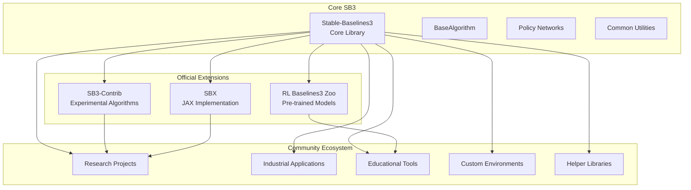
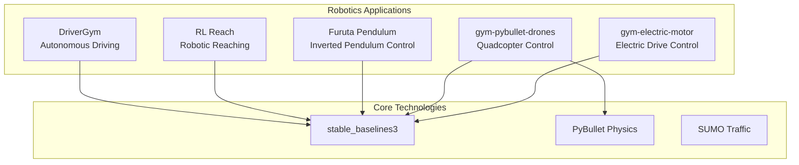
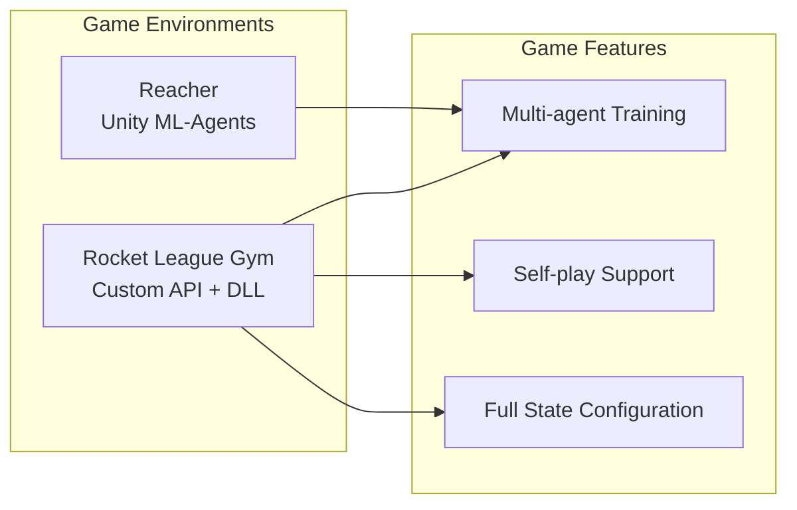
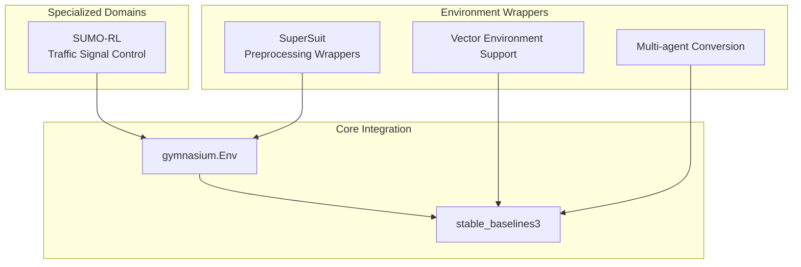

<!-- source: DeepWiki mcp.deepwiki.com · repo DLR-RM/stable-baselines3 · page 11 SB3 Ecosystem · fetched 2026-10-14 -->

# SB3 Ecosystem

<details>
<summary>Relevant source files</summary>

The following files were used as context for generating this wiki page:

- [docs/guide/rl_zoo.md](docs/guide/rl_zoo.md)
- [docs/guide/sbx.md](docs/guide/sbx.md)
- [docs/misc/projects.md](docs/misc/projects.md)

</details>


This document covers the broader ecosystem of projects, extensions, and applications built around Stable-Baselines3. It includes official extensions, community-contributed libraries, and real-world applications that demonstrate SB3's usage across various domains.

For information about the core SB3 architecture and algorithms, see [Core Architecture](#2) and [Algorithms](#3). For development and contribution guidelines, see [Development & Contributing](#12).

## Ecosystem Overview

The SB3 ecosystem consists of three main layers: the core library, official extensions, and a diverse community of applications and tools.

### Core Ecosystem Architecture



Sources: [docs/misc/projects.md:1-193]()

## Official Extensions

### SB3-Contrib
SB3-Contrib is a separate repository that provides experimental algorithms and features that extend the core SB3 functionality. These algorithms are often newer or less stable than those in the main library, or they might be specialized for certain use cases.

**Key Algorithms (Examples):**
- `TRPO` (Trust Region Policy Optimization)
- `QR-DQN` (Quantile Regression DQN)
- `TQC` (Truncated Quantile Critics)

### RL Baselines3 Zoo
[RL Baselines3 Zoo](https://github.com/DLR-RM/rl-baselines3-zoo) is a training framework for Reinforcement Learning (RL) that complements Stable-Baselines3. It provides scripts for training, evaluating agents, tuning hyperparameters, plotting results, and recording videos [docs/guide/rl_zoo.md:5-8]().

**Features:**
- **Pre-trained models**: A collection of agents trained with tuned hyperparameters for common environments [docs/guide/rl_zoo.md:9]().
- **Hyperparameter Optimization**: Utilizes [Optuna](https://optuna.org/) for optimizing hyperparameters [docs/guide/rl_zoo.md:92-93]().
- **Training and Evaluation Scripts**: Provides command-line interfaces for training (`python -m rl_zoo3.train`) and enjoying (`python -m rl_zoo3.enjoy`) agents [docs/guide/rl_zoo.md:59-61](), [docs/guide/rl_zoo.md:77-79]().
- **Colab Notebooks**: Offers online training capabilities via Google Colab [docs/guide/rl_zoo.md:103-104]().

**Installation:**
The `rl_zoo3` package can be installed via pip: `pip install rl_zoo3` [docs/guide/rl_zoo.md:22](). Alternatively, the repository can be cloned and dependencies installed [docs/guide/rl_zoo.md:28-49]().

**Usage Example (Training):**
```bash
python -m rl_zoo3.train --algo ppo --env CartPole-v1 --eval-freq 10000 --save-freq 50000
```
This command trains a PPO agent on the `CartPole-v1` environment, evaluating every 10,000 timesteps and saving checkpoints every 50,000 timesteps [docs/guide/rl_zoo.md:64-67]().

**Usage Example (Hyperparameter Optimization):**
```bash
python -m rl_zoo3.train --algo ppo --env MountainCar-v0 -n 50000 -optimize --n-trials 1000 --n-jobs 2 \
  --sampler random --pruner median
```
This command optimizes hyperparameters for PPO on `MountainCar-v0` using a random sampler and median pruner, with 1000 trials and 2 parallel jobs, for a maximum of 50,000 steps [docs/guide/rl_zoo.md:97-100]().

### SBX (Stable Baselines Jax)
[Stable Baselines Jax (SBX)](https://github.com/araffin/sbx) is a proof-of-concept version of Stable-Baselines3 implemented in JAX. It aims for significantly faster execution (up to 20 times faster) compared to SB3 due to JAX's JIT compilation capabilities [docs/guide/sbx.md:5-7]().

**Implemented Algorithms:**
SBX provides JAX implementations for several popular RL algorithms, including:
- `SAC` (Soft Actor-Critic) and `SAC-N` [docs/guide/sbx.md:11]().
- `TQC` (Truncated Quantile Critics) [docs/guide/sbx.md:12]().
- `DroQ` (Dropout Q-Functions for Doubly Efficient Reinforcement Learning) [docs/guide/sbx.md:13]().
- `PPO` (Proximal Policy Optimization) [docs/guide/sbx.md:14]().
- `DQN` (Deep Q Network) [docs/guide/sbx.md:15]().
- `TD3` (Twin Delayed DDPG) [docs/guide/sbx.md:16]().
- `DDPG` (Deep Deterministic Policy Gradient) [docs/guide/sbx.md:17]().
- `CrossQ` (Batch Normalization in Deep Reinforcement Learning) [docs/guide/sbx.md:18]().
- `SimBa` (Simplicity Bias for Scaling Up Parameters in Deep Reinforcement Learning) [docs/guide/sbx.md:19]().

**Compatibility with RL Zoo:**
SBX follows the SB3 API, making it compatible with the RL Baselines3 Zoo. This requires creating wrapper scripts (`train_sbx.py` and `enjoy_sbx.py`) to map SBX algorithms to the `rl_zoo3.ALGOS` dictionary [docs/guide/sbx.md:21-23]().

**`train_sbx.py` Example:**
```python
import rl_zoo3
import rl_zoo3.train
from rl_zoo3.train import train
from sbx import DDPG, DQN, PPO, SAC, TD3, TQC, CrossQ

rl_zoo3.ALGOS["ddpg"] = DDPG
rl_zoo3.ALGOS["dqn"] = DQN
rl_zoo3.ALGOS["sac"] = SAC
rl_zoo3.ALGOS["ppo"] = PPO
rl_zoo3.ALGOS["td3"] = TD3
rl_zoo3.ALGOS["tqc"] = TQC
rl_zoo3.ALGOS["crossq"] = CrossQ
rl_zoo3.train.ALGOS = rl_zoo3.ALGOS
rl_zoo3.exp_manager.ALGOS = rl_zoo3.ALGOS

if __name__ == "__main__":
    train()
```
This script allows using the RL Zoo CLI with SBX algorithms, e.g., `python train_sbx.py --algo sac --env Pendulum-v1` [docs/guide/sbx.md:26-47](), [docs/guide/sbx.md:49]().

**`enjoy_sbx.py` Example:**
Similar to `train_sbx.py`, this script enables using SBX algorithms for enjoying trained agents via the RL Zoo's `enjoy` command [docs/guide/sbx.md:52-73]().

Sources: [docs/guide/sbx.md:1-74](), [docs/guide/rl_zoo.md:1-108]()

## Community Projects by Domain

### Robotics and Control



**Notable Projects:**

- **DriverGym**: An open-source Gym-compatible environment for developing RL algorithms for autonomous driving. It provides access to over 1000 hours of expert logged data and supports reactive and data-driven agent behavior [docs/misc/projects.md:8-11]().
    - GitHub: <https://github.com/woven-by-toyota/l5kit> [docs/misc/projects.md:16]()
    - Paper: <https://arxiv.org/abs/2111.06889> [docs/misc/projects.md:20]()
- **RL Reach**: A platform for reproducible reinforcement learning experiments in customizable robotic reaching tasks. It helps users investigate and identify optimal training configurations [docs/misc/projects.md:22-25]().
    - GitHub: <https://github.com/PierreExeter/rl_reach> [docs/misc/projects.md:30]()
    - Paper: <https://arxiv.org/abs/2102.04916> [docs/misc/projects.md:34]()
- **Generalized State Dependent Exploration for Deep Reinforcement Learning in Robotics**: This project introduced an exploration method to train RL agents directly on real robots and was the starting point for Stable-Baselines3 [docs/misc/projects.md:37-39]().
    - GitHub: <https://github.com/DLR-RM/stable-baselines3/tree/sde> [docs/misc/projects.md:45]()
    - Paper: <https://arxiv.org/abs/2005.05719> [docs/misc/projects.md:49]()
- **Furuta Pendulum Robot**: Provides everything needed to build and train a rotary inverted pendulum, including code, CAD files, and a bill of materials. It utilizes the gSDE method [docs/misc/projects.md:52-54]().
    - GitHub: <https://github.com/Armandpl/furuta> [docs/misc/projects.md:60]()
- **gym-pybullet-drones**: PyBullet Gym environments for single and multi-agent reinforcement learning of quadcopter control. It offers physics-based simulation and compatibility with `gym.Env` and RLlib's `MultiAgentEnv` [docs/misc/projects.md:92-96]().
    - GitHub: <https://github.com/learnsyslab/gym-pybullet-drones> [docs/misc/projects.md:103]()
    - Paper: <https://arxiv.org/abs/2103.02142> [docs/misc/projects.md:107]()
- **gym-electric-motor**: An OpenAI gym environment for the simulation and control of electric drive trains. It offers a rich interface for customization, including different control algorithms, reward shaping, and various motor types [docs/misc/projects.md:142-151]().
    - GitHub: <https://github.com/upb-lea/gym-electric-motor> [docs/misc/projects.md:161]()
    - SB3 Tutorial: [Colab Link](https://colab.research.google.com/github/upb-lea/gym-electric-motor/blob/master/examples/reinforcement_learning_controllers/stable_baselines3_dqn_disc_pmsm_example.ipynb) [docs/misc/projects.md:165]()

Sources: [docs/misc/projects.md:8-178]()

### Games and Entertainment



**Key Capabilities:**
- **Reacher**: A solution to the Udacity deep reinforcement learning course's second project. It demonstrates wrapping single and multi-agent Unity environments for use with Stable-Baselines3 [docs/misc/projects.md:64-68]().
    - GitHub: <https://github.com/koulakis/reacher-deep-reinforcement-learning> [docs/misc/projects.md:75]()
- **Rocket League Gym**: A custom Python API and C++ DLL to treat the game Rocket League as an OpenAI Gym environment. It dramatically increases game run rate, supports full configuration of initial states, observations, rewards, and terminal states, and allows for multi-agent training and self-play [docs/misc/projects.md:125-132]().
    - GitHub: <https://github.com/lucas-emery/rocket-league-gym> [docs/misc/projects.md:138]()

Sources: [docs/misc/projects.md:64-75](), [docs/misc/projects.md:125-138]()

### Research and Advanced Methods

- **policy-distillation-baselines**: A PyTorch implementation of Policy Distillation for control, using well-trained teachers from Stable-Baselines3. It provides examples for policy distillation in various environments [docs/misc/projects.md:180-183]().
    - GitHub: <https://github.com/dion-jy/policy-distillation-baselines> [docs/misc/projects.md:190]()

Sources: [docs/misc/projects.md:180-190]()

## Environment Extensions and Wrappers

### Multi-Environment Support



**SuperSuit Features:**
[SuperSuit](https://github.com/Farama-Foundation/SuperSuit) contains easy-to-use wrappers for Gym (and multi-agent PettingZoo) environments to perform common preprocessing tasks like frame stacking, converting graphical observations to greyscale, and max-and-skip for Atari [docs/misc/projects.md:110-113]().
- Wrappers that apply lambda functions to observations, actions, or rewards with a single line of code [docs/misc/projects.md:114]().
- All wrappers can be used natively on vector environments, and wrappers exist to convert Gym environments to vectorized environments and concatenate multiple vector environments [docs/misc/projects.md:115-116]().
- Includes a wrapper for using regular single-agent RL libraries (like Stable-Baselines3) with simple multi-agent PettingZoo environments [docs/misc/projects.md:117-118]().
    - GitHub: <https://github.com/Farama-Foundation/SuperSuit> [docs/misc/projects.md:121]()

**SUMO-RL**: A simple interface to instantiate RL environments with SUMO for Traffic Signal Control. It supports multi-agent RL, compatibility with `gym.Env` and popular RL libraries, and easy customization of state and reward definitions [docs/misc/projects.md:78-83]().
    - GitHub: <https://github.com/LucasAlegre/sumo-rl> [docs/misc/projects.md:89]()

Sources: [docs/misc/projects.md:78-89](), [docs/misc/projects.md:110-121]()

## Integration Patterns

### Common Usage Patterns

Most community projects follow similar integration patterns with SB3:

1.  **Environment Creation**: Custom `gymnasium.Env` implementations.
2.  **Algorithm Selection**: Choose appropriate SB3 algorithm based on action space.
3.  **Training Scripts**: Standardized training loops with callbacks.
4.  **Evaluation**: Using `evaluate_policy` helper functions.

### Compatibility Requirements

Projects typically ensure compatibility with:
- `gymnasium.Env` interface standards.
- SB3 vectorized environment expectations.
- Standard observation and action space formats.
- Policy network interfaces.

Sources: [docs/misc/projects.md:66-68](), [docs/misc/projects.md:80-82](), [docs/misc/projects.md:94-96]()

## Educational and Learning Resources

Many projects serve educational purposes:
- **Colab Notebooks**: Interactive tutorials for specific domains, such as the `gym-electric-motor` SB3 tutorial [docs/misc/projects.md:165]().
- **Tutorial Videos**: Step-by-step guidance for implementation, like the video overview for the Furuta Pendulum project [docs/misc/projects.md:54]().
- **Example Scripts**: Ready-to-use training and evaluation code, often found in project repositories.
- **Documentation**: Comprehensive guides for custom implementations.

These resources help bridge the gap between SB3's core functionality and domain-specific applications.

Sources: [docs/misc/projects.md:54](), [docs/misc/projects.md:165]()

---

