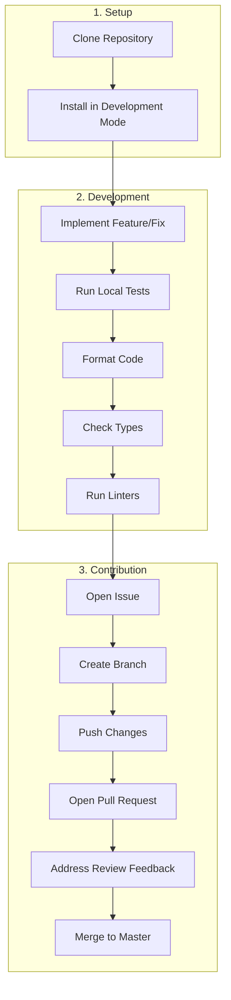
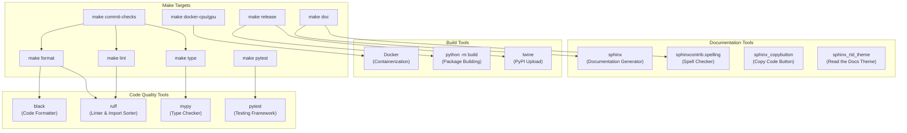
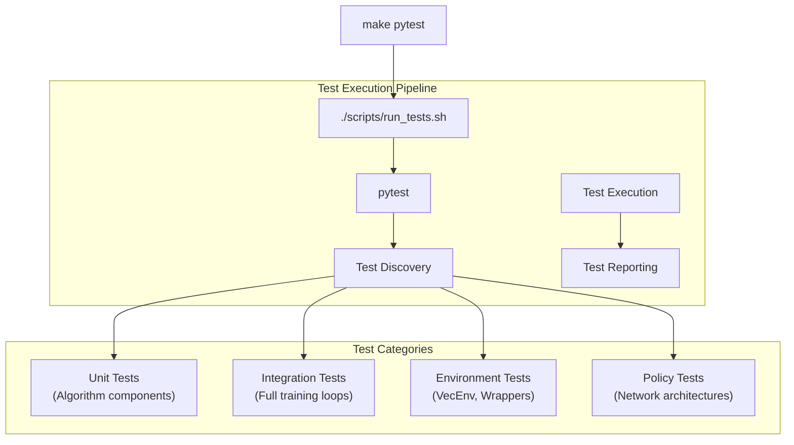
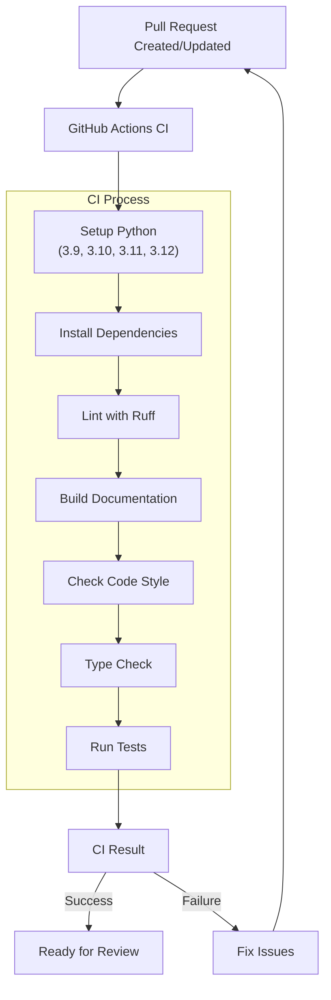
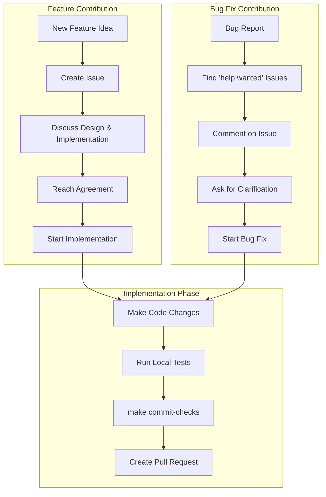
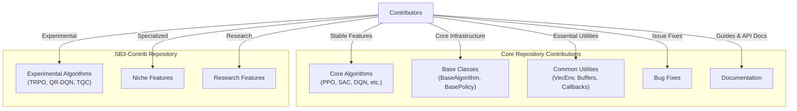
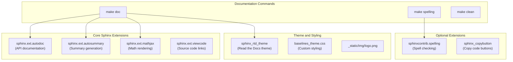
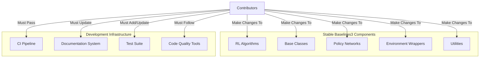
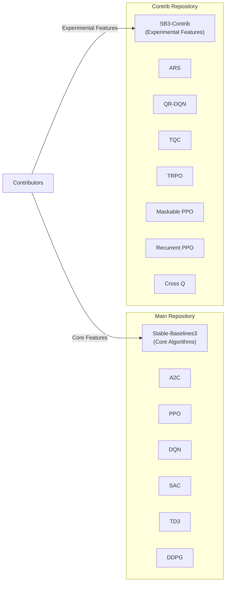
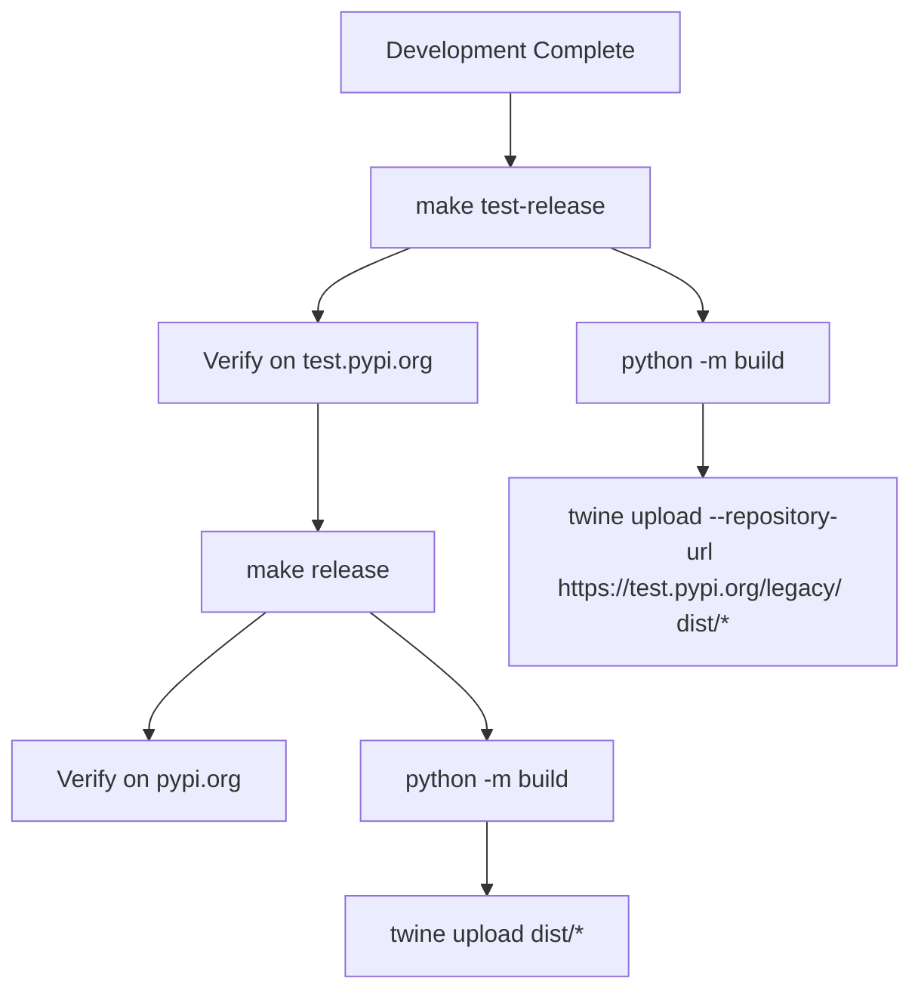

<!-- source: DeepWiki mcp.deepwiki.com · repo DLR-RM/stable-baselines3 · page 12 Development & Contributing · fetched 2026-10-14 -->

# Development & Contributing

<details>
<summary>Relevant source files</summary>

The following files were used as context for generating this wiki page:

- [CONTRIBUTING.md](CONTRIBUTING.md)
- [Makefile](Makefile)
- [docs/conf.py](docs/conf.py)
- [docs/guide/developer.md](docs/guide/developer.md)

</details>


This guide provides comprehensive information for developers who want to contribute to Stable Baselines3 (SB3). It covers the development environment setup, coding standards, testing procedures, and the contribution workflow.

## Getting Started

### Setting Up Development Environment

To develop Stable Baselines3 on your machine, follow these steps:

1.  **Clone the repository:**
    ```bash
    git clone https://github.com/DLR-RM/stable-baselines3
    cd stable-baselines3/
    ```

2.  **Install SB3 in development mode with dependencies:**
    ```bash
    pip install -e '.[docs,tests,extra]'
    ```
    This installation mode allows you to modify the source code and have the changes immediately reflected when importing the package.

### Development Environment Options

| Environment | Command | Use Case |
|-------------|---------|-----------|
| Standard Development | `pip install -e '.[docs,tests,extra]'` | Local development with all features |
| Docker CPU | `make docker-cpu` | Containerized development environment |
| Docker GPU | `make docker-gpu` | GPU-enabled containerized environment |
| Minimal Install | `pip install -e .` | Basic development without docs/tests |

### Docker Development Environment

For containerized development, SB3 provides Docker images:

```bash
# Build CPU Docker image
make docker-cpu

# Build GPU Docker image  
make docker-gpu

# Build and push (if RELEASE=True is set)
export RELEASE=True
make docker
```
Sources: [CONTRIBUTING.md:24-37](), [Makefile:48-56]()

## Development Workflow

The following diagram illustrates the typical development workflow when contributing to Stable Baselines3:


Sources: [CONTRIBUTING.md:22-37](), [CONTRIBUTING.md:63-68]()

### Development Tools and Infrastructure

#### Development Tools Ecosystem



#### Lint Paths and Target Files

The development tools operate on these specific paths defined in [Makefile:2]():

| Path | Purpose |
|------|---------|
| `stable_baselines3/` | Main source code |
| `tests/` | Test suite |
| `docs/conf.py` | Documentation configuration |
| `setup.py` | Package setup |

Sources: [Makefile:1-68](), [docs/conf.py:64-81]()

## Code Standards

### Code Style Requirements

Stable Baselines3 enforces strict code style standards:

| Tool | Purpose | Configuration |
|------|---------|---------------|
| **black** | Code formatting | Max line length: 127 characters |
| **ruff** | Linting & import sorting | Follows isort rules |
| **mypy** | Type checking | Strict type annotations required |

#### Code Style Commands

```bash
# Format code (sorts imports + reformats)
make format

# Check formatting without changes
make check-codestyle  

# Run linter with detailed output
make lint

# Type checking
make type

# Missing annotations check
make missing-annotations

# Run all checks (format + type + lint)
make commit-checks
```

#### Linting Configuration

The linting process uses `ruff` with specific rule sets defined in [Makefile:19-23]():

```bash
# Critical syntax errors (E9, F63, F7, F82)
ruff check ${LINT_PATHS} --select=E9,F63,F7,F82 --output-format=full

# All rules with warnings (exit-zero mode)
ruff check ${LINT_PATHS} --exit-zero --output-format=concise
```

### Type Checking Standards

SB3 requires comprehensive type annotations. The type checker runs in two modes:

| Command | Strictness | Purpose |
|---------|------------|---------|
| `make type` | Standard | Regular type checking |
| `make missing-annotations` | Strict | Identifies missing type annotations |

Sources: [CONTRIBUTING.md:40-44](), [Makefile:7-37]()

### Documentation Standards

Functions and methods should be documented using the following template:

```python
def my_function(arg1: type1, arg2: type2) -> returntype:
    """
    Short description of the function.

    :param arg1: describe what is arg1
    :param arg2: describe what is arg2
    :return: describe what is returned
    """
    ...
    return my_variable
```
Sources: [CONTRIBUTING.md:46-60]()

## Testing Infrastructure

### Testing Requirements

All contributions must include comprehensive tests:

-   **New features**: Add tests in `tests/` folder ensuring functionality works as expected
-   **Bug fixes**: Add regression tests to prevent future occurrences
-   **Algorithm changes**: Update or add algorithm-specific tests

### Test Execution

#### Test Framework and Commands



#### Test Commands

```bash
# Run all tests via script
make pytest

# Direct pytest execution  
./scripts/run_tests.sh

# Type checking tests
make type

# Check for missing type annotations
make missing-annotations
```

### Test Structure and Organization

The test suite is organized in the `tests/` directory with tests covering:

| Test Category | Location | Coverage |
|---------------|----------|----------|
| Algorithm Tests | `tests/` | Core RL algorithms (PPO, SAC, etc.) |
| Environment Tests | `tests/` | VecEnv, wrappers, environment handling |
| Policy Tests | `tests/` | Policy networks, feature extractors |
| Integration Tests | `tests/` | End-to-end training workflows |
| Utility Tests | `tests/` | Common utilities, buffers, callbacks |

Sources: [CONTRIBUTING.md:71-87](), [Makefile:4-5]()

## Continuous Integration

The following diagram shows the CI process for Stable Baselines3:


Sources: [.github/workflows/ci.yml:1-69]()

## Contributing Process

### Issue and Pull Request Workflow

#### Before Contributing



### Pull Request Requirements

#### Mandatory PR Checklist

| Requirement | Details |
|-------------|---------|
| **Maintainer Review** | At least one maintainer approval required |
| **CI Tests Pass** | All continuous integration tests must pass |
| **Changelog Updated** | Update `docs/misc/changelog.md` with your changes |
| **Documentation** | Add/update documentation for new features |
| **Username Attribution** | Add your username to changelog entries |

#### Maintainer List

Pull requests are reviewed by these maintainers (from [CONTRIBUTING.md:66]()):
-   @hill-a
-   @araffin  
-   @ernestum
-   @AdamGleave
-   @Miffyli
-   @qgallouedec

### Contribution Categories


Sources: [CONTRIBUTING.md:1-20](), [CONTRIBUTING.md:63-68]()

## Documentation System

### Documentation Infrastructure

#### Sphinx Configuration and Extensions

The documentation system uses Sphinx with multiple extensions configured in [docs/conf.py:64-81]():



### Documentation Commands

```bash
# Build documentation locally
make doc

# Check spelling (requires sphinxcontrib.spelling)
make spelling

# Clean documentation build files
make clean
```

### Documentation Standards

| Aspect | Requirement |
|--------|-------------|
| **Line Length** | 88 characters (different from code's 127) |
| **Format** | reStructuredText (.rst) and MyST Markdown (.md) |
| **API Documentation** | Auto-generated from docstrings |
| **Type Hints** | Included in documentation via `autodoc_typehints = "description"` |

### Documentation Structure

The documentation system automatically processes:

-   **Source Files**: Located in `docs/` directory, supporting both reStructuredText (`.rst`) and MyST Markdown (`.md`) [docs/conf.py:89]()
-   **API Reference**: Auto-generated from source code docstrings  
-   **Static Assets**: Stored in `docs/_static/` including logo and CSS [docs/conf.py:117-122]()
-   **Templates**: Custom templates in `docs/_templates/` [docs/conf.py:84]()
-   **Master Document**: Defined as `index` in [docs/conf.py:93]()

### Hosting and Deployment

Documentation is automatically built and hosted on Read the Docs, with builds triggered by repository changes.
Sources: [CONTRIBUTING.md:100-110](), [docs/conf.py:1-214]()

## Project Structure

The following diagram shows how the contributing guidelines relate to the overall project architecture:


Sources: [docs/guide/developer.md:15-77](), [CONTRIBUTING.md:1-121]()

## SB3 Ecosystem Contributions

Stable Baselines3 has a separate repository for experimental features called [SB3-Contrib](https://github.com/Stable-Baselines-Team/stable-baselines3-contrib). If your contribution is experimental or too niche for the main repository, it may be better suited for SB3-Contrib.


Sources: [docs/guide/developer.md:69-72]()

## Development Tasks Reference

### Complete Make Targets

The following table summarizes all available development tasks from [Makefile:1-68]():

| Category | Task | Command | Description |
|----------|------|---------|-------------|
| **Testing** | Run tests | `make pytest` | Execute all tests via `./scripts/run_tests.sh` |
| **Type Checking** | Type check | `make type` | Run mypy type checking |
| | Missing annotations | `make missing-annotations` | Find missing type annotations (strict mode) |
| **Code Quality** | Format code | `make format` | Sort imports (ruff) + reformat (black) |
| | Check style | `make check-codestyle` | Verify formatting without changes |
| | Lint code | `make lint` | Run ruff linter with syntax error detection |
| | All checks | `make commit-checks` | Run format + type + lint together |
| **Documentation** | Build docs | `make doc` | Build documentation with Sphinx |
| | Check spelling | `make spelling` | Verify documentation spelling |
| | Clean docs | `make clean` | Remove documentation build artifacts |
| **Docker** | CPU image | `make docker-cpu` | Build CPU Docker development image |
| | GPU image | `make docker-gpu` | Build GPU-enabled Docker image |  
| | All images | `make docker` | Build both CPU and GPU images |
| **Release** | Test release | `make test-release` | Upload to test PyPI repository |
| | Production release | `make release` | Build and upload to PyPI |

### Development Workflow Commands

#### Pre-commit Workflow
```bash
# Complete pre-commit check sequence
make commit-checks

# Individual checks
make format        # Fix formatting issues
make type         # Check type annotations  
make lint         # Check code quality
```

#### Testing Workflow  
```bash
# Run comprehensive test suite
make pytest

# Quick type verification
make type

# Find missing type annotations
make missing-annotations
```

#### Documentation Workflow
```bash
# Build and verify documentation
make doc

# Check for spelling errors
make spelling

# Clean build artifacts
make clean
```

### Release and Distribution

#### Release Process Commands



#### Docker Development

```bash
# Standard Docker development setup
make docker-cpu

# GPU-enabled development (requires NVIDIA Docker)
make docker-gpu

# Release mode (builds and pushes if RELEASE=True)
export RELEASE=True
make docker
```
Sources: [Makefile:1-68](), [CONTRIBUTING.md:86-110]()

## Debugging and Troubleshooting

When developing Stable Baselines3, you may encounter issues with tests, linting, or type checking. Here are some tips for troubleshooting:

1.  For test failures, examine the test output to identify which test is failing and why
2.  For linting issues, use the detailed output from `make lint` to find and fix problems
3.  For type errors, `make type` will show which files and lines have type annotation issues
4.  For documentation build errors, check the error output from `make doc`

## Additional Resources

-   [GitHub Repository](https://github.com/DLR-RM/stable-baselines3)
-   [Documentation](https://stable-baselines3.readthedocs.io/)
-   List of maintainers who can review PRs: @hill-a, @araffin, @ernestum, @AdamGleave, @Miffyli, and @qgallouedec

Sources: [CONTRIBUTING.md:66-67]()

---

