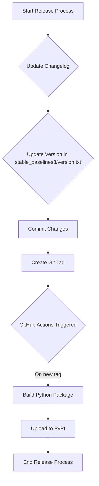

<!-- source: DeepWiki mcp.deepwiki.com · repo DLR-RM/stable-baselines3 · page 12.1 Contributing Workflow & Release Process · fetched 2026-10-14 -->

# Contributing Workflow & Release Process

<details>
<summary>Relevant source files</summary>

The following files were used as context for generating this wiki page:

- [.github/ISSUE_TEMPLATE/bug_report.yml](.github/ISSUE_TEMPLATE/bug_report.yml)
- [.github/ISSUE_TEMPLATE/custom_env.yml](.github/ISSUE_TEMPLATE/custom_env.yml)
- [.github/ISSUE_TEMPLATE/documentation.yml](.github/ISSUE_TEMPLATE/documentation.yml)
- [.github/ISSUE_TEMPLATE/feature_request.yml](.github/ISSUE_TEMPLATE/feature_request.yml)
- [.github/ISSUE_TEMPLATE/question.yml](.github/ISSUE_TEMPLATE/question.yml)
- [.github/PULL_REQUEST_TEMPLATE.md](.github/PULL_REQUEST_TEMPLATE.md)
- [CODE_OF_CONDUCT.md](CODE_OF_CONDUCT.md)
- [CONTRIBUTING.md](CONTRIBUTING.md)
- [Makefile](Makefile)
- [docs/conf.py](docs/conf.py)
- [docs/misc/changelog.md](docs/misc/changelog.md)
- [stable_baselines3/version.txt](stable_baselines3/version.txt)

</details>


This page outlines the contribution guidelines, development workflow, and release process for the Stable-Baselines3 codebase. It covers how to contribute new features or bug fixes, the tools used for code quality, the structure of the changelog, and the versioning scheme.

## Contributing to Stable-Baselines3

Contributions to Stable-Baselines3 are welcome and fall into two main categories: proposing and implementing new features, or implementing features/bug fixes for existing issues [CONTRIBUTING.md:6-12]().

### Contribution Workflow

1.  **Proposing a New Feature**: Create an issue to discuss the design and implementation of your intended feature. Once an agreement is reached, proceed with the implementation [CONTRIBUTING.md:7-9]().
2.  **Implementing an Existing Feature or Bug Fix**: Look at the outstanding issues labeled "help wanted" on GitHub. Comment on the task you wish to work on. Ask for more context if needed [CONTRIBUTING.md:10-13]().
3.  **Submitting a Pull Request (PR)**: After implementing a feature or bug fix, submit a Pull Request to the main repository [CONTRIBUTING.md:15-16](). Ensure the PR adheres to the provided template, otherwise it may be ignored [CONTRIBUTING.md:18]().

#### Important Notes on AI-Assisted Contributions
The use of LLMs or code assistants (e.g., Claude or Copilot) must be publicly disclosed when submitting issues or pull requests [CONTRIBUTING.md:3-4](). PRs fully generated by an LLM/code assistant are not accepted unless triggered by a maintainer [CONTRIBUTING.md:66-67]().

### Development Setup

To set up Stable-Baselines3 for development:
1.  Clone the repository:
    ```bash
    git clone https://github.com/DLR-RM/stable-baselines3
    cd stable-baselines3/
    ```
    [CONTRIBUTING.md:31-33]()
2.  Install in editable mode with development dependencies:
    ```bash
    pip install -e '.[docs,tests,extra]'
    ```
    [CONTRIBUTING.md:37]()

Sources:
* [CONTRIBUTING.md:1-125]()

## Code Quality and Testing

Stable-Baselines3 enforces strict code quality standards using various tools and `Makefile` targets.

### Codestyle

The project uses `black` for code formatting (max line length of 127 characters) and `ruff` (with `isort` rules) for import sorting [CONTRIBUTING.md:43-44](). Documentation uses a default line length of 88 characters [CONTRIBUTING.md:45]().

To automatically reformat your code, run:
```bash
make format
```
[CONTRIBUTING.md:47, Makefile:25-29]()

To check the codestyle without modifying files, use:
```bash
make check-codestyle
make lint
```
[CONTRIBUTING.md:47, Makefile:31-35, Makefile:18-22]()

### Type Hinting and Documentation

All functions and methods should be documented and type-hinted using the following template:
```python
def my_function(arg1: type1, arg2: type2) -> returntype:
    """
    Short description of the function.

    :param arg1: describe what is arg1
    :param arg2: describe what is arg2
    :return: describe what is returned
    """
    ...
    return my_variable
```
[CONTRIBUTING.md:49-63]()

### Testing

New features and bug fixes require corresponding tests in the `tests/` folder using `pytest` [CONTRIBUTING.md:77-78]().

To run tests:
```bash
make pytest
```
[CONTRIBUTING.md:83, Makefile:4-5]()

To perform type checking with `mypy`:
```bash
make type
```
[CONTRIBUTING.md:88, Makefile:16]()

To run all commit checks (format, type, lint):
```bash
make commit-checks
```
[CONTRIBUTING.md:101, Makefile:37]()

### Documentation Building

To build the documentation locally:
```bash
make doc
```
[CONTRIBUTING.md:108, Makefile:39-40]()

To check documentation spelling (requires `sphinxcontrib.spelling`):
```bash
make spelling
```
[CONTRIBUTING.md:113, Makefile:42-43]()

Sources:
* [CONTRIBUTING.md:43-115]()
* [Makefile:4-43]()

## Pull Request Guidelines

Before submitting a PR, it is mandatory to open an issue to discuss the feature or bug fix. This helps prevent duplicate work and streamlines the review process [CONTRIBUTING.md:69-70]().

Each PR must be reviewed and accepted by at least one maintainer and must pass all Continuous Integration (CI) tests [CONTRIBUTING.md:72-73]().

The pull request template `.github/PULL_REQUEST_TEMPLATE.md` guides contributors through the necessary steps, including:
*   Providing a description and motivation for the changes [.github/PULL_REQUEST_TEMPLATE.md:2-7]()
*   Linking to an issue (if applicable) [.github/PULL_REQUEST_TEMPLATE.md:8-10]()
*   Categorizing the type of change (bug fix, new feature, breaking change, documentation) [.github/PULL_REQUEST_TEMPLATE.md:12-17]()
*   A checklist of required actions, such as reading the contribution guide, updating the changelog, updating tests, reformatting code, and ensuring all `make` checks pass [.github/PULL_REQUEST_TEMPLATE.md:22-33]()

### Issue Templates

The repository provides several issue templates to guide users in reporting problems or suggesting improvements:
*   **Bug Report**: For unexpected behavior, crashes, or bugs. Requires a clear description, steps to reproduce, relevant log output, and system information [.github/ISSUE_TEMPLATE/bug_report.yml:1-73]().
*   **Custom Gym Environment Issue**: Specifically for problems involving custom Gymnasium environments. Encourages checking the environment with `stable_baselines3.common.env_checker.check_env` [.github/ISSUE_TEMPLATE/custom_env.yml:1-109]().
*   **Feature Request**: For new features or improvements. Asks for a description, motivation, pitch, and potential alternatives [.github/ISSUE_TEMPLATE/feature_request.yml:1-46]().
*   **Question**: For general questions about Stable-Baselines3 [.github/ISSUE_TEMPLATE/question.yml:1-32]().
*   **Documentation**: For reporting errors, inconsistencies, or missing information in the documentation [.github/ISSUE_TEMPLATE/documentation.yml:1-25]().

Sources:
* [CONTRIBUTING.md:69-73]()
* [.github/PULL_REQUEST_TEMPLATE.md:1-38]()
* [.github/ISSUE_TEMPLATE/bug_report.yml:1-73]()
* [.github/ISSUE_TEMPLATE/custom_env.yml:1-109]()
* [.github/ISSUE_TEMPLATE/feature_request.yml:1-46]()
* [.github/ISSUE_TEMPLATE/question.yml:1-32]()
* [.github/ISSUE_TEMPLATE/documentation.yml:1-25]()

## Changelog and Versioning

The changelog (`docs/misc/changelog.md`) must be updated for every contribution. Contributors should add their username next to each entry they add [CONTRIBUTING.md:119-120]().

### Changelog Structure

The changelog is organized by release version, with sections for:
*   Breaking Changes
*   New Features
*   Bug Fixes
*   Sections for related projects like `SB3-Contrib`, `RL Zoo`, and `SBX`
*   Deprecations
*   Others (miscellaneous changes)
*   Documentation updates

Example entries from `docs/misc/changelog.md`:
```markdown
## Release 2.9.2a0 (WIP)

### Breaking Changes:

### New Features:

### Bug Fixes:

- Fixed file descriptor leak in `SubprocVecEnv.close()` by closing parent-side pipes to prevent "too many open files" errors in long-running loops

### [SB3-Contrib]

### [RL Zoo]

### [SBX] (SB3 + Jax)

### Deprecations:

### Others:

- Fixed moviepy test compatibility with moviepy >= 2.0 (PyTorch doesn't support it yet)
- Added filter for numpy `newshape` deprecation warning from torch tensorboard

### Documentation:

- Clarified in the `n_steps` docstring that it only applies when `replay_buffer_class` is `None`, and that a custom replay buffer must be configured with `replay_buffer_kwargs={"n_steps": ..., "gamma": ...}` (@Koustav-github)
```
[docs/misc/changelog.md:5-39]()

### Versioning

The current version of Stable-Baselines3 is stored in `stable_baselines3/version.txt` [stable_baselines3/version.txt:1](). This version is used by the Sphinx documentation builder to set the `release` and `version` variables [docs/conf.py:39-52]().

The version string `2.9.2a0` indicates:
*   `2`: Major version
*   `9`: Minor version
*   `2`: Patch version
*   `a0`: Alpha release (e.g., `a` for alpha, `b` for beta, `rc` for release candidate, followed by a number)

### Release Process

The release process involves building and uploading the package to PyPI.

#### PyPI Package Release
To build and upload the package to PyPI:
```bash
make release
```
This command executes `python -m build` to create distribution packages and then `twine upload dist/*` to upload them to the official PyPI repository [Makefile:59-61]().

#### Test PyPI Package Release
To test the package release on Test PyPI:
```bash
make test-release
```
This command builds the package and uploads it to the Test PyPI repository [Makefile:64-66]().

### Release Workflow
The project uses GitHub Actions to automatically publish to PyPI when a new tag is created [docs/misc/changelog.md:72]().

The overall release process can be visualized as follows:


**Title: Release Process Flow**

Sources:
* [docs/misc/changelog.md:1-174]()
* [stable_baselines3/version.txt:1]()
* [docs/conf.py:39-52]()
* [Makefile:59-66]()

## Code of Conduct

The Stable-Baselines3 project adheres to the Contributor Covenant Code of Conduct. This document outlines pledges for a harassment-free experience, standards for acceptable and unacceptable behavior, and enforcement responsibilities and guidelines [CODE_OF_CONDUCT.md:1-126]().

Sources:
* [CODE_OF_CONDUCT.md:1-126]()

---

