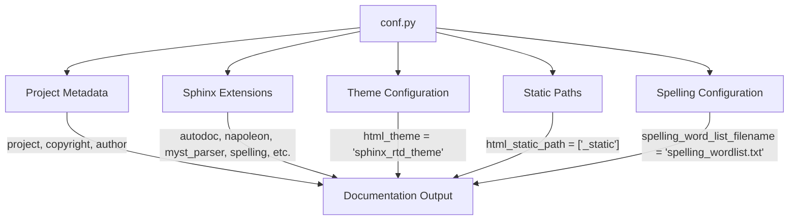
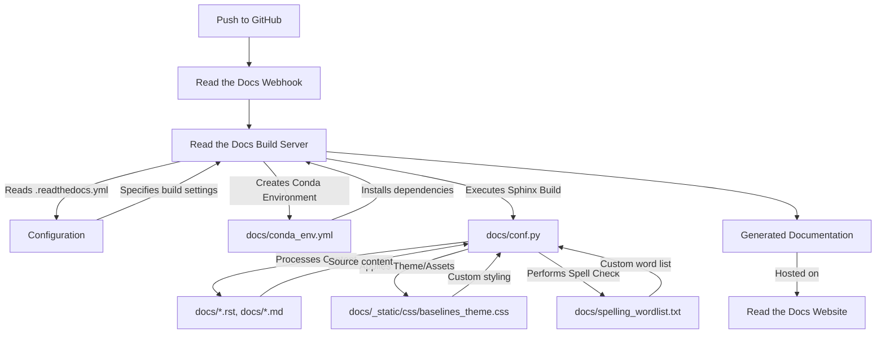

<!-- source: DeepWiki mcp.deepwiki.com · repo DLR-RM/stable-baselines3 · page 12.2 Documentation Build System · fetched 2026-10-14 -->

# Documentation Build System

<details>
<summary>Relevant source files</summary>

The following files were used as context for generating this wiki page:

- [.readthedocs.yml](.readthedocs.yml)
- [docs/Makefile](docs/Makefile)
- [docs/README.md](docs/README.md)
- [docs/_static/css/baselines_theme.css](docs/_static/css/baselines_theme.css)
- [docs/conda_env.yml](docs/conda_env.yml)
- [docs/guide/install.md](docs/guide/install.md)
- [docs/make.bat](docs/make.bat)
- [docs/spelling_wordlist.txt](docs/spelling_wordlist.txt)

</details>


This page details the documentation build system for Stable-Baselines3, covering its structure, configuration, theme, static assets, spelling checks, and integration with Read the Docs. The documentation is built using Sphinx, a powerful documentation generator that converts reStructuredText or Markdown files into various output formats, primarily HTML.

## Sphinx Documentation Layout

The documentation source files are located in the `docs/` directory. This directory contains the configuration file `conf.py`, static assets, and the various `.rst` and `.md` files that make up the documentation content.

### Building the Documentation Locally

To build the documentation locally, you first need to install the necessary dependencies. This can be done by installing the `[docs]` extra package:
```bash
pip install -e ".[docs]"
```
[docs/README.md:10-12]()

Alternatively, for development purposes, you can install the full development version with all extras:
```bash
git clone https://github.com/DLR-RM/stable-baselines3 && cd stable-baselines3
pip install -e '.[docs,tests,extra]'
```
[docs/guide/install.md:60-63]()

Once the dependencies are installed, navigate to the `docs/` directory and use `make` to build the HTML documentation:
```bash
make html
```
[docs/README.md:17-19]()

For automatic rebuilding upon file changes, `sphinx-autobuild` can be used:
```bash
sphinx-autobuild . _build/html
```
[docs/README.md:23-25]()

The `Makefile` [docs/Makefile:1-21]() and `make.bat` [docs/make.bat:1-36]() scripts define the build commands. The `Makefile` sets `SPHINXOPTS = -W` [docs/Makefile:6]() to make warnings fatal, ensuring high quality documentation.

### Documentation Build Process
```mermaid
graph TD
    A[User/ReadTheDocs] --> B{Trigger Build};
    B -- "make html" or "sphinx-autobuild" --> C[Sphinx Build System];
    C -- "Reads conf.py" --> D[Configuration];
    C -- "Processes .rst/.md files" --> E[Content Files];
    C -- "Applies theme" --> F[Theme & Static Assets];
    C -- "Checks spelling" --> G[Spelling Wordlist];
    C -- "Generates output" --> H[HTML Documentation];
    D -- "Defines extensions, theme, etc." --> C;
    E -- "Includes text, code, diagrams" --> C;
    F -- "Custom CSS, logo" --> C;
    G -- "Excludes known words from spell check" --> C;
```
Sources: [docs/README.md:10-25](), [docs/Makefile:1-21](), [docs/make.bat:1-36](), [docs/conf.py](), [docs/spelling_wordlist.txt:1-126]()

## `conf.py` Configuration

The `conf.py` file is the main configuration file for Sphinx. It defines various project-specific settings, extensions, and paths.

Key configurations include:
*   **Project Information**: `project`, `copyright`, `author`.
*   **Extensions**: A list of Sphinx extensions used to enhance functionality. Common extensions include `sphinx.ext.autodoc` for automatic documentation from docstrings, `sphinx.ext.napoleon` for Google/NumPy style docstrings, `sphinx.ext.viewcode` for linking to source code, `sphinx.ext.githubpages` for GitHub Pages compatibility, `sphinx.ext.doctest` for testing code examples, `sphinx.ext.intersphinx` for linking to external documentation, `sphinx.ext.todo` for todo lists, `sphinx.ext.coverage` for coverage reports, `sphinx.ext.mathjax` for mathematical equations, `sphinx.ext.ifconfig` for conditional content, `sphinx.ext.imgmath` for math as images, `sphinx.ext.inheritance_diagram` for class inheritance diagrams, `sphinx_copybutton` for adding a copy button to code blocks, `myst_parser` for parsing Markdown files, and `sphinxcontrib.spelling` for spell checking.
*   **Theme**: `html_theme` is set to `sphinx_rtd_theme`.
*   **Static Paths**: `html_static_path` specifies directories for static files like CSS and images.
*   **Spelling Configuration**: `spelling_show_suggestions`, `spelling_lang`, and `spelling_word_list_filename` are configured for the spell checker.


Sources: [docs/conf.py](), [docs/spelling_wordlist.txt:1-126]()

## Theme and Static Assets

The documentation uses the `sphinx_rtd_theme` [docs/conf.py:100]() for its visual presentation. This theme is widely used and provides a clean, responsive layout.

Custom CSS is applied via `docs/_static/css/baselines_theme.css` [docs/_static/css/baselines_theme.css:1-61](). This file overrides default styles to match the project's branding, such as:
*   **Main Colors**: Defines `--main-bg-color` (e.g., `#343A40`) and `--link-color` (e.g., `#FD7E14`) [docs/_static/css/baselines_theme.css:2-5]().
*   **Header Fonts**: Sets `font-family` for `h1`, `h2`, etc., to "Lato", "proxima-nova", etc. [docs/_static/css/baselines_theme.css:8-10]().
*   **Navigation Background**: Sets the background color for `.wy-side-nav-search` and `.wy-nav-top` to `--main-bg-color` [docs/_static/css/baselines_theme.css:14-21]().
*   **Link Colors**: Customizes `a` and `a:hover` colors to `--link-color` and `#4F778F` respectively [docs/_static/css/baselines_theme.css:24-30]().
*   **Code Block Background**: Sets the background for code blocks to `#f8f8f8` [docs/_static/css/baselines_theme.css:49-51]().

These customizations ensure a consistent look and feel across the documentation.

## Spelling Checks

The documentation build system includes a spell checker using the `sphinxcontrib.spelling` extension. This helps maintain high quality and professionalism in the written content.

The spell checker is configured in `conf.py` [docs/conf.py:120-122]() with:
*   `spelling_show_suggestions = True`: Displays suggestions for misspelled words.
*   `spelling_lang = 'en_US'`: Sets the language to American English.
*   `spelling_word_list_filename = 'spelling_wordlist.txt'`: Specifies a custom wordlist.

The `docs/spelling_wordlist.txt` file [docs/spelling_wordlist.txt:1-126]() contains a list of words that are intentionally excluded from spell checking. These typically include technical terms, acronyms, or proper nouns that are not found in standard dictionaries but are correct within the context of the project. Examples include `VecEnv`, `gSDE`, `minibatch`, `hyperparameters`, `TensorFlow`, `pytorch`, and various library or project-specific terms.

## Read the Docs Configuration

The documentation is hosted on Read the Docs, which automates the build and deployment process. The `.readthedocs.yml` file [.readthedocs.yml:1-21]() configures how Read the Docs builds the documentation.

Key settings in `.readthedocs.yml` include:
*   `version: 2`: Specifies the configuration file version.
*   `sphinx.configuration: docs/conf.py`: Points to the Sphinx configuration file.
*   `formats: all`: Builds documentation in all available formats (e.g., HTML, PDF, ePub).
*   `conda.environment: docs/conda_env.yml`: Specifies a Conda environment file for dependencies. This ensures a consistent build environment.
*   `build.os: ubuntu-24.04`: Sets the operating system for the build environment.
*   `build.tools.python: "miniforge3-25.11"`: Specifies the Python toolchain to use.

The `docs/conda_env.yml` file [docs/conda_env.yml:1-18]() defines the Conda environment used by Read the Docs. It lists essential dependencies such as `pip`, `python`, `pytorch-cpu`, and various Sphinx-related packages like `sphinx`, `sphinx_rtd_theme`, `sphinx_copybutton`, and `myst-parser`. This ensures that all required tools and libraries are available during the Read the Docs build process.

### Read the Docs Build Flow

Sources: [.readthedocs.yml:1-21](), [docs/conda_env.yml:1-18](), [docs/conf.py](), [docs/_static/css/baselines_theme.css:1-61](), [docs/spelling_wordlist.txt:1-126]()

---

