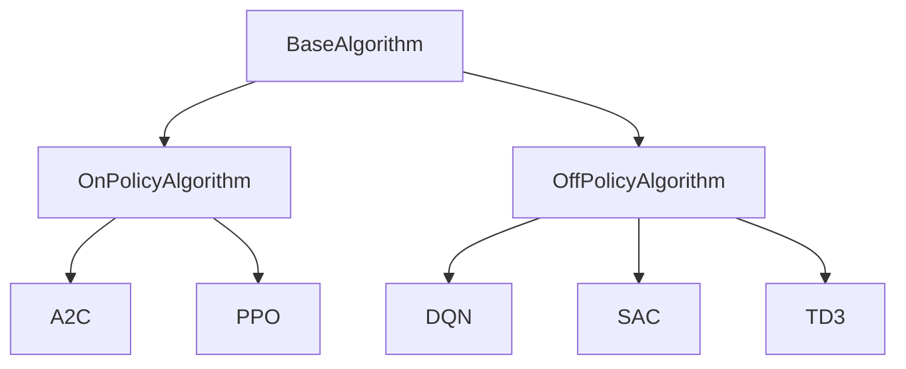
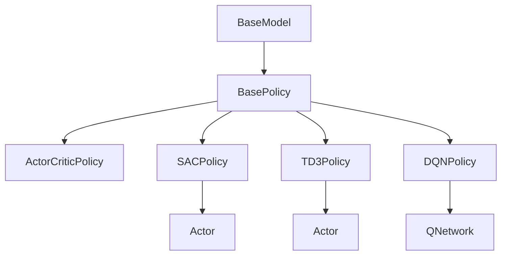

<!-- source: DeepWiki mcp.deepwiki.com · repo DLR-RM/stable-baselines3 · page 13 Glossary · fetched 2026-10-14 -->

# Glossary

Relevant source files

The following files were used as context for generating this wiki page:

- [README.md](README.md)
- [docs/guide/rl.md](docs/guide/rl.md)
- [docs/index.rst](docs/index.rst)
- [docs/spelling_wordlist.txt](docs/spelling_wordlist.txt)
- [stable_baselines3/common/base_class.py](stable_baselines3/common/base_class.py)
- [stable_baselines3/common/policies.py](stable_baselines3/common/policies.py)
- [stable_baselines3/common/type_aliases.py](stable_baselines3/common/type_aliases.py)
- [stable_baselines3/dqn/policies.py](stable_baselines3/dqn/policies.py)
- [stable_baselines3/sac/policies.py](stable_baselines3/sac/policies.py)
- [stable_baselines3/td3/policies.py](stable_baselines3/td3/policies.py)

This page provides definitions for terms, jargon, and abbreviations specific to the Stable-Baselines3 (SB3) codebase. It aims to clarify concepts for developers and users, often including pointers to relevant code sections for deeper understanding.

## Core Concepts

### BaseAlgorithm
The abstract base class for all reinforcement learning algorithms in SB3. It provides common functionalities such as environment setup, logging, device management, and random seed handling. All specific algorithms (like PPO, A2C, SAC) inherit from `BaseAlgorithm` [stable_baselines3/common/base_class.py:67-67]().

**Diagram: BaseAlgorithm Inheritance**

Sources:
* [stable_baselines3/common/base_class.py:67-67]()

### Policy
In SB3, a `Policy` refers to the neural network architecture that dictates an agent's behavior. It maps observations from the environment to actions. The base class for all policies is `BasePolicy` [stable_baselines3/common/policies.py:39-39](). Policies can be further specialized into actor-critic policies, Q-networks, etc., depending on the algorithm.

**Diagram: Policy Class Hierarchy (Simplified)**

Sources:
* [stable_baselines3/common/policies.py:39-39]()
* [stable_baselines3/sac/policies.py:25-25]()
* [stable_baselines3/td3/policies.py:20-20]()
* [stable_baselines3/dqn/policies.py:18-18]()

### net_arch
Short for "network architecture," `net_arch` is a parameter used to define the structure of the neural networks within a policy. It's typically a list of integers, where each integer represents the number of neurons in a hidden layer. For actor-critic methods, it can also be a dictionary specifying separate architectures for the actor and critic networks [stable_baselines3/td3/policies.py:119-120]().

For example, `net_arch=[64, 64]` would create a network with two hidden layers, each having 64 neurons.

Sources:
* [stable_baselines3/td3/policies.py:119-120]()
* [stable_baselines3/sac/policies.py:54-55]()
* [stable_baselines3/dqn/policies.py:38-38]()

## Environment Interaction

### VecEnv
Short for "Vectorized Environment," `VecEnv` is an abstract base class [stable_baselines3/common/base_class.py:37-37]() that allows running multiple independent environments in parallel. This significantly speeds up data collection during training. SB3 provides several implementations, such as `DummyVecEnv` (for sequential execution) and `SubprocVecEnv` (for parallel execution using multiprocessing).

Sources:
* [stable_baselines3/common/base_class.py:37-37]()
* [docs/spelling_wordlist.txt:9-9]()

### Rollout
A "rollout" refers to a sequence of observations, actions, rewards, and other relevant information collected from the environment during a certain period. In on-policy algorithms like PPO and A2C, rollouts are collected and then used to update the policy, after which the data is discarded. The `RolloutBuffer` [stable_baselines3/common/type_aliases.py:32-39]() stores these samples.

Sources:
* [stable_baselines3/common/type_aliases.py:32-39]()
* [docs/spelling_wordlist.txt:101-101]()

### Replay Buffer
A data structure used in off-policy algorithms (like DQN, SAC, TD3) to store past experiences (transitions: observation, action, reward, next observation, done). These experiences are then sampled randomly to train the agent, breaking the correlation between consecutive samples and improving sample efficiency. The `ReplayBuffer` [stable_baselines3/common/type_aliases.py:50-57]() stores these samples.

Sources:
* [stable_baselines3/common/type_aliases.py:50-57]()

## Algorithm-Specific Terms

### gSDE
Short for "Generalized State-Dependent Exploration," `gSDE` is an exploration strategy that introduces noise into the policy's output in a way that depends on the current state. This can lead to more efficient exploration compared to simple action noise. It is used in algorithms like SAC [stable_baselines3/sac/policies.py:36-37]().

Sources:
* [stable_baselines3/sac/policies.py:36-37]()
* [stable_baselines3/common/base_class.py:90-90]()
* [docs/spelling_wordlist.txt:120-120]()

### GAE
Short for "Generalized Advantage Estimation," `GAE` is a method used in actor-critic algorithms (like A2C and PPO) to estimate the advantage function. It provides a balance between bias and variance in the advantage estimate by combining n-step returns with value function bootstrapping.

Sources:
* No direct code citation for GAE definition, but it's a core concept in on-policy algorithms.

## Other Terms

### Schedule
A `Schedule` [stable_baselines3/common/type_aliases.py:29-29]() is a callable that takes the current progress (a float from 1.0 down to 0.0, representing the remaining training progress) as input and returns a scalar value. This is commonly used to dynamically adjust hyperparameters like the learning rate or exploration rate during training.

Sources:
* [stable_baselines3/common/type_aliases.py:29-29]()

### TensorBoard
An open-source machine learning toolkit for visualization. SB3 integrates with TensorBoard to log training metrics, episode rewards, and other relevant data, which can then be visualized in a web interface.

Sources:
* [README.md:37-37]()
* [stable_baselines3/common/base_class.py:79-79]()

### RL Zoo
Refers to the "RL Baselines3 Zoo" project, a companion repository to Stable-Baselines3. It provides a training framework, pre-trained agents, and tuned hyperparameters for various environments and algorithms.

Sources:
* [README.md:69-85]()
* [docs/index.rst:17-20]()

### SB3-Contrib
Refers to the "Stable-Baselines3 Contrib" repository. This repository hosts experimental features and newer algorithms that are not yet part of the stable core SB3 library, allowing for more rapid development and testing of new ideas.

Sources:
* [README.md:87-92]()
* [docs/index.rst:21-21]()

### SBX
Refers to "Stable Baselines Jax," a proof-of-concept version of Stable-Baselines3 implemented in JAX. It aims for faster execution, sometimes achieving significant speedups.

Sources:
* [README.md:94-99]()
* [docs/index.rst:23-23]()