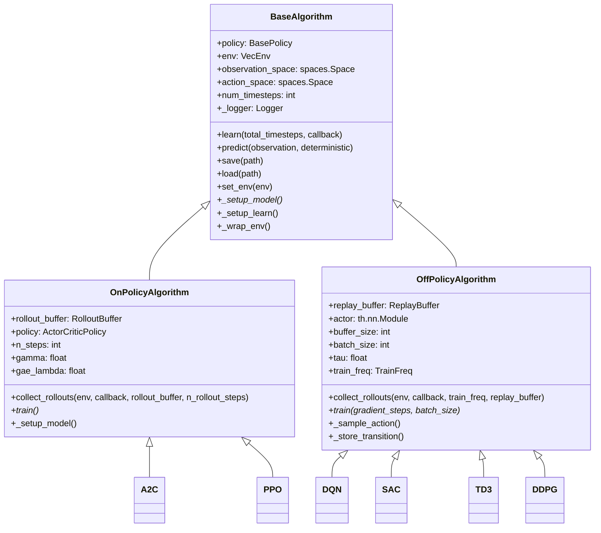
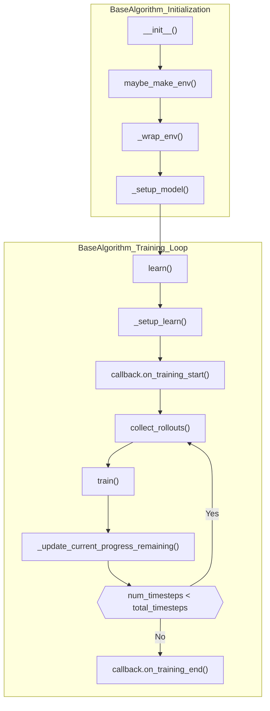
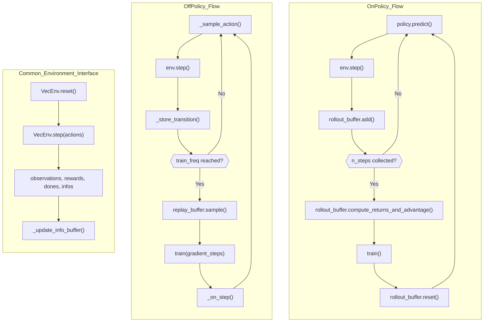
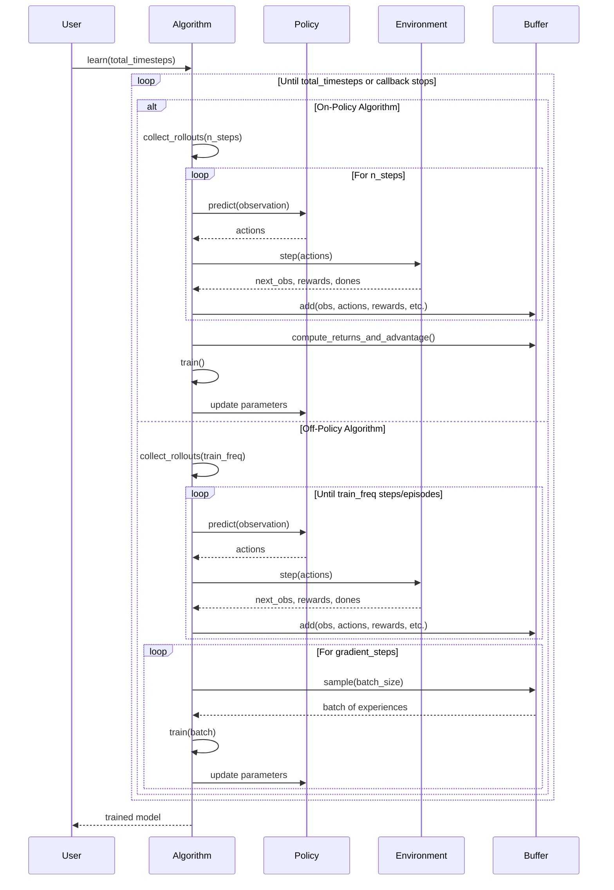
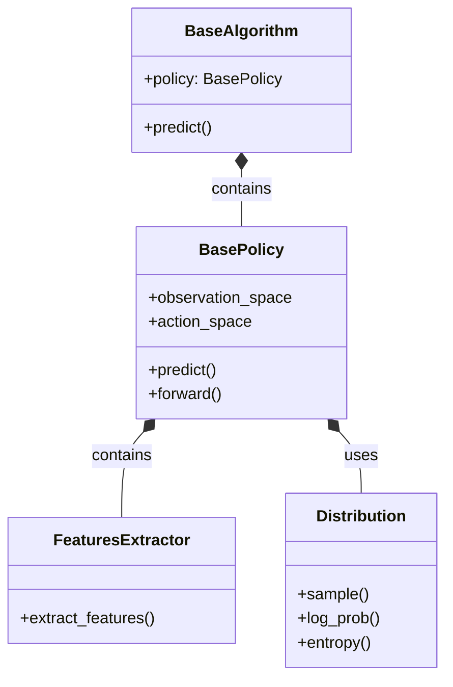
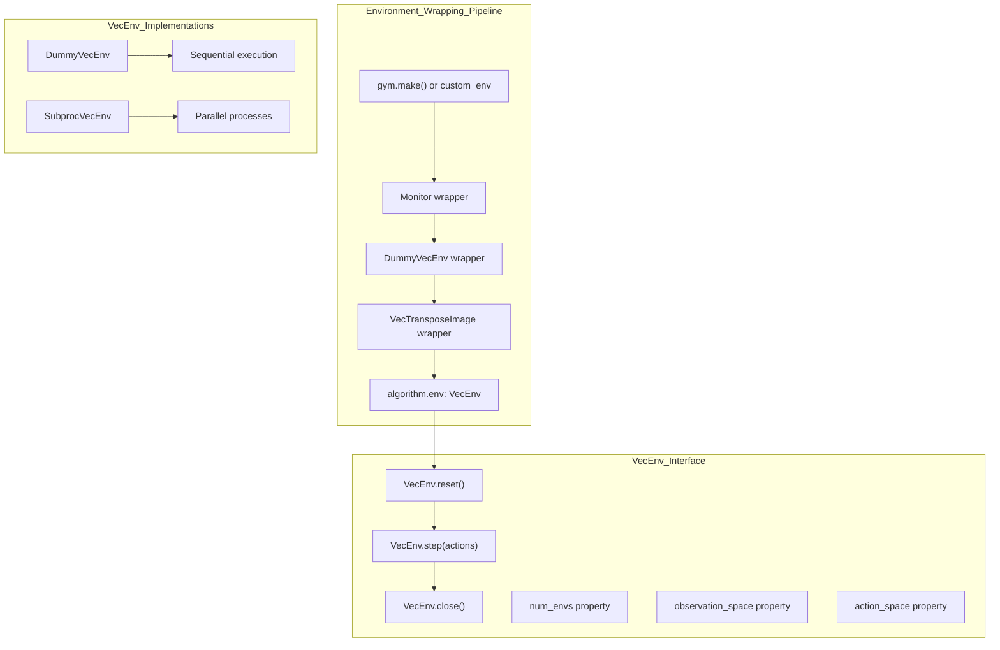
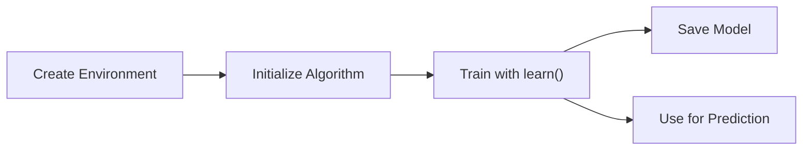
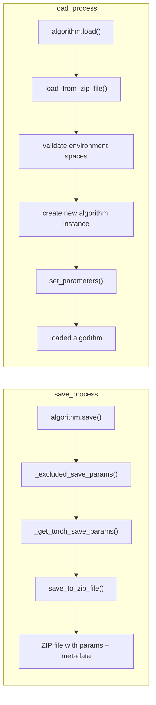
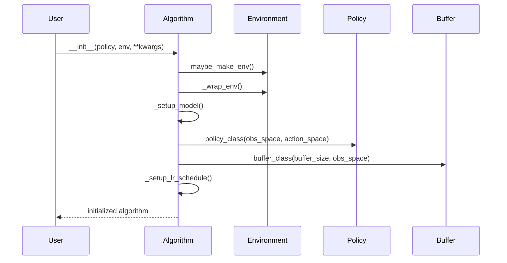

<!-- source: DeepWiki mcp.deepwiki.com · repo DLR-RM/stable-baselines3 · page 2 Core Architecture · fetched 2026-10-14 -->

# Core Architecture

Relevant source files

The following files were used as context for generating this wiki page:

- [stable_baselines3/common/base_class.py](stable_baselines3/common/base_class.py)
- [stable_baselines3/common/off_policy_algorithm.py](stable_baselines3/common/off_policy_algorithm.py)
- [stable_baselines3/common/on_policy_algorithm.py](stable_baselines3/common/on_policy_algorithm.py)

This page documents the foundational architecture and class hierarchy of Stable Baselines3 (SB3). It explains the core components that all algorithms in SB3 are built upon and how they interact with each other. For specific algorithm implementations, see [Algorithms](#3), and for details on policies, see [Policy Networks](#4).

## Class Hierarchy Overview

The Stable Baselines3 framework is built around a clean inheritance structure that allows for code reuse while maintaining algorithm-specific optimizations. At its core is the `BaseAlgorithm` abstract base class, which provides the foundation for all reinforcement learning algorithms.

### Core Class Hierarchy

Sources: [stable_baselines3/common/base_class.py:67-98](), [stable_baselines3/common/on_policy_algorithm.py:21-60](), [stable_baselines3/common/off_policy_algorithm.py:27-110]()

## BaseAlgorithm - The Foundation

The `BaseAlgorithm` class provides the core functionality shared by all RL algorithms in SB3. It is an abstract base class that defines the standard interface and implements common methods. For a detailed look, see [BaseAlgorithm & Algorithm Base Classes](#2.1).

### Core BaseAlgorithm Components

The `BaseAlgorithm` class [stable_baselines3/common/base_class.py:67]() provides the foundation for all RL algorithms with these key responsibilities:

#### Environment Management
- `_wrap_env()` [stable_baselines3/common/base_class.py:204-249]() - Automatically wraps environments with `Monitor` and `DummyVecEnv`
- `set_env()` [stable_baselines3/common/base_class.py:476-509]() - Validates and sets new environments
- `env: VecEnv` attribute stores the vectorized environment

#### Policy and Network Management  
- `policy: BasePolicy` attribute stores the neural network policy
- `policy_class` and `policy_kwargs` manage policy creation
- `_get_policy_from_name()` [stable_baselines3/common/base_class.py:323-338]() resolves policy aliases

#### Model Persistence
- `save()` [stable_baselines3/common/base_class.py:819-862]() - Saves model parameters and metadata to zip file
- `load()` [stable_baselines3/common/base_class.py:642-802]() - Loads model from zip file with environment validation
- `get_parameters()` / `set_parameters()` for parameter management

#### Training Infrastructure
- `_setup_model()` abstract method for subclass initialization
- `_setup_learn()` [stable_baselines3/common/base_class.py:383-436]() prepares training state
- `_update_learning_rate()` [stable_baselines3/common/base_class.py:287-301]() handles learning rate schedules

### Key BaseAlgorithm Methods

| Method | Line Reference | Purpose |
|--------|---------------|---------|
| `learn()` | [stable_baselines3/common/base_class.py:512-535]() | Abstract training entry point |
| `predict()` | [stable_baselines3/common/base_class.py:537-557]() | Action prediction from observations |
| `save()` | [stable_baselines3/common/base_class.py:819-862]() | Model serialization to zip file |
| `load()` | [stable_baselines3/common/base_class.py:642-802]() | Model deserialization with validation |
| `_setup_model()` | [stable_baselines3/common/base_class.py:252-253]() | Abstract method for network initialization |
| `set_env()` | [stable_baselines3/common/base_class.py:476-509]() | Environment replacement with validation |
| `_wrap_env()` | [stable_baselines3/common/base_class.py:204-249]() | Automatic environment wrapping |

### BaseAlgorithm Training Lifecycle

Sources: [stable_baselines3/common/base_class.py:106-122](), [stable_baselines3/common/base_class.py:383-436](), [stable_baselines3/common/base_class.py:512-535]()

## On-Policy vs Off-Policy Algorithms

SB3 organizes algorithms into two main categories based on how they use collected experience data:

### OnPolicyAlgorithm Architecture

The `OnPolicyAlgorithm` class [stable_baselines3/common/on_policy_algorithm.py:21]() serves as the base for algorithms that learn from recently collected experiences and discard them after updates. These algorithms typically use a `RolloutBuffer` for temporary storage. For more details, see [BaseAlgorithm & Algorithm Base Classes](#2.1).

#### Core Components
- `rollout_buffer: RolloutBuffer` [stable_baselines3/common/on_policy_algorithm.py:58]() - Temporary experience storage
- `policy: ActorCriticPolicy` [stable_baselines3/common/on_policy_algorithm.py:59]() - Actor-critic policy networks
- `n_steps: int` - Number of environment steps per rollout
- `gamma: float` - Discount factor for returns calculation
- `gae_lambda: float` - GAE lambda parameter for advantage estimation

#### Key Methods
- `collect_rollouts()` [stable_baselines3/common/on_policy_algorithm.py:162-268]() - Collects n_steps experiences
- `train()` [stable_baselines3/common/on_policy_algorithm.py:270-275]() - Abstract method for policy updates
- `_setup_model()` [stable_baselines3/common/on_policy_algorithm.py:115-140]() - Initializes rollout buffer and policy

#### Hyperparameters Table

| Parameter | Type | Purpose | Line Reference |
|-----------|------|---------|----------------|
| `n_steps` | int | Rollout length per update | [stable_baselines3/common/on_policy_algorithm.py:66]() |
| `gamma` | float | Discount factor | [stable_baselines3/common/on_policy_algorithm.py:67]() |
| `gae_lambda` | float | GAE lambda parameter | [stable_baselines3/common/on_policy_algorithm.py:68]() |
| `ent_coef` | float | Entropy coefficient | [stable_baselines3/common/on_policy_algorithm.py:69]() |
| `vf_coef` | float | Value function coefficient | [stable_baselines3/common/on_policy_algorithm.py:70]() |
| `max_grad_norm` | float | Gradient clipping threshold | [stable_baselines3/common/on_policy_algorithm.py:71]() |

Sources: [stable_baselines3/common/on_policy_algorithm.py:21-114](), [stable_baselines3/common/on_policy_algorithm.py:162-268]()

### OffPolicyAlgorithm Architecture

The `OffPolicyAlgorithm` class [stable_baselines3/common/off_policy_algorithm.py:27]() serves as the base for algorithms that can learn from previously collected experiences stored in a replay buffer. For more details, see [BaseAlgorithm & Algorithm Base Classes](#2.1).

#### Core Components
- `replay_buffer: ReplayBuffer` [stable_baselines3/common/off_policy_algorithm.py:136]() - Long-term experience storage
- `actor: th.nn.Module` [stable_baselines3/common/off_policy_algorithm.py:79]() - Actor network for action generation
- `train_freq: TrainFreq` - Controls training frequency (steps or episodes)
- `action_noise: ActionNoise` - Exploration noise for deterministic policies

#### Key Methods
- `collect_rollouts()` [stable_baselines3/common/off_policy_algorithm.py:513-607]() - Collects experiences based on train_freq
- `train()` [stable_baselines3/common/off_policy_algorithm.py:360-365]() - Abstract method for network updates
- `_sample_action()` [stable_baselines3/common/off_policy_algorithm.py:367-414]() - Action sampling with exploration
- `_store_transition()` [stable_baselines3/common/off_policy_algorithm.py:448-511]() - Stores experiences in replay buffer

#### Hyperparameters Table

| Parameter | Type | Purpose | Line Reference |
|-----------|------|---------|----------------|
| `buffer_size` | int | Replay buffer capacity | [stable_baselines3/common/off_policy_algorithm.py:86]() |
| `learning_starts` | int | Steps before training begins | [stable_baselines3/common/off_policy_algorithm.py:87]() |
| `batch_size` | int | Mini-batch size for training | [stable_baselines3/common/off_policy_algorithm.py:88]() |
| `tau` | float | Soft update coefficient | [stable_baselines3/common/off_policy_algorithm.py:89]() |
| `gamma` | float | Discount factor | [stable_baselines3/common/off_policy_algorithm.py:90]() |
| `train_freq` | TrainFreq | Training frequency | [stable_baselines3/common/off_policy_algorithm.py:91]() |
| `gradient_steps` | int | Updates per training step | [stable_baselines3/common/off_policy_algorithm.py:92]() |

Sources: [stable_baselines3/common/off_policy_algorithm.py:27-149](), [stable_baselines3/common/off_policy_algorithm.py:513-607]()

## Experience Collection and Learning Flow

The following diagram illustrates how experience data flows through the system during training:

### Experience Collection and Training Flows

Sources: [stable_baselines3/common/on_policy_algorithm.py:194-217](), [stable_baselines3/common/off_policy_algorithm.py:558-604](), [stable_baselines3/common/base_class.py:438-457]()

## Core Training Process

Both algorithm types implement the `learn()` method from `BaseAlgorithm` but with different approaches:

Sources: [stable_baselines3/common/on_policy_algorithm.py:300-341](), [stable_baselines3/common/off_policy_algorithm.py:305-351]()

## Key Abstractions and Composition

### Policy and Network Composition

The policy objects in SB3 encapsulate the neural networks that map observations to actions. The following diagram shows how these components fit together:

### Environment Wrapping and Vectorization

SB3 automatically wraps environments to ensure consistent interfaces and enable vectorized execution:

#### Environment Wrapping Process
1. `maybe_make_env()` [stable_baselines3/common/base_class.py:48-64]() - Creates environment from string ID
2. `_wrap_env()` [stable_baselines3/common/base_class.py:204-249]() - Applies necessary wrappers
3. Automatic `Monitor` wrapping for episode statistics
4. `DummyVecEnv` wrapping for single environments  
5. `VecTransposeImage` for image observations

#### Environment Architecture

#### Key Environment Methods

| Method | Purpose | Line Reference |
|--------|---------|----------------|
| `_wrap_env()` | Applies Monitor, DummyVecEnv, VecTransposeImage wrappers | [stable_baselines3/common/base_class.py:204-249]() |
| `set_env()` | Validates and replaces environment | [stable_baselines3/common/base_class.py:476-509]() |
| `get_env()` | Returns current environment | [stable_baselines3/common/base_class.py:459-465]() |
| `check_for_correct_spaces()` | Validates observation/action spaces | [stable_baselines3/common/utils.py:304-319]() |

Sources: [stable_baselines3/common/base_class.py:48-64](), [stable_baselines3/common/base_class.py:204-249](), [stable_baselines3/common/utils.py:304-319]()

## Standard Algorithm Workflow

The standard workflow for creating and using an algorithm in SB3 follows these steps:

1. **Initialization**:
   - Create an environment
   - Initialize the algorithm with appropriate hyperparameters
   - The algorithm creates the policy and other components

2. **Training**:
   - Call the `learn()` method
   - The algorithm collects experiences and updates the policy
   - Callbacks can monitor and control the training process

3. **Inference**:
   - Use the trained policy for prediction with `predict()`
   - Or save the model with `save()` for later use

## Integration Patterns

The SB3 architecture follows several design patterns that make it flexible and extensible:

1. **Template Method Pattern**: Base classes define the skeleton of operations, while subclasses fill in specific implementations
2. **Strategy Pattern**: Policies can be swapped out (e.g., MLP vs CNN) without changing the algorithm
3. **Observer Pattern**: Callback system allows monitoring without modifying core code
4. **Factory Method Pattern**: Policy creation is delegated to subclasses

## Model Persistence and State Management

SB3 provides comprehensive model saving and loading capabilities with automatic environment validation:

### Save/Load Architecture

#### Key Persistence Methods

| Method | Purpose | Line Reference |
|--------|---------|----------------|
| `save()` | Serializes model to zip file | [stable_baselines3/common/base_class.py:819-862]() |
| `load()` | Deserializes model with validation | [stable_baselines3/common/base_class.py:642-802]() |
| `get_parameters()` | Extracts PyTorch state dicts | [stable_baselines3/common/base_class.py:804-817]() |
| `set_parameters()` | Loads PyTorch state dicts | [stable_baselines3/common/base_class.py:574-640]() |
| `_excluded_save_params()` | Lists params to exclude from pickle | [stable_baselines3/common/base_class.py:303-321]() |
| `_get_torch_save_params()` | Identifies PyTorch parameters | [stable_baselines3/common/base_class.py:340-356]() |

#### Initialization Flow

Sources: [stable_baselines3/common/base_class.py:106-191](), [stable_baselines3/common/base_class.py:642-862](), [stable_baselines3/common/on_policy_algorithm.py:115-140](), [stable_baselines3/common/off_policy_algorithm.py:174-215]()

## Common Interfaces

The core interfaces in SB3 are designed to be simple and consistent:

| Interface | Main Methods | Purpose |
|-----------|--------------|---------|
| Algorithm | `learn()`, `predict()`, `save()`, `load()` | Core RL algorithm functionality |
| Policy | `predict()`, `forward()`, `evaluate_actions()` | Mapping observations to actions |
| Buffer | `add()`, `sample()`, `reset()` | Storing and retrieving experiences |
| VecEnv | `reset()`, `step()`, `close()` | Environment interaction |
| Callback | `on_step()`, `on_rollout_start/end()`, etc. | Monitoring and controlling training |

Sources: [stable_baselines3/common/base_class.py:512-535](), [stable_baselines3/common/base_class.py:537-557]()

## Child Pages

For a deeper dive into specific aspects of the core architecture, refer to the following child pages:

- **[BaseAlgorithm & Algorithm Base Classes](#2.1)**: Provides a detailed examination of `BaseAlgorithm`, `OnPolicyAlgorithm`, and `OffPolicyAlgorithm`, covering their setup, learning loops, rollout collection, and device/seed handling.
- **[Common Utilities & Type Aliases](#2.2)**: Explores shared helper functions in `common/utils.py`, including schedules, device management, explained variance, type aliases, running mean/std, and preprocessing utilities.
- **[Probability Distributions & Preprocessing](#2.3)**: Focuses on the action distributions used in SB3 (e.g., Diagonal Gaussian, Categorical, Bernoulli, SquashedGaussian) and the preprocessing steps for observation and action spaces.

---

