<!-- source: DeepWiki mcp.deepwiki.com · repo DLR-RM/stable-baselines3 · page 2.2 Common Utilities & Type Aliases · fetched 2026-10-14 -->

# Common Utilities & Type Aliases

<details>
<summary>Relevant source files</summary>

The following files were used as context for generating this wiki page:

- [docs/common/utils.md](docs/common/utils.md)
- [stable_baselines3/common/running_mean_std.py](stable_baselines3/common/running_mean_std.py)
- [stable_baselines3/common/type_aliases.py](stable_baselines3/common/type_aliases.py)
- [stable_baselines3/common/utils.py](stable_baselines3/common/utils.py)
- [tests/test_utils.py](tests/test_utils.py)

</details>


This page details the common utility functions and type aliases used throughout the Stable-Baselines3 codebase. These shared helpers, primarily found in `stable_baselines3/common/utils.py` and `stable_baselines3/common/type_aliases.py`, provide functionalities such as scheduling, device management, explained variance calculation, and running mean/standard deviation tracking. They are fundamental building blocks for various algorithms and components within the library.

## Type Aliases

Stable-Baselines3 uses a set of type aliases to improve code readability and maintainability, especially when dealing with complex nested types or common patterns. These aliases are defined in `stable_baselines3/common/type_aliases.py` [stable_baselines3/common/type_aliases.py:1-105]().

The `Schedule` type alias is particularly important, representing a callable that takes a `float` (progress remaining) and returns a `float` [stable_baselines3/common/type_aliases.py:28-29](). This is used for annealing learning rates, exploration rates, or other hyper-parameters over the course of training.

Other notable type aliases include:
*   `GymEnv`: Union of `gym.Env` and `VecEnv` [stable_baselines3/common/type_aliases.py:16]().
*   `GymObs`: Represents observations from a Gymnasium environment [stable_baselines3/common/type_aliases.py:17]().
*   `TensorDict`: A dictionary where keys are strings and values are PyTorch tensors [stable_baselines3/common/type_aliases.py:22]().
*   `RolloutBufferSamples`, `DictRolloutBufferSamples`, `ReplayBufferSamples`, `DictReplayBufferSamples`: Named tuples used to structure data sampled from rollout and replay buffers [stable_baselines3/common/type_aliases.py:32-67]().
*   `TrainFreq`: A named tuple specifying a training frequency (e.g., every N steps or N episodes) [stable_baselines3/common/type_aliases.py:80-82]().

### Type Alias Diagram

```mermaid
graph TD
    subgraph "Type Aliases (type_aliases.py)"
        GymEnv["GymEnv (Union[gym.Env, VecEnv])"]
        GymObs["GymObs (Union[tuple, dict, np.ndarray, int])"]
TensorDict["TensorDict (dict[str, th.Tensor])"]
        Schedule["Schedule (Callable[[float], float])"]
        RolloutBufferSamples["RolloutBufferSamples (NamedTuple)"]
        DictRolloutBufferSamples["DictRolloutBufferSamples (NamedTuple)"]
        ReplayBufferSamples["ReplayBufferSamples (NamedTuple)"]
        DictReplayBufferSamples["DictReplayBufferSamples (NamedTuple)"]
        TrainFreq["TrainFreq (NamedTuple)"]
        PolicyPredictor["PolicyPredictor (Protocol)"]
    end
    subgraph "Core Components"
        gym.Env
        VecEnv
        th.Tensor
        BaseCallback
    end

    GymEnv --> gym.Env
    GymEnv --> VecEnv
    Schedule --> BaseCallback
    RolloutBufferSamples --> th.Tensor
    DictRolloutBufferSamples --> TensorDict
    ReplayBufferSamples --> th.Tensor
    DictReplayBufferSamples --> TensorDict
    TrainFreq --> TrainFrequencyUnit
    PolicyPredictor --> np.ndarray
    PolicyPredictor --> th.Tensor
```


Sources: [stable_baselines3/common/type_aliases.py:1-105]()

## Schedules

The `stable_baselines3/common/utils.py` module provides several classes and functions for managing schedules, which are crucial for dynamically adjusting hyperparameters like learning rates or exploration rates during training.

### `FloatSchedule`

The `FloatSchedule` class acts as a wrapper to ensure that the output of any schedule is always a `float` [stable_baselines3/common/utils.py:80-104](). This is important for consistency and to prevent issues with unpickling models. It can wrap either a constant float value or another callable schedule.

*   **Initialization**: Takes `value_schedule` which can be a `float`, `int`, or an existing `Schedule` callable [stable_baselines3/common/utils.py:89-96]().
*   **Call Method**: `__call__(self, progress_remaining: float) -> float` [stable_baselines3/common/utils.py:98-101]() evaluates the wrapped schedule and casts the result to a `float`.

### `LinearSchedule`

`LinearSchedule` implements a linear interpolation between a `start` and `end` value over a specified `end_fraction` of the training progress [stable_baselines3/common/utils.py:107-132](). This is commonly used for annealing exploration rates (e.g., epsilon in DQN).

*   **Initialization**: Requires `start`, `end` values, and `end_fraction` [stable_baselines3/common/utils.py:120-123]().
*   **Call Method**: `__call__(self, progress_remaining: float) -> float` [stable_baselines3/common/utils.py:125-129]() calculates the current value based on the `progress_remaining`. If `(1 - progress_remaining)` exceeds `end_fraction`, it returns the `end` value.

### `ConstantSchedule`

`ConstantSchedule` is a simple schedule that always returns a fixed `val` [stable_baselines3/common/utils.py:135-150](). This is useful for hyperparameters that do not change during training, such as a fixed learning rate or clip range.

*   **Initialization**: Takes a single `val` argument [stable_baselines3/common/utils.py:144]().
*   **Call Method**: `__call__(self, _: float) -> float` [stable_baselines3/common/utils.py:146]() always returns `self.val`.

### Deprecated Schedule Functions

The module also includes `get_schedule_fn` and `get_linear_fn` [stable_baselines3/common/utils.py:158-189](). These are deprecated and primarily kept for backward compatibility when loading older models. New code should use `FloatSchedule`, `LinearSchedule`, and `ConstantSchedule` directly.

### Schedule Usage Diagram

```mermaid
graph TD
    subgraph "Schedule Classes (common/utils.py)"
        FloatSchedule["FloatSchedule"]
        LinearSchedule["LinearSchedule"]
        ConstantSchedule["ConstantSchedule"]
    end

    subgraph "Type Aliases (common/type_aliases.py)"
        ScheduleType["Schedule (Callable[[float], float])"]
    end

    FloatSchedule -- "Wraps" --> ScheduleType
    LinearSchedule -- "Implements" --> ScheduleType
    ConstantSchedule -- "Implements" --> ScheduleType

    FloatSchedule -- "Can wrap" --> LinearSchedule
    FloatSchedule -- "Can wrap" --> ConstantSchedule
    FloatSchedule -- "Can wrap" --> "float (constant value)"

    LinearSchedule -- "Used for" --> "Epsilon-greedy annealing"
    ConstantSchedule -- "Used for" --> "Fixed learning rate"

    style FloatSchedule fill:#fff,stroke:#333,stroke-width:2px
    style LinearSchedule fill:#fff,stroke:#333,stroke-width:2px
    style ConstantSchedule fill:#fff,stroke:#333,stroke-width:2px
    style ScheduleType fill:#fff,stroke:#333,stroke-width:2px
```
Sources: [stable_baselines3/common/utils.py:80-189](), [stable_baselines3/common/type_aliases.py:28-29]()

## Running Mean and Standard Deviation

The `stable_baselines3/common/running_mean_std.py` module provides the `RunningMeanStd` class for efficiently calculating the running mean and standard deviation of a data stream. This is particularly useful for observation normalization in reinforcement learning.

### `RunningMeanStd` Class

The `RunningMeanStd` class implements a parallel algorithm for calculating variance, as described on Wikipedia [stable_baselines3/common/running_mean_std.py:8-9]().

*   **Initialization**: `__init__(self, epsilon: float = 1e-4, shape: tuple[int, ...] = ())` [stable_baselines3/common/running_mean_std.py:5-16]() initializes `mean` to zeros, `var` to ones, and `count` to `epsilon` (to prevent division by zero).
*   **`copy()`**: Returns a deep copy of the `RunningMeanStd` object [stable_baselines3/common/running_mean_std.py:17-25]().
*   **`combine(other: RunningMeanStd)`**: Merges statistics from another `RunningMeanStd` object into the current one [stable_baselines3/common/running_mean_std.py:27-34](). This is useful in distributed settings where statistics from different workers need to be aggregated.
*   **`update(arr: np.ndarray)`**: Updates the running mean and variance with a new batch of data `arr` [stable_baselines3/common/running_mean_std.py:36-39](). It calculates the batch mean, variance, and count, then calls `update_from_moments`.
*   **`update_from_moments(batch_mean: np.ndarray, batch_var: np.ndarray, batch_count: float)`**: The core logic for updating the statistics. It uses the parallel algorithm to combine the current statistics with the provided batch statistics [stable_baselines3/common/running_mean_std.py:41-55]().

Sources: [stable_baselines3/common/running_mean_std.py:1-55]()

## Other Common Utilities

The `stable_baselines3/common/utils.py` module contains various other helper functions:

*   **`set_random_seed(seed: int, using_cuda: bool = False)`**: Seeds Python's `random`, NumPy's `np.random`, and PyTorch's `th.manual_seed` for reproducibility. If `using_cuda` is true, it also sets `torch.backends.cudnn.deterministic` and `torch.backends.cudnn.benchmark` [stable_baselines3/common/utils.py:28-46]().
*   **`explained_variance(y_pred: np.ndarray, y_true: np.ndarray) -> float`**: Computes the fraction of variance that `y_pred` explains about `y_true`. A value of 1 indicates perfect prediction, 0 means it's no better than predicting the mean, and negative values mean it's worse than predicting zero [stable_baselines3/common/utils.py:49-65]().
*   **`update_learning_rate(optimizer: th.optim.Optimizer, learning_rate: float)`**: Updates the learning rate for all parameter groups within a given PyTorch optimizer [stable_baselines3/common/utils.py:68-78](). This is often used in conjunction with learning rate schedules.
*   **`zip_strict(*iterables)`**: A utility function that behaves like `zip` but raises a `ValueError` if the iterables have different lengths [stable_baselines3/common/utils.py:32](). This helps catch common errors during iteration.
*   **`get_system_info()`**: Gathers and returns system information, including OS, Python version, PyTorch version, and Stable-Baselines3 version [stable_baselines3/common/utils.py:29](). This is useful for debugging and reporting issues.
*   **`polyak_update(params: Iterable[th.nn.Parameter], target_params: Iterable[th.nn.Parameter], tau: float)`**: Performs a Polyak (exponential moving average) update of target network parameters towards the main network parameters [stable_baselines3/common/utils.py:31](). This is a common technique in off-policy algorithms like SAC and TD3.
*   **`is_vectorized_observation(observation: np.ndarray, observation_space: gym.Space) -> bool`**: Checks if a given observation is vectorized based on the provided observation space [stable_baselines3/common/utils.py:30]().
*   **`check_shape_equal(shape1: tuple[int, ...], shape2: tuple[int, ...])`**: Asserts that two shapes are equal, raising an error if they are not [stable_baselines3/common/utils.py:24]().
*   **`get_parameters_by_name(model: th.nn.Module, excluded_params: list[str] | None = None) -> list[tuple[str, th.Tensor]]`**: Retrieves named parameters from a PyTorch module, optionally excluding some [stable_baselines3/common/utils.py:27]().

Sources: [stable_baselines3/common/utils.py:28-78](), [stable_baselines3/common/utils.py:31](), [stable_baselines3/common/utils.py:32](), [stable_baselines3/common/utils.py:29](), [stable_baselines3/common/utils.py:30](), [stable_baselines3/common/utils.py:24](), [stable_baselines3/common/utils.py:27](), [tests/test_utils.py:114]()

---

