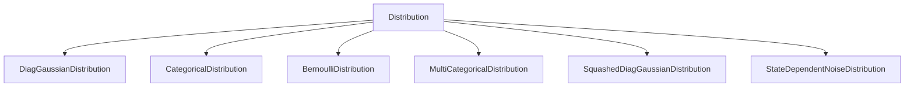
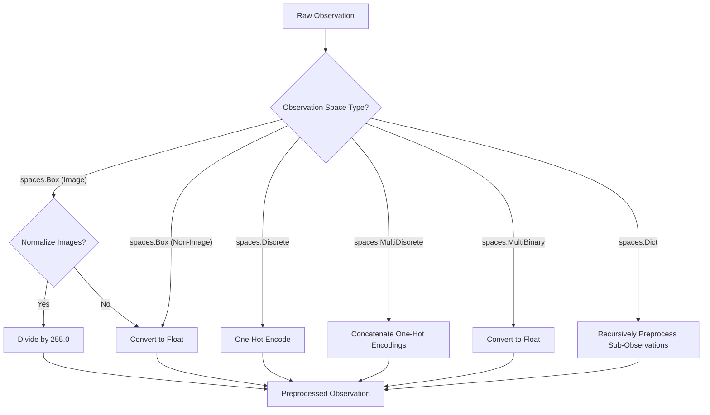

<!-- source: DeepWiki mcp.deepwiki.com · repo DLR-RM/stable-baselines3 · page 2.3 Probability Distributions & Preprocessing · fetched 2026-10-14 -->

# Probability Distributions & Preprocessing

<details>
<summary>Relevant source files</summary>

The following files were used as context for generating this wiki page:

- [stable_baselines3/common/distributions.py](stable_baselines3/common/distributions.py)
- [stable_baselines3/common/preprocessing.py](stable_baselines3/common/preprocessing.py)
- [tests/test_distributions.py](tests/test_distributions.py)
- [tests/test_preprocessing.py](tests/test_preprocessing.py)
- [tests/test_spaces.py](tests/test_spaces.py)

</details>


This page details the probability distributions used in Stable-Baselines3 for defining action spaces and the preprocessing steps applied to observations and actions. Understanding these components is crucial for comprehending how agents interact with environments and how their policies are structured.

## Action Distributions

Stable-Baselines3 implements several probability distributions to handle different types of action spaces, primarily continuous and discrete. These distributions are subclasses of the abstract base class `Distribution` [stable_baselines3/common/distributions.py:26-110](). Each distribution provides methods for creating its neural network components, setting its parameters, sampling actions, computing log probabilities, and calculating entropy.

### `Distribution` Abstract Base Class

The `Distribution` class [stable_baselines3/common/distributions.py:26-110]() defines the common interface for all action distributions.

```python
class Distribution(ABC):
    distribution: TorchDistribution | list[TorchDistribution]

    @abstractmethod
    def proba_distribution_net(self, *args, **kwargs) -> nn.Module | tuple[nn.Module, nn.Parameter]: ...

    @abstractmethod
    def proba_distribution(self: SelfDistribution, *args, **kwargs) -> SelfDistribution: ...

    @abstractmethod
    def log_prob(self, actions: th.Tensor) -> th.Tensor: ...

    @abstractmethod
    def entropy(self) -> th.Tensor | None: ...

    @abstractmethod
    def sample(self) -> th.Tensor: ...

    @abstractmethod
    def mode(self) -> th.Tensor: ...

    def get_actions(self, deterministic: bool = False) -> th.Tensor: ...

    @abstractmethod
    def actions_from_params(self, *args, **kwargs) -> th.Tensor: ...

    @abstractmethod
    def log_prob_from_params(self, *args, **kwargs) -> tuple[th.Tensor, th.Tensor]: ...
```

Key methods include:
*   `proba_distribution_net()`: Creates the PyTorch modules and parameters that define the distribution's output layer (e.g., mean and log standard deviation for Gaussian distributions).
*   `proba_distribution()`: Sets the internal `torch.distributions.Distribution` object based on the provided parameters.
*   `log_prob()`: Computes the log probability of given actions under the current distribution.
*   `entropy()`: Calculates the Shannon entropy of the distribution.
*   `sample()`: Draws a stochastic sample from the distribution.
*   `mode()`: Returns the most likely action (deterministic output).
*   `get_actions()`: A convenience method to get either a stochastic sample or the mode based on the `deterministic` flag [stable_baselines3/common/distributions.py:82-91]().

#### Diagram: `Distribution` Class Hierarchy


Sources: [stable_baselines3/common/distributions.py:26-110]()

### `DiagGaussianDistribution`

This distribution is used for continuous action spaces where actions are assumed to be independent, meaning the covariance matrix is diagonal.

*   **Action Space Type**: `gymnasium.spaces.Box`
*   **Implementation**: Uses `torch.distributions.Normal` [stable_baselines3/common/distributions.py:166]().
*   **Parameters**: The `proba_distribution_net` method [stable_baselines3/common/distributions.py:141-153]() creates a linear layer for the mean actions and a `nn.Parameter` for the log standard deviation. The standard deviation is shared across all actions by default, but can be made action-dependent.
*   **Sampling**: Uses the reparameterization trick (`.rsample()`) for sampling to allow gradients to flow through [stable_baselines3/common/distributions.py:185]().
*   **Log Probability/Entropy**: The `sum_independent_dims` helper function [stable_baselines3/common/distributions.py:112-124]() is used to sum the log probabilities or entropies across independent action dimensions.

Sources: [stable_baselines3/common/distributions.py:127-194]()

### `CategoricalDistribution`

This distribution is for discrete action spaces, where the agent chooses one action from a finite set.

*   **Action Space Type**: `gymnasium.spaces.Discrete`
*   **Implementation**: Uses `torch.distributions.Categorical`.
*   **Parameters**: `proba_distribution_net` creates a linear layer that outputs logits for each action [stable_baselines3/common/distributions.py:209-210]().
*   **Sampling**: Samples directly from the `Categorical` distribution [stable_baselines3/common/distributions.py:239]().
*   **Mode**: Returns the action with the highest logit [stable_baselines3/common/distributions.py:242]().

Sources: [stable_baselines3/common/distributions.py:197-256]()

### `BernoulliDistribution`

Used for binary action spaces, where each action dimension can be either 0 or 1.

*   **Action Space Type**: `gymnasium.spaces.MultiBinary`
*   **Implementation**: Uses `torch.distributions.Bernoulli`.
*   **Parameters**: `proba_distribution_net` creates a linear layer that outputs logits for each binary action [stable_baselines3/common/distributions.py:300-301]().
*   **Sampling**: Samples directly from the `Bernoulli` distribution [stable_baselines3/common/distributions.py:328]().
*   **Mode**: Returns 1 if the probability is >= 0.5, else 0 [stable_baselines3/common/distributions.py:331]().

Sources: [stable_baselines3/common/distributions.py:290-347]()

### `SquashedDiagGaussianDistribution`

This is a variant of the `DiagGaussianDistribution` where the output actions are squashed to be within a specific range (typically [-1, 1]) using a Tanh function. This is commonly used in algorithms like SAC.

*   **Action Space Type**: `gymnasium.spaces.Box` (continuous, typically [-1, 1])
*   **Implementation**: Extends `DiagGaussianDistribution` and applies a `TanhBijector` [stable_baselines3/common/distributions.py:400-401]() to the samples.
*   **Log Probability**: The log probability calculation accounts for the change of variables introduced by the Tanh squashing function [stable_baselines3/common/distributions.py:410-414]().
*   **Entropy**: The entropy for squashed Gaussian distributions does not have a simple analytical form and is often approximated or computed numerically [tests/test_distributions.py:113]().

Sources: [stable_baselines3/common/distributions.py:350-440](), [tests/test_distributions.py:26-38](), [tests/test_distributions.py:40-55]()

### `StateDependentNoiseDistribution`

This distribution is used for continuous action spaces with state-dependent exploration noise (gSDE). The standard deviation of the Gaussian distribution is a function of the state.

*   **Action Space Type**: `gymnasium.spaces.Box`
*   **Implementation**: Uses `torch.distributions.Normal`.
*   **Parameters**: `proba_distribution_net` creates a linear layer for the mean actions and a `nn.Parameter` for the log standard deviation, which is then modulated by the state [stable_baselines3/common/distributions.py:470-471]().
*   **Noise Sampling**: The noise weights are sampled and updated periodically [stable_baselines3/common/distributions.py:500-501]().

Sources: [stable_baselines3/common/distributions.py:443-550](), [tests/test_distributions.py:96-111]()

## Observation and Action Space Preprocessing

Stable-Baselines3 includes utilities to preprocess observations and determine the shapes of observation and action spaces, making them suitable for neural network inputs.

### `get_obs_shape`

This function determines the shape of an observation space, which is crucial for defining the input layers of neural networks.

*   For `spaces.Box`, it returns the `shape` attribute directly [stable_baselines3/common/preprocessing.py:151]().
*   For `spaces.Discrete`, it returns `(1,)` as it represents a single integer [stable_baselines3/common/preprocessing.py:154]().
*   For `spaces.MultiDiscrete`, it returns `(len(observation_space.nvec),)` [stable_baselines3/common/preprocessing.py:157]().
*   For `spaces.MultiBinary`, it returns the `shape` attribute [stable_baselines3/common/preprocessing.py:160]().
*   For `spaces.Dict`, it recursively calls `get_obs_shape` for each subspace [stable_baselines3/common/preprocessing.py:162]().

Sources: [stable_baselines3/common/preprocessing.py:142-167](), [tests/test_preprocessing.py:7-22]()

### `preprocess_obs`

This function transforms raw observations from the environment into a format suitable for neural network input.

*   **Image Normalization**: If an observation space is identified as an image (using `is_image_space` [stable_baselines3/common/preprocessing.py:26-68]()), its pixel values (assumed to be in [0, 255]) are normalized to [0, 1] by dividing by 255.0 [stable_baselines3/common/preprocessing.py:118-119]().
*   **Discrete Observations**: `spaces.Discrete` observations are converted into one-hot encoded vectors [stable_baselines3/common/preprocessing.py:122-124]().
*   **MultiDiscrete Observations**: `spaces.MultiDiscrete` observations are converted into a concatenated one-hot encoded vector for each sub-space [stable_baselines3/common/preprocessing.py:126-135]().
*   **MultiBinary Observations**: `spaces.MultiBinary` observations are converted to float tensors [stable_baselines3/common/preprocessing.py:137]().
*   **Dict Observations**: For `spaces.Dict`, it recursively preprocesses each sub-observation [stable_baselines3/common/preprocessing.py:107-113]().

Sources: [stable_baselines3/common/preprocessing.py:91-140](), [tests/test_preprocessing.py:31-65]()

#### Diagram: Observation Preprocessing Flow


Sources: [stable_baselines3/common/preprocessing.py:91-140]()

### `is_image_space` and `is_image_space_channels_first`

These helper functions are used to identify if an observation space represents an image and its channel order (channels-first or channels-last).

*   `is_image_space` [stable_baselines3/common/preprocessing.py:26-68]() checks if a `spaces.Box` has 3 dimensions, `uint8` dtype, and values in [0, 255]. It can also check the number of channels (1, 3, or 4).
*   `is_image_space_channels_first` [stable_baselines3/common/preprocessing.py:9-23]() determines the channel order by finding the smallest dimension. If the first dimension is the smallest, it's considered channels-first (CxHxW).

Sources: [stable_baselines3/common/preprocessing.py:9-68]()

### `maybe_transpose`

This function handles transposing image observations to a channels-first format (CxHxW) if they are initially channels-last (HxWxC), which is the expected format for PyTorch convolutions. It uses `VecTransposeImage.transpose_image` for the actual transposition [stable_baselines3/common/preprocessing.py:85]().

Sources: [stable_baselines3/common/preprocessing.py:71-88]()

---

