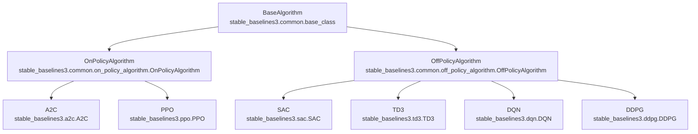
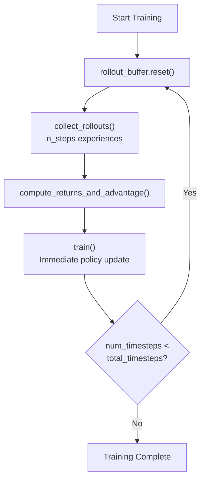
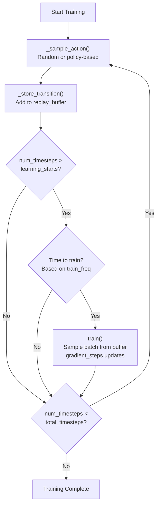

<!-- source: DeepWiki mcp.deepwiki.com · repo DLR-RM/stable-baselines3 · page 3 Algorithms · fetched 2026-10-14 -->

# Algorithms

<details>
<summary>Relevant source files</summary>

The following files were used as context for generating this wiki page:

- [stable_baselines3/a2c/a2c.py](stable_baselines3/a2c/a2c.py)
- [stable_baselines3/ppo/ppo.py](stable_baselines3/ppo/ppo.py)
- [stable_baselines3/sac/sac.py](stable_baselines3/sac/sac.py)
- [stable_baselines3/td3/td3.py](stable_baselines3/td3/td3.py)

</details>


This document provides an overview of the reinforcement learning algorithms implemented in Stable-Baselines3 and their categorization into on-policy and off-policy approaches. It covers the base classes that define common behavior and the fundamental differences between algorithm types.

For detailed implementation of specific on-policy algorithms like PPO and A2C, see [On-Policy Algorithms](#3.1). For off-policy algorithms like SAC, TD3, DQN, and DDPG, see [Off-Policy Algorithms](#3.2).

## Algorithm Hierarchy and Base Classes

Stable-Baselines3 organizes its reinforcement learning algorithms using a clear inheritance hierarchy with two main categories: on-policy and off-policy algorithms. Both inherit from a common `BaseAlgorithm` class that provides shared functionality.

### Algorithm Inheritance Structure



Sources: [stable_baselines3/common/on_policy_algorithm.py:21-27](), [stable_baselines3/common/off_policy_algorithm.py:27-29]()

## Algorithm Categorization

### On-Policy Algorithms

On-policy algorithms learn from experiences collected using the current policy. They typically collect a batch of experiences, use them immediately for training, and then discard them. The `OnPolicyAlgorithm` class implements this pattern. Examples include `PPO` [stable_baselines3/ppo/ppo.py:18]() and `A2C` [stable_baselines3/a2c/a2c.py:16]().

**Key characteristics:**
- Use `RolloutBuffer` for temporary experience storage
- Collect exactly `n_steps` experiences per environment before training
- Train immediately after collection, then reset the buffer
- Support Generalized Advantage Estimation (GAE) with `gae_lambda`

For a detailed discussion of PPO and A2C, including their loss functions, GAE, and clipping mechanisms, see [On-Policy Algorithms](#3.1).

### Off-Policy Algorithms

Off-policy algorithms can learn from experiences collected using any policy, including older versions of the current policy or even random actions. The `OffPolicyAlgorithm` class implements replay buffer functionality for this purpose. Examples include `SAC` [stable_baselines3/sac/sac.py:19]() and `TD3` [stable_baselines3/td3/td3.py:19]().

**Key characteristics:**
- Use `ReplayBuffer` for persistent experience storage  
- Support configurable `buffer_size` (typically 1M experiences)
- Include warmup phase with `learning_starts` random actions
- Train periodically based on `train_freq` parameter
- Support action noise for exploration

For a detailed discussion of SAC, TD3, DQN, and DDPG, including target networks, entropy tuning, and exploration schedules, see [Off-Policy Algorithms](#3.2).

## Core Algorithm Parameters

| Parameter | On-Policy | Off-Policy | Purpose |
|-----------|-----------|------------|---------|
| `n_steps` | ✓ | ✗ | Number of steps per rollout before training |
| `buffer_size` | ✗ | ✓ | Maximum size of replay buffer |
| `learning_starts` | ✗ | ✓ | Steps before learning begins (warmup) |
| `batch_size` | ✓ (PPO) | ✓ | Minibatch size for gradient updates |
| `train_freq` | ✗ | ✓ | Training frequency (steps or episodes) |
| `tau` | ✗ | ✓ | Soft update coefficient for target networks |
| `gae_lambda` | ✓ | ✗ | GAE lambda parameter for advantage estimation |
| `ent_coef` | ✓ | ✓ (SAC) | Entropy coefficient for policy loss |
| `vf_coef` | ✓ | ✗ | Value function coefficient for loss |
| `gamma` | ✓ | ✓ | Discount factor |

Sources: [stable_baselines3/common/on_policy_algorithm.py:61-85](), [stable_baselines3/common/off_policy_algorithm.py:81-111](), [stable_baselines3/ppo/ppo.py:86-87](), [stable_baselines3/sac/sac.py:100-101]()

## Training Flow Differences

### On-Policy Training Flow



Sources: [stable_baselines3/common/on_policy_algorithm.py:300-341]()

### Off-Policy Training Flow



Sources: [stable_baselines3/common/off_policy_algorithm.py:312-359]()

## Experience Management

### RolloutBuffer vs ReplayBuffer

The choice between `RolloutBuffer` and `ReplayBuffer` is fundamental to the algorithm design:

**RolloutBuffer (On-Policy):**
- Stores exactly `n_steps * n_envs` experiences
- Computes returns and advantages using GAE
- Data is consumed once and discarded
- Implemented in `stable_baselines3.common.buffers.RolloutBuffer`
- Used by `PPO` [stable_baselines3/ppo/ppo.py:98]() and `A2C` [stable_baselines3/a2c/a2c.py:81]()

**ReplayBuffer (Off-Policy):**
- Stores up to `buffer_size` experiences (circular buffer)
- Supports random sampling for breaking temporal correlations  
- Data can be reused multiple times
- Variants include `DictReplayBuffer`, `NStepReplayBuffer`, `HerReplayBuffer`
- Used by `SAC` [stable_baselines3/sac/sac.py:107]() and `TD3` [stable_baselines3/td3/td3.py:96]()

Sources: [stable_baselines3/common/on_policy_algorithm.py:115-134](), [stable_baselines3/common/off_policy_algorithm.py:174-204]()

## Action Selection and Exploration

### On-Policy Action Selection

On-policy algorithms sample actions directly from the current policy distribution:

```python
# From collect_rollouts method
with th.no_grad():
    obs_tensor = obs_as_tensor(self._last_obs, self.device)
    actions, values, log_probs = self.policy(obs_tensor)
```

Sources: [stable_baselines3/common/on_policy_algorithm.py:199-203]()

### Off-Policy Action Selection  

Off-policy algorithms support multiple exploration strategies through the `_sample_action` method:

- **Warmup phase**: Random actions when `num_timesteps < learning_starts`
- **Policy-based**: Actions from current policy (potentially stochastic)
- **Action noise**: Additional noise for deterministic policies (TD3, DDPG)
- **State-dependent exploration**: Optional SDE support, e.g., `use_sde` in `SAC` [stable_baselines3/sac/sac.py:114]() and `PPO` [stable_baselines3/ppo/ppo.py:96]().

Sources: [stable_baselines3/common/off_policy_algorithm.py:367-414]()

---

