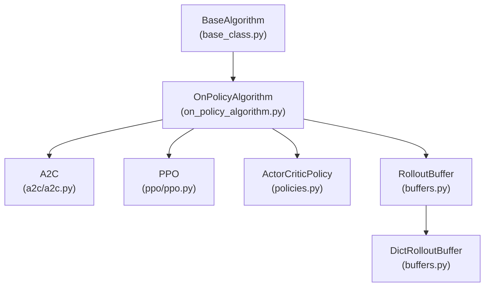
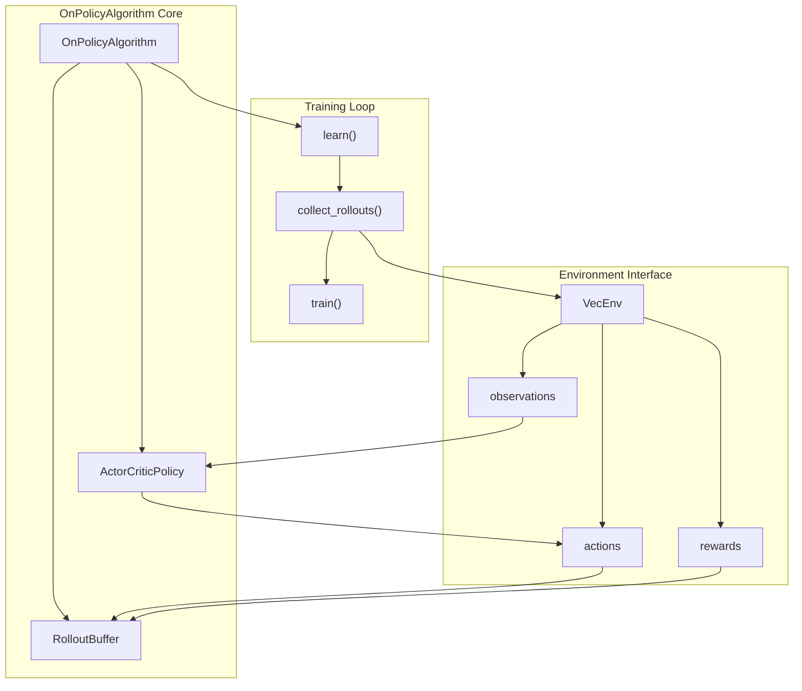
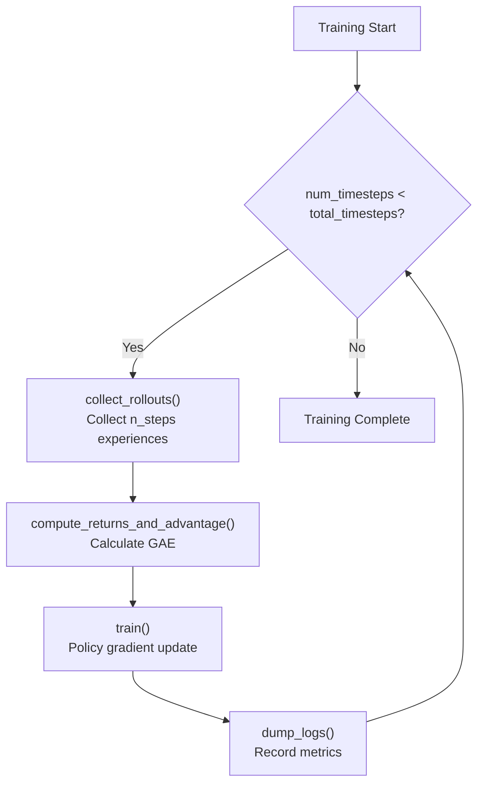
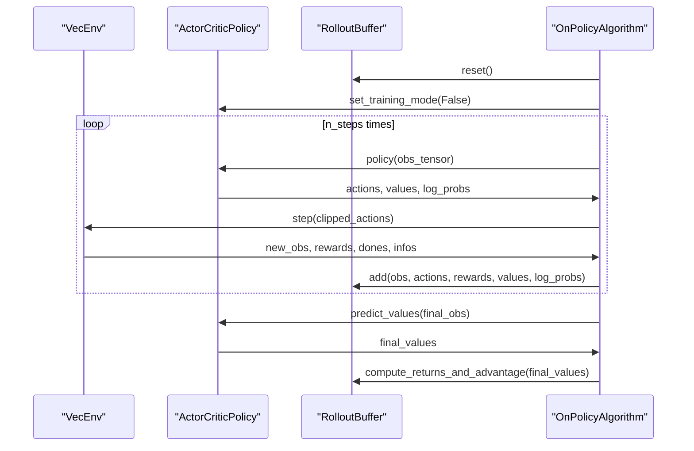
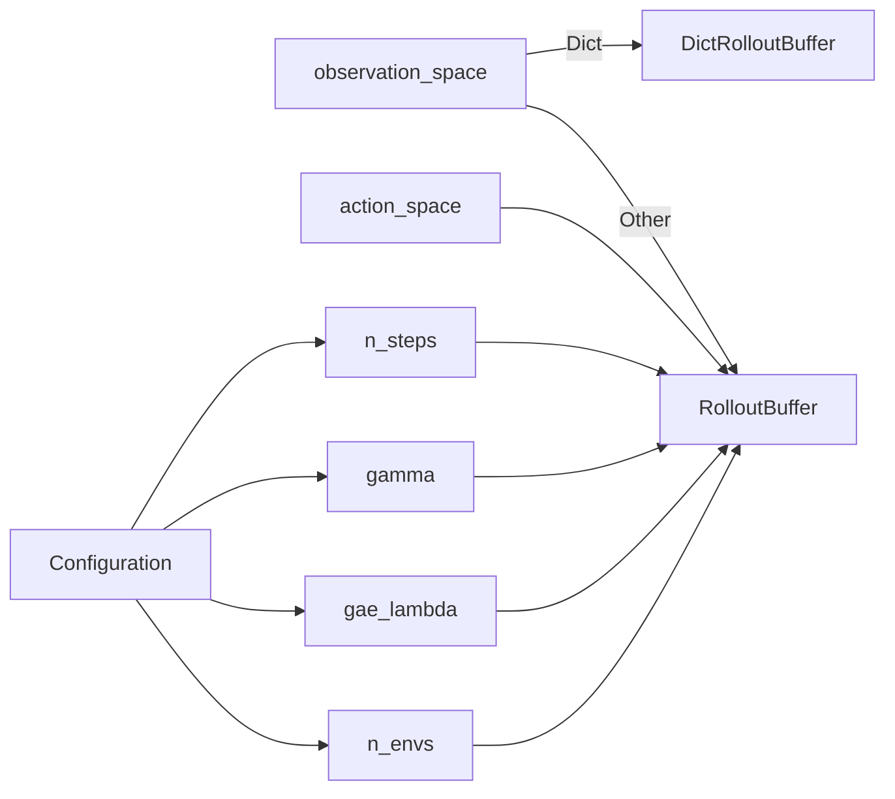
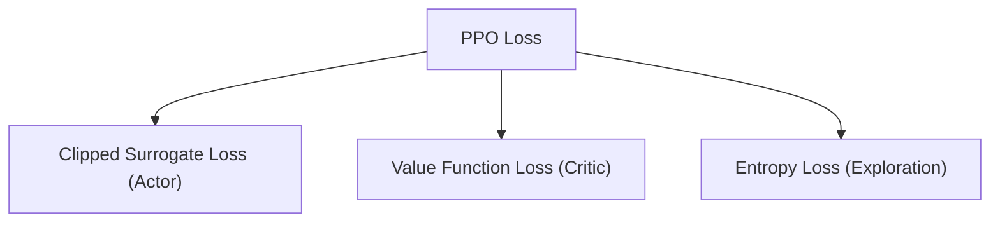
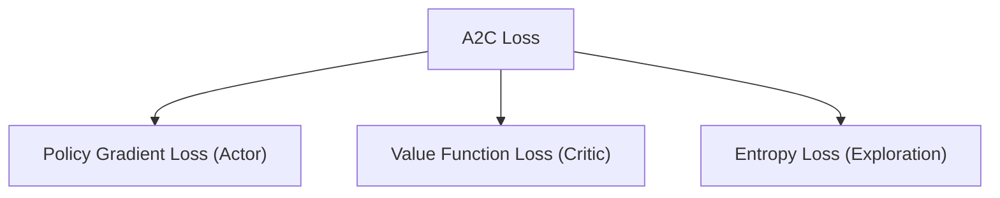

<!-- source: DeepWiki mcp.deepwiki.com · repo DLR-RM/stable-baselines3 · page 3.1 On-Policy Algorithms · fetched 2026-10-14 -->

# On-Policy Algorithms

<details>
<summary>Relevant source files</summary>

The following files were used as context for generating this wiki page:

- [docs/modules/a2c.md](docs/modules/a2c.md)
- [docs/modules/ppo.md](docs/modules/ppo.md)
- [stable_baselines3/a2c/a2c.py](stable_baselines3/a2c/a2c.py)
- [stable_baselines3/common/vec_env/vec_video_recorder.py](stable_baselines3/common/vec_env/vec_video_recorder.py)
- [stable_baselines3/ppo/ppo.py](stable_baselines3/ppo/ppo.py)
- [tests/test_cnn.py](tests/test_cnn.py)
- [tests/test_dict_env.py](tests/test_dict_env.py)
- [tests/test_gae.py](tests/test_gae.py)

</details>


This page covers on-policy reinforcement learning algorithms in Stable-Baselines3, including A2C (Advantage Actor-Critic) and PPO (Proximal Policy Optimization). On-policy algorithms learn directly from the experiences generated by the current policy, requiring fresh data collection for each policy update.

For off-policy algorithms that can reuse past experiences, see [Off-Policy Algorithms](#3.2). For general algorithm concepts and the overall algorithm architecture, see [Algorithms](#3).

## Overview

On-policy algorithms in Stable-Baselines3 share a common architectural foundation through the `OnPolicyAlgorithm` base class. These algorithms collect a fixed number of environment steps using the current policy, then update the policy using this freshly collected data.

### Key Characteristics

| Characteristic | Description |
|---------------|-------------|
| **Data Usage** | Uses only fresh experiences from current policy |
| **Sample Efficiency** | Generally less sample efficient than off-policy methods |
| **Stability** | More stable training, less prone to divergence |
| **Memory Usage** | Lower memory requirements (no replay buffer) |
| **Parallelization** | Naturally supports multiple parallel environments |

### Supported Algorithms

- **A2C (Advantage Actor-Critic)**: Synchronous version of A3C with advantage estimation
- **PPO (Proximal Policy Optimization)**: Clip-based policy optimization with improved stability

## Architecture Overview

The on-policy algorithm system is built around the `OnPolicyAlgorithm` base class and its associated components.

### Class Hierarchy



Sources: [stable_baselines3/common/on_policy_algorithm.py:21-342]()

### Core Components



Sources: [stable_baselines3/common/on_policy_algorithm.py:162-268](), [stable_baselines3/common/on_policy_algorithm.py:300-341]()

## Data Flow and Training Process

On-policy algorithms follow a structured collect-then-train cycle that ensures policy updates use only current policy data.

### Training Cycle



Sources: [stable_baselines3/common/on_policy_algorithm.py:300-341]()

### Rollout Collection Process



Sources: [stable_baselines3/common/on_policy_algorithm.py:162-268]()

## Key Parameters and Configuration

On-policy algorithms are configured through several critical parameters that control the learning process.

### Essential Parameters

| Parameter | Type | Description | Default |
|-----------|------|-------------|---------|
| `n_steps` | `int` | Steps per environment per update | Algorithm-specific |
| `gamma` | `float` | Discount factor for future rewards | 0.99 |
| `gae_lambda` | `float` | GAE lambda parameter | Algorithm-specific |
| `ent_coef` | `float` | Entropy coefficient for exploration | Algorithm-specific |
| `vf_coef` | `float` | Value function loss coefficient | Algorithm-specific |
| `max_grad_norm` | `float` | Maximum gradient norm for clipping | Algorithm-specific |

Sources: [stable_baselines3/common/on_policy_algorithm.py:61-110]()

### Buffer Configuration



Sources: [stable_baselines3/common/on_policy_algorithm.py:115-138]()

## Implementation Details

### Model Setup Process

The `_setup_model` method initializes the core components:

1. **Learning Rate Schedule**: Configures learning rate scheduling via `_setup_lr_schedule()`
2. **Random Seed**: Sets random seed for reproducibility via `set_random_seed()`
3. **Buffer Selection**: Chooses appropriate buffer class based on observation space type
4. **Buffer Initialization**: Creates buffer with algorithm-specific parameters
5. **Policy Creation**: Instantiates `ActorCriticPolicy` with environment spaces
6. **Device Transfer**: Moves policy to specified device (CPU/GPU)

Sources: [stable_baselines3/common/on_policy_algorithm.py:115-141]()

### Gradient Clipping and Optimization

On-policy algorithms implement gradient clipping through the `max_grad_norm` parameter to stabilize training:

```python
# Applied in concrete algorithm implementations
torch.nn.utils.clip_grad_norm_(self.policy.parameters(), self.max_grad_norm)
```

Sources: [stable_baselines3/ppo/ppo.py:95](), [stable_baselines3/a2c/a2c.py:76]()

### Action Space Handling

The algorithm handles different action spaces during rollout collection:

- **Continuous (Box)**: Actions are clipped to environment bounds or unscaled if using squashed output
- **Discrete**: Actions are reshaped to column vector format for buffer storage

Sources: [stable_baselines3/common/on_policy_algorithm.py:208-232]()

### Terminal State Bootstrapping

On-policy algorithms handle episode termination by bootstrapping value estimates for timeout scenarios:

```python
# When episode ends due to time limit, not terminal state
if done and infos[idx].get("TimeLimit.truncated", False):
    terminal_value = self.policy.predict_values(terminal_obs)[0]
    rewards[idx] += self.gamma * terminal_value
```

This ensures proper value estimation when episodes are truncated rather than naturally terminated.

Sources: [stable_baselines3/common/on_policy_algorithm.py:234-245]()

### Multi-Environment Support

On-policy algorithms natively support vectorized environments through the `VecEnv` interface, enabling efficient parallel data collection across multiple environment instances.

Sources: [stable_baselines3/common/on_policy_algorithm.py:162-268]()

## Proximal Policy Optimization (PPO)

PPO is an on-policy algorithm that aims to achieve the data efficiency and reliable performance of Trust Region Policy Optimization (TRPO) while being much simpler to implement. It uses a clipped surrogate objective function to limit the policy update size, preventing large, destabilizing changes.

### PPO Loss Function

The PPO objective function is a combination of three terms: a clipped surrogate objective for the actor, a value function loss for the critic, and an entropy bonus for exploration.



The total loss optimized by PPO is:
$L^{PPO}(\theta) = E_t[\min(r_t(\theta)\hat{A}_t, \text{clip}(r_t(\theta), 1-\epsilon, 1+\epsilon)\hat{A}_t)] - c_1 L^{VF}_t(\theta) + c_2 S_t(\theta)$

Where:
- $r_t(\theta) = \frac{\pi_\theta(a_t|s_t)}{\pi_{\theta_{old}}(a_t|s_t)}$ is the ratio of the new policy probability to the old policy probability.
- $\hat{A}_t$ is the advantage estimate at time $t$.
- $\epsilon$ is the clipping parameter (`clip_range`).
- $L^{VF}_t(\theta)$ is the value function loss.
- $S_t(\theta)$ is the entropy bonus.
- $c_1$ (`vf_coef`) and $c_2$ (`ent_coef`) are coefficients for the value function and entropy terms, respectively.

#### Clipped Surrogate Objective

The core of PPO is the clipped surrogate objective, which prevents the new policy from deviating too much from the old policy.
The term $\min(r_t(\theta)\hat{A}_t, \text{clip}(r_t(\theta), 1-\epsilon, 1+\epsilon)\hat{A}_t)$ ensures that the policy update is bounded. If the advantage is positive, the policy is encouraged to increase the probability of that action, but only up to $1+\epsilon$ times the old probability. If the advantage is negative, the policy is encouraged to decrease the probability, but only down to $1-\epsilon$ times the old probability.

The implementation calculates the ratio `ratio = th.exp(log_prob - rollout_data.old_log_prob)` and then computes the two terms for the min operation: `pg_losses1 = advantages * ratio` and `pg_losses2 = advantages * th.clamp(ratio, 1 - clip_fraction, 1 + clip_fraction)`. The policy loss is then `(-th.min(pg_losses1, pg_losses2)).mean()`.
Sources: [stable_baselines3/ppo/ppo.py:249-257]()

#### Value Function Loss

The value function loss is typically a Mean Squared Error (MSE) between the predicted value and the target value (returns).
$L^{VF}_t(\theta) = (V_\theta(s_t) - V^{target}_t)^2$

The implementation uses `F.mse_loss(values, rollout_data.returns)`.
Sources: [stable_baselines3/ppo/ppo.py:260]()

PPO also supports clipping the value function, controlled by `clip_range_vf`. If enabled, the value function loss is also clipped to prevent large changes.
Sources: [stable_baselines3/ppo/ppo.py:262-270]()

#### Entropy Loss

An entropy bonus $S_t(\theta)$ is added to encourage exploration. This is the negative of the entropy of the policy distribution.
The implementation uses `entropy_loss = -entropy.mean()`.
Sources: [stable_baselines3/ppo/ppo.py:272]()

### Generalized Advantage Estimation (GAE)

PPO uses Generalized Advantage Estimation (GAE) to compute advantage estimates. GAE balances the bias-variance trade-off in advantage estimation using the `gae_lambda` parameter.
The advantages are computed in the `RolloutBuffer.compute_returns_and_advantage` method.
Sources: [stable_baselines3/common/buffers.py:300-340]()

The formula for GAE is:
$\hat{A}_t = \delta_t + (\gamma\lambda)\delta_{t+1} + (\gamma\lambda)^2\delta_{t+2} + \dots$
where $\delta_t = R_t + \gamma V(s_{t+1}) - V(s_t)$ is the TD error.

A `CheckGAECallback` is used in tests to verify the correctness of GAE computation.
Sources: [tests/test_gae.py:66-103]()

### PPO Hyperparameters

Key hyperparameters for PPO include:
- `n_steps`: Number of steps to collect per environment before updating.
- `batch_size`: Minibatch size for optimization.
- `n_epochs`: Number of passes over the collected data during optimization.
- `gamma`: Discount factor.
- `gae_lambda`: GAE parameter.
- `clip_range`: Clipping parameter for the policy objective.
- `clip_range_vf`: Clipping parameter for the value function (optional).
- `ent_coef`: Entropy coefficient.
- `vf_coef`: Value function coefficient.
- `max_grad_norm`: Maximum gradient norm for clipping.
- `normalize_advantage`: Whether to normalize advantages.
- `target_kl`: Optional KL divergence limit to prevent large policy updates.

Sources: [stable_baselines3/ppo/ppo.py:84-108]()

### PPO Class (`PPO`)

The `PPO` class inherits from `OnPolicyAlgorithm` and implements the PPO-specific training logic.
Sources: [stable_baselines3/ppo/ppo.py:18]()

```python
class PPO(OnPolicyAlgorithm):
    # ...
    def __init__(
        self,
        policy: str | type[ActorCriticPolicy],
        env: GymEnv | str,
        learning_rate: float | Schedule = 3e-4,
        n_steps: int = 2048,
        batch_size: int = 64,
        n_epochs: int = 10,
        gamma: float = 0.99,
        gae_lambda: float = 0.95,
        clip_range: float | Schedule = 0.2,
        clip_range_vf: float | Schedule | None = None,
        normalize_advantage: bool = True,
        ent_coef: float = 0.0,
        vf_coef: float = 0.5,
        max_grad_norm: float = 0.5,
        use_sde: bool = False,
        sde_sample_freq: int = -1,
        rollout_buffer_class: type[RolloutBuffer] | None = None,
        rollout_buffer_kwargs: dict[str, Any] | None = None,
        target_kl: float | None = None,
        stats_window_size: int = 100,
        tensorboard_log: str | None = None,
        policy_kwargs: dict[str, Any] | None = None,
        verbose: int = 0,
        seed: int | None = None,
        device: th.device | str = "auto",
        _init_setup_model: bool = True,
    ):
        super().__init__(
            policy,
            env,
            learning_rate=learning_rate,
            n_steps=n_steps,
            gamma=gamma,
            gae_lambda=gae_lambda,
            ent_coef=ent_coef,
            vf_coef=vf_coef,
            max_grad_norm=max_grad_norm,
            use_sde=use_sde,
            sde_sample_freq=sde_sample_freq,
            rollout_buffer_class=rollout_buffer_class,
            rollout_buffer_kwargs=rollout_buffer_kwargs,
            stats_window_size=stats_window_size,
            tensorboard_log=tensorboard_log,
            policy_kwargs=policy_kwargs,
            verbose=verbose,
            device=device,
            seed=seed,
            _init_setup_model=False,
            supported_action_spaces=(
                spaces.Box,
                spaces.Discrete,
                spaces.MultiDiscrete,
                spaces.MultiBinary,
            ),
        )
        # ...
```
Sources: [stable_baselines3/ppo/ppo.py:18-136]()

## Advantage Actor-Critic (A2C)

A2C is a synchronous, deterministic variant of A3C (Asynchronous Advantage Actor-Critic). It uses a single worker to collect experiences and update the policy, making it simpler than A3C while still leveraging advantage estimation.

### A2C Loss Function

The A2C loss function is similar to PPO, combining a policy gradient loss, a value function loss, and an entropy bonus. However, it does not use the clipping mechanism of PPO.



The total loss optimized by A2C is:
$L^{A2C}(\theta) = -E_t[\log \pi_\theta(a_t|s_t)\hat{A}_t] + c_1 L^{VF}_t(\theta) - c_2 S_t(\theta)$

Where:
- $\log \pi_\theta(a_t|s_t)$ is the log probability of the action taken.
- $\hat{A}_t$ is the advantage estimate at time $t$.
- $L^{VF}_t(\theta)$ is the value function loss.
- $S_t(\theta)$ is the entropy bonus.
- $c_1$ (`vf_coef`) and $c_2$ (`ent_coef`) are coefficients for the value function and entropy terms, respectively.

#### Policy Gradient Loss

The policy gradient loss directly maximizes the expected advantage.
The implementation calculates `policy_loss = -(advantages * log_prob).mean()`.
Sources: [stable_baselines3/a2c/a2c.py:154]()

#### Value Function Loss

Similar to PPO, the value function loss is typically an MSE between the predicted value and the target value (returns).
The implementation uses `value_loss = F.mse_loss(values, rollout_data.returns)`.
Sources: [stable_baselines3/a2c/a2c.py:157]()

#### Entropy Loss

An entropy bonus $S_t(\theta)$ is added to encourage exploration.
The implementation uses `entropy_loss = -entropy.mean()`.
Sources: [stable_baselines3/a2c/a2c.py:158]()

### Generalized Advantage Estimation (GAE)

A2C also uses GAE for advantage estimation, similar to PPO, with the `gae_lambda` parameter.
Sources: [stable_baselines3/common/buffers.py:300-340]()

### A2C Hyperparameters

Key hyperparameters for A2C include:
- `n_steps`: Number of steps to collect per environment before updating.
- `gamma`: Discount factor.
- `gae_lambda`: GAE parameter.
- `ent_coef`: Entropy coefficient.
- `vf_coef`: Value function coefficient.
- `max_grad_norm`: Maximum gradient norm for clipping.
- `rms_prop_eps`: Epsilon for the RMSProp optimizer (if `use_rms_prop` is True).
- `use_rms_prop`: Whether to use RMSProp or Adam as the optimizer.
- `normalize_advantage`: Whether to normalize advantages.

Sources: [stable_baselines3/a2c/a2c.py:70-90]()

### A2C Class (`A2C`)

The `A2C` class inherits from `OnPolicyAlgorithm` and implements the A2C-specific training logic.
Sources: [stable_baselines3/a2c/a2c.py:16]()

```python
class A2C(OnPolicyAlgorithm):
    # ...
    def __init__(
        self,
        policy: str | type[ActorCriticPolicy],
        env: GymEnv | str,
        learning_rate: float | Schedule = 7e-4,
        n_steps: int = 5,
        gamma: float = 0.99,
        gae_lambda: float = 1.0,
        ent_coef: float = 0.0,
        vf_coef: float = 0.5,
        max_grad_norm: float = 0.5,
        rms_prop_eps: float = 1e-5,
        use_rms_prop: bool = True,
        use_sde: bool = False,
        sde_sample_freq: int = -1,
        rollout_buffer_class: type[RolloutBuffer] | None = None,
        rollout_buffer_kwargs: dict[str, Any] | None = None,
        normalize_advantage: bool = False,
        stats_window_size: int = 100,
        tensorboard_log: str | None = None,
        policy_kwargs: dict[str, Any] | None = None,
        verbose: int = 0,
        seed: int | None = None,
        device: th.device | str = "auto",
        _init_setup_model: bool = True,
    ):
        super().__init__(
            policy,
            env,
            learning_rate=learning_rate,
            n_steps=n_steps,
            gamma=gamma,
            gae_lambda=gae_lambda,
            ent_coef=ent_coef,
            vf_coef=vf_coef,
            max_grad_norm=max_grad_norm,
            use_sde=use_sde,
            sde_sample_freq=sde_sample_freq,
            rollout_buffer_class=rollout_buffer_class,
            rollout_buffer_kwargs=rollout_buffer_kwargs,
            stats_window_size=stats_window_size,
            tensorboard_log=tensorboard_log,
            policy_kwargs=policy_kwargs,
            verbose=verbose,
            device=device,
            seed=seed,
            _init_setup_model=False,
            supported_action_spaces=(
                spaces.Box,
                spaces.Discrete,
                spaces.MultiDiscrete,
                spaces.MultiBinary,
            ),
        )
        # ...
```
Sources: [stable_baselines3/a2c/a2c.py:16-119]()

---

