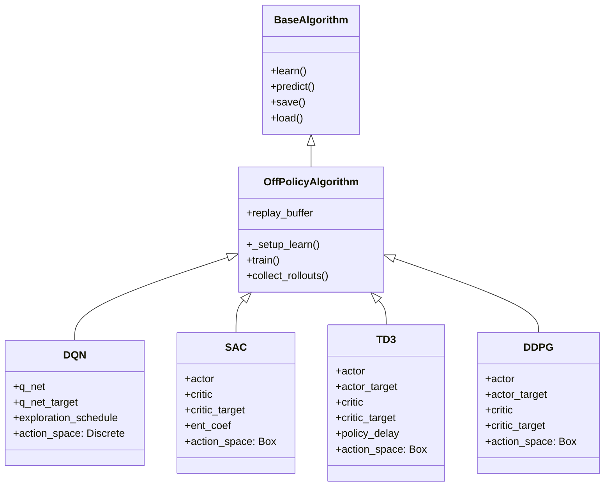
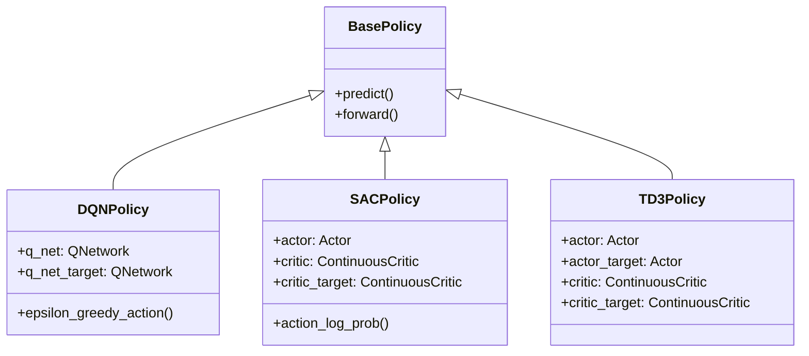

<!-- source: DeepWiki mcp.deepwiki.com · repo DLR-RM/stable-baselines3 · page 3.2 Off-Policy Algorithms · fetched 2026-10-14 -->

# Off-Policy Algorithms

<details>
<summary>Relevant source files</summary>

The following files were used as context for generating this wiki page:

- [docs/modules/dqn.md](docs/modules/dqn.md)
- [docs/modules/sac.md](docs/modules/sac.md)
- [docs/modules/td3.md](docs/modules/td3.md)
- [stable_baselines3/ddpg/ddpg.py](stable_baselines3/ddpg/ddpg.py)
- [stable_baselines3/dqn/dqn.py](stable_baselines3/dqn/dqn.py)
- [stable_baselines3/sac/sac.py](stable_baselines3/sac/sac.py)
- [stable_baselines3/td3/td3.py](stable_baselines3/td3/td3.py)

</details>


## Purpose and Scope

This document provides a detailed technical overview of the off-policy reinforcement learning algorithms implemented in Stable Baselines3. Off-policy algorithms are characterized by their ability to learn from experiences that were not necessarily generated by the current policy, making them generally more sample-efficient than on-policy methods. For information about on-policy algorithms like PPO and A2C, see [On-Policy Algorithms](#3.1).

## Off-Policy Algorithm Hierarchy

In Stable Baselines3, all off-policy algorithms inherit from a common `OffPolicyAlgorithm` base class, which itself inherits from the `BaseAlgorithm` class. This hierarchy provides shared functionality while allowing for algorithm-specific implementations.

### Key Off-Policy Algorithms



Sources: [stable_baselines3/dqn/dqn.py:19-65](), [stable_baselines3/sac/sac.py:19-79](), [stable_baselines3/td3/td3.py:19-67]()

## Core Components of Off-Policy Learning

Off-policy algorithms in Stable Baselines3 share several key components that enable their functionality:

```mermaid
flowchart TD
    subgraph "Off-Policy Algorithm"
        Policy["Policy Networks"]
        ReplayBuffer["Replay Buffer"]
        ExplStrat["Exploration Strategy"]
        Training["Training Process"]
    end
    
    Environment["Environment"] --> |"States, Rewards"| Off-Policy Algorithm
    Off-Policy Algorithm --> |"Actions"| Environment
    
    ReplayBuffer --> |"Sample Transitions"| Training
    Training --> |"Update"| Policy
    ExplStrat --> |"Introduce Randomness"| Policy
    Policy --> |"Generate Actions"| Environment
```

Sources: [stable_baselines3/dqn/dqn.py:184-226](), [stable_baselines3/sac/sac.py:199-297](), [stable_baselines3/td3/td3.py:154-211]()

### Replay Buffer

All off-policy algorithms use a replay buffer to store and sample experiences. This buffer allows these algorithms to:

1. Reuse past experiences for multiple updates
2. Break temporal correlations by sampling randomly
3. Improve sample efficiency

Unlike on-policy methods that discard experiences after each update, off-policy algorithms can learn from data collected by any policy, including past versions of the policy.

### Target Networks

Target networks are separate copies of the main networks that are updated more slowly to stabilize learning. All off-policy algorithms in SB3 implement some form of target network:

- DQN: Target Q-network
- SAC: Target critic networks
- TD3: Target actor and critic networks

## Algorithm Implementations

### DQN (Deep Q-Network)

DQN implements Q-learning with deep neural networks and several stabilizing techniques.

#### Key Components
- Q-Network: Predicts action values for each discrete action
- Target Q-Network: Slowly updated copy of the Q-Network for stable learning
- Epsilon-greedy exploration: Balances exploration and exploitation

#### Implementation Details
- Action space: Only supports `Discrete` action spaces [stable_baselines3/dqn/dqn.py:132]()
- Exploration: Uses epsilon-greedy with a decaying schedule, managed by `exploration_schedule` [stable_baselines3/dqn/dqn.py:75]()
- Update mechanism: Updates target network using polyak averaging with parameter `tau` [stable_baselines3/dqn/dqn.py:88]()

```python
# Key DQN hyperparameters and their defaults
learning_rate = 1e-4
buffer_size = 1_000_000  # 1e6
learning_starts = 100
batch_size = 32
tau = 1.0  # Hard update by default
gamma = 0.99
train_freq = 4
gradient_steps = 1
target_update_interval = 10000
exploration_fraction = 0.1
exploration_initial_eps = 1.0
exploration_final_eps = 0.05
```

Sources: [stable_baselines3/dqn/dqn.py:76-103](), [stable_baselines3/dqn/dqn.py:184-226]()

### SAC (Soft Actor-Critic)

SAC is an entropy-regularized actor-critic algorithm designed for continuous control.

#### Key Components
- Actor (Policy) Network: Outputs actions with a probabilistic policy
- Critic Networks (Twin Q-functions): Estimate action values
- Entropy regularization: Encourages exploration through policy entropy

#### Implementation Details
- Action space: Only supports `Box` (continuous) action spaces [stable_baselines3/sac/sac.py:134]()
- Entropy coefficient: Can be fixed or automatically adjusted via `ent_coef` [stable_baselines3/sac/sac.py:111]()
- Optimization: Uses separate optimizers for actor, critic, and optionally entropy coefficient
- Update mechanism: Soft updates with parameter `tau` [stable_baselines3/sac/sac.py:102]()

```python
# Key SAC hyperparameters and their defaults
learning_rate = 3e-4
buffer_size = 1_000_000  # 1e6
learning_starts = 100
batch_size = 256
tau = 0.005
gamma = 0.99
train_freq = 1
gradient_steps = 1
ent_coef = "auto"  # Automatically adjust entropy coefficient
target_update_interval = 1
```

Sources: [stable_baselines3/sac/sac.py:90-119](), [stable_baselines3/sac/sac.py:199-297]()

### TD3 (Twin Delayed DDPG)

TD3 is an improvement over DDPG, addressing function approximation errors through several techniques.

#### Key Components
- Actor Network: Deterministic policy that outputs actions
- Twin Critic Networks: Two Q-functions to reduce overestimation bias
- Target Actor and Critics: Slowly updated copies for stability
- Delayed policy updates: Updates actor less frequently than critics

#### Implementation Details
- Action space: Only supports `Box` (continuous) action spaces [stable_baselines3/td3/td3.py:134]()
- Target policy noise: Adds noise to target actions for smoothing, controlled by `target_policy_noise` and `target_noise_clip` [stable_baselines3/td3/td3.py:139-140]()
- Policy delay: Updates actor and target networks every `policy_delay` steps [stable_baselines3/td3/td3.py:138]()
- Twin critics: Uses minimum of both critics to reduce overestimation

```python
# Key TD3 hyperparameters and their defaults
learning_rate = 1e-3
buffer_size = 1_000_000  # 1e6
learning_starts = 100
batch_size = 256
tau = 0.005
gamma = 0.99
train_freq = 1
gradient_steps = 1
policy_delay = 2
target_policy_noise = 0.2
target_noise_clip = 0.5
```

Sources: [stable_baselines3/td3/td3.py:79-105](), [stable_baselines3/td3/td3.py:154-211]()

### DDPG (Deep Deterministic Policy Gradient)

DDPG is a deterministic policy gradient algorithm for continuous control tasks. It is implemented as a special case of TD3 in Stable Baselines3.

#### Key Components
- Similar structure to TD3 but with a single critic network. This is achieved by setting `n_critics=1` in `policy_kwargs` [stable_baselines3/ddpg/ddpg.py:115]().
- Action noise instead of parameter space noise for exploration.
- Removes TD3's specific tricks like policy delay, target noise clipping, and target policy noise by setting `policy_delay=1`, `target_noise_clip=0.0`, and `target_policy_noise=0.1` during initialization [stable_baselines3/ddpg/ddpg.py:107-109]().

## Training Process Comparison

The table below summarizes the key differences in the training processes of the off-policy algorithms:

| Feature | DQN | SAC | TD3 |
|---------|-----|-----|-----|
| Action Space | Discrete | Continuous | Continuous |
| Policy Type | Value-based (Q-network) | Stochastic | Deterministic |
| Target Update | Hard update by default (τ=1.0) | Soft update (τ=0.005) | Soft update (τ=0.005) |
| Exploration | Epsilon-greedy | Entropy maximization | Action noise |
| Critics | Single Q-network | Twin Q-networks | Twin Q-networks |
| Policy Updates | Every step | Every step | Delayed (every 2 steps by default) |
| Target Smoothing | No | No | Yes (adds noise to target actions) |
| Loss Function | Huber Loss | MSE | MSE |

Sources: [stable_baselines3/dqn/dqn.py:184-226](), [stable_baselines3/sac/sac.py:199-297](), [stable_baselines3/td3/td3.py:154-211]()

## Key Implementation Features

### Training Method

The core of each off-policy algorithm is its `train()` method, which:
1. Samples a batch of transitions from the replay buffer
2. Computes target values using the target networks
3. Updates the main networks using gradient descent
4. Occasionally updates the target networks

Here's a simplified flow of the training process:

```mermaid
flowchart TD
    Sample["Sample from Replay Buffer"] --> TargetCalc["Calculate Target Values"]
    TargetCalc --> CurrentQCalc["Calculate Current Q-Values"]
    CurrentQCalc --> LossCalc["Calculate Loss"]
    LossCalc --> Backprop["Backpropagate"]
    Backprop --> UpdateTargets["Update Target Networks"]
    
    subgraph DQN["DQN Training"]
        dqnStep1["Sample batch"] --> dqnStep2["Compute target Q-values"]
        dqnStep2 --> dqnStep3["Compute current Q-values"]
        dqnStep3 --> dqnStep4["Compute Huber loss"]
        dqnStep4 --> dqnStep5["Update Q-network"]
        dqnStep5 --> dqnStep6["Polyak update target"]
    end
    
    subgraph SAC["SAC Training"]
        sacStep1["Sample batch"] --> sacStep2["Update entropy coefficient"]
        sacStep2 --> sacStep3["Compute target Q-values"]
        sacStep3 --> sacStep4["Update critics"]
        sacStep4 --> sacStep5["Update actor"]
        sacStep5 --> sacStep6["Polyak update targets"]
    end
    
    subgraph TD3["TD3 Training"]
        td3Step1["Sample batch"] --> td3Step2["Add noise to target actions"]
        td3Step2 --> td3Step3["Compute target Q-values"]
        td3Step3 --> td3Step4["Update critics"]
        td3Step4 --> td3Step5["Update actor every N steps"]
        td3Step5 --> td3Step6["Polyak update targets"]
    end
```



Sources: [stable_baselines3/dqn/dqn.py:184-226](), [stable_baselines3/sac/sac.py:199-297](), [stable_baselines3/td3/td3.py:154-211]()

### Policy Setup

Each algorithm has a slightly different policy setup:



Sources: [stable_baselines3/dqn/dqn.py:73-74](), [stable_baselines3/sac/sac.py:85-88](), [stable_baselines3/td3/td3.py:73-77]()

## Algorithm-Specific Techniques

### DQN-Specific
- Uses epsilon-greedy exploration with a linear decay schedule, implemented by `LinearSchedule` and `exploration_schedule` [stable_baselines3/dqn/dqn.py:75]().
- Default configuration implements hard updates (τ=1.0) rather than soft updates [stable_baselines3/dqn/dqn.py:88]().
- Applies Huber loss to handle potential outliers in the Q-value estimation.

### SAC-Specific
- Automatic entropy coefficient tuning (when `ent_coef="auto"`) [stable_baselines3/sac/sac.py:111](). This involves optimizing the logarithm of the entropy coefficient for stability.
- Uses reparameterization trick for sampling actions with backpropagation.
- Maintains a stochastic policy even during evaluation (can be made deterministic).

### TD3-Specific
- Delayed policy updates (updates actor less frequently than critic) via `policy_delay` [stable_baselines3/td3/td3.py:138]().
- Target policy smoothing (adds noise to actions when computing target values) using `target_policy_noise` and `target_noise_clip` [stable_baselines3/td3/td3.py:139-140]().
- Clipped double Q-learning (uses minimum of both critics to reduce overestimation).

## Usage Considerations

When choosing between off-policy algorithms in SB3, consider:

1. **Action Space Type**:
   - Discrete action spaces: DQN is the only option [stable_baselines3/dqn/dqn.py:132]().
   - Continuous action spaces: SAC [stable_baselines3/sac/sac.py:134](), TD3 [stable_baselines3/td3/td3.py:134](), or DDPG.

2. **Sample Efficiency vs. Stability**:
   - SAC: Generally most sample-efficient but can be harder to tune.
   - TD3: Good balance of stability and sample efficiency.
   - DQN: Well-studied for discrete action problems.

3. **Exploration Requirements**:
   - Hard exploration problems may benefit from SAC's entropy-based exploration.
   - Problems requiring precise control might prefer TD3 with carefully tuned action noise.

These guidelines combined with the technical details above should help you choose and implement the appropriate off-policy algorithm for your reinforcement learning problem using Stable Baselines3.

---

