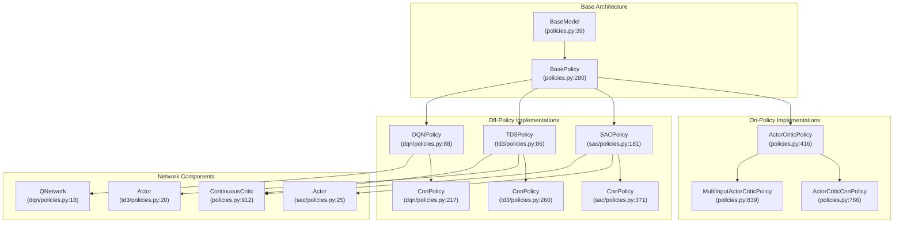
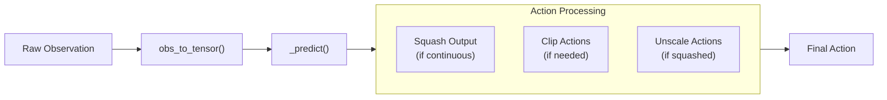
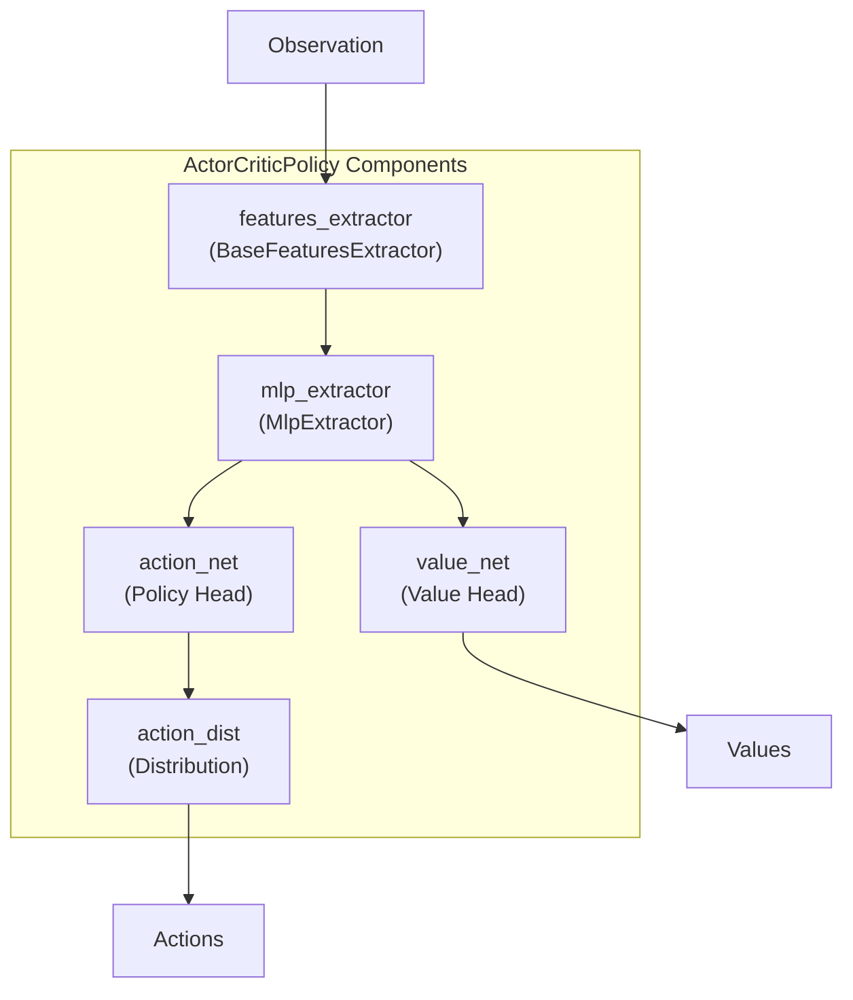
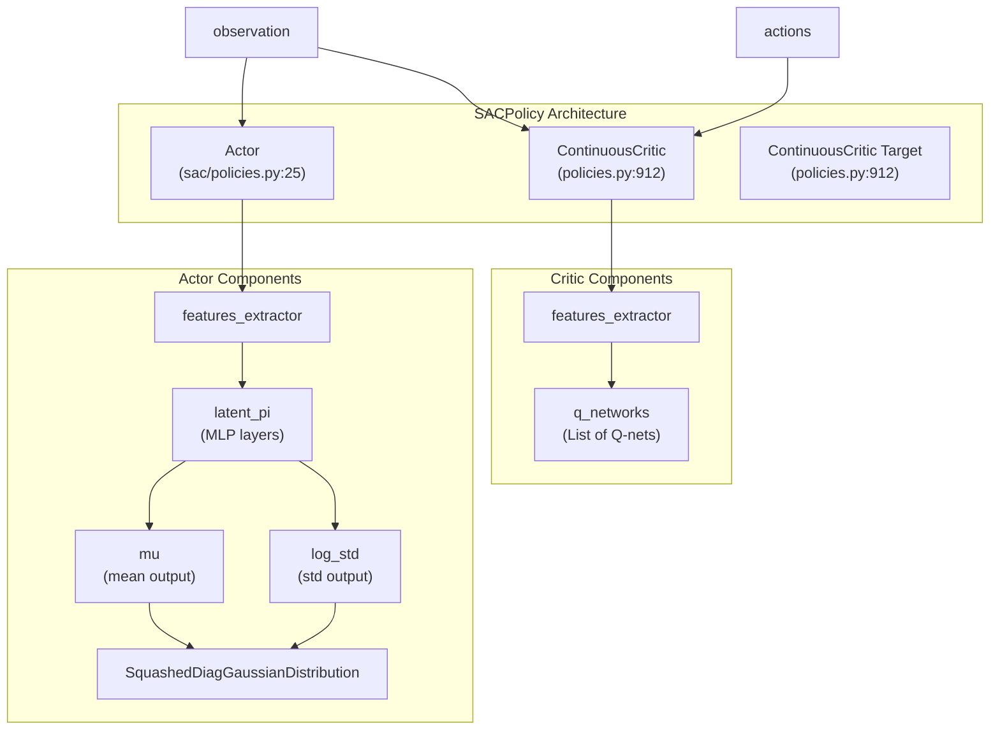
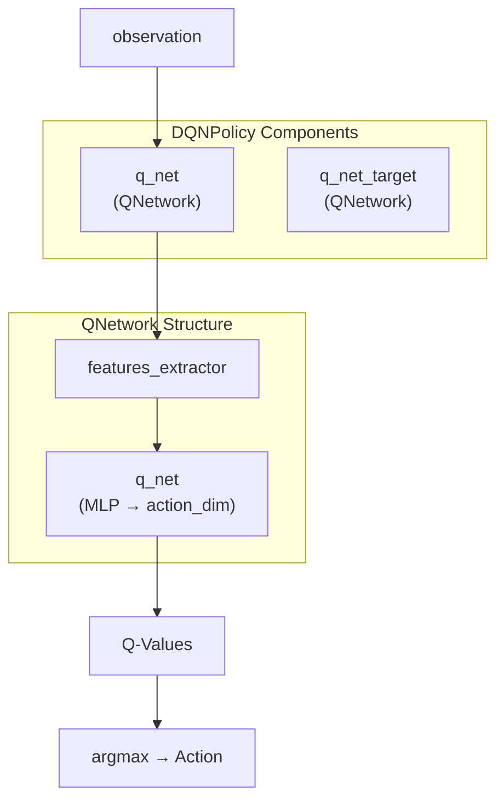
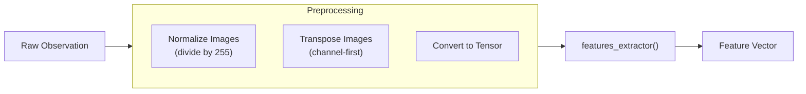

<!-- source: DeepWiki mcp.deepwiki.com · repo DLR-RM/stable-baselines3 · page 4 Policy Networks · fetched 2026-10-14 -->

# Policy Networks

Relevant source files

The following files were used as context for generating this wiki page:

- [stable_baselines3/common/policies.py](stable_baselines3/common/policies.py)
- [stable_baselines3/dqn/policies.py](stable_baselines3/dqn/policies.py)
- [stable_baselines3/sac/policies.py](stable_baselines3/sac/policies.py)
- [stable_baselines3/td3/policies.py](stable_baselines3/td3/policies.py)

This document covers the policy network system in Stable-Baselines3, which serves as the core neural network architecture for decision-making in reinforcement learning algorithms. Policy networks handle observation processing, action prediction, and value estimation across different algorithm types and observation/action spaces.

For information about the broader algorithm implementations that use these policies, see [Algorithms](#3). For details about environment handling and observation preprocessing, see [Environments](#5).

## Policy Architecture Overview

The policy system in Stable-Baselines3 follows a hierarchical design with base classes providing common functionality and algorithm-specific implementations handling particular requirements.

Sources: [stable_baselines3/common/policies.py:1-987](), [stable_baselines3/sac/policies.py:1-500](), [stable_baselines3/td3/policies.py:1-365](), [stable_baselines3/dqn/policies.py:1-304]()

## Base Classes

### BaseModel

The `BaseModel` class provides fundamental functionality for all neural network models in the framework, including feature extraction, device management, and model persistence.

| Component | Purpose | Key Methods |
|-----------|---------|-------------|
| Feature Extraction | Process observations through feature extractors | `extract_features()`, `make_features_extractor()` |
| Device Management | Handle GPU/CPU placement | `device` property |
| Model Persistence | Save/load functionality | `save()`, `load()`, `load_from_vector()` |
| Observation Processing | Convert observations to tensors | `obs_to_tensor()`, `is_vectorized_observation()` |

Key attributes managed by `BaseModel`:
- `observation_space`: Environment observation space
- `action_space`: Environment action space  
- `features_extractor`: Network for processing observations
- `normalize_images`: Whether to normalize image inputs
- `optimizer_class` and `optimizer_kwargs`: Optimizer configuration

Sources: [stable_baselines3/common/policies.py:39-278]()

### BasePolicy

`BasePolicy` extends `BaseModel` with action prediction capabilities and serves as the abstract base for all policy implementations.

The core prediction pipeline:

Sources: [stable_baselines3/common/policies.py:280-414]()

## Algorithm-Specific Policy Implementations

This section provides a high-level overview of algorithm-specific policy implementations. For detailed information on the class hierarchy and components, refer to [Policy Class Hierarchy](#4.1).

### ActorCriticPolicy (On-Policy)

Used by PPO and A2C algorithms, `ActorCriticPolicy` combines both policy (actor) and value function (critic) in a single network with shared or separate feature extractors.

Key configuration parameters:
- `net_arch`: Network architecture specification (e.g., `dict(pi=[64, 64], vf=[64, 64])`)
- `share_features_extractor`: Whether actor and critic share feature extraction
- `use_sde`: Enable State Dependent Exploration
- `ortho_init`: Use orthogonal weight initialization

For details, see [Policy Class Hierarchy](#4.1).
Sources: [stable_baselines3/common/policies.py:416-764]()

### SACPolicy (Off-Policy)

SAC uses separate actor and critic networks with distinct optimizers and supports both regular and state-dependent exploration.

SAC-specific features:
- Separate optimizers for actor and critic: `actor.optimizer` [stable_baselines3/sac/policies.py:230](), `critic.optimizer` [stable_baselines3/sac/policies.py:236]()
- Support for gSDE via `use_sde` parameter [stable_baselines3/sac/policies.py:74]()
- Multiple Q-networks (default: 2) for reduced overestimation [stable_baselines3/sac/policies.py:209]()
- Optional feature extractor sharing: `share_features_extractor` [stable_baselines3/sac/policies.py:210]()

For details, see [Policy Class Hierarchy](#4.1).
Sources: [stable_baselines3/sac/policies.py:181-366]()

### TD3Policy (Off-Policy)

TD3 uses deterministic actors with target networks for both actor and critic components.

Key differences from SAC:
- Deterministic policy (no stochastic sampling) [stable_baselines3/td3/policies.py:60]()
- Actor and critic target networks: `actor_target` [stable_baselines3/td3/policies.py:110](), `critic_target` [stable_baselines3/td3/policies.py:112]()
- Default architecture: `[400, 300]` for MLP, `[256, 256]` for CNN [stable_baselines3/td3/policies.py:141-145]()

For details, see [Policy Class Hierarchy](#4.1).
Sources: [stable_baselines3/td3/policies.py:86-255]()

### DQNPolicy (Value-Based)

DQN uses Q-networks for discrete action spaces without separate actor components.

DQN-specific characteristics:
- Single Q-network with target network for stability [stable_baselines3/dqn/policies.py:108-109]()
- Greedy action selection: `q_values.argmax(dim=1)` [stable_baselines3/dqn/policies.py:71]()
- Discrete action spaces only (`spaces.Discrete`) [stable_baselines3/dqn/policies.py:30]()

For details, see [Policy Class Hierarchy](#4.1).
Sources: [stable_baselines3/dqn/policies.py:88-212]()

## Feature Extraction and Network Components

This section provides a high-level overview of feature extractors and network components. For detailed information on their implementation and usage, refer to [Feature Extractors & Torch Layers](#4.2).

### Feature Extractors

All policies use feature extractors to process raw observations into feature vectors:

| Extractor Type | Use Case | Implementation |
|---------------|----------|----------------|
| `FlattenExtractor` | Vector observations | Flattens input to 1D |
| `NatureCNN` | Image observations | CNN with specific architecture |
| `CombinedExtractor` | Dict observations | Combines multiple extractors |

The feature extraction pipeline:

For details, see [Feature Extractors & Torch Layers](#4.2).
Sources: [stable_baselines3/common/policies.py:122-131]()

### Network Architecture Configuration

Network architectures are specified through the `net_arch` parameter:

- **List format**: `[64, 64]` - shared layers for actor-critic
- **Dict format**: `dict(pi=[64, 64], vf=[64, 64])` - separate actor/critic layers
- **Algorithm defaults**:
  - ActorCritic: `dict(pi=[64, 64], vf=[64, 64])` [stable_baselines3/common/policies.py:496-500]()
  - SAC: `[256, 256]` [stable_baselines3/sac/policies.py:244-246]()
  - TD3: `[400, 300]` (MLP), `[256, 256]` (CNN) [stable_baselines3/td3/policies.py:141-145]()
  - DQN: `[64, 64]` (MLP), `[]` (CNN) [stable_baselines3/dqn/policies.py:134-138]()

For details, see [Feature Extractors & Torch Layers](#4.2).
Sources: [stable_baselines3/common/policies.py:496-500](), [stable_baselines3/sac/policies.py:244-246](), [stable_baselines3/td3/policies.py:141-145](), [stable_baselines3/dqn/policies.py:134-138]()

## Policy Variants

### CNN Policies

All algorithm implementations provide CNN variants for image-based observations:

- `ActorCriticCnnPolicy`: Uses `NatureCNN` as default feature extractor
- `sac.CnnPolicy`, `td3.CnnPolicy`, `dqn.CnnPolicy`: Algorithm-specific CNN policies

### MultiInput Policies  

For environments with dictionary observation spaces:

- `MultiInputActorCriticPolicy`: Uses `CombinedExtractor`
- `sac.MultiInputPolicy`, `td3.MultiInputPolicy`, `dqn.MultiInputPolicy`

### Policy Aliases

Common aliases for easier usage:
- `MlpPolicy` = Main policy class for each algorithm
- Algorithm-specific imports: `from stable_baselines3.sac import MlpPolicy`

Sources: [stable_baselines3/common/policies.py:766-910](), [stable_baselines3/sac/policies.py:368-500](), [stable_baselines3/td3/policies.py:257-365](), [stable_baselines3/dqn/policies.py:214-304]()

---

