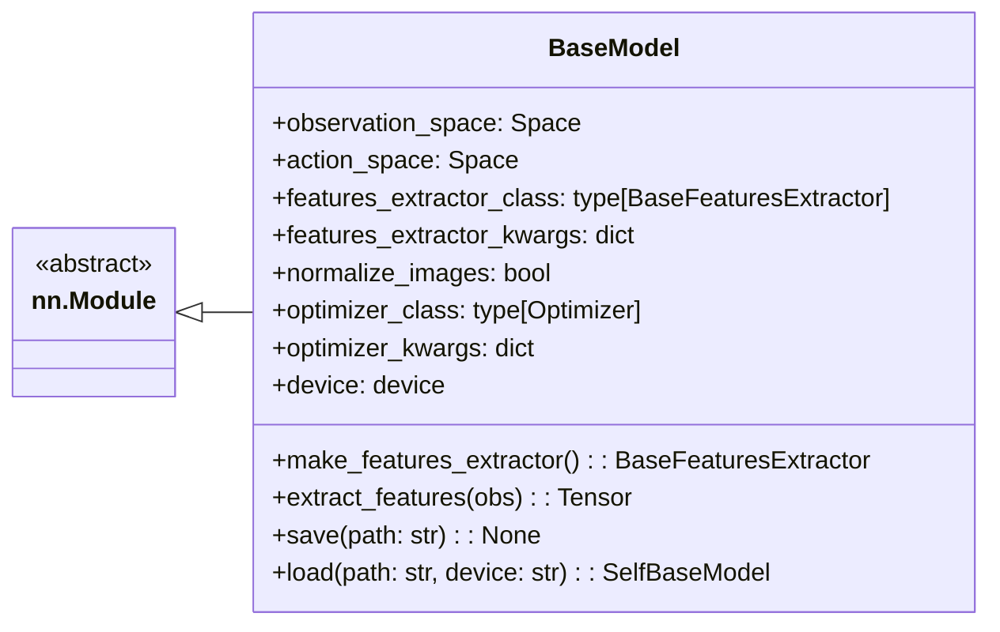
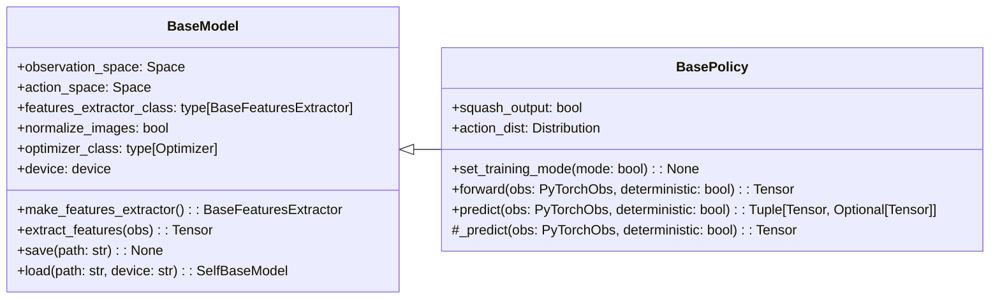
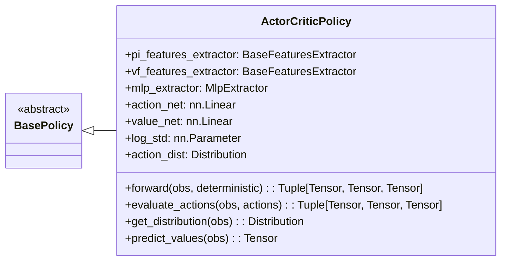
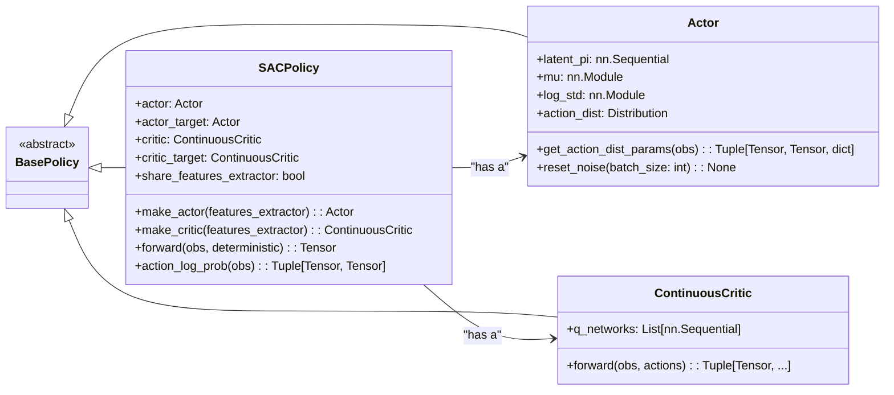
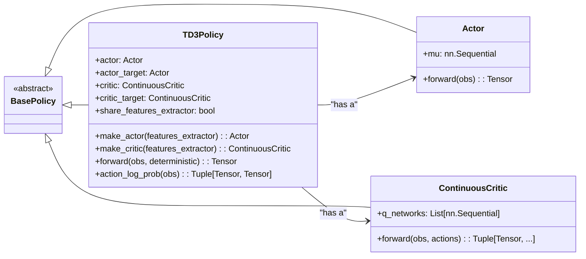
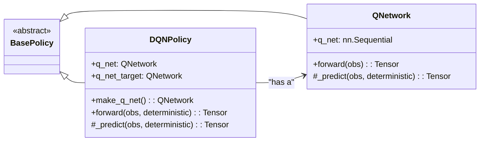

<!-- source: DeepWiki mcp.deepwiki.com · repo DLR-RM/stable-baselines3 · page 4.1 Policy Class Hierarchy · fetched 2026-10-14 -->

# Policy Class Hierarchy

Relevant source files

The following files were used as context for generating this wiki page:

- [stable_baselines3/a2c/policies.py](stable_baselines3/a2c/policies.py)
- [stable_baselines3/common/policies.py](stable_baselines3/common/policies.py)
- [stable_baselines3/ddpg/policies.py](stable_baselines3/ddpg/policies.py)
- [stable_baselines3/dqn/policies.py](stable_baselines3/dqn/policies.py)
- [stable_baselines3/ppo/policies.py](stable_baselines3/ppo/policies.py)
- [stable_baselines3/sac/policies.py](stable_baselines3/sac/policies.py)
- [stable_baselines3/td3/policies.py](stable_baselines3/td3/policies.py)

This page details the policy class hierarchy within Stable-Baselines3, focusing on the foundational `BaseModel` and `BasePolicy` classes, and their specialized implementations for various algorithms like `ActorCriticPolicy`, `SACPolicy`, `TD3Policy`, and `DQNPolicy`. It also covers the actor and critic components that constitute these policies.

## BaseModel and BasePolicy

At the core of the policy architecture are `BaseModel` and `BasePolicy`.

### BaseModel

The `BaseModel` class [stable_baselines3/common/policies.py:39-175]() serves as the abstract base for all models that make predictions based on observations. This includes both policies (which predict actions) and critics (which estimate values).

Key responsibilities of `BaseModel` include:
*   **Observation and Action Space Handling**: Stores the `observation_space` and `action_space` of the environment [stable_baselines3/common/policies.py:82-83]().
*   **Feature Extraction**: Manages the `features_extractor_class` and `features_extractor_kwargs` for processing raw observations into a feature representation [stable_baselines3/common/policies.py:48-52](). It provides `make_features_extractor()` [stable_baselines3/common/policies.py:118-120]() to create a feature extractor instance and `extract_features()` [stable_baselines3/common/policies.py:122-131]() to apply it.
*   **Image Normalization**: Handles optional normalization of image observations [stable_baselines3/common/policies.py:53-54]().
*   **Optimizer Configuration**: Stores the `optimizer_class` and `optimizer_kwargs` for creating optimizers [stable_baselines3/common/policies.py:55-58]().
*   **Device Management**: Provides a `device` property to infer the PyTorch device the model resides on [stable_baselines3/common/policies.py:149-156]().
*   **Serialization**: Implements `save()` [stable_baselines3/common/policies.py:158-165]() and `load()` [stable_baselines3/common/policies.py:167-175]() methods for model persistence, using `_get_constructor_parameters()` [stable_baselines3/common/policies.py:133-146]() to store necessary constructor arguments.

**Diagram: BaseModel Class Structure**
Sources: [stable_baselines3/common/policies.py:39-175]()

### BasePolicy

The `BasePolicy` class [stable_baselines3/common/policies.py:200-240]() extends `BaseModel` and adds functionalities specific to policies. It introduces the `_predict()` method, which is an abstract method that concrete policy implementations must define to produce actions.

Key additions in `BasePolicy`:
*   **Prediction Interface**: Defines the abstract `_predict()` method [stable_baselines3/common/policies.py:238-240]() for generating actions.
*   **Action Sampling**: The `_get_action_dist_from_latent()` method [stable_baselines3/common/policies.py:242-260]() creates an action distribution from a latent representation, which is then used by `_get_actions()` [stable_baselines3/common/policies.py:262-277]() to sample actions.
*   **Evaluation Mode**: `set_training_mode()` [stable_baselines3/common/policies.py:279-285]() allows switching between training and evaluation modes.
*   **Action Distribution**: `action_dist` property [stable_baselines3/common/policies.py:287-290]() holds the probability distribution over actions.

**Diagram: BasePolicy Class Structure**
Sources: [stable_baselines3/common/policies.py:39-175](), [stable_baselines3/common/policies.py:200-240]()

## ActorCriticPolicy

The `ActorCriticPolicy` [stable_baselines3/common/policies.py:300-500]() is a fundamental policy structure used in on-policy algorithms like A2C and PPO. It consists of two main components: an actor network and a critic network, which may or may not share a feature extractor.

*   **Actor Network**: Responsible for outputting the action distribution.
*   **Critic Network**: Responsible for outputting the state-value function.

The `ActorCriticPolicy` class handles the creation and management of these networks. It uses `MlpExtractor` [stable_baselines3/common/torch_layers.py:29]() or `NatureCNN` [stable_baselines3/common/torch_layers.py:30]() as feature extractors, depending on the observation space.

Key methods:
*   `_build()`: Constructs the actor and critic networks based on the provided `net_arch` [stable_baselines3/common/policies.py:370-409]().
*   `forward()`: Computes actions, value estimates, and log probabilities given an observation [stable_baselines3/common/policies.py:411-429]().
*   `evaluate_actions()`: Evaluates actions and returns value estimates, log probabilities, and entropy [stable_baselines3/common/policies.py:431-450]().
*   `get_distribution()`: Returns the action distribution for a given observation [stable_baselines3/common/policies.py:452-460]().
*   `predict_values()`: Predicts the value of a given observation [stable_baselines3/common/policies.py:462-468]().

`MlpPolicy` and `CnnPolicy` for PPO and A2C are simply aliases for `ActorCriticPolicy` and `ActorCriticCnnPolicy` respectively [stable_baselines3/ppo/policies.py:5-6](), [stable_baselines3/a2c/policies.py:5-6]().

**Diagram: ActorCriticPolicy Class Structure**
Sources: [stable_baselines3/common/policies.py:300-500](), [stable_baselines3/ppo/policies.py:5-6](), [stable_baselines3/a2c/policies.py:5-6]()

## SACPolicy

The `SACPolicy` [stable_baselines3/sac/policies.py:200-500]() is designed for the Soft Actor-Critic (SAC) algorithm. It comprises an `Actor` network and multiple `ContinuousCritic` networks.

### Actor (SAC)

The `Actor` class [stable_baselines3/sac/policies.py:25-169]() for SAC is a `BasePolicy` that outputs parameters for a `SquashedDiagGaussianDistribution` or `StateDependentNoiseDistribution` (if `use_sde` is true). It includes:
*   `latent_pi`: An MLP that processes features into a latent representation [stable_baselines3/sac/policies.py:85-86]().
*   `mu`: A linear layer for the mean of the action distribution [stable_baselines3/sac/policies.py:102]().
*   `log_std`: A linear layer for the log standard deviation of the action distribution [stable_baselines3/sac/policies.py:103]().
*   `get_action_dist_params()`: Computes the mean, log standard deviation, and any additional parameters for the action distribution [stable_baselines3/sac/policies.py:147-165]().

### SACPolicy Structure

`SACPolicy` orchestrates the actor and critic networks:
*   **Actor**: `self.actor` and `self.actor_target` are instances of `Actor` [stable_baselines3/sac/policies.py:290-291]().
*   **Critic**: `self.critic` and `self.critic_target` are instances of `ContinuousCritic` [stable_baselines3/sac/policies.py:292-293](). SAC typically uses two Q-networks for the critic to mitigate overestimation bias.
*   **Shared Feature Extractor**: The `share_features_extractor` flag determines if the actor and critic share the same feature extractor [stable_baselines3/sac/policies.py:300]().

**Diagram: SACPolicy and its Components**
Sources: [stable_baselines3/sac/policies.py:25-169](), [stable_baselines3/sac/policies.py:200-500](), [stable_baselines3/common/policies.py:502-560]()

## TD3Policy

The `TD3Policy` [stable_baselines3/td3/policies.py:86-365]() implements the policy for the Twin Delayed DDPG (TD3) algorithm. Similar to SAC, it uses an `Actor` and multiple `ContinuousCritic` networks, but the actor is deterministic.

### Actor (TD3)

The `Actor` class [stable_baselines3/td3/policies.py:20-83]() for TD3 is a `BasePolicy` that outputs deterministic actions.
*   `mu`: An MLP that directly outputs the action, squashed to the action space bounds [stable_baselines3/td3/policies.py:58-60]().
*   `forward()`: Computes the deterministic action given an observation [stable_baselines3/td3/policies.py:75-78]().

### TD3Policy Structure

`TD3Policy` manages the actor and critic networks:
*   **Actor**: `self.actor` and `self.actor_target` are instances of the TD3 `Actor` [stable_baselines3/td3/policies.py:109-110]().
*   **Critic**: `self.critic` and `self.critic_target` are instances of `ContinuousCritic` [stable_baselines3/td3/policies.py:111-112](). TD3 also uses two Q-networks for the critic.
*   **Shared Feature Extractor**: The `share_features_extractor` flag controls feature extractor sharing [stable_baselines3/td3/policies.py:168]().

**Diagram: TD3Policy and its Components**
Sources: [stable_baselines3/td3/policies.py:20-83](), [stable_baselines3/td3/policies.py:86-365](), [stable_baselines3/common/policies.py:502-560]()
Note that DDPG policies are aliases for TD3 policies [stable_baselines3/ddpg/policies.py:2]().

## DQNPolicy

The `DQNPolicy` [stable_baselines3/dqn/policies.py:88-304]() implements the policy for the Deep Q-Network (DQN) algorithm. It consists of a `QNetwork` and a target `QNetwork`.

### QNetwork

The `QNetwork` class [stable_baselines3/dqn/policies.py:18-85]() is a `BasePolicy` that estimates Q-values for discrete actions.
*   `q_net`: An MLP that takes features as input and outputs a Q-value for each possible action [stable_baselines3/dqn/policies.py:57-58]().
*   `forward()`: Computes the Q-values for all actions given an observation [stable_baselines3/dqn/policies.py:59-66]().
*   `_predict()`: Selects the action with the highest Q-value (greedy action) [stable_baselines3/dqn/policies.py:68-73]().

### DQNPolicy Structure

`DQNPolicy` manages the Q-networks:
*   **Q-Network**: `self.q_net` is the primary Q-network [stable_baselines3/dqn/policies.py:108]().
*   **Target Q-Network**: `self.q_net_target` is a copy of `self.q_net` used for stability during training [stable_baselines3/dqn/policies.py:109](). It is put into evaluation mode (`set_training_mode(False)`) [stable_baselines3/dqn/policies.py:166]().
*   `make_q_net()`: Helper to create `QNetwork` instances [stable_baselines3/dqn/policies.py:175-178]().

**Diagram: DQNPolicy and its Components**
Sources: [stable_baselines3/dqn/policies.py:18-85](), [stable_baselines3/dqn/policies.py:88-304]()

---

