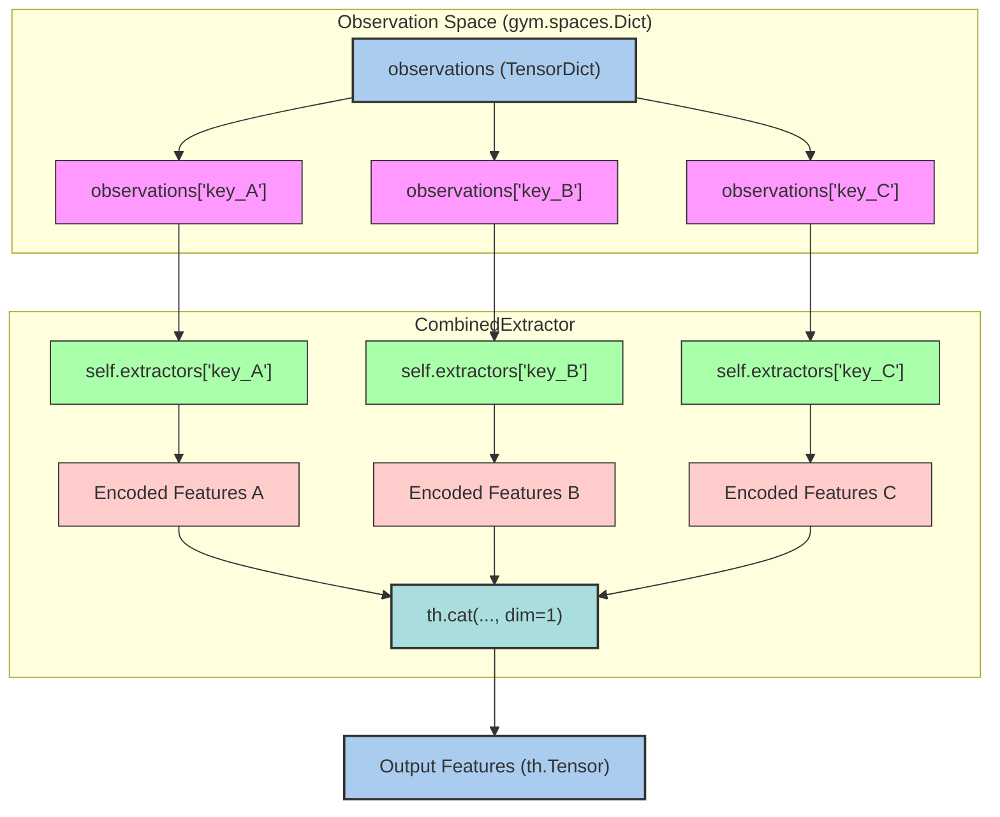
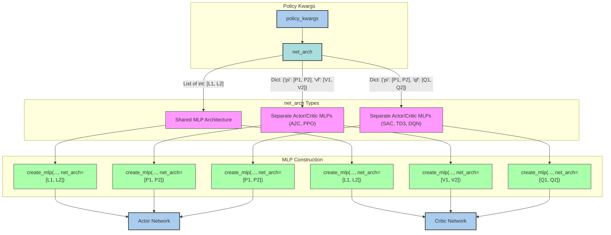

<!-- source: DeepWiki mcp.deepwiki.com · repo DLR-RM/stable-baselines3 · page 4.2 Feature Extractors & Torch Layers · fetched 2026-10-14 -->

# Feature Extractors & Torch Layers

<details>
<summary>Relevant source files</summary>

The following files were used as context for generating this wiki page:

- [stable_baselines3/common/torch_layers.py](stable_baselines3/common/torch_layers.py)
- [tests/test_custom_policy.py](tests/test_custom_policy.py)

</details>


This page details the feature extractors and PyTorch layers used within Stable-Baselines3 policies. It covers the `NatureCNN`, `FlattenExtractor`, and `CombinedExtractor` classes, which are responsible for processing observations into a suitable format for policy networks. Additionally, it explains the `create_mlp` helper function for constructing Multi-Layer Perceptrons (MLPs) and how the `net_arch` parameter is used to define network architectures.

## BaseFeaturesExtractor

The `BaseFeaturesExtractor` is an abstract base class for all feature extractors in Stable-Baselines3. It inherits from `torch.nn.Module` and provides a common interface for processing observations.

The primary role of a feature extractor is to transform raw observations from the environment into a fixed-size feature vector that can be fed into subsequent policy or value networks.

```python
class BaseFeaturesExtractor(nn.Module):
    def __init__(self, observation_space: gym.Space, features_dim: int = 0) -> None:
        super().__init__()
        assert features_dim > 0
        self._observation_space = observation_space
        self._features_dim = features_dim

    @property
    def features_dim(self) -> int:
        return self._features_dim
```

The `features_dim` property [stable_baselines3/common/torch_layers.py:26-28]() indicates the dimensionality of the output feature vector.

Sources:
* [stable_baselines3/common/torch_layers.py:11-28]()

## FlattenExtractor

The `FlattenExtractor` is a simple feature extractor that flattens the input observation. It is typically used when the observation space is already a 1D vector or when no complex feature extraction (like CNNs for images) is required.

```python
class FlattenExtractor(BaseFeaturesExtractor):
    def __init__(self, observation_space: gym.Space) -> None:
        super().__init__(observation_space, get_flattened_obs_dim(observation_space))
        self.flatten = nn.Flatten()

    def forward(self, observations: th.Tensor) -> th.Tensor:
        return self.flatten(observations)
```

It initializes an `nn.Flatten()` layer [stable_baselines3/common/torch_layers.py:41]() and its `forward` method simply applies this flattening operation to the input observations [stable_baselines3/common/torch_layers.py:44](). The `features_dim` is determined by `get_flattened_obs_dim`, which calculates the total number of elements in the flattened observation space [stable_baselines3/common/torch_layers.py:40]().

Sources:
* [stable_baselines3/common/torch_layers.py:31-44]()

## NatureCNN

The `NatureCNN` class implements the Convolutional Neural Network architecture described in the DQN Nature paper (Mnih et al., 2015). This extractor is designed for image-based observation spaces.

```python
class NatureCNN(BaseFeaturesExtractor):
    def __init__(
        self,
        observation_space: gym.Space,
        features_dim: int = 512,
        normalized_image: bool = False,
    ) -> None:
        assert isinstance(observation_space, spaces.Box), (
            "NatureCNN must be used with a gym.spaces.Box ",
            f"observation space, not {observation_space}",
        )
        super().__init__(observation_space, features_dim)
        # We assume CxHxW images (channels first)
        # Re-ordering will be done by pre-preprocessing or wrapper
        assert is_image_space(observation_space, check_channels=False, normalized_image=normalized_image), (
            "You should use NatureCNN "
            f"only with images not with {observation_space}\n"
            "(you are probably using `CnnPolicy` instead of `MlpPolicy` or `MultiInputPolicy`)\n"
            "If you are using a custom environment,\n"
            "please check it using our env checker:\n"
            "https://stable-baselines3.readthedocs.io/en/master/common/env_checker.html.\n"
            "If you are using `VecNormalize` or already normalized channel-first images "
            "you should pass `normalize_images=False`: \n"
            "https://stable-baselines3.readthedocs.io/en/master/guide/custom_env.html"
        )
        n_input_channels = observation_space.shape[0]
        self.cnn = nn.Sequential(
            nn.Conv2d(n_input_channels, 32, kernel_size=8, stride=4, padding=0),
            nn.ReLU(),
            nn.Conv2d(32, 64, kernel_size=4, stride=2, padding=0),
            nn.ReLU(),
            nn.Conv2d(64, 64, kernel_size=3, stride=1, padding=0),
            nn.ReLU(),
            nn.Flatten(),
        )

        # Compute shape by doing one forward pass
        with th.no_grad():
            n_flatten = self.cnn(th.as_tensor(observation_space.sample()[None]).float()).shape[1]

        self.linear = nn.Sequential(nn.Linear(n_flatten, features_dim), nn.ReLU())

    def forward(self, observations: th.Tensor) -> th.Tensor:
        return self.linear(self.cnn(observations))
```

The constructor performs checks to ensure the `observation_space` is a `Box` space and represents an image [stable_baselines3/common/torch_layers.py:69-86](). It then defines a convolutional network (`self.cnn`) consisting of three `Conv2d` layers followed by `ReLU` activations and a `Flatten` layer [stable_baselines3/common/torch_layers.py:88-96]().

After the CNN, a linear layer (`self.linear`) with a `ReLU` activation maps the flattened CNN output to the desired `features_dim` [stable_baselines3/common/torch_layers.py:102](). The `n_flatten` dimension is dynamically computed by performing a forward pass with a dummy observation [stable_baselines3/common/torch_layers.py:99-100]().

The `forward` method applies the CNN and then the linear layer sequentially [stable_baselines3/common/torch_layers.py:104]().

Sources:
* [stable_baselines3/common/torch_layers.py:47-105]()

## CombinedExtractor

The `CombinedExtractor` is designed to handle `gym.spaces.Dict` observation spaces, where observations are composed of multiple distinct components (e.g., an image and a vector of sensor readings). It applies a different feature extractor to each component of the dictionary observation.

```python
class CombinedExtractor(BaseFeaturesExtractor):
    """
    Combined features extractor for Dict observation spaces.
    Builds a features extractor for each key of the space.
    Enables different feature extractors per observation key.

    :param observation_space: A gymnasium.spaces.Dict observation space
    :param cnn_output_dim: Number of features to output from each CNN extractor for image
        observations.
    """

    def __init__(self, observation_space: spaces.Dict, cnn_output_dim: int = 256) -> None:
        super().__init__(observation_space, features_dim=0)

        extractors: dict[str, nn.Module] = {}
        total_concat_size = 0
        for key, subspace in observation_space.spaces.items():
            if is_image_space(subspace):
                extractors[key] = NatureCNN(subspace, features_dim=cnn_output_dim)
                total_concat_size += cnn_output_dim
            else:
                # The observation key is a vector, flatten it if needed
                extractors[key] = nn.Flatten()
                total_concat_size += get_flattened_obs_dim(subspace)

        self.extractors = nn.ModuleDict(extractors)
        self._features_dim = total_concat_size

    def forward(self, observations: TensorDict) -> th.Tensor:
        encoded_tensor_list = []

        for key, extractor in self.extractors.items():
            encoded_tensor_list.append(extractor(observations[key]))
        return th.cat(encoded_tensor_list, dim=1)
```

In its constructor, `CombinedExtractor` iterates through each `subspace` in the `observation_space.spaces` dictionary [stable_baselines3/common/torch_layers.py:190]().
- If a `subspace` is an image space (checked by `is_image_space`), a `NatureCNN` is created for it [stable_baselines3/common/torch_layers.py:191-192]().
- Otherwise, an `nn.Flatten()` extractor is used [stable_baselines3/common/torch_layers.py:195]().

The individual extractors are stored in an `nn.ModuleDict` called `self.extractors` [stable_baselines3/common/torch_layers.py:199](). The `_features_dim` is the sum of the output dimensions of all individual extractors [stable_baselines3/common/torch_layers.py:193, 197, 200]().

The `forward` method processes each observation component using its corresponding extractor and concatenates the resulting feature vectors along dimension 1 [stable_baselines3/common/torch_layers.py:204-207]().

### Diagram: CombinedExtractor Data Flow


Sources:
* [stable_baselines3/common/torch_layers.py:179-207]()

## MLP Creation Helper: `create_mlp`

The `create_mlp` function is a utility for constructing Multi-Layer Perceptrons (MLPs) as a list of `torch.nn.Module` objects. It provides flexibility in defining the network architecture, activation functions, and optional pre/post-linear modules.

```python
def create_mlp(
    input_dim: int,
    output_dim: int,
    net_arch: list[int],
    activation_fn: type[nn.Module] = nn.ReLU,
    squash_output: bool = False,
    with_bias: bool = True,
    pre_linear_modules: list[type[nn.Module]] | None = None,
    post_linear_modules: list[type[nn.Module]] | None = None,
) -> list[nn.Module]:
    # ... (implementation details) ...
```

Key parameters:
- `input_dim`: Dimension of the input vector.
- `output_dim`: Dimension of the output layer. If `output_dim <= 0`, no final output layer is added.
- `net_arch`: A list of integers defining the number of units in each hidden layer. For example, `[64, 64]` creates two hidden layers with 64 units each.
- `activation_fn`: The activation function to use after each hidden layer (default: `nn.ReLU`).
- `squash_output`: If `True`, a `nn.Tanh` activation is applied to the final output layer.
- `pre_linear_modules`: A list of `nn.Module` types to add *before* each linear layer (e.g., `nn.BatchNorm1d`). These modules should maintain the input dimension.
- `post_linear_modules`: A list of `nn.Module` types to add *after* each linear layer and *before* the activation function (e.g., `nn.LayerNorm`, `nn.Dropout`). These modules should also maintain the input dimension.

The function constructs the MLP layer by layer. For each layer specified in `net_arch`:
1. It adds `pre_linear_modules` [stable_baselines3/common/torch_layers.py:150-152, 162-164]().
2. It adds an `nn.Linear` layer [stable_baselines3/common/torch_layers.py:153, 165]().
3. It adds `post_linear_modules` [stable_baselines3/common/torch_layers.py:156-158, 167-169]().
4. It adds the `activation_fn` [stable_baselines3/common/torch_layers.py:159, 170]().

Finally, if `output_dim > 0`, a final `nn.Linear` layer is added to produce the desired output dimension [stable_baselines3/common/torch_layers.py:174](). If `squash_output` is `True`, an `nn.Tanh` activation is appended [stable_baselines3/common/torch_layers.py:176]().

### Diagram: `create_mlp` Structure

```mermaid
graph TD
    Input["Input (input_dim)"] --> PreLinear1["pre_linear_modules (input_dim)"]
    PreLinear1 --> Linear1["nn.Linear(input_dim, net_arch[0])"]
    Linear1 --> PostLinear1["post_linear_modules (net_arch[0])"]
    PostLinear1 --> Activation1["activation_fn()"]

    Activation1 --> PreLinear2["pre_linear_modules (net_arch[0])"]
    PreLinear2 --> Linear2["nn.Linear(net_arch[0], net_arch[1])"]
    Linear2 --> PostLinear2["post_linear_modules (net_arch[1])"]
    PostLinear2 --> Activation2["activation_fn()"]

    Activation2 --> ...
    ... --> PreLinearN["pre_linear_modules (net_arch[N-1])"]
    PreLinearN --> LinearN["nn.Linear(net_arch[N-1], net_arch[N])"]
    LinearN --> PostLinearN["post_linear_modules (net_arch[N])"]
    PostLinearN --> ActivationN["activation_fn()"]

    ActivationN --> FinalLinear["nn.Linear(net_arch[N], output_dim)"]
    FinalLinear --> SquashOutput{"squash_output ?"}
    SquashOutput -- Yes --> Tanh["nn.Tanh()"]
    SquashOutput -- No --> Output["Output (output_dim)"]
    Tanh --> Output

    style Input fill:#ace,stroke:#333,stroke-width:2px
    style Output fill:#ace,stroke:#333,stroke-width:2px
    style PreLinear1 fill:#afa,stroke:#333,stroke-width:1px
    style Linear1 fill:#fcc,stroke:#333,stroke-width:1px
    style PostLinear1 fill:#afa,stroke:#333,stroke-width:1px
    style Activation1 fill:#add,stroke:#333,stroke-width:1px
    style PreLinear2 fill:#afa,stroke:#333,stroke-width:1px
    style Linear2 fill:#fcc,stroke:#333,stroke-width:1px
    style PostLinear2 fill:#afa,stroke:#333,stroke-width:1px
    style Activation2 fill:#add,stroke:#333,stroke-width:1px
    style PreLinearN fill:#afa,stroke:#333,stroke-width:1px
    style LinearN fill:#fcc,stroke:#333,stroke-width:1px
    style PostLinearN fill:#afa,stroke:#333,stroke-width:1px
    style ActivationN fill:#add,stroke:#333,stroke-width:1px
    style FinalLinear fill:#fcc,stroke:#333,stroke-width:1px
    style SquashOutput fill:#add,stroke:#333,stroke-width:1px
    style Tanh fill:#add,stroke:#333,stroke-width:1px
```



Sources:
* [stable_baselines3/common/torch_layers.py:108-177]()
* [tests/test_custom_policy.py:76-127]()

## `net_arch` Handling

The `net_arch` parameter is crucial for defining the architecture of the policy and value networks within Stable-Baselines3 algorithms. It can be specified in `policy_kwargs` when creating a model.

### For `MlpPolicy` (A2C, PPO)

For `MlpPolicy` used with on-policy algorithms like A2C and PPO, `net_arch` can be:
- A list of integers: `[64, 64]` creates two hidden layers of 64 units for both the actor (policy) and critic (value) networks.
- A dictionary: `dict(vf=[16], pi=[8])` allows separate architectures for the value function (`vf`) and policy (`pi`) networks. `vf` defines the critic's MLP, and `pi` defines the actor's MLP. If a key is omitted, the default architecture for that component is used.

Example usage:
```python
# Shared MLP for actor and critic
model = PPO("MlpPolicy", "CartPole-v1", policy_kwargs=dict(net_arch=[64, 64]))

# Separate MLPs for actor and critic
model = A2C("MlpPolicy", "CartPole-v1", policy_kwargs=dict(net_arch=dict(vf=[16], pi=[8])))
```
The `test_flexible_mlp` function in the test suite verifies various `net_arch` configurations for A2C and PPO [tests/test_custom_policy.py:10-35]().

### For `MlpPolicy` (SAC, TD3, DQN)

For `MlpPolicy` used with off-policy algorithms like SAC, TD3, and DQN, `net_arch` can also be:
- A list of integers: `[64, 64]` creates two hidden layers of 64 units for the policy network (actor) and the Q-networks (critics).
- A dictionary: `dict(qf=[8], pi=[8, 4])` allows separate architectures for the Q-function (`qf`) and policy (`pi`) networks.

Example usage:
```python
# Shared MLP for actor and critics
model = SAC("MlpPolicy", "Pendulum-v1", policy_kwargs=dict(net_arch=[64, 64]))

# Separate MLPs for actor and critics
model = TD3("MlpPolicy", "Pendulum-v1", policy_kwargs=dict(net_arch=dict(qf=[8], pi=[8, 4])))
```
The `test_custom_offpolicy` function tests these configurations for SAC and TD3 [tests/test_custom_policy.py:37-42]().

### Diagram: `net_arch` Configuration Mapping



Sources:
* [tests/test_custom_policy.py:10-24]()
* [tests/test_custom_policy.py:26-35]()
* [tests/test_custom_policy.py:37-42]()

---

