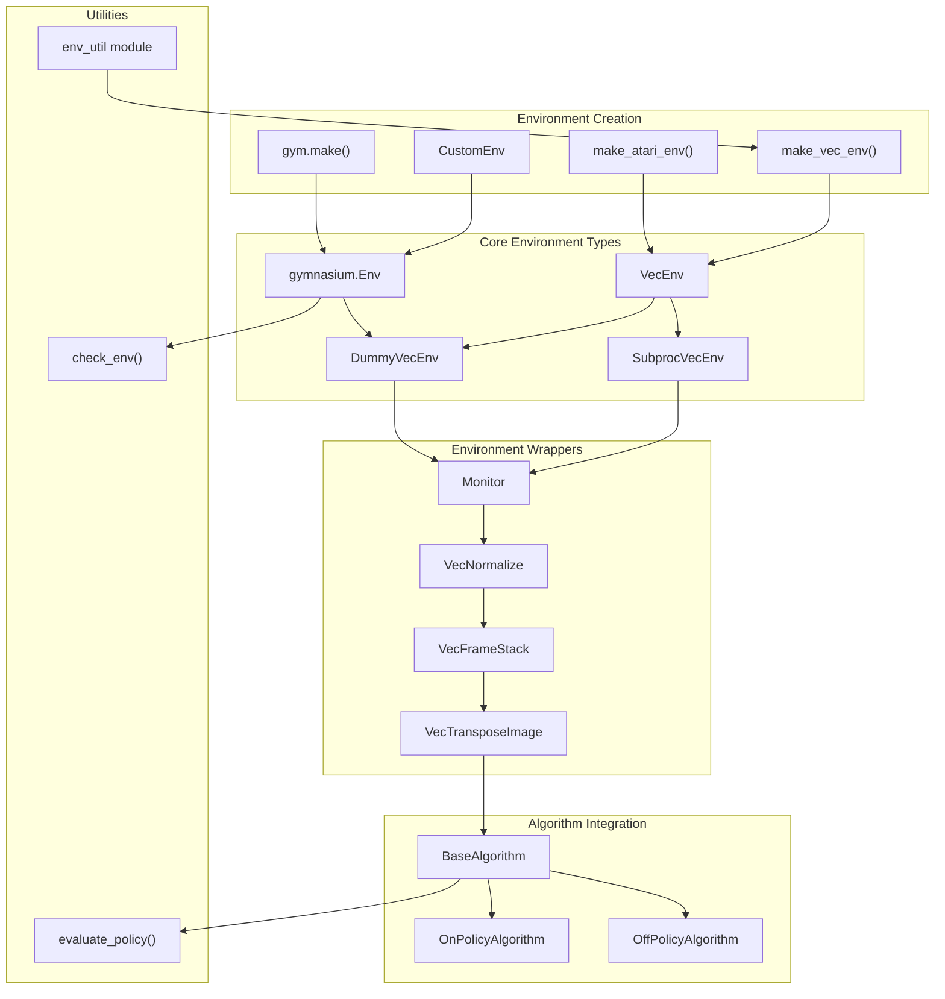
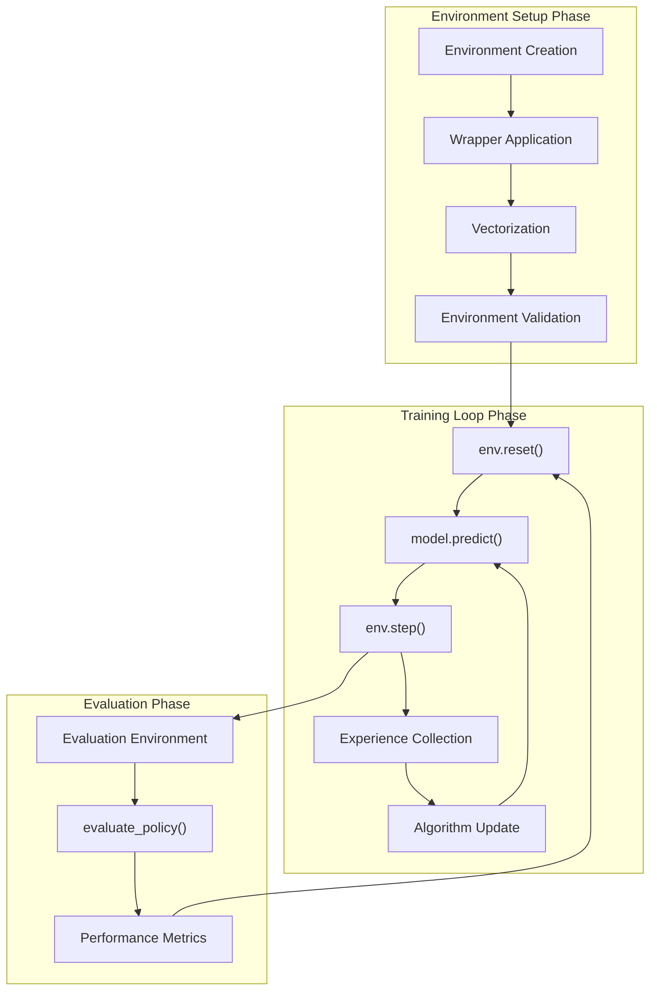
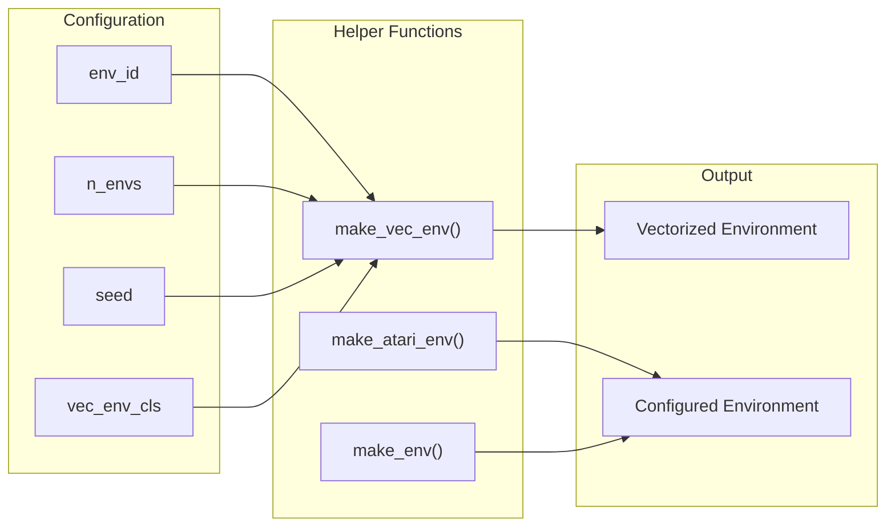
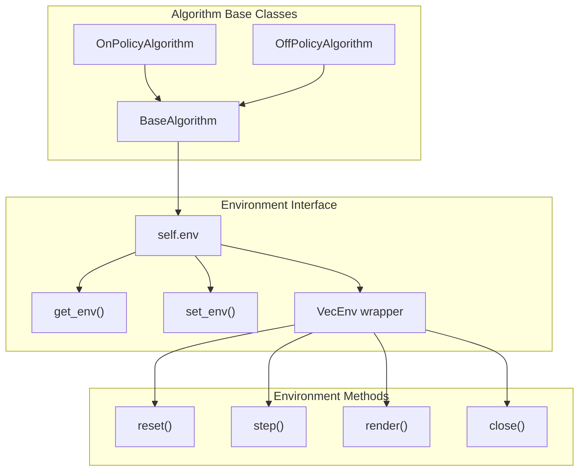

<!-- source: DeepWiki mcp.deepwiki.com · repo DLR-RM/stable-baselines3 · page 5 Environments · fetched 2026-10-14 -->

# Environments

<details>
<summary>Relevant source files</summary>

The following files were used as context for generating this wiki page:

- [stable_baselines3/common/env_checker.py](stable_baselines3/common/env_checker.py)
- [stable_baselines3/common/envs/identity_env.py](stable_baselines3/common/envs/identity_env.py)
- [stable_baselines3/common/envs/multi_input_envs.py](stable_baselines3/common/envs/multi_input_envs.py)
- [tests/test_env_checker.py](tests/test_env_checker.py)
- [tests/test_envs.py](tests/test_envs.py)

</details>


This document covers environment handling, integration patterns, and environment utilities in Stable-Baselines3. It focuses on how SB3 integrates with Gymnasium environments, core environment patterns, and the fundamental utilities for environment management.

For vectorized environment systems, see [Vectorized Environments](#5.1). For environment wrappers and normalization, see [Environment Wrappers & Normalization](#5.2). For creating custom environments, see [Custom Environments](#5.3).

## Environment Integration Architecture

SB3 builds upon the Gymnasium environment interface to provide a flexible and powerful environment management system. The framework supports both single and vectorized environments with various preprocessing and monitoring capabilities.



Sources: [docs/guide/examples.rst:67-159](), [docs/guide/custom_env.rst:46-101]()

## Core Environment Patterns

SB3 supports multiple environment usage patterns depending on training requirements and performance needs.

### Single Environment Pattern

The simplest pattern uses a single environment instance, typically wrapped in `DummyVecEnv` for API consistency:

| Component | Purpose | Example Usage |
|-----------|---------|---------------|
| `gym.make()` | Environment creation | `env = gym.make("LunarLander-v3")` |
| `DummyVecEnv` | Single-env vectorization | Automatic wrapping by algorithms |
| `Monitor` | Episode tracking | Automatic or manual wrapping |

### Multi-Environment Pattern

For improved sample efficiency and parallelization:

| Component | Purpose | Key Features |
|-----------|---------|--------------|
| `SubprocVecEnv` | Multi-process environments | Parallel execution, isolated processes |
| `make_vec_env()` | Helper for vectorization | Simplified creation with seeding |
| `make_env()` | Environment factory | Custom environment configuration |

Sources: [docs/guide/examples.rst:116-159]()

## Environment Lifecycle and Data Flow

This diagram shows how environments interact with SB3 algorithms during training:



Sources: [docs/guide/examples.rst:78-94](), [docs/guide/examples.rst:312-350]()

## Environment Utilities and Helpers

SB3 provides several utilities to simplify environment management and ensure compatibility.

### Environment Creation Helpers



Sources: [docs/guide/examples.rst:147-150](), [docs/guide/examples.rst:374-389]()

### Environment Validation

The `check_env()` function validates environment compatibility with SB3. It performs a series of checks to ensure the environment adheres to the Gymnasium API and SB3's specific requirements. This includes verifying the observation and action spaces, data types, and the format of return values from `reset()` and `step()`.

```mermaid
graph TD
    A[check_env(env)] --> B{Is env a Gymnasium Env?};
    B -- Yes --> C{Check observation_space};
    B -- No --> Error1[AssertionError: Not a Gymnasium Env];
    C --> D{Check action_space};
    D --> E{Call env.reset()};
    E --> F{Validate reset() return values};
    F --> G{Call env.step()};
    G --> H{Validate step() return values};
    H --> I{Check for unsupported spaces};
    I --> J[Validation Complete];

    subgraph "Observation Space Checks"
        C --> C1{Check for nested Dict spaces};
        C --> C2{Check for Tuple spaces};
        C --> C3{Check for Sequence spaces};
        C --> C4{Check for Graph spaces};
        C --> C5{Check for OneOf spaces};
        C --> C6{Check for MultiDiscrete with multi-dim nvec};
        C --> C7{Check for non-zero start in Discrete/MultiDiscrete};
        C --> C8{Check image observation properties (dtype, range, shape)};
    end

    subgraph "Action Space Checks"
        D --> D1{Check for Dict action spaces};
        D --> D2{Check for non-zero start in Discrete/MultiDiscrete};
        D --> D3{Check Box action space properties (symmetry, dtype, bounds)};
    end

    subgraph "Return Value Checks"
        F --> F1{Validate observation in space};
        F --> F2{Validate info dict};
        G --> G1{Validate observation in space};
        G --> G2{Validate reward type};
        G --> G3{Validate terminated/truncated types};
        G --> G4{Validate info dict};
    end
```
Sources: [stable_baselines3/common/env_checker.py:9-10](), [stable_baselines3/common/env_checker.py:95-159](), [stable_baselines3/common/env_checker.py:470-547](), [tests/test_envs.py:39-41](), [tests/test_env_checker.py:36-37]()

## Environment Space Requirements

SB3 has specific requirements for environment spaces that algorithms can handle. The `check_env` utility emits warnings or errors for unsupported configurations.

### Observation Spaces

| Space Type | Support | Requirements | Warnings/Errors |
|------------|---------|--------------|-----------------|
| `Box` | Full | Any shape, `np.uint8` for images (0-255 range recommended) | Warnings for non-`uint8` image dtype, non-[0,255] range, small image resolution [stable_baselines3/common/env_checker.py:66-93]() |
| `Discrete` | Full | Must start from 0 | Warning if `start != 0` [stable_baselines3/common/env_checker.py:47-54]() |
| `MultiDiscrete` | Full | Must start from 0, 1D `nvec` | Warning if `start != 0` [stable_baselines3/common/env_checker.py:47-54](), warning for multi-dimensional `nvec` [stable_baselines3/common/env_checker.py:123-129]() |
| `Dict` | Full | For multi-input policies, no nested `Dict` spaces | Warning for nested `Dict` spaces [stable_baselines3/common/env_checker.py:115-121]() |
| `Tuple` | Limited | Not directly supported, convert to `Dict` | Warning for `Tuple` spaces [stable_baselines3/common/env_checker.py:132-138]() |
| `Sequence` | Limited | Not supported, pad to fixed size | Warning for `Sequence` spaces [stable_baselines3/common/env_checker.py:156-159]() |
| `Graph` | Limited | Not supported | Warning for `Graph` spaces [stable_baselines3/common/env_checker.py:109](), [stable_baselines3/common/env_checker.py:144]() |
| `OneOf` | Limited | Not supported | Warning for `OneOf` spaces [stable_baselines3/common/env_checker.py:147-151]() |

### Action Spaces

| Space Type | Algorithm Support | Notes | Warnings/Errors |
|------------|------------------|-------|-----------------|
| `Discrete` | All algorithms | Must start from 0 | Warning if `start != 0` [stable_baselines3/common/env_checker.py:47-54]() |
| `Box` | Continuous control algorithms (SAC, TD3, DDPG, PPO, A2C) | Recommended range `[-1, 1]` for continuous actions | Warnings for non-symmetric range, non-`float32` dtype, very large/small ranges, unbounded spaces [stable_baselines3/common/env_checker.py:400-420]() |
| `MultiDiscrete` | Limited | Some algorithms only, must start from 0 | Warning if `start != 0` [stable_baselines3/common/env_checker.py:47-54](), warning for multi-dimensional `nvec` [stable_baselines3/common/env_checker.py:123-129]() |
| `Dict` | Not supported | | Warning for `Dict` action spaces [stable_baselines3/common/env_checker.py:390-394]() |

Sources: [stable_baselines3/common/env_checker.py:47-54](), [stable_baselines3/common/env_checker.py:66-93](), [stable_baselines3/common/env_checker.py:115-159](), [stable_baselines3/common/env_checker.py:390-420](), [tests/test_envs.py:107-132](), [tests/test_envs.py:153-175](), [tests/test_env_checker.py:33-37]()

## Integration with Algorithm Classes

Environments integrate with SB3's algorithm hierarchy through standardized interfaces:



Sources: [docs/guide/examples.rst:97-102](), [docs/guide/examples.rst:630-633]()

---

