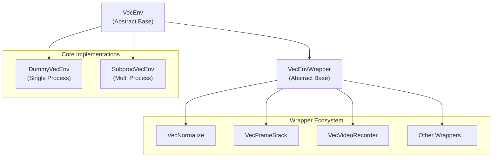
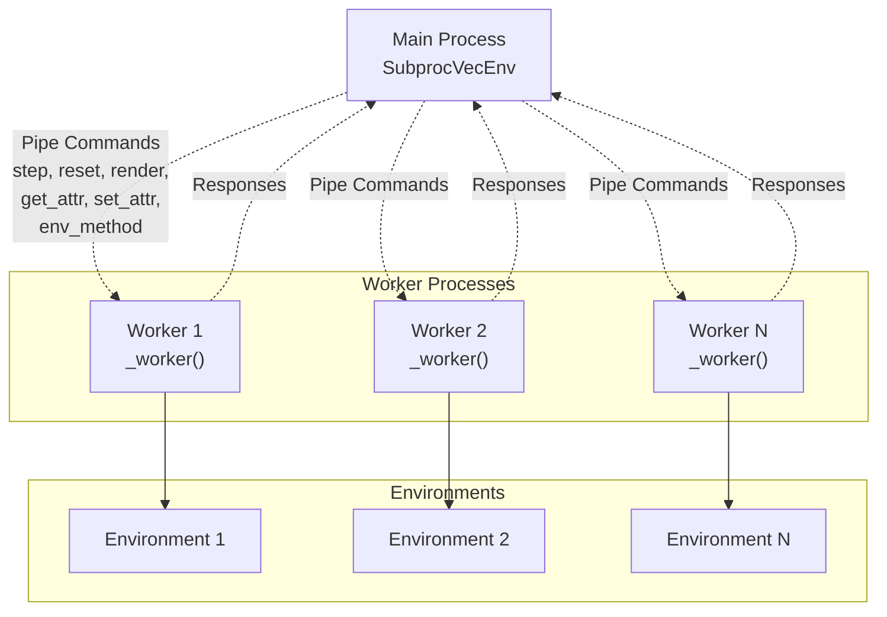
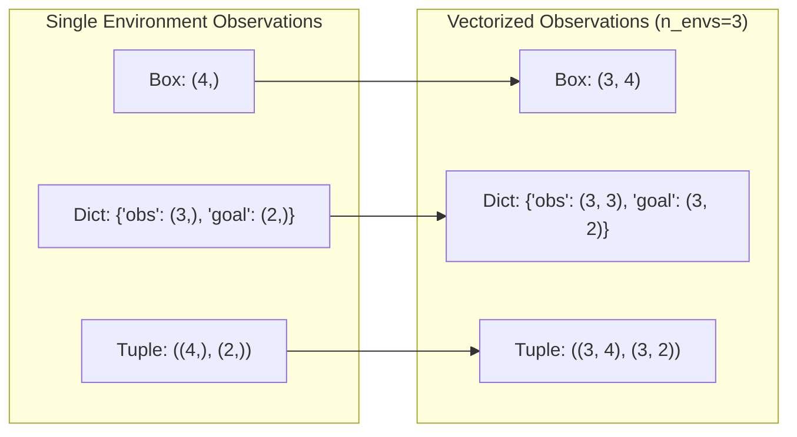

<!-- source: DeepWiki mcp.deepwiki.com · repo DLR-RM/stable-baselines3 · page 5.1 Vectorized Environments · fetched 2026-10-14 -->

# Vectorized Environments

<details>
<summary>Relevant source files</summary>

The following files were used as context for generating this wiki page:

- [docs/guide/vec_envs.md](docs/guide/vec_envs.md)
- [stable_baselines3/common/evaluation.py](stable_baselines3/common/evaluation.py)
- [stable_baselines3/common/vec_env/__init__.py](stable_baselines3/common/vec_env/__init__.py)
- [stable_baselines3/common/vec_env/base_vec_env.py](stable_baselines3/common/vec_env/base_vec_env.py)
- [stable_baselines3/common/vec_env/dummy_vec_env.py](stable_baselines3/common/vec_env/dummy_vec_env.py)
- [stable_baselines3/common/vec_env/patch_gym.py](stable_baselines3/common/vec_env/patch_gym.py)
- [stable_baselines3/common/vec_env/subproc_vec_env.py](stable_baselines3/common/vec_env/subproc_vec_env.py)
- [stable_baselines3/common/vec_env/util.py](stable_baselines3/common/vec_env/util.py)
- [stable_baselines3/common/vec_env/vec_frame_stack.py](stable_baselines3/common/vec_env/vec_frame_stack.py)
- [tests/test_vec_envs.py](tests/test_vec_envs.py)

</details>


Vectorized Environments are a method for stacking multiple independent environments into a single environment. Instead of training an RL agent on 1 environment per step, it allows us to train it on `n` environments per step. Because of this, `actions` passed to the environment are now a vector (of dimension `n`). It is the same for `observations`, `rewards` and end of episode signals (`dones`). In the case of non-array observation spaces such as `Dict` or `Tuple`, where different sub-spaces may have different shapes, the sub-observations are vectors (of dimension `n`).

This document covers the vectorized environment system in Stable-Baselines3, which enables parallel execution of multiple environment instances for improved training performance. Vectorized environments stack multiple independent environments into a single environment interface, allowing algorithms to collect experiences from `n` environments simultaneously rather than one at a time.

For information about environment wrappers that can be applied to vectorized environments, see [Environment Wrappers & Normalization](#5.2). For guidance on creating custom environments that can be vectorized, see [Custom Environments](#5.3).

## Core Architecture

The vectorized environment system is built around the abstract `VecEnv` base class, which defines a common interface for running multiple environments in parallel. The system provides two main implementations: `DummyVecEnv` for single-process execution and `SubprocVecEnv` for multi-process execution.



Sources: [stable_baselines3/common/vec_env/base_vec_env.py:50-358](), [stable_baselines3/common/vec_env/dummy_vec_env.py:15-142](), [stable_baselines3/common/vec_env/subproc_vec_env.py:79-222]()

### VecEnv Base Class

The `VecEnv` class defines the core interface that all vectorized environments must implement:

| Method | Purpose | Return Type |
|--------|---------|-------------|
| `reset()` | Reset all environments | `VecEnvObs` |
| `step(actions)` | Step all environments with given actions | `VecEnvStepReturn` |
| `step_async(actions)` | Start async step | `None` |
| `step_wait()` | Wait for async step completion | `VecEnvStepReturn` |
| `close()` | Clean up resources | `None` |
| `get_attr(attr_name, indices)` | Get attribute from environments | `list[Any]` |
| `set_attr(attr_name, value, indices)` | Set attribute in environments | `None` |
| `env_method(method_name, *args, indices, **kwargs)` | Call method on environments | `list[Any]` |

The base class also handles seeding (`seed()`), options (`set_options()`), rendering (`render()`), and wrapper introspection (`env_is_wrapped()`).

Sources: [stable_baselines3/common/vec_env/base_vec_env.py:108-326]()

## Implementation Types

### DummyVecEnv - Single Process Execution

`DummyVecEnv` runs all environments sequentially in the same Python process. It's suitable for computationally simple environments where the overhead of multiprocessing would outweigh the benefits.

**Key characteristics:**
- Sequential execution in single process
- Lower memory overhead
- No multiprocessing complexity
- Direct access to environment instances via `self.envs`

**Usage example:**
```python
from stable_baselines3.common.vec_env import DummyVecEnv
import gymnasium as gym

vec_env = DummyVecEnv([lambda: gym.make("CartPole-v1") for _ in range(4)])
```

Sources: [stable_baselines3/common/vec_env/dummy_vec_env.py:15-142]()

### SubprocVecEnv - Multi-Process Execution

`SubprocVecEnv` runs each environment in a separate process, enabling true parallelism for computationally expensive environments. Communication between the main process and worker processes occurs via pipes.

**Key characteristics:**
- Parallel execution across multiple processes
- Better performance for complex environments
- Higher memory overhead
- Process communication via pipes
- Supports different start methods (`fork`, `spawn`, `forkserver`)

**Usage example:**
```python
from stable_baselines3.common.vec_env import SubprocVecEnv
import gymnasium as gym

vec_env = SubprocVecEnv([lambda: gym.make("CartPole-v1") for _ in range(4)])
```

Sources: [stable_baselines3/common/vec_env/subproc_vec_env.py:79-222]()

## Worker Process Architecture

`SubprocVecEnv` uses a worker-based architecture where each environment runs in its own process. The main process communicates with workers through pipes using a command-response protocol.



### Communication Protocol

The worker processes handle the following commands:

| Command | Purpose | Data |
|---------|---------|------|
| `"step"` | Execute environment step | Action |
| `"reset"` | Reset environment | Seed and options |
| `"render"` | Render environment | None |
| `"get_attr"` | Get environment attribute | Attribute name |
| `"set_attr"` | Set environment attribute | Attribute name and value |
| `"env_method"` | Call environment method | Method name, args, kwargs |
| `"is_wrapped"` | Check wrapper type | Wrapper class |
| `"close"` | Shutdown worker | None |

Sources: [stable_baselines3/common/vec_env/subproc_vec_env.py:20-77](), [stable_baselines3/common/vec_env/subproc_vec_env.py:131-221]()

## API Differences from Gymnasium

The VecEnv API differs from the standard Gymnasium API in several important ways:

### Reset Behavior
- **VecEnv**: `obs = vec_env.reset()` returns only observations [stable_baselines3/common/vec_env/base_vec_env.py:109-110]()
- **Gymnasium**: `obs, info = env.reset()` returns observations and info
- Reset info is stored in `vec_env.reset_infos` rather than returned [stable_baselines3/common/vec_env/base_vec_env.py:69]()

### Step Return Format  
- **VecEnv**: Returns 4-tuple `(obs, rewards, dones, infos)` [stable_baselines3/common/vec_env/base_vec_env.py:21]()
- **Gymnasium**: Returns 5-tuple `(obs, reward, terminated, truncated, info)`
- `dones = terminated or truncated` for each environment [stable_baselines3/common/vec_env/dummy_vec_env.py:63]()
- Truncation info available in `infos[i]["TimeLimit.truncated"]` [stable_baselines3/common/vec_env/dummy_vec_env.py:66]()

### Automatic Reset
- Environments automatically reset when episodes end [stable_baselines3/common/vec_env/dummy_vec_env.py:68-71]()
- Terminal observations stored in `infos[i]["terminal_observation"]` [stable_baselines3/common/vec_env/dummy_vec_env.py:70]()
- No manual reset required between episodes

### Batched Operations
- All operations work on batches of environments
- Actions, observations, rewards, and dones are arrays with batch dimension
- `obs.shape = (n_envs, *single_env_obs_shape)`

Sources: [docs/guide/vec_envs.md:47-98](), [stable_baselines3/common/vec_env/base_vec_env.py:13-21]()

## Observation Space Handling

Vectorized environments handle different observation space types by stacking observations along the batch dimension:



The `_stack_obs()` function in `SubprocVecEnv` handles observation stacking based on the observation space type:

- **Box spaces**: Direct numpy stacking [stable_baselines3/common/vec_env/subproc_vec_env.py:224-249]()
- **Dict spaces**: Stack each sub-observation independently [stable_baselines3/common/vec_env/util.py:25-26]()
- **Tuple spaces**: Stack each tuple element independently [stable_baselines3/common/vec_env/util.py:27-29]()

Sources: [stable_baselines3/common/vec_env/subproc_vec_env.py:224-249](), [stable_baselines3/common/vec_env/dummy_vec_env.py:44-47](), [stable_baselines3/common/vec_env/util.py:14-33]()

## Environment Access and Control

Vectorized environments provide methods to interact with individual environments or subsets:

### Attribute Access
```python
# Get attribute from all environments
values = vec_env.get_attr("attribute_name")

# Set attribute on specific environments  
vec_env.set_attr("attribute_name", new_value, indices=[0, 2])

# Check if attribute exists
has_attr = vec_env.has_attr("attribute_name")
```

Sources: [stable_baselines3/common/vec_env/base_vec_env.py:166-186](), [tests/test_vec_envs.py:127-187]()

### Method Calls
```python
# Call method on all environments
results = vec_env.env_method("method_name", arg1, arg2, kwarg1=value1)

# Call method on subset of environments
subset_results = vec_env.env_method("method_name", indices=[1, 3])
```

Sources: [stable_baselines3/common/vec_env/base_vec_env.py:188-212](), [tests/test_vec_envs.py:145-168]()

### Wrapper Introspection  
```python
# Check if environments are wrapped with specific wrapper
is_wrapped = vec_env.env_is_wrapped(Monitor)  # Returns [True, False, True, ...]
```

Sources: [stable_baselines3/common/vec_env/__init__.py:45-54](), [stable_baselines3/common/evaluation.py:68]()

---

