<!-- source: DeepWiki mcp.deepwiki.com · repo DLR-RM/stable-baselines3 · page 5.2 Environment Wrappers & Normalization · fetched 2026-10-14 -->

# Environment Wrappers & Normalization

Relevant source files

The following files were used as context for generating this wiki page:

- [stable_baselines3/common/atari_wrappers.py](stable_baselines3/common/atari_wrappers.py)
- [stable_baselines3/common/env_util.py](stable_baselines3/common/env_util.py)
- [stable_baselines3/common/vec_env/vec_check_nan.py](stable_baselines3/common/vec_env/vec_check_nan.py)
- [stable_baselines3/common/vec_env/vec_extract_dict_obs.py](stable_baselines3/common/vec_env/vec_extract_dict_obs.py)
- [stable_baselines3/common/vec_env/vec_monitor.py](stable_baselines3/common/vec_env/vec_monitor.py)
- [stable_baselines3/common/vec_env/vec_normalize.py](stable_baselines3/common/vec_env/vec_normalize.py)
- [stable_baselines3/common/vec_env/vec_transpose.py](stable_baselines3/common/vec_env/vec_transpose.py)
- [tests/test_predict.py](tests/test_predict.py)
- [tests/test_run.py](tests/test_run.py)
- [tests/test_vec_extract_dict_obs.py](tests/test_vec_extract_dict_obs.py)
- [tests/test_vec_monitor.py](tests/test_vec_monitor.py)
- [tests/test_vec_normalize.py](tests/test_vec_normalize.py)

This document covers the environment wrapper system in Stable-Baselines3, focusing on preprocessing utilities that transform observations and rewards before they reach the learning algorithm. The primary components include observation/reward normalization (`VecNormalize`), episode monitoring (`Monitor`), and specialized Atari preprocessing wrappers.

For information about vectorized environments and parallel execution, see [Vectorized Environments](#5.1). For custom environment creation, see [Custom Environments](#5.3).

## Wrapper Architecture Overview

The wrapper system in SB3 follows the standard Gymnasium wrapper pattern, where environments are composed through layered transformations. The most commonly used wrappers form a preprocessing pipeline that normalized data and tracks training metrics.

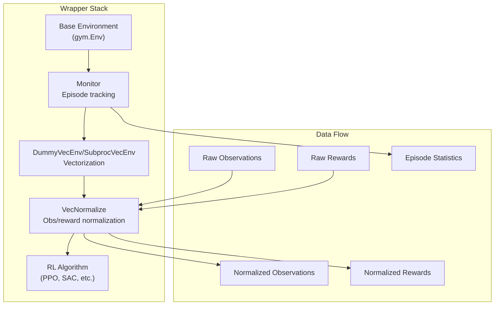

Sources: [stable_baselines3/common/vec_env/vec_normalize.py:15-332](), [stable_baselines3/common/monitor.py:15-255](), [tests/test_vec_normalize.py:268-304]()

## VecNormalize: Observation and Reward Normalization

`VecNormalize` is the core normalization wrapper that maintains running statistics to standardize observations and rewards during training. It wraps vectorized environments and applies z-score normalization using exponentially decaying statistics.

### Core Functionality

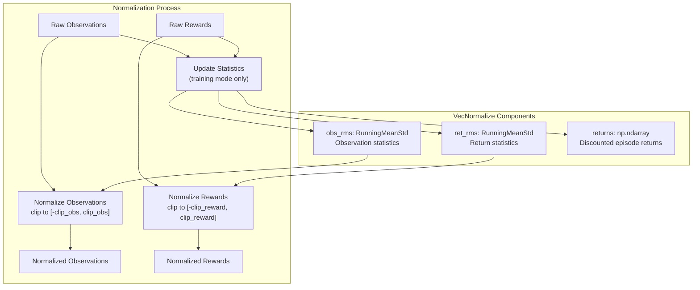

Sources: [stable_baselines3/common/vec_env/vec_normalize.py:15-98](), [stable_baselines3/common/vec_env/vec_normalize.py:174-207]()

### Key Parameters and Configuration

| Parameter | Type | Default | Description |
|-----------|------|---------|-------------|
| `training` | bool | True | Whether to update running statistics |
| `norm_obs` | bool | True | Enable observation normalization |
| `norm_reward` | bool | True | Enable reward normalization |
| `clip_obs` | float | 10.0 | Clipping range for observations |
| `clip_reward` | float | 10.0 | Clipping range for rewards |
| `gamma` | float | 0.99 | Discount factor for return calculation |
| `epsilon` | float | 1e-8 | Small constant to avoid division by zero |
| `norm_obs_keys` | list[str] | None | Keys to normalize in dict observation spaces |

Sources: [stable_baselines3/common/vec_env/vec_normalize.py:35-46]()

### Dictionary Observation Support

`VecNormalize` supports `spaces.Dict` observation spaces with selective key normalization. This is particularly useful for environments with mixed observation types, such as goal-conditioned RL.

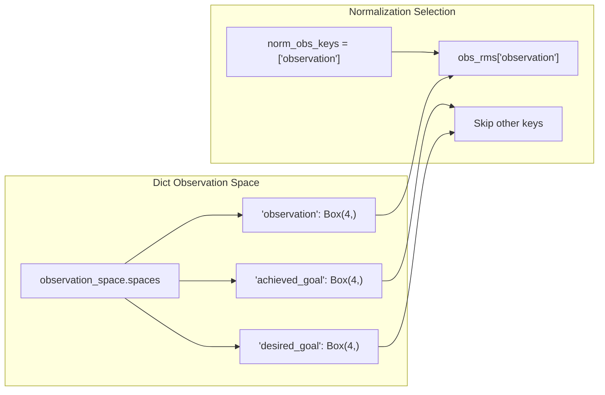

Sources: [stable_baselines3/common/vec_env/vec_normalize.py:56-68](), [stable_baselines3/common/vec_env/vec_normalize.py:104-116](), [tests/test_vec_normalize.py:355-368]()

### Persistence and State Management

`VecNormalize` provides save/load functionality to preserve normalization statistics across training sessions. The wrapper can be serialized without the underlying environment and later reattached.

Sources: [stable_baselines3/common/vec_env/vec_normalize.py:310-332](), [stable_baselines3/common/vec_env/vec_normalize.py:128-172]()

## VecFrameStack: Stacking Frames

`VecFrameStack` is a wrapper that stacks the last `n_stack` observations along a new axis. This is commonly used in environments where a single observation does not provide enough information about the state, such as Atari games where velocity and direction are inferred from multiple frames.

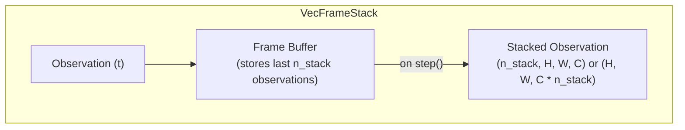

The `VecFrameStack` wrapper takes a `VecEnv` and an integer `n_stack` as input. It modifies the observation space to reflect the stacked frames. For example, if the original observation space is `(H, W, C)`, the new observation space will be `(n_stack, H, W, C)` or `(H, W, C * n_stack)` depending on the stacking method.

Sources: [stable_baselines3/common/vec_env/vec_frame_stack.py:15-49]()

## VecTransposeImage: Transposing Image Observations

`VecTransposeImage` re-orders the channels of image observations, typically from HxWxC (height, width, channels) to CxHxW (channels, height, width). This is a common requirement for PyTorch convolution layers.

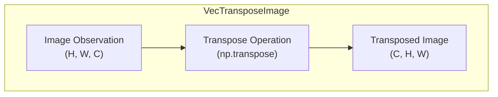

This wrapper automatically detects if the observation space is an image or a dictionary containing image spaces and applies the transposition accordingly. It also updates the observation space of the wrapped environment.

Sources: [stable_baselines3/common/vec_env/vec_transpose.py:10-74]()

## VecMonitor: Episode Statistics Tracking for VecEnvs

`VecMonitor` is a vectorized version of the `Monitor` wrapper, designed to track episode-level statistics (rewards, lengths, time) for `VecEnv` instances. It is particularly useful when the underlying `VecEnv` is created directly without individual `Monitor` wrappers.

### Data Collection and Logging

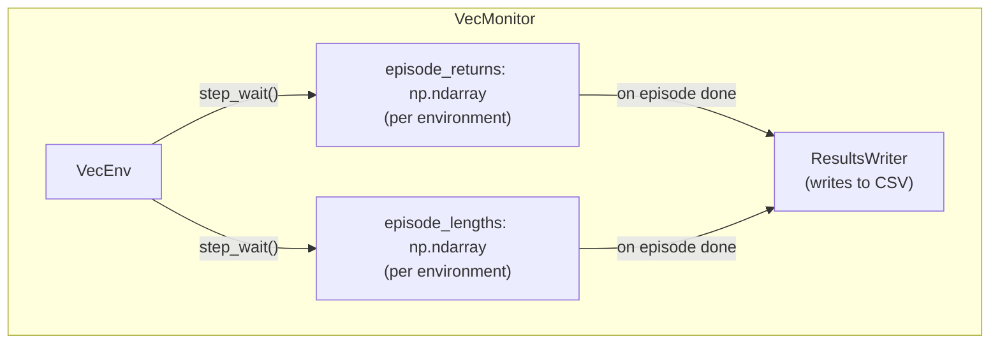

The `VecMonitor` collects episode data for each environment in the `VecEnv` and writes it to a CSV file using `ResultsWriter`. It also supports logging additional information from the `info` dictionary returned by `env.step()`.

Sources: [stable_baselines3/common/vec_env/vec_monitor.py:9-94]()

### CSV Output Format

The `VecMonitor` generates structured CSV logs similar to `Monitor`, with episode statistics and metadata:

| Column | Description |
|--------|-------------|
| `r` | Episode return (sum of rewards) |
| `l` | Episode length (number of steps) |
| `t` | Episode time (wall-clock seconds since start) |
| Additional | User-defined keys from `info_keywords` |

Sources: [stable_baselines3/common/vec_env/vec_monitor.py:60-66]()

## VecCheckNan: NaN and Inf Checking

`VecCheckNan` is a debugging wrapper that checks for `NaN` (Not a Number) and `inf` (infinity) values in observations, actions, and rewards. It can either raise a `ValueError` or issue a `UserWarning` to alert the user about numerical instabilities.

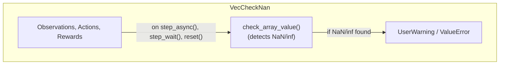

This wrapper is useful for identifying issues early in the training process that might lead to unstable learning. It can be configured to check for `inf` values and to warn only once.

Sources: [stable_baselines3/common/vec_env/vec_check_nan.py:9-107]()

## VecVideoRecorder: Recording Videos of Episodes

`VecVideoRecorder` allows recording videos of episodes from a `VecEnv`. It can be configured to record a certain number of episodes or for a specific duration.

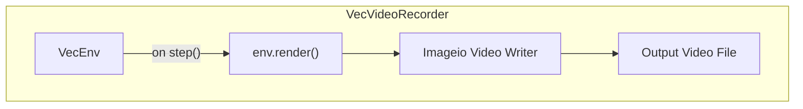

This wrapper is useful for visualizing agent behavior and debugging. It requires the `imageio` library to be installed.

Sources: [stable_baselines3/common/vec_env/vec_video_recorder.py:10-100]()

## VecExtractDictObs: Extracting Observations from Dict Spaces

`VecExtractDictObs` is a specialized wrapper for `VecEnv` instances that have `spaces.Dict` observation spaces. It extracts a specific key from the dictionary observation and makes it the primary observation for the agent.

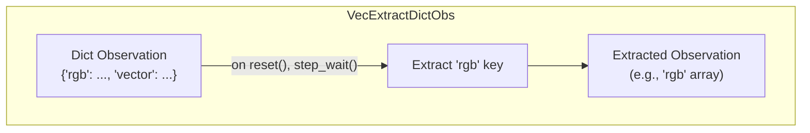

This wrapper simplifies the observation space for algorithms that are not designed to handle dictionary observations directly. It also handles `terminal_observation` in the `info` dictionary.

Sources: [stable_baselines3/common/vec_env/vec_extract_dict_obs.py:7-33]()

## Atari Preprocessing Wrappers

SB3 provides specialized wrappers for Atari environments that implement standard preprocessing techniques from the DQN literature.

### Individual Atari Wrappers

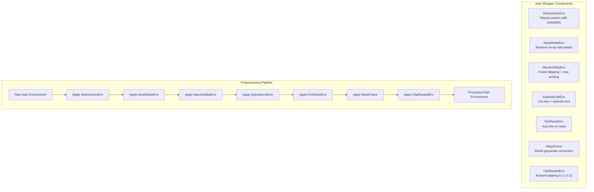

Sources: [stable_baselines3/common/atari_wrappers.py:250-307](), [stable_baselines3/common/atari_wrappers.py:17-212]()

### AtariWrapper: Unified Preprocessing

The `AtariWrapper` class combines all individual wrappers into a single convenient interface:

| Wrapper | Default | Purpose |
|---------|---------|---------|
| `StickyActionEnv` | disabled | Action repeat for stochasticity |
| `NoopResetEnv` | 30 max no-ops | Randomize initial states |
| `MaxAndSkipEnv` | 4 frame skip | Frame skipping with max pooling |
| `EpisodicLifeEnv` | enabled | Treat life loss as episode termination |
| `FireResetEnv` | conditional | Auto-fire for certain games |
| `WarpFrame` | 84x84 | Resize and convert to grayscale |
| `ClipRewardEnv` | enabled | Clip rewards to {-1, 0, 1} |

Sources: [stable_baselines3/common/atari_wrappers.py:281-306]()

## env_util Helpers

The `env_util.py` module provides helper functions for creating and managing environments, especially vectorized ones.

### `make_vec_env`

The `make_vec_env` function is a versatile utility for creating a wrapped, monitored `VecEnv`. It can take an environment ID, an environment class, or a callable returning an environment. By default, it uses `DummyVecEnv` but can be configured to use `SubprocVecEnv` or a custom `VecEnv` class.

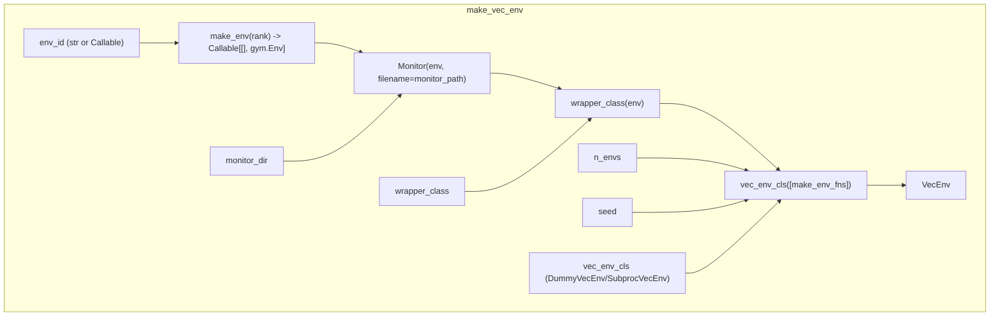

Sources: [stable_baselines3/common/env_util.py:40-129]()

### `make_atari_env`

The `make_atari_env` function is a specialized helper built on top of `make_vec_env` that automatically applies common Atari preprocessing wrappers.

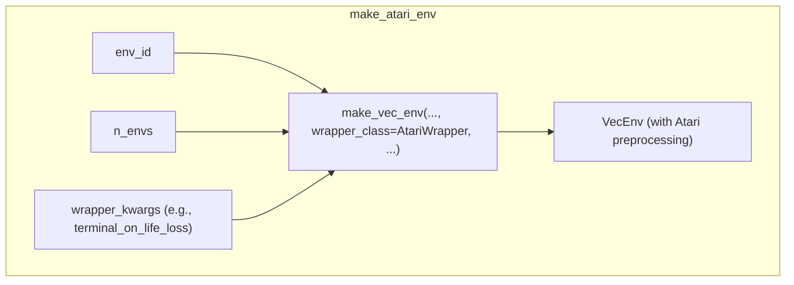

Sources: [stable_baselines3/common/env_util.py:132-180]()

### `unwrap_wrapper` and `is_wrapped`

These utility functions help inspect the wrapper stack of an environment.
- `unwrap_wrapper(env, wrapper_class)`: Recursively searches for and returns an instance of `wrapper_class` if it exists in the environment's wrapper stack.
- `is_wrapped(env, wrapper_class)`: Checks if an environment has been wrapped with a specific `wrapper_class`.

Sources: [stable_baselines3/common/env_util.py:13-37]()

## Utility Functions

### Environment Synchronization

The module provides utilities for managing wrapper hierarchies and synchronizing statistics between environments.

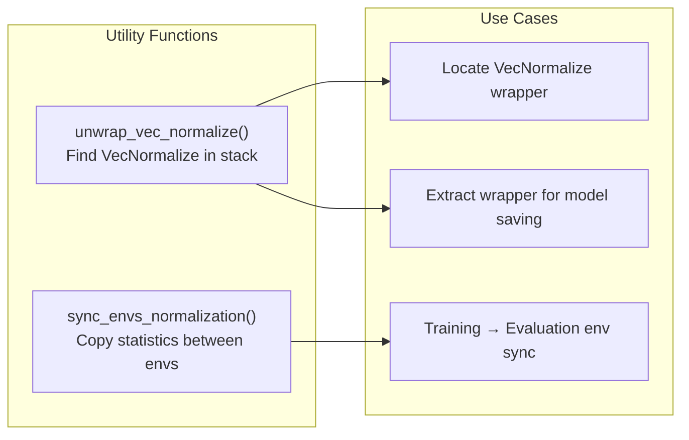

Sources: [stable_baselines3/common/vec_env/__init__.py](), [tests/test_vec_normalize.py:421-477]()

### Integration with RL Algorithms

SB3 algorithms automatically detect and manage `VecNormalize` wrappers through the `get_vec_normalize_env()` method, enabling seamless integration of normalization with model training and evaluation.

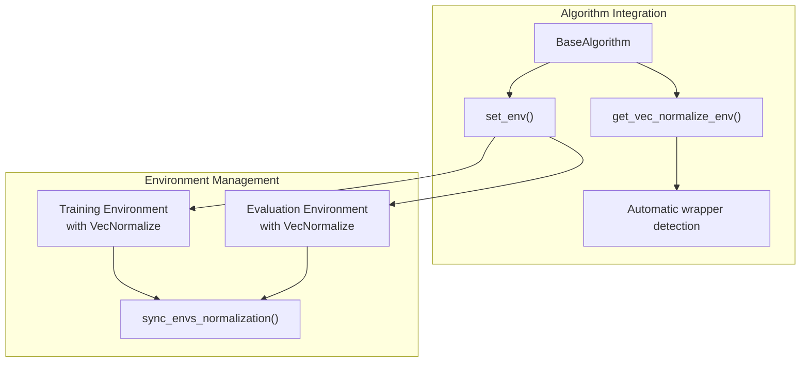

Sources: [tests/test_vec_normalize.py:377-417](), [tests/test_vec_normalize.py:400-417]()

---

