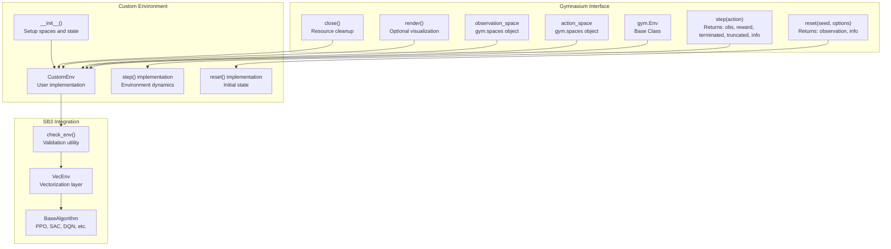
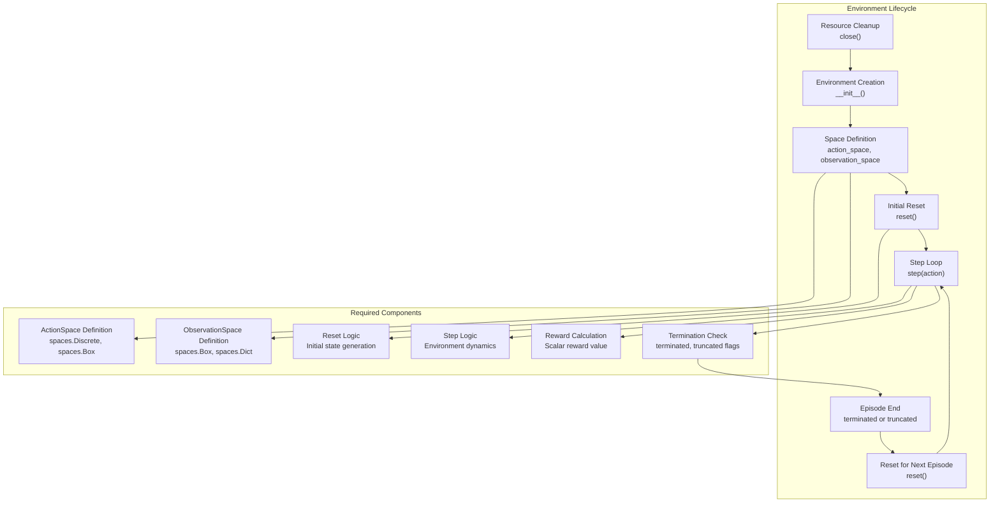
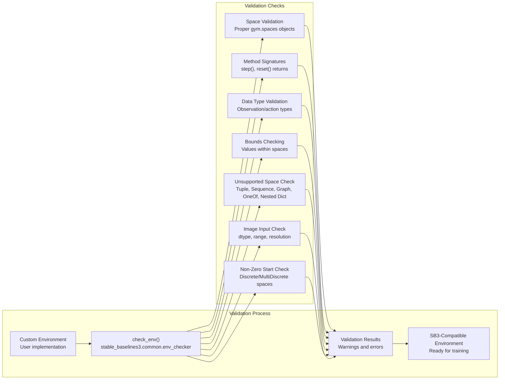
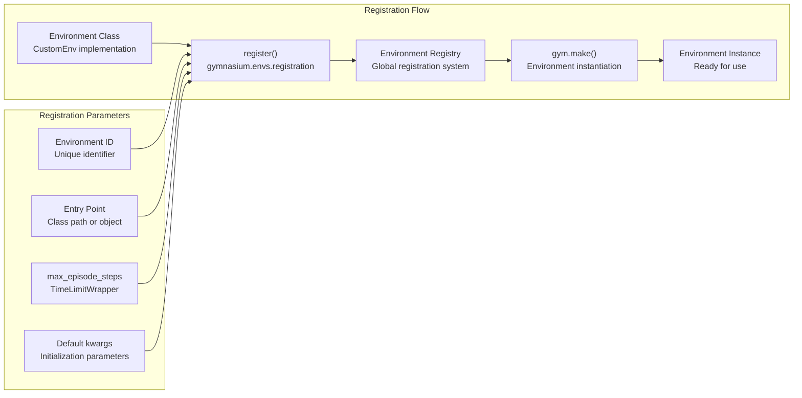
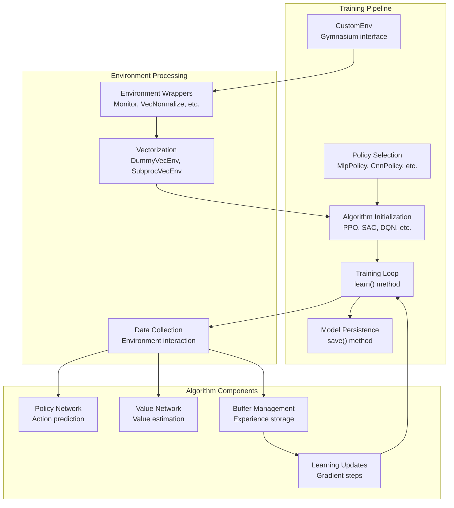
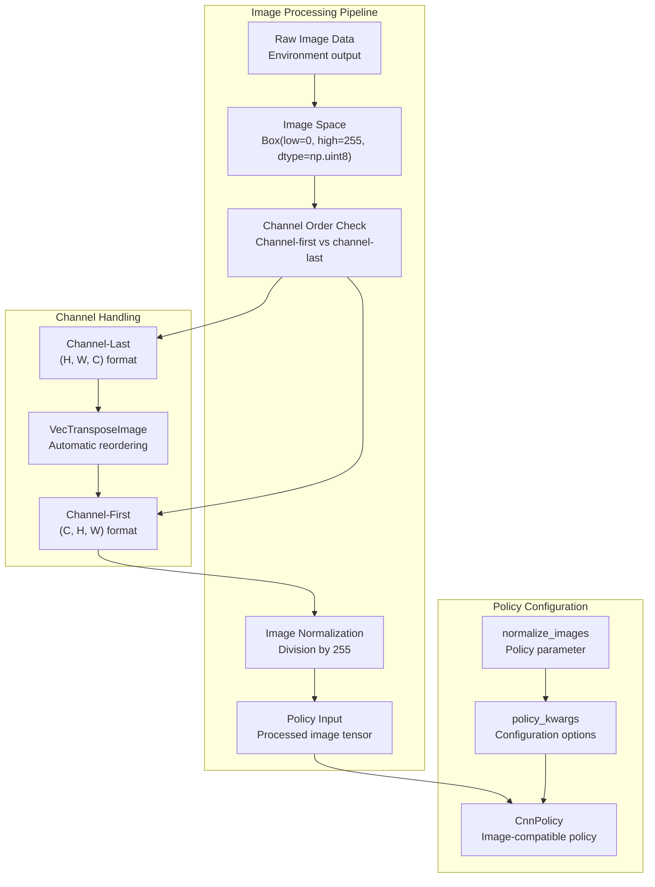
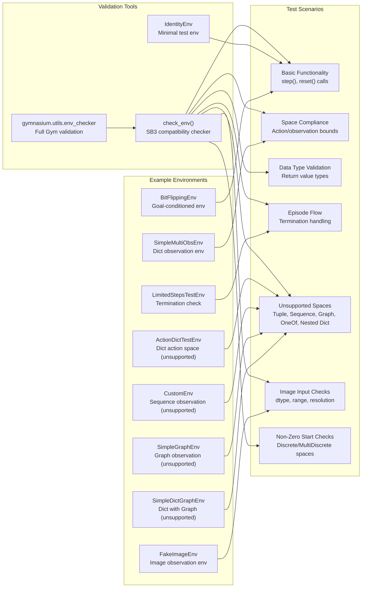

<!-- source: DeepWiki mcp.deepwiki.com · repo DLR-RM/stable-baselines3 · page 5.3 Custom Environments · fetched 2026-10-14 -->

# Custom Environments

Relevant source files

The following files were used as context for generating this wiki page:

- [docs/guide/custom_env.md](docs/guide/custom_env.md)
- [stable_baselines3/common/env_checker.py](stable_baselines3/common/env_checker.py)
- [tests/test_env_checker.py](tests/test_env_checker.py)
- [tests/test_envs.py](tests/test_envs.py)

This page covers creating and integrating custom Gymnasium environments with Stable-Baselines3. Custom environments allow you to define domain-specific reinforcement learning problems while leveraging SB3's algorithms and training infrastructure.

For information about environment vectorization, see [Vectorized Environments](#5.1). For environment preprocessing and normalization utilities, see [Environment Wrappers & Normalization](#5.2).

## Environment Interface Requirements

Custom environments must implement the Gymnasium interface to be compatible with Stable-Baselines3. The core requirements include inheriting from `gym.Env` and implementing specific methods with correct signatures.

Sources: [docs/guide/custom_env.md:5-7](), [docs/guide/custom_env.md:61-95]()

## Core Implementation Pattern

The basic structure for a custom environment follows a standardized pattern with required methods and proper space definitions.

Sources: [docs/guide/custom_env.md:72-85]()

## Space Configuration and Constraints

Different observation and action space types require specific configurations for compatibility with SB3 policies and algorithms.

| Space Type | Configuration Requirements | SB3 Policy Compatibility |
|------------|---------------------------|---------------------------|
| `spaces.Discrete` | Must have `start=0` | All discrete-action algorithms |
| `spaces.Box` (continuous) | Proper bounds and dtype | Continuous-action algorithms |
| `spaces.Box` (images) | `dtype=np.uint8`, bounds [0,255] | CNN policies |
| `spaces.Dict` | Nested spaces properly defined | MultiInputPolicy |
| `spaces.MultiDiscrete` | Must have `start=0` for all sub-spaces | Limited algorithm support |

```mermaid
graph TB
    subgraph "Observation Space Types"
        VectorObs["Vector Observations<br/>spaces.Box(shape=(n,))"]
        ImageObs["Image Observations<br/>spaces.Box(low=0, high=255, dtype=np.uint8)"]
        DictObs["Dictionary Observations<br/>spaces.Dict with mixed types"]
        TupleObs["Tuple Observations<br/>spaces.Tuple"]
        SequenceObs["Sequence Observations<br/>spaces.Sequence"]
        GraphObs["Graph Observations<br/>spaces.Graph"]
        OneOfObs["OneOf Observations<br/>spaces.OneOf"]
    end
    
    subgraph "Action Space Types"
        DiscreteAct["Discrete Actions<br/>spaces.Discrete(n, start=0)"]
        ContinuousAct["Continuous Actions<br/>spaces.Box(low, high, shape)"]
        MultiDiscreteAct["Multi-Discrete Actions<br/>spaces.MultiDiscrete with start=0"]
        DictAct["Dict Actions<br/>spaces.Dict"]
    end
    
    subgraph "Policy Compatibility"
        MlpPolicy["MlpPolicy<br/>Vector observations"]
        CnnPolicy["CnnPolicy<br/>Image observations"]
        MultiInputPolicy["MultiInputPolicy<br/>Dict observations"]
    end
    
    VectorObs --> MlpPolicy
    ImageObs --> CnnPolicy
    DictObs --> MultiInputPolicy
    
    DiscreteAct --> MlpPolicy
    DiscreteAct --> CnnPolicy
    DiscreteAct --> MultiInputPolicy
    
    ContinuousAct --> MlpPolicy
    ContinuousAct --> CnnPolicy
    ContinuousAct --> MultiInputPolicy

    TupleObs -- "Not supported by SB3" --> MlpPolicy
    TupleObs -- "Not supported by SB3" --> CnnPolicy
    TupleObs -- "Not supported by SB3" --> MultiInputPolicy

    SequenceObs -- "Not supported by SB3" --> MlpPolicy
    SequenceObs -- "Not supported by SB3" --> CnnPolicy
    SequenceObs -- "Not supported by SB3" --> MultiInputPolicy

    GraphObs -- "Not supported by SB3" --> MlpPolicy
    GraphObs -- "Not supported by SB3" --> CnnPolicy
    GraphObs -- "Not supported by SB3" --> MultiInputPolicy

    OneOfObs -- "Not supported by SB3" --> MlpPolicy
    OneOfObs -- "Not supported by SB3" --> CnnPolicy
    OneOfObs -- "Not supported by SB3" --> MultiInputPolicy

    DictAct -- "Not supported by SB3" --> MlpPolicy
    DictAct -- "Not supported by SB3" --> CnnPolicy
    DictAct -- "Not supported by SB3" --> MultiInputPolicy
```

Stable-Baselines3 has specific requirements and limitations regarding Gymnasium spaces:
*   `spaces.Discrete` and `spaces.MultiDiscrete` must have a `start` value of 0. If your environment uses a non-zero start, a wrapper can be used to shift the action space [docs/guide/custom_env.md:26-38](). The `_check_non_zero_start` function in `stable_baselines3.common.env_checker` verifies this [stable_baselines3/common/env_checker.py:39-55]().
*   `spaces.MultiDiscrete` with multi-dimensional arrays (`len(nvec.shape) > 1`) are not supported. A `ReshapeWrapper` can flatten the `nvec` to a 1D array [docs/guide/custom_env.md:40-58]().
*   `spaces.Tuple` observation spaces are not directly supported. It is recommended to convert them to `spaces.Dict` [stable_baselines3/common/env_checker.py:131-138]().
*   `spaces.Dict` observation spaces do not support nesting (Dict spaces inside Dict spaces) [stable_baselines3/common/env_checker.py:114-121]().
*   `spaces.Sequence`, `spaces.Graph`, and `spaces.OneOf` observation spaces are not supported [stable_baselines3/common/env_checker.py:147-159]().
*   `spaces.Dict` action spaces are not supported [stable_baselines3/common/env_checker.py:210-216]().

Sources: [docs/guide/custom_env.md:9-16](), [docs/guide/custom_env.md:26-58](), [docs/guide/custom_env.md:78-80](), [stable_baselines3/common/env_checker.py:39-55](), [stable_baselines3/common/env_checker.py:103-159](), [stable_baselines3/common/env_checker.py:210-216]()

## Environment Validation

The `check_env` function validates custom environments against SB3 requirements and provides warnings for potential issues.

The `stable_baselines3.common.env_checker.check_env` function performs a series of checks to ensure compatibility:
*   It verifies that the environment inherits from `gym.Env` [stable_baselines3/common/env_checker.py:230]().
*   It checks for the presence and correct type of `observation_space` and `action_space` [stable_baselines3/common/env_checker.py:231-232]().
*   It calls `_check_unsupported_spaces` to warn about unsupported space types like `spaces.Tuple`, `spaces.Sequence`, `spaces.Graph`, `spaces.OneOf`, and nested `spaces.Dict` [stable_baselines3/common/env_checker.py:234]().
*   For `spaces.Box` observations that appear to be images, it calls `_check_image_input` to verify `dtype` (`np.uint8`), value range (`[0, 255]`), and minimum resolution [stable_baselines3/common/env_checker.py:239-240]().
*   It checks for `Discrete` and `MultiDiscrete` spaces with non-zero `start` values using `_check_non_zero_start` [stable_baselines3/common/env_checker.py:235-236]().
*   It performs a series of `reset()` and `step()` calls to validate return types, shapes, and bounds of observations, rewards, and done flags [stable_baselines3/common/env_checker.py:244-499]().
*   For continuous action spaces, it checks if the action space is symmetric around zero and has finite bounds [stable_baselines3/common/env_checker.py:195-208]().

You can use `check_env(env)` to validate your custom environment [docs/guide/custom_env.md:109-114](). Note that Gymnasium also has its own `gymnasium.utils.env_checker.check_env`, but the SB3 version checks for a subset of features specifically supported by Stable-Baselines3 [docs/guide/custom_env.md:116-117]().

Sources: [docs/guide/custom_env.md:109-117](), [stable_baselines3/common/env_checker.py:39-55](), [stable_baselines3/common/env_checker.py:58-92](), [stable_baselines3/common/env_checker.py:95-216](), [stable_baselines3/common/env_checker.py:228-547]()

## Environment Registration

Environments can be registered with Gymnasium for easy instantiation and integration with training workflows.

| Registration Component | Purpose | Example |
|------------------------|---------|---------|
| `id` | Unique environment identifier | `"CustomEnv-v1"` |
| `entry_point` | Path to environment class | `"module.path:ClassName"` |
| `max_episode_steps` | Episode length limit | `500` (applies `TimeLimitWrapper`) |
| `kwargs` | Default initialization arguments | Environment-specific parameters |

Sources: [docs/guide/custom_env.md:124-135]()

## Integration with SB3 Algorithms

Custom environments integrate seamlessly with SB3 algorithms once they implement the required interface. The training process follows standard patterns.

Sources: [docs/guide/custom_env.md:99-104]()

## Image Observation Handling

Custom environments using image observations require specific configuration for proper integration with CNN policies.

| Image Configuration | Requirement | Notes |
|---------------------|-------------|-------|
| Data Type | `np.uint8` | Required for SB3 preprocessing |
| Value Range | `[0, 255]` | Normalized to `[0, 1]` by default |
| Channel Order | Channel-first preferred | Channel-last supported with wrapper |
| Space Definition | `Box(low=0, high=255, shape=(C,H,W))` | Proper bounds specification |
| Policy Selection | `CnnPolicy` | Required for image inputs |

Sources: [docs/guide/custom_env.md:9-25](), [docs/guide/custom_env.md:78-80]()

## Testing and Validation Framework

SB3 provides comprehensive testing utilities for validating custom environments before training.

The `stable_baselines3.common.env_checker.check_env` function is used extensively in the SB3 test suite (`tests/test_envs.py`, `tests/test_env_checker.py`) to validate various environment configurations. This includes:
*   Testing standard Gymnasium environments like "CartPole-v1" and "Pendulum-v1" [tests/test_envs.py:31-49]().
*   Validating SB3's internal custom environments such as `BitFlippingEnv`, `IdentityEnv`, `FakeImageEnv`, and `SimpleMultiObsEnv` [tests/test_envs.py:51-56]().
*   Specific tests for `BitFlippingEnv` with different observation types (continuous, discrete, image) [tests/test_envs.py:69-74]().
*   Tests for unsupported observation spaces, including small images, incorrect image ranges/dtypes, `spaces.Tuple`, nested `spaces.Dict`, `Discrete` and `MultiDiscrete` with non-zero starts, and 2D `MultiDiscrete` [tests/test_envs.py:107-132](). These tests expect `UserWarning` messages from `check_env` [tests/test_envs.py:148-149]().
*   Tests for unsupported action spaces, such as non-symmetric `spaces.Box`, incorrect dtypes, too large/small ranges, unbounded spaces, and `Discrete`/`MultiDiscrete` with non-zero starts [tests/test_envs.py:152-175](). These also expect warnings or errors [tests/test_envs.py:190-207]().
*   Detailed error messages are checked when observations are outside their defined space, covering wrong bounds, dtypes, and shapes for various space types [tests/test_env_checker.py:57-114]().
*   Validation of environments that terminate quickly, ensuring `check_env` can handle short episodes [tests/test_env_checker.py:183-188]().
*   Specific tests for `spaces.Dict` action spaces (which are not supported) [tests/test_env_checker.py:33-37](), and `spaces.Sequence` and `spaces.Graph` observation spaces [tests/test_env_checker.py:45-46](), [tests/test_env_checker.py:190-202]().

Sources: [docs/guide/custom_env.md:109-117](), [docs/guide/custom_env.md:137-140](), [tests/test_envs.py:31-208](), [tests/test_env_checker.py:33-37](), [tests/test_env_checker.py:45-46](), [tests/test_env_checker.py:57-114](), [tests/test_env_checker.py:183-188](), [tests/test_env_checker.py:190-202]()

---

